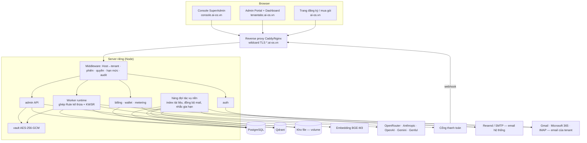
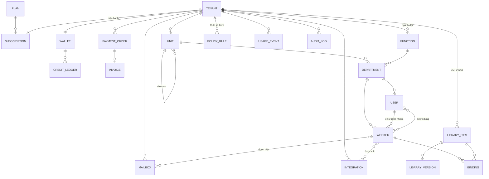

# AI OS Admin Portal — Tài liệu mô tả & thiết kế (bản production)

> **Phiên bản:** v2.1 (03/11/2026) — gộp **v2.0** (cập nhật theo thiết kế giao diện, [§24](#24-cập-nhật-theo-thiết-kế-giao-diện-v20--112026)) với **v1.4** (động cơ chạy Worker, ví theo lô, RLS, lộ trình 0a–1b) và áp các quyết định ngày 03/11 ([§25](#25-quyết-định-03112026-v21)). Đã chốt toàn bộ: D1–D9, Q1–Q7, C1–C4, U1–U13, M1–M12, R1. Việc **chưa làm có chủ đích**: pháp lý khi thu tiền (PL1). Thứ tự ưu tiên khi đọc: **§25 → §24 → các chương trước**.
> **Phạm vi:** thiết kế, chưa viết code.
> **Lịch sử:** v0.1 là bản khảo sát và đề xuất. v1.0 bỏ Hermes và Mem0, thêm subdomain theo tenant, cơ cấu tổ chức phức hợp theo ngành dọc, Kho KWSR, thanh toán và ví token, email của tenant, và đưa 11 hạng mục bổ sung vào phạm vi. v1.1 chốt Q1–Q7: **PostgreSQL thay Firebase**, thêm lược đồ CSDL ([§7.7](#77-lưu-trữ-trên-postgresql)) và cấu hình server ([§3.1](#31-thành-phần-chạy-trên-server-riêng)). v1.2 thêm đặc tả đầy đủ **Console SuperAdmin** ([§22](#22-console-superadmin-consoleai-osvn)) và sơ đồ màn hình quản trị tenant ([§23](#23-sơ-đồ-màn-hình-quản-trị-tenant-tenantabcai-osvn)). **v2.0** gộp bản Admin và bản bổ sung Console thành một tài liệu, và đưa mọi điều chỉnh chức năng / logic phát sinh khi thiết kế giao diện vào [§24](#24-cập-nhật-theo-thiết-kế-giao-diện-v20--112026): logic thống nhất 3 khu vực, Cài đặt trạng thái, Quy tắc duyệt, danh mục Kho (loại tài liệu, loại bước, thẻ), Global Rule đồng bộ, Mô hình AI, Sửa Worker một trang, Người dùng theo sơ đồ tổ chức, đổi gói và chứng từ chuyển khoản. **v1.4** (31/10, nhánh review): §9.5 Động cơ chạy Worker, ví credit theo lô, ba role CSDL và RLS cho nội dung riêng tư, U13 (Worker không nhận lệnh từ Orchestrator), quy ước frontend/CI, lộ trình 0a/0b/1a/1b. **v2.1** gộp hai nhánh; bỏ hẳn bản demo (R1: xây mới, không di trú); chốt Chat Social chỉ cho Worker gắn cờ và chỉ trả lời từ Knowledge được gán; Telegram Bot ra lệnh Orchestrator; Rule không có bước đồng bộ; chuỗi công việc tự chạy tiếp; sửa lược đồ cho đủ `tenant_id` và RLS.

---

## 0. Tóm tắt

### 0.1 Bức tranh chung

- **Hiện trạng:** bản demo hiện tại (dashboard tĩnh + proxy Node chạy trên máy người dùng) chỉ dùng để thử ý tưởng cho một công ty. Production **xây mới theo kế hoạch** trong tài liệu này; không dùng lại mã, module nghiệp vụ hay dữ liệu của bản demo (R1, §2).
- **Mục tiêu:** một nền tảng nhiều khách hàng (tenant), chạy trên server riêng. Mỗi khách có subdomain riêng (`tenantabc.ai-os.vn`). Có một **Console SuperAdmin** cho nhà cung cấp (`console.ai-os.vn`, §22) và một **Admin Portal** cho từng khách do Admin của tenant tự quản trị (§23).
- **Bước chuyển cốt lõi:** mọi cấu hình chuyển từ mã nguồn vào cơ sở dữ liệu và gắn với `tenantId`. Mọi tính năng trong tài liệu này đều xây trên bước chuyển đó.

### 0.2 Quyết định đã chốt

| # | Chủ đề | Quyết định |
|---|---|---|
| — | Hermes Agent | **Không dùng.** Gỡ khỏi thiết kế và mã nguồn ([§2.2](#22-gỡ-bản-demo-khỏi-nhánh-chính-r1)). Worker gọi thẳng API mô hình |
| D1 | Cấp quản trị | **SuperAdmin** thuộc hệ thống. Mỗi tenant có **Admin** toàn quyền cấu hình trong tenant đó |
| D2 | Xác thực | **Tự xây**: scrypt, phiên cookie, email |
| D3 | Tạo Worker | **Chỉ tạo qua giao diện** (trình hướng dẫn). Không có API công khai hay API token để tạo Worker |
| D4 | Hạ tầng | **Server riêng**, không chạy trên Cloudflare |
| D5 | Gói & hạn mức | Dùng bảng đề xuất ([§10](#10-gói--hạn-mức)) |
| D6 | Orchestrator | **Không tính** vào `maxWorkers`. Mỗi tenant có sẵn một Orchestrator, không xoá được |
| D7 | Email hệ thống | Resend, hoặc nhà cung cấp phù hợp qua lớp `mailer` thay thế được |
| D8 | Kho vector | **Qdrant** tự vận hành (thay Mem0) |
| D9 | Danh tính người dùng | Đăng ký và xác thực bằng email. v1: email là duy nhất toàn hệ thống, mỗi người thuộc một tenant |
| — | Dữ liệu cá nhân | **Tạm chưa đề cập.** Thiết kế chừa sẵn chỗ để bổ sung khi cần |
| Q1 | Cơ sở dữ liệu | **PostgreSQL** tự chạy trên server riêng. **Bỏ Firebase** (Firestore và Cloud Storage) |
| Q2 | Cổng thanh toán | **PayOS (VietQR)** trước, kèm xác nhận chuyển khoản thủ công; VNPay ở bước sau |
| Q3 | Hoá đơn | Giai đoạn 3 xuất **phiếu thu PDF**; hoá đơn điện tử tích hợp sau, khi chốt nhà cung cấp |
| Q4 | Đơn vị credit | **1 credit = 1 VNĐ**; giá bán token = giá nhà cung cấp × hệ số (mặc định 1,3) do SuperAdmin chỉnh |
| Q5 | Embedding | Model đa ngôn ngữ **tự chạy** cùng server (**BGE-M3**, 1024 chiều) |
| Q6 | Kết nối mô hình mặc định | **Platform** (khoá của hệ thống, trừ Ví). BYOK là tuỳ chọn từ gói Standard |
| Q7 | Tên host | `console.ai-os.vn` (SuperAdmin), `ai-os.vn/dang-ky` (đăng ký) |
| — | Hạn mức thêm mới | **Số đơn vị** 1/3/20 và **số hộp thư** 1/5/30 cho Starter/Standard/Business (theo đề xuất ở §10) |
| C1 | Vào quản trị tenant từ Console | Phiên hỗ trợ mặc định **chỉ xem**, muốn sửa phải bật thêm (§22.8) |
| C2 | Thông báo cho khách | **Luôn gửi email** cho Admin tenant khi bắt đầu và kết thúc phiên hỗ trợ |
| C3 | Vai nhân viên hệ thống | v1 **một vai `superadmin`**, chừa cột `platform_role` để tách 4 vai sau (§22.10) |
| C4 | Thao tác SuperAdmin bị chặn | Giữ nguyên danh sách chặn (§22.8). Với mật khẩu, SuperAdmin **chỉ gửi link đặt lại** cho Admin tenant |
| U1–U10 | Không gian làm việc của người dùng | Chi tiết ở [`USER_WORKSPACE_DESIGN.md`](USER_WORKSPACE_DESIGN.md) §0.2. Phần ảnh hưởng tới tài liệu này: **chính sách nhận việc** Mở / Theo bộ phận / Hạn chế cho từng Worker (§9.4); **quyền ra lệnh Orchestrator** cấp riêng từng người (§5); **cờ Mật** cho tài liệu Knowledge (§9.3, §15); **chỉ `tenant_admin` xem được hội thoại** của người dùng, có nhật ký; **phiên hỗ trợ không đọc hội thoại** (§22.8) |
| U13 | Worker nhạy cảm | Mỗi Worker có tuỳ chọn **«Không nhận lệnh từ Orchestrator»** (`accept_from_orchestrator`; mặc định vẫn nhận). Đặt trong trình tạo Worker bước 1 ([§9.4](#94-worker-tạo-sửa-xoá-d3-chỉ-qua-giao-diện)). Worker đặt tắt thì Orchestrator không giao được, kể cả cho người có quyền ra lệnh (tài liệu Workspace §6.2) |
| R1 | Bản demo | **Xây mới theo kế hoạch.** Mã nguồn, module nghiệp vụ, dữ liệu và cấu hình của bản demo không được dùng lại và không di trú; tài liệu không mô tả lại. Cách gỡ ở [§2.2](#22-gỡ-bản-demo-khỏi-nhánh-chính-r1) |
| PL1 | Pháp lý khi thu tiền | **Bổ sung sau** (hoá đơn, dữ liệu cá nhân). Chưa chặn GĐ0–GĐ2; phải có trước khi thu tiền thật ở GĐ3 ([§20](#20-việc-cần-chuẩn-bị-song-song-ngoài-code)) |

### 0.3 Yêu cầu bổ sung đã đưa vào

| # | Yêu cầu | Mục |
|---|---|---|
| 1 | Thanh toán mua và gia hạn gói, thanh toán cho bộ đếm token | [§11](#11-thanh-toán-mua-gói-gia-hạn-nạp-token) |
| 2 | Cơ cấu Tổng công ty, Chi nhánh, Cửa hàng; sơ đồ theo **ngành dọc**; Rule kế thừa theo ngành | [§8](#8-cơ-cấu-tổ-chức-phức-hợp--ngành-dọc) |
| 3 | **Kho KWSR** dùng chung: chọn khi cấu hình và tinh chỉnh được khi tạo Worker | [§9](#9-kho-kwsr-thư-viện-dùng-chung) |
| 4 | Tích hợp **email của tenant** cho công việc (tuỳ chọn của người dùng) | [§14](#14-tích-hợp-email-của-tenant) |
| 5 | Tạo tenant (tên, email, username, mật khẩu) và đăng nhập theo **subdomain** | [§4](#4-tenant-subdomain--khởi-tạo) |
| 6 | Màn "Mức sử dụng" hiện **số dư token** của các kết nối cần nạp tiền | [§12](#12-màn-mức-sử-dụng) |
| 7 | Đồng ý cả 11 hạng mục bổ sung (B1–B11) | [§16](#16-hạng-mục-bổ-sung-b1b11) |
| 8 | Điều chỉnh chức năng và logic theo bản thiết kế giao diện (11/2026) | [§24](#24-cập-nhật-theo-thiết-kế-giao-diện-v20--112026) |
| 9 | Quyết định 03/11/2026: Chat Social, Telegram, Rule, ngân sách, thanh toán, phạm vi quản lý, phê duyệt, trạng thái, tài liệu Mật, chuỗi công việc | [§25](#25-quyết-định-03112026-v21) |

---

## 1. Thuật ngữ

| Thuật ngữ | Nghĩa |
|---|---|
| **Platform** | Hệ thống AI OS do bạn vận hành |
| **SuperAdmin** | Quản trị viên của Platform, làm việc trên Console |
| **Tenant** | Một doanh nghiệp mua AI OS, có subdomain riêng |
| **Plan** (Gói) | Gói tài khoản, quyết định hạn mức |
| **Subscription** | Thuê bao gói của một tenant theo chu kỳ |
| **Wallet** (Ví credit) | Số dư credit để trả cho token và ảnh khi dùng khoá của Platform |
| **Unit** (Đơn vị) | Tổng công ty, Chi nhánh, Cửa hàng… (cây pháp nhân hoặc địa điểm) |
| **Function** (Ngành dọc) | Chức năng xuyên suốt các đơn vị: Kế toán, Kinh doanh, Nhân sự… |
| **Department** (Bộ phận) | Giao của **Unit × Function**, ví dụ "Kế toán – Chi nhánh Hà Nội" |
| **Worker** | Một AI Agent chuyên môn |
| **Orchestrator** | Worker điều phối, nhận lệnh rồi giao việc |
| **KWSR** | Knowledge · Workflow · Skill · Rule |
| **Kho KWSR** (Library) | Thư viện mục KWSR dùng chung cho nhiều Worker |
| **Binding** | Liên kết một Worker với một mục trong Kho (theo kho, hoặc đã tinh chỉnh) |
| **Member** | Người dùng của tenant |
| **Integration** | Kết nối tới nền tảng ngoài |
| **Mailbox** | Hộp thư của tenant hoặc của người dùng được kết nối cho Worker |

---

## 2. Hiện trạng và quyết định xây mới

### 2.1 Vì sao không phát triển tiếp từ bản demo

Bản demo cho thấy ý tưởng (KWSR, sơ đồ tổ chức theo phòng ban, Orchestrator giao việc, "mỗi Agent có đúng một người chịu trách nhiệm") nhưng không đủ nền cho sản phẩm nhiều khách hàng:

| # | Thiếu sót của bản demo | Thiết kế production xử lý ở |
|---|---|---|
| G1 | Không có xác thực; mọi API mở | §6, §17 |
| G2 | Proxy chạy trên máy người xem, không có dữ liệu chung | §3 |
| G3 | Chỉ một công ty, dữ liệu không có `tenant_id` | §3, §7.7 (RLS) |
| G4 | Cấu hình Worker nằm cứng trong mã | §9.4 (Worker là bản ghi, tạo qua giao diện) |
| G5 | KWSR là danh sách chữ, không phiên bản, không dùng chung | §9 (Kho KWSR) |
| G6 | Upload tài liệu và nguồn tri thức chỉ là giao diện mô phỏng | §15 |
| G7 | Khoá API rải rác trong file cấu hình | §13.3 (két bí mật) |
| G8 | Không đo sử dụng, không thu tiền | §11, §12 |
| G9 | Không có động cơ chạy Worker có chốt chặn | §9.5 |
| G10 | Phụ thuộc Hermes, Mem0, Firebase | Không dùng (§0.2: Hermes; Q1; D8) |
| G11 | Sơ đồ tổ chức phẳng, không có đơn vị nhiều cấp | §8 |

Các ý tưởng trên được giữ ở mức **khái niệm**, mã được viết mới theo §3.2.

### 2.2 Gỡ bản demo khỏi nhánh chính (R1)

Làm ở **đầu Giai đoạn 0a**, một commit riêng:

1. Gắn thẻ git `demo-final` vào commit cuối của bản demo, để vẫn dựng lại được bản demo đang chạy ở `workers.ai-os.vn` khi cần đối chiếu.
2. Xoá khỏi nhánh chính toàn bộ mã và dữ liệu của bản demo: thư mục `website/`, `server/`, các thư mục nghiệp vụ mẫu và dữ liệu đi kèm, cấu hình Firebase, và các tài liệu hướng dẫn của bản demo. Chỉ giữ `docs/` (hai tài liệu thiết kế) và các tài liệu nghiên cứu ý tưởng ban đầu.
3. Không di trú dữ liệu nào từ bản demo (kể cả dữ liệu trên Firestore nếu có): tenant đầu tiên được tạo mới qua Console (§4.3).
4. Bản demo ở `workers.ai-os.vn` chạy độc lập cho tới khi bản production thay thế, rồi tắt (§20).

Kho hệ thống (§9.1) và mẫu Worker (B4) được **soạn mới** theo danh mục loại tài liệu, loại bước và thẻ ở §24.7, không nạp từ nội dung mẫu của bản demo.

---

## 3. Kiến trúc mục tiêu



**Nguyên tắc**

1. **Tenant xác định theo `Host`.** `tenantabc.ai-os.vn` thì tenant là `tenantabc`. Không route nào nhận `tenantId` từ body hay query do client gửi.
2. **Cookie theo từng host** (`__Host-sid`, không đặt `Domain`). Phiên của tenant A không bao giờ gửi sang subdomain tenant B. Console dùng host và cookie riêng.
3. **Mọi truy cập dữ liệu đi qua `Repository(tenantId)`**, lớp duy nhất được chạm vào CSDL. Đây là chốt chặn chống rò dữ liệu chéo khách.
4. **Hạn mức, số dư và quyền kiểm ở server.** Giao diện chỉ làm mờ nút.
5. **Bí mật không rời server.** Khi trả về luôn che dạng `sk-…a1b2`.
6. **Frontend giữ phong cách hiện tại:** HTML + JS thuần, không bước build.
7. **Đóng gói chạy bằng Docker Compose** trên server riêng (§3.1). Hàng đợi tác vụ nền chạy **ngay trên PostgreSQL** (`SELECT … FOR UPDATE SKIP LOCKED`), không cần thêm Redis.
8. **Phụ thuộc tối thiểu, nhưng không tự viết giao thức phức tạp.** Mặc định dùng thư viện chuẩn của Node và `pg`; không dùng ORM. Với phần dễ sai về bảo mật hoặc giao thức — IMAP/SMTP, OAuth client, phân tích multipart, TOTP, trích PDF/OCR, tạo PDF — dùng thư viện đã được kiểm chứng. Tiêu chí: còn được bảo trì trong 12 tháng gần nhất, giấy phép dùng thương mại được, ít phụ thuộc bắc cầu, ghim phiên bản. Mỗi thư viện thêm vào ghi một dòng lý do trong `docs/DEPENDENCIES.md`.

### 3.1 Thành phần chạy trên server riêng

| Dịch vụ (Docker Compose) | Vai trò | Mạng |
|---|---|---|
| `caddy` | Reverse proxy, TLS wildcard `*.{BASE_DOMAIN}`, chuyển request theo Host | Mở cổng 80/443 ra Internet — **dịch vụ duy nhất mở ra ngoài** |
| `aios-server` | Node: API, trang tĩnh, động cơ chạy Worker, tác vụ nền. **v1 chạy một tiến trình** (bộ cộng dồn chi phí ở §11.4 chỉ đúng với một tiến trình; muốn nhân bản phải đổi theo ghi chú ở đó) | Nội bộ |
| `postgres` (16+) | CSDL chính | Nội bộ, **không** mở cổng ra ngoài |
| `qdrant` | Kho vector | Nội bộ, bật API key |
| `embeddings` | Phục vụ BGE-M3 qua HTTP (ví dụ image Text Embeddings Inference) | Nội bộ |
| Volume `objects/` | Kho file: tài liệu Knowledge, ảnh, CV, hoá đơn PDF (`tenants/{id}/…`) | Đọc/ghi qua `objectStore` — đổi sang S3-compatible (MinIO…) sau chỉ cần thay lớp này |
| Cron sao lưu | `pg_dump` hằng ngày, snapshot Qdrant, nén thư mục `objects/`, đẩy sang máy hoặc dịch vụ khác | — |

**Cấu hình server tối thiểu đề xuất** cho giai đoạn đầu (vài chục tenant): **4 vCPU, 16 GB RAM, 200 GB SSD**. BGE-M3 chạy CPU chiếm khoảng 3–4 GB RAM; khi nạp nhiều tài liệu cùng lúc, index sẽ chậm hơn nhưng không chặn Worker trả lời. Nâng cấp khi số tenant hoặc lượng tài liệu tăng: tách `embeddings` sang máy có GPU, hoặc tách `postgres` ra máy riêng.

### 3.2 Quy ước frontend

Giữ phong cách HTML + JS thuần, không bước build, nhưng chốt các quy ước sau **trước khi viết Console, Admin Portal và Workspace** (khoảng 40 màn mới):

| Hạng mục | Quy ước |
|---|---|
| Module | `<script type="module">`, mỗi màn một module. Dùng chung thư mục `website/js/ui/` (API client, escape, hộp thoại, bảng, form) |
| Escape mặc định | Mọi chuỗi chèn vào HTML đi qua helper template tag `h` tự escape. Chèn thô phải gọi `raw()` kèm ghi chú lý do. **Không** `innerHTML` với dữ liệu do người dùng hoặc Worker tạo (tên Worker, nội dung KWSR, câu trả lời của Worker) |
| Nội dung markdown của Worker | Qua bộ render markdown + sanitizer đã kiểm chứng (allowlist thẻ và thuộc tính); liên kết có `rel="noopener noreferrer"` |
| CSP | `script-src 'self'`; **không** `unsafe-inline`, **không** `unsafe-eval`. Không viết `onclick=` trong HTML; gắn sự kiện bằng `addEventListener` hoặc uỷ quyền sự kiện (`data-action`) |
| API client | Một wrapper duy nhất: gắn CSRF, đọc lỗi chuẩn `{error:{code,message}}`, `401` về `/login`, `409 LIMIT_REACHED` mở hộp mời nâng gói, `402` mở hộp nạp token |
| Mã giao diện | **Viết mới** theo bản thiết kế giao diện; không dùng lại mã của bản demo (R1). Bộ token màu, chữ, khoảng cách lấy từ thiết kế, khai báo một lần trong `website/css/tokens.css`; viết thành class CSS, không dùng `style` inline. Font tải về và phục vụ từ chính server (không gọi Google Fonts) để giữ CSP chặt |
| Kiểm | ESLint (chỉ trong `devDependencies`) với luật cấm `innerHTML =` ngoài `ui/` và cấm thuộc tính sự kiện inline |

### 3.3 Môi trường và kiểm thử

| Môi trường | Cách chạy |
|---|---|
| **Máy lập trình** | `docker compose up` (postgres, qdrant, embeddings thu nhỏ hoặc bản giả). `BASE_DOMAIN=aios.localhost`, Caddy dùng `tls internal`; trình duyệt tự phân giải `*.localhost`. **Phải kiểm ở GĐ0a** rằng cookie `__Host-sid` chạy được trên `tenantabc.aios.localhost` ở Chrome và Firefox. Phương án dự phòng: `BASE_DOMAIN=aios.test` + `mkcert` + `dnsmasq` |
| **Staging** | `staging.ai-os.vn` và `*.staging.ai-os.vn`; CSDL riêng; khoá nhà cung cấp riêng (PayOS sandbox); không dùng dữ liệu thật |
| **Production** | Theo §3.1 |

**CI (GitHub Actions)** chạy với dịch vụ PostgreSQL 16 và Qdrant. Các job bắt buộc phải xanh mới được gộp:

1. Lint và unit test.
2. Chạy toàn bộ migration từ CSDL rỗng; chạy lại không lỗi.
3. **Test cách ly tenant quét mọi route.** Danh sách route lấy từ khai báo route, không viết tay, nên route mới tự bị quét.
4. **Test RLS và quyền** bằng kết nối thật `aios_app`, `aios_console`, `aios_system`, kể cả truy vấn cố tình bỏ điều kiện `tenant_id` và `user_id`.
5. Test dạng bảng cho `rules-engine`, `relation()`, `taskPolicy.create` và Action Gate (§9.5).
6. Test webhook thanh toán lặp lại không cộng tiền hai lần.

**Hợp đồng API.** Mỗi nhóm endpoint ở §17 có schema yêu cầu và phản hồi trong `docs/api/openapi.yaml`, **viết trước khi làm giao diện**. PR đổi API phải sửa file này; CI có test hợp đồng cho các endpoint trọng yếu (đăng nhập, tạo Worker, thanh toán, tạo công việc).

---

## 4. Tenant, subdomain & khởi tạo

### 4.1 Tên miền (cấu hình được lúc go-live)

| Biến môi trường | Mặc định | Ý nghĩa |
|---|---|---|
| `BASE_DOMAIN` | `ai-os.vn` | Tên miền gốc. Đổi tên miền chỉ cần sửa biến này và DNS |
| `CONSOLE_HOST` | `console.ai-os.vn` | Nơi SuperAdmin đăng nhập |
| `PUBLIC_HOST` | `ai-os.vn` | Trang giới thiệu, đăng ký, mua gói |
| `TENANT_HOST_PATTERN` | `{slug}.{BASE_DOMAIN}` | Mẫu subdomain của tenant |

Hạ tầng cần có:
- DNS wildcard `*.ai-os.vn` trỏ về server.
- Chứng chỉ TLS wildcard qua Let's Encrypt, xác minh DNS-01. Caddy tự gia hạn được.
- Host lạ hoặc slug không tồn tại trả về trang 404 chung.
- **Tên miền riêng của khách** (ví dụ `ai.congtyabc.vn` qua CNAME, TLS cấp theo yêu cầu) để ở Giai đoạn 4.

### 4.2 Quy tắc slug (tên tenant trên URL)

- Gồm `a-z`, `0-9` và `-`, dài 3–30 ký tự, không bắt đầu hay kết thúc bằng `-`. Lưu chữ thường, duy nhất toàn hệ thống.
- **Danh sách cấm:** `www, api, app, admin, console, mail, smtp, imap, static, cdn, assets, auth, login, billing, pay, status, docs, help, support, dev, staging, test, demo, workers, root, superadmin, system, ai-os`. SuperAdmin bổ sung được.
- Đổi slug được (chỉ SuperAdmin làm). Slug cũ tự chuyển hướng 301 trong 30 ngày và bị giữ chỗ 180 ngày để tránh người khác chiếm.

### 4.3 Hai cách tạo tenant

Cả hai cách đều nhập cùng 4 thông tin: **Tên tenant (slug)**, **Email**, **Username**, **Mật khẩu khởi tạo**. Thêm tên hiển thị của công ty và gói.

**(a) SuperAdmin tạo trên Console**

```
Console › Tenant › ＋ Tạo tenant          (màn Console đầy đủ ở §22)
  Tên công ty (hiển thị)  [Công ty TNHH ABC              ]
  Tên tenant (slug)       [tenantabc ] .ai-os.vn   ✔ còn trống
  Gói                     [Standard ▾]   Chu kỳ [Tháng ▾]   ☐ Dùng thử 14 ngày
  ── Tài khoản Admin đầu tiên ──
  Email                   [admin@abc.vn                  ]
  Username                [admin                         ]
  Mật khẩu khởi tạo       [••••••••••••] [🎲 Tạo ngẫu nhiên] 👁
                          ☑ Bắt đổi mật khẩu ở lần đăng nhập đầu
  [ Tạo tenant ]
```

Khi bấm Tạo, hệ thống **làm trong một giao dịch**:
1. Tạo tenant.
2. Tạo đơn vị gốc (Tổng công ty).
3. Tạo bộ Ngành dọc mặc định.
4. Tạo Orchestrator.
5. Tạo Subscription (trial hoặc chờ thanh toán).
6. Tạo Ví.
7. Tạo user Admin (`mustChangePassword = true`).
8. Ghi audit.

Sau đó gửi email tới Admin **chỉ kèm link** `https://tenantabc.ai-os.vn/login`. Email **không bao giờ chứa mật khẩu**; SuperAdmin tự chuyển mật khẩu qua kênh khác. Mật khẩu chỉ hiện một lần sau khi tạo.

**(b) Khách tự đăng ký và mua gói trên `ai-os.vn`** (D9: xác thực bằng email)

```
Chọn gói → Nhập: Tên công ty · slug · Email · Username · Mật khẩu
        → Mã xác thực 6 số gửi email (hạn 10 phút, tối đa 5 lần thử)
        → Thanh toán (§11), hoặc bắt đầu dùng thử nếu gói cho phép
        → Khởi tạo tenant (như (a)) → chuyển tới https://{slug}.ai-os.vn/login
```

Trong luồng này người dùng tự chọn mật khẩu nên không bắt đổi. Slug được **giữ chỗ 30 phút** trong lúc chờ thanh toán. Có CAPTCHA và giới hạn tốc độ theo IP để chống tạo tenant rác.

### 4.4 Đăng nhập theo subdomain

- `https://tenantabc.ai-os.vn/login` hiện tên và logo của tenant (B-branding). Ô đăng nhập nhận **username hoặc email**, cộng mật khẩu.
- Tenant lấy từ Host. Username **duy nhất trong tenant**; email duy nhất toàn hệ thống (D9).
- Người dùng tenant A đăng nhập ở subdomain tenant B sẽ thất bại với thông báo lỗi chung.
- SuperAdmin chỉ đăng nhập được ở `CONSOLE_HOST`. Muốn vào một tenant để hỗ trợ thì dùng **phiên hỗ trợ** từ Console (§22.8).

---

## 5. Vai trò & phân quyền

| Vai trò | Thuộc | Phạm vi | Mô tả |
|---|---|---|---|
| `superadmin` | Platform | Mọi tenant | Làm việc trên Console (§22): gói, tenant, giá model, thanh toán, Kho hệ thống, vô hiệu hoá tenant, vào quản trị tenant bằng phiên hỗ trợ (§22.8) |
| `tenant_admin` | Tenant | Toàn tenant | **Toàn quyền cấu hình** (D1): Worker, Kho KWSR, người dùng, cơ cấu tổ chức, kết nối, email, thanh toán, nạp token. Mỗi tenant luôn có ít nhất 1 Admin |
| `unit_manager` | Tenant | Một đơn vị và các đơn vị con | Quản lý Worker và người dùng trong nhánh đơn vị của mình (ví dụ Giám đốc chi nhánh) |
| `function_head` | Tenant | Một ngành dọc, từ đơn vị được gán trở xuống | Ví dụ Kế toán trưởng Tổng công ty: đặt Rule và phát hành mục Kho cho ngành Kế toán của mọi chi nhánh và cửa hàng |
| `member` | Tenant | Worker được cấp | Dùng Worker; kết nối hộp thư cá nhân của mình (§14) |
| `viewer` | Tenant | Chỉ xem | Xem báo cáo và sơ đồ |

**Ma trận quyền** (✔ có · ◐ trong phạm vi được gán · ✖ không)

| Chức năng | superadmin | tenant_admin | unit_manager | function_head | member |
|---|:-:|:-:|:-:|:-:|:-:|
| Gói, tenant, giá model, Kho hệ thống | ✔ | ✖ | ✖ | ✖ | ✖ |
| Mua, gia hạn gói, nạp token, xem hoá đơn | ✔ | ✔ | ✖ | ✖ | ✖ |
| Cơ cấu đơn vị và ngành dọc | ✔ | ✔ | ◐ thêm đơn vị con | ✖ | xem |
| Tạo, xoá Worker (qua giao diện) | ✔ | ✔ | ◐ | ✖ | ✖ |
| Sửa Worker và Binding KWSR | ✔ | ✔ | ◐ | ◐ Worker thuộc ngành mình | ✖ |
| Soạn và phát hành mục Kho KWSR | ✔ | ✔ | ◐ phát hành trong nhánh | ◐ phát hành theo ngành | ✖ |
| Rule kế thừa (đơn vị hoặc ngành) | ✔ | ✔ | ◐ cấp đơn vị | ◐ cấp ngành | ✖ |
| Kết nối API | ✔ | ✔ | ✖ | ✖ | ✖ |
| Hộp thư dùng chung của tenant | ✔ | ✔ | ✖ | ✖ | ✖ |
| Hộp thư cá nhân của mình | — | ✔ | ✔ | ✔ | ✔ |
| Người dùng | ✔ | ✔ | ◐ trong nhánh | ✖ | ✖ |
| Nhật ký kiểm toán | ✔ | ✔ | ◐ | ◐ | ✖ |
| Mức sử dụng | ✔ | ✔ | ◐ | ◐ | ✖ |

**Quy tắc an toàn:**
- Không ai tự nâng quyền của mình.
- Không xoá hay hạ quyền được Admin cuối cùng của tenant.
- `unit_manager` và `function_head` không bao giờ được gỡ Rule do cấp trên đặt (§8.3).

**Ràng buộc v1 (đã chấp nhận):** mỗi người dùng thuộc **một** bộ phận (`dept_id`). Một người có thể giữ **nhiều phạm vi quản lý** (bộ phận, đơn vị và cấp dưới, ngành dọc) trong bảng `user_manage_scopes`; quyền thực tế là hợp các phạm vi (§24.11, M7).

---

## 6. Xác thực

### 6.1 Luồng

```
Đăng nhập (username|email + mật khẩu) trên {slug}.ai-os.vn
 ├─ sai / không tồn tại → "Tên đăng nhập hoặc mật khẩu không đúng" (một thông báo chung cho mọi trường hợp)
 ├─ tenant disabled     → không cho đăng nhập: "Tài khoản đã bị vô hiệu hoá. Vui lòng liên hệ AI OS." (§22.7)
 ├─ tenant suspended    → cho đăng nhập, chỉ đọc, hiện banner "Gói đã hết hạn — gia hạn để tiếp tục"
 ├─ user locked         → thông báo chung + gợi ý liên hệ Admin
 └─ đúng → tạo phiên → mustChangePassword ? /doi-mat-khau : (admin/manager → /admin, còn lại → /dashboard)
```

| Luồng | Chi tiết |
|---|---|
| **Admin thêm user** | Nhập email, username, tên, vai trò, bộ phận, rồi chọn một trong hai: **gửi lời mời** (link đặt mật khẩu, hạn 72 giờ, dùng một lần) hoặc **đặt mật khẩu khởi tạo** (bắt đổi ở lần đầu, giống tạo tenant) |
| **Quên mật khẩu** | Luôn trả lời "Nếu tài khoản tồn tại, chúng tôi đã gửi hướng dẫn". Link hạn 30 phút, dùng một lần. Mọi phiên cũ bị huỷ |
| **Xác thực email** | Tenant tự đăng ký thì bắt buộc OTP. User được Admin thêm thì xác thực khi bấm link mời. Đổi email phải xác nhận ở **địa chỉ mới**, và có thông báo gửi tới địa chỉ cũ |

### 6.2 Quy tắc bảo mật

| Hạng mục | Quy định |
|---|---|
| Băm mật khẩu | `crypto.scrypt` (N ≥ 2¹⁵, r=8, p=1), salt 16 byte; so sánh bằng `timingSafeEqual` |
| Mật khẩu | Tối thiểu 10 ký tự; chặn danh sách mật khẩu phổ biến; không trùng username hoặc email; khác mật khẩu tạm (khi đổi lần đầu); **không** bắt buộc tổ hợp chữ/số/ký tự đặc biệt và không ép đổi định kỳ. Áp như nhau ở mọi màn (đăng ký, đổi mật khẩu lần đầu, nhận lời mời, đặt lại) |
| Phiên | Cookie `__Host-sid` (`HttpOnly; Secure; SameSite=Lax; Path=/`), giá trị 32 byte ngẫu nhiên; CSDL chỉ lưu băm SHA-256. Hạn tuyệt đối 12 giờ, hết hạn sau 2 giờ không hoạt động (Console: 4 giờ và 30 phút) |
| Chống dò mật khẩu | Sai 5 lần trong 15 phút (tính theo user + IP) thì khoá tạm, thời gian khoá tăng dần; giới hạn tốc độ theo IP; thời gian phản hồi gần như nhau giữa các trường hợp |
| CSRF | `SameSite=Lax` + kiểm `Origin` và `Sec-Fetch-Site` với mọi request ghi |
| Header | HSTS, CSP chặt, `X-Frame-Options: DENY`, `Referrer-Policy: same-origin` |
| MFA (TOTP) | **Bắt buộc với SuperAdmin** từ Giai đoạn 0b. Tenant Admin bật tuỳ chọn ở Giai đoạn 4 |
| SuperAdmin đầu tiên | Tạo bằng CLI `node scripts/create-superadmin.js`. Không có đường đăng ký SuperAdmin công khai |
| Audit | Đăng nhập thành công hoặc thất bại, đổi mật khẩu, khoá, đổi vai trò, mở và đóng phiên hỗ trợ |

---

## 7. Mô hình dữ liệu (mức logic)

Các mục 7.1–7.5 mô tả thực thể ở mức logic (viết dạng JSON cho dễ đọc). Cách lưu cụ thể trên **PostgreSQL** ở [§7.7](#77-lưu-trữ-trên-postgresql): tên cột dùng `snake_case`, các trường lồng nhau như `limits`, `runtime`, `content` lưu dạng `jsonb`. Mọi bảng thuộc tenant đều có `tenant_id` và các cột `created_at/by`, `updated_at/by`.

### 7.1 Sơ đồ quan hệ



### 7.2 Nền tảng & thương mại

```jsonc
// plans
{ "id": "standard", "name": "AI OS Standard", "active": true, "sortOrder": 2,
  "prices": { "month": 0, "year": 0 },                   // VNĐ — SuperAdmin nhập
  "trialDays": 14,
  "includedCreditsPerCycle": 0,                          // credit tặng mỗi chu kỳ (không cộng dồn)
  "limits": { "maxWorkers": 10, "maxMembers": 25, "maxUnits": 3, "maxKnowledgeMB": 2048,
              "maxDocsPerWorker": 200, "maxIntegrations": 10, "maxMailboxes": 5, "maxConcurrentRuns": 5,
              "allowedModels": ["deepseek/deepseek-v4-flash", "…"],
              "features": { "mcpSources": false, "functionLines": true, "byok": true,
                            "auditRetentionDays": 90, "customDomain": false } } }

// tenants
{ "id": "t_…", "slug": "tenantabc", "displayName": "Công ty TNHH ABC", "status": "active",
  // trialing | active | past_due | suspended | cancelled — trạng thái THANH TOÁN
  "disabledAt": null, "disabledReason": null, "disabledBy": null,   // vô hiệu hoá do SuperAdmin — trục riêng, §22.7
  "limitOverrides": {}, "branding": { "logoPath": null, "primaryColor": null },
  "settings": { "locale": "vi", "timezone": "Asia/Ho_Chi_Minh", "sessionHours": 12,
                "creditBillingMode": "platform" } }       // platform | byok | mixed (§11.4)

// subscriptions
{ "tenantId": "t_…", "planId": "standard", "cycle": "month",
  "status": "active", "currentPeriodStart": "…", "currentPeriodEnd": "…",
  "graceEndsAt": null, "pendingChange": { "planId": "starter", "effectiveAt": "…" } }

// wallets       — 1 ví / tenant; balance là số đệm = Σ remaining của các lô còn hạn − overdraft (đối soát hằng giờ)
{ "tenantId": "t_…", "balance": 1250000, "overdraft": 0, "lowBalanceThreshold": 100000, "autoPauseAtZero": true }

// credit_lots   — mỗi lần cộng credit là một lô; trừ credit là giảm remaining của lô (§11.4)
{ "id": 42, "tenantId": "t_…", "bucket": "purchased",   // plan (tặng theo chu kỳ) | purchased (nạp) | adjust (SuperAdmin cộng tay)
  "granted": 500000, "remaining": 312000, "grantedAt": "…", "expiresAt": "…",   // purchased: +12 tháng; adjust: null
  "closedAt": null, "closedReason": null }                // depleted | expired

// credit_ledger — CHỈ THÊM, không sửa, không xoá
{ "tenantId": "t_…", "type": "consume",                  // grant_plan | purchase | consume | refund | adjust | expire
  "amount": -3120, "balanceAfter": 1246880, "bucket": "purchased", "lotId": 42,
  "ref": { "kind": "usage_batch", "id": "ub_…" }, "note": null, "at": "…", "by": "system" }

// model_pricing — SuperAdmin quản lý
{ "model": "deepseek/deepseek-v4-flash", "creditPer1MIn": 0, "creditPer1MOut": 0,
  "creditPerImage": null, "active": true }

// payment_orders, invoices — xem §11
```

### 7.3 Tổ chức & người dùng

```jsonc
// units
{ "id": "u_hq", "tenantId": "t_…", "name": "Tổng công ty ABC", "type": "hq",   // hq | branch | store | other
  "parentId": null, "code": "HQ", "address": "…", "headUserId": "usr_…", "order": 0 }
// functions (ngành dọc)
{ "id": "f_ketoan", "tenantId": "t_…", "name": "Kế toán", "icon": "📊", "order": 3 }
// departments = unit × function
{ "id": "d_…", "tenantId": "t_…", "unitId": "u_hn", "functionId": "f_ketoan",
  "name": null,                // null → tự hiển thị "Kế toán – Chi nhánh Hà Nội"
  "headUserId": "usr_…" }
// users
{ "id": "usr_…", "tenantId": "t_…", "email": "a@abc.vn", "username": "an.nguyen",
  "name": "…", "title": "…", "role": "member", "deptId": "d_…",
  "manageScopes": [ { "kind": "unit_subtree", "unitId": "u_hn" }, { "kind": "function", "unitId": "u_hq", "functionId": "f_ketoan" } ],   // nhiều phạm vi (M7)
  "status": "active",          // invited | active | locked | disabled
  "passwordHash": "scrypt$…", "mustChangePassword": false, "emailVerifiedAt": "…",
  "mfa": { "enabled": false, "secretRef": null },
  "failedLogins": 0, "lockedUntil": null, "lastLoginAt": "…" }
// sessions, invites, email_otps — chỉ lưu băm của token
```

Ràng buộc duy nhất: `tenants.slug`; `users.email` (toàn hệ thống, chữ thường); `(users.tenantId, users.username)`; `(departments.unitId, departments.functionId)`.

### 7.4 Worker, Kho KWSR, Rule

```jsonc
// workers
{ "id": "w_…", "tenantId": "t_…", "name": "Kế toán công nợ HN", "icon": "📊",
  "role": "…", "kind": "worker",               // worker | orchestrator
  "deptId": "d_…", "ownerUserId": "usr_…", "accessUserIds": [],
  "runtime": { "integrationId": "i_…", "model": "deepseek/deepseek-v4-flash",
               "mode": "Planning", "maxTokens": 16000, "temperature": 0.4 },
  "intakePolicy": "department",                // open | department | restricted — chính sách nhận việc (tài liệu Workspace §5.3)
  "acceptFromOrchestrator": true,              // false = Worker nhạy cảm, không nhận lệnh từ Orchestrator (U13)
  "systemPrompt": "…", "status": "draft",     // draft | active | paused | archived
  "budget": { "dailyCredit": 50000, "onExceed": "pause" },
  "integrationIds": [], "mailboxGrants": [], "maturity": 0, "stage": "Học việc" }

// library_items — Kho KWSR
{ "id": "lib_…", "tenantId": "t_…",           // tenantId = null → Kho HỆ THỐNG
  "type": "rule",                              // knowledge | workflow | skill | rule
  "title": "…", "tags": ["công nợ"], "functionIds": ["f_ketoan"],
  "ownerUnitId": "u_hq", "visibility": "function_line",   // tenant | unit_subtree | function_line
  "distribution": "suggested",                 // suggested | mandatory  (§8.3, §9.3)
  "currentVersion": 3, "status": "published",  // draft | published | deprecated
  "sourceSystemItemId": null }                 // nếu nhập từ Kho hệ thống
// library_versions — nội dung theo phiên bản
{ "itemId": "lib_…", "version": 3, "content": { … }, "changeNote": "…", "at": "…", "by": "…" }
//   knowledge: { state: active|archived, kind, source: file|text|mcp, mime, sizeBytes, storagePath, indexStatus, chunks }
//   workflow:  { command: "/bao-cao-thang", description, steps[], markdown, requiresActions: [] }
//   skill:     { slug, description, markdown, requiresActions: [] }   // SKILL.md; requiresActions = hành động cần dùng (§9.5.4)
//   rule:      { text, severity: block|warn|ask, enforcement: prompt|hard|ai, allowLocalOverride: false,
//                hardCheck: { action, denyIf?, approvalIf? } }   // bắt buộc khi enforcement = hard; khai báo dạng dữ liệu (§9.5.4). ai = chỉ cảnh báo / hỏi lại, không phải chốt chặn (§24.4)

// bindings — Worker dùng mục nào trong Kho
{ "workerId": "w_…", "itemId": "lib_…",
  "mode": "linked",            // linked (theo kho) | customized (đã tinh chỉnh)
  "followLatest": true, "pinnedVersion": null,   // linked: tự lên bản mới hay ghim
  "baseVersion": 2, "localContent": null,        // customized: nội dung đã chỉnh + bản kho làm gốc
  "origin": "manual",          // manual | inherited (do phân phối mandatory) | wizard
  "enabled": true }

// policy_rules — Rule gắn vào CẤU TRÚC (không phải vào từng Worker), §8.3
{ "id": "pr_…", "tenantId": "t_…", "itemId": "lib_…",        // nội dung Rule nằm trong Kho
  "scope": "function_at_unit",  // tenant | unit | function_at_unit | function_everywhere
  "unitId": "u_hq", "functionId": "f_ketoan", "inheritDown": true }
```

Mục chỉ dùng cho riêng một Worker vẫn nằm trong Kho, với `visibility: "worker_private"`, nên lúc nào cũng có nút "Đưa vào Kho chung". Nhờ vậy chỉ có **một** cấu trúc lưu trữ KWSR.

### 7.5 Kết nối, email, đo đếm, audit

```jsonc
// integrations
{ "id": "i_…", "tenantId": "t_…",              // tenantId = null → kết nối CỦA PLATFORM
  "provider": "openrouter", "category": "llm", "name": "OpenRouter công ty",
  "billingMode": "byok",                         // platform | byok — §11.4
  "secret": { "ciphertext": "…", "nonce": "…", "keyVersion": 1 }, "masked": "sk-…a1b2",
  "config": { … }, "status": "ok", "lastTestedAt": "…",
  "balance": { "source": "api", "amount": 18.42, "currency": "USD", "checkedAt": "…" } }
// worker_integrations — Worker được dùng kết nối nào (quyền tối thiểu)
{ "workerId": "w_…", "integrationId": "i_…", "scopes": [], "grantedBy": "usr_…", "grantedAt": "…" }
// mailboxes — §14
{ "id": "mb_…", "tenantId": "t_…", "kind": "shared",       // shared | personal
  "ownerUserId": null,                                       // personal: bắt buộc là chủ hộp thư
  "provider": "gmail", "address": "sales@abc.vn",            // gmail | graph | imap
  "secret": { "ciphertext": "…", "nonce": "…", "keyVersion": 1 },
  "status": "ok", "syncState": { }, "lastSyncedAt": "…" }
// mailbox_grants — một dòng cho mỗi cặp (hộp thư × Worker)
{ "mailboxId": "mb_…", "workerId": "w_…", "canRead": false, "readFilter": { "labels": [], "senders": [], "sinceDays": 30 },
  "canDraft": true, "canSend": false, "sendRequiresApproval": true,
  "allowedDomains": [], "dailySendCap": 20, "signature": "…", "grantedBy": "usr_…" }
// usage_events — gộp theo lô; usage_daily — tổng theo ngày × worker × model
// audit_logs
{ "at": "…", "tenantId": "t_…", "actorId": "…", "actorRole": "…", "ip": "…",
  "action": "worker.update", "target": { "type": "worker", "id": "w_…" },
  "diff": { "before": { … }, "after": { … } }, "supportSessionId": null }   // khác null = thao tác trong phiên hỗ trợ
```

### 7.6 Dữ liệu khởi tạo (không di trú)

Không di trú dữ liệu từ bản demo (R1). Khi tạo tenant (§4.3), hệ thống dựng sẵn:

| Dữ liệu | Khởi tạo |
|---|---|
| Đơn vị | 1 đơn vị gốc `hq` |
| Phòng ban | Bộ phòng ban mặc định do Console quản lý (Kế toán, Kinh doanh, Marketing, Nhân sự, Pháp lý, CSKH…) |
| Orchestrator | 1 Worker `kind = orchestrator` |
| Trạng thái, Nhóm trạng thái, bảng chuyển trạng thái, ánh xạ sự kiện → trạng thái | Bộ mặc định (§24.3, §25.3) |
| Loại tài liệu, Loại bước Workflow, Danh mục thẻ | Bộ mặc định từ Kho hệ thống (§24.7) |
| Mô hình AI | Model Console cho phép theo gói; 1 model mặc định |
| Quy tắc duyệt | Bộ khuyến nghị (bật sẵn) (§24.5) |
| Ví, thuê bao, kết nối Platform | Theo §4.3 |

Bộ mặc định ở trên do Console quản lý (`scripts/seed-platform-defaults.js` nạp lần đầu), không lấy từ bản demo.

### 7.7 Lưu trữ trên PostgreSQL

**Nguyên tắc**

| Hạng mục | Quyết định |
|---|---|
| Phiên bản | PostgreSQL 16+, extension `citext`, `pgcrypto` (sinh `gen_random_uuid()`) |
| Mô hình tenant | **Một CSDL, một schema dùng chung**, mọi bảng thuộc tenant có cột `tenant_id uuid not null`; index bắt đầu bằng `tenant_id` |
| Truy cập từ Node | Gói `pg` (node-postgres), **SQL thuần, không ORM**. Câu lệnh luôn dùng tham số (`$1`), không bao giờ nối chuỗi |
| Migration | File SQL đánh số trong `server/db/migrations/`, chạy bằng `server/db/migrate.js`, ghi vết vào `schema_migrations`. Chỉ thêm file mới, không sửa file đã chạy |
| Dữ liệu linh hoạt | `jsonb` cho `plans.limits`, `workers.runtime`, `library_versions.content`, `integrations.config`, `audit_logs.diff` |
| Thời gian | `timestamptz`, lưu UTC, hiển thị theo `tenants.settings.timezone` |
| Tiền | `bigint` (đơn vị credit = VNĐ), **không dùng số thực** |

**Lớp chắn thứ hai: Row-Level Security (RLS).** Repository (§3) là lớp chắn thứ nhất. RLS thêm một lớp nữa ở chính CSDL, để một truy vấn lỡ quên điều kiện `tenant_id` vẫn không đọc được dữ liệu tenant khác.

```sql
-- Ứng dụng kết nối bằng role KHÔNG phải chủ bảng, KHÔNG có BYPASSRLS. Ba role, ba phạm vi:
CREATE ROLE aios_app LOGIN;      -- request của tenant VÀ tác vụ nền của một tenant (index tài liệu, đồng bộ mail, chạy Worker):
                                 --   luôn set_config('app.tenant_id', …) trước khi chạy
CREATE ROLE aios_console LOGIN;  -- Console SuperAdmin: chỉ đọc các VIEW quản lý (bên dưới) + ghi qua thao tác định nghĩa sẵn
CREATE ROLE aios_system LOGIN;   -- tác vụ xuyên tenant, không gắn người dùng: nhắc gia hạn, đối soát thanh toán, đóng lô credit hết hạn,
                                 --   đăng ký tenant mới, webhook thanh toán. Chỉ chạm bảng quản lý, không chạm bảng nội dung
-- Mỗi bảng thuộc tenant:
ALTER TABLE workers ENABLE ROW LEVEL SECURITY;
ALTER TABLE workers FORCE ROW LEVEL SECURITY;
CREATE POLICY tenant_isolation ON workers TO aios_app
  USING (tenant_id = current_setting('app.tenant_id')::uuid)
  WITH CHECK (tenant_id = current_setting('app.tenant_id')::uuid);
-- aios_console / aios_system KHÔNG có policy trên bảng gốc của tenant. Chúng chỉ có quyền trên:
--   (a) bảng của Platform (plans, model_pricing, payment_orders, subscriptions, credit_*, tenants, jobs, audit_logs…) và
--   (b) các view quản lý, ví dụ:
CREATE VIEW console_workers WITH (security_barrier) AS
  SELECT id, tenant_id, name, kind, dept_id, status, runtime->>'model' AS model, created_at FROM workers;   -- không có system_prompt
GRANT SELECT ON console_workers TO aios_console;
```

**Nguyên tắc cho `aios_console` và `aios_system`: danh sách cho phép, không phải danh sách cấm.** Role không có quyền gì trên bảng nào cho tới khi được `GRANT` rõ ràng.

- Console đọc dữ liệu của tenant **chỉ qua view quản lý** (`console_users`, `console_workers`, `console_integrations`, `console_mailboxes`, `console_worker_runs`…) chứa đúng các cột nêu ở §22.1 và §22.5. Không view nào có cột nội dung hay bí mật: `password_hash`, `mfa`, `secret`, `system_prompt`, địa chỉ hộp thư cá nhân.
- Dữ liệu của chính Platform (nhân viên hệ thống, `tenant_id IS NULL`; Kho hệ thống, `library_items` có `tenant_id IS NULL`) có policy riêng cho `aios_console`, giới hạn đúng các dòng đó.
- Nhóm **bảng nội dung riêng tư** — `conversations`, `messages`, `message_feedback`, `feedback_shares`, `worker_run_state` — còn được `REVOKE ALL … FROM aios_console, aios_system`, để chạm vào là lỗi `permission denied` thay vì lặng lẽ thấy bảng rỗng. Chỉ có policy cho `aios_app` (chi tiết ở Workspace §16).
- Việc hệ thống buộc phải chạm tới nhóm này — xoá hẳn hội thoại sau 30 ngày, xoá dữ liệu tenant khi hết hợp đồng (B8) — đi qua hàm `SECURITY DEFINER` hẹp (`purge_deleted_conversations()`, `delete_tenant_data(tenant_id)`), có audit, và không hàm nào trả nội dung ra.
- Test CI (§3.3): `aios_console` và `aios_system` không `SELECT` được bảng gốc hay cột nào ngoài danh sách cho phép.

Mỗi request của tenant chạy trong một giao dịch, mở đầu bằng `SELECT set_config('app.tenant_id', $1, true)`. Tham số `true` nghĩa là chỉ có hiệu lực trong giao dịch đó, nên kết nối trả về pool không mang theo tenant cũ. Thiếu biến này thì `current_setting` báo lỗi và truy vấn thất bại, tức là **mặc định từ chối**. Mỗi request đặt thêm `app.user_id` và `app.is_tenant_admin`; biến sau mặc định `'false'` và chỉ được đặt `'true'` trong các handler đọc hội thoại của người khác (Workspace §16).

Một số bước phải chạy **trước khi** biết tenant, hoặc phải nhìn xuyên tenant. Mỗi bước đi qua một hàm hẹp, không mở quyền rộng:

| Bước | Cách xử lý |
|---|---|
| Đổi Host thành tenant | Hàm `resolve_tenant(slug)` dạng `SECURITY DEFINER`, chỉ trả `id` và `status` |
| Kiểm email trùng toàn hệ thống khi thêm user | Dựa vào ràng buộc `UNIQUE` của CSDL; lỗi trùng được đổi thành thông báo chung, không lộ email đó thuộc tenant nào |
| Đăng ký tenant mới, webhook thanh toán, tác vụ xuyên tenant | Chạy bằng role `aios_system` trong module riêng, có audit. Tác vụ nền của **một** tenant (index tài liệu, đồng bộ mail, chạy Worker) chạy bằng `aios_app` với `app.tenant_id` của tenant đó |

**Lược đồ các bảng chính** (rút gọn; khi viết migration sẽ thêm đủ cột theo §7.2–7.5):

```sql
-- ===== Platform =====
CREATE TABLE plans (id text PRIMARY KEY, name text NOT NULL, prices jsonb NOT NULL,
  trial_days int NOT NULL DEFAULT 0, included_credits_per_cycle bigint NOT NULL DEFAULT 0,
  limits jsonb NOT NULL, active boolean NOT NULL DEFAULT true, sort_order int);

CREATE TABLE tenants (id uuid PRIMARY KEY DEFAULT gen_random_uuid(),
  slug citext NOT NULL UNIQUE CHECK (slug ~ '^[a-z0-9]([a-z0-9-]{1,28})[a-z0-9]$'),
  display_name text NOT NULL, status text NOT NULL,   -- trialing|active|past_due|suspended|cancelled (thanh toán)
  disabled_at timestamptz, disabled_reason text, disabled_by uuid,   -- vô hiệu hoá do SuperAdmin (§22.7)
  limit_overrides jsonb NOT NULL DEFAULT '{}', branding jsonb, settings jsonb NOT NULL DEFAULT '{}',
  created_at timestamptz NOT NULL DEFAULT now());
CREATE TABLE slug_reservations (slug citext PRIMARY KEY, reason text, until timestamptz NOT NULL);

CREATE TABLE users (id uuid PRIMARY KEY DEFAULT gen_random_uuid(),
  tenant_id uuid REFERENCES tenants(id),              -- NULL = superadmin
  email citext NOT NULL UNIQUE,                        -- D9: duy nhất toàn hệ thống
  username citext NOT NULL, name text, title text, role text NOT NULL,
  platform_role text,                                  -- chỉ cho superadmin: v1 luôn 'owner' (§22.10)
  dept_id uuid, status text NOT NULL,              -- phạm vi quản lý: bảng user_manage_scopes (§24.13, M7)
  password_hash text, must_change_password boolean NOT NULL DEFAULT false,
  email_verified_at timestamptz, mfa jsonb, failed_logins int NOT NULL DEFAULT 0,
  locked_until timestamptz, last_login_at timestamptz,
  UNIQUE (tenant_id, username));
CREATE TABLE sessions (token_hash bytea PRIMARY KEY, user_id uuid NOT NULL REFERENCES users(id) ON DELETE CASCADE,
  tenant_id uuid, host text NOT NULL, expires_at timestamptz NOT NULL, idle_expires_at timestamptz NOT NULL,
  ip inet, user_agent text, support_session_id uuid);  -- khác NULL = phiên hỗ trợ của SuperAdmin (§22.8)
-- support_tickets, support_sessions: xem §22.8
CREATE TABLE tenant_notes (id bigserial PRIMARY KEY, tenant_id uuid NOT NULL REFERENCES tenants(id),
  at timestamptz NOT NULL DEFAULT now(), by_user uuid NOT NULL, text text NOT NULL);   -- ghi chú nội bộ của Console (§22.5), khách không thấy; không có policy cho aios_app

-- ===== Thương mại =====
CREATE TABLE subscriptions (tenant_id uuid PRIMARY KEY REFERENCES tenants(id), plan_id text NOT NULL REFERENCES plans(id),
  cycle text NOT NULL, status text NOT NULL, current_period_start timestamptz, current_period_end timestamptz,
  grace_ends_at timestamptz, pending_change jsonb);
CREATE TABLE wallets (tenant_id uuid PRIMARY KEY REFERENCES tenants(id),
  balance bigint NOT NULL DEFAULT 0,                  -- số đệm = Σ remaining các lô còn hạn − overdraft; đối soát hằng giờ
  overdraft bigint NOT NULL DEFAULT 0 CHECK (overdraft >= 0),   -- phần đã dùng vượt số dư (tối đa bằng ngưỡng, §11.4)
  low_balance_threshold bigint, auto_pause_at_zero boolean NOT NULL DEFAULT true);
CREATE TABLE credit_lots (id bigserial PRIMARY KEY, tenant_id uuid NOT NULL REFERENCES tenants(id),
  bucket text NOT NULL CHECK (bucket IN ('plan','purchased','adjust')),
  granted bigint NOT NULL CHECK (granted > 0),
  remaining bigint NOT NULL CHECK (remaining >= 0 AND remaining <= granted),
  granted_at timestamptz NOT NULL DEFAULT now(),
  expires_at timestamptz,                             -- NULL = không hết hạn (adjust)
  closed_at timestamptz, closed_reason text);         -- depleted | expired
CREATE INDEX credit_lots_open ON credit_lots (tenant_id, bucket, expires_at) WHERE closed_at IS NULL;
CREATE TABLE credit_ledger (id bigserial PRIMARY KEY, tenant_id uuid NOT NULL REFERENCES tenants(id),
  type text NOT NULL CHECK (type IN ('grant_plan','purchase','consume','refund','adjust','expire')),
  lot_id bigint REFERENCES credit_lots(id),           -- mỗi dòng ledger thuộc đúng một lô
  amount bigint NOT NULL, balance_after bigint NOT NULL, bucket text NOT NULL,
  ref_kind text, ref_id text, note text, at timestamptz NOT NULL DEFAULT now(), by_user uuid);
-- Ledger chỉ thêm: thu hồi quyền UPDATE/DELETE với mọi role ứng dụng
REVOKE UPDATE, DELETE ON credit_ledger FROM aios_app, aios_console, aios_system;
-- Lô chỉ đổi remaining/closed_*, không bao giờ xoá
REVOKE DELETE ON credit_lots FROM aios_app, aios_console, aios_system;
CREATE TABLE payment_orders (id uuid PRIMARY KEY DEFAULT gen_random_uuid(), tenant_id uuid NOT NULL REFERENCES tenants(id),
  gateway text NOT NULL, order_code bigint NOT NULL, kind text NOT NULL, items jsonb NOT NULL,
  amount bigint NOT NULL CHECK (amount > 0), currency text NOT NULL DEFAULT 'VND', status text NOT NULL,
  gateway_ref text, paid_at timestamptz, expires_at timestamptz, created_by uuid,
  UNIQUE (gateway, order_code));                      -- chống xử lý trùng
CREATE TABLE payment_webhook_events (gateway text, event_id text, received_at timestamptz DEFAULT now(),
  payload jsonb, PRIMARY KEY (gateway, event_id));   -- webhook lặp lại → ON CONFLICT DO NOTHING
CREATE TABLE model_pricing (model text PRIMARY KEY, credit_per_1m_in bigint, credit_per_1m_out bigint,
  credit_per_image bigint, markup numeric(4,2) NOT NULL DEFAULT 1.30, active boolean DEFAULT true);

-- ===== Tổ chức =====
CREATE TABLE units (id uuid PRIMARY KEY DEFAULT gen_random_uuid(), tenant_id uuid NOT NULL REFERENCES tenants(id),
  name text NOT NULL, type text NOT NULL CHECK (type IN ('hq','branch','store','other')),
  parent_id uuid REFERENCES units(id), code text, head_user_id uuid, sort_order int);
CREATE UNIQUE INDEX one_hq_per_tenant ON units(tenant_id) WHERE type = 'hq';
CREATE TABLE functions (id uuid PRIMARY KEY DEFAULT gen_random_uuid(), tenant_id uuid NOT NULL REFERENCES tenants(id),
  name text NOT NULL, icon text, sort_order int, UNIQUE (tenant_id, name));
CREATE TABLE departments (id uuid PRIMARY KEY DEFAULT gen_random_uuid(), tenant_id uuid NOT NULL REFERENCES tenants(id),
  unit_id uuid NOT NULL REFERENCES units(id), function_id uuid NOT NULL REFERENCES functions(id),
  name text, head_user_id uuid, UNIQUE (unit_id, function_id));

-- ===== Worker & Kho KWSR =====
CREATE TABLE workers (id uuid PRIMARY KEY DEFAULT gen_random_uuid(), tenant_id uuid NOT NULL REFERENCES tenants(id),
  kind text NOT NULL DEFAULT 'worker', name text NOT NULL, icon text, role text, dept_id uuid REFERENCES departments(id),
  intake_policy text NOT NULL DEFAULT 'department' CHECK (intake_policy IN ('open','department','restricted')),
  accept_from_orchestrator boolean NOT NULL DEFAULT true,   -- U13: false = không nhận lệnh từ Orchestrator
  owner_user_id uuid REFERENCES users(id), runtime jsonb NOT NULL, system_prompt text, status text NOT NULL,
  budget jsonb, maturity int DEFAULT 0, stage text);
CREATE UNIQUE INDEX one_orchestrator_per_tenant ON workers(tenant_id) WHERE kind = 'orchestrator';
CREATE TABLE worker_access (worker_id uuid REFERENCES workers(id) ON DELETE CASCADE, user_id uuid REFERENCES users(id),
  tenant_id uuid NOT NULL, PRIMARY KEY (worker_id, user_id));
CREATE TABLE library_items (id uuid PRIMARY KEY DEFAULT gen_random_uuid(),
  tenant_id uuid REFERENCES tenants(id),              -- NULL = Kho hệ thống
  type text NOT NULL CHECK (type IN ('knowledge','workflow','skill','rule')), title text NOT NULL,
  tags text[], function_ids uuid[], owner_unit_id uuid, visibility text NOT NULL, distribution text NOT NULL,
  current_version int NOT NULL DEFAULT 1, status text NOT NULL, source_system_item_id uuid);
CREATE TABLE library_versions (item_id uuid REFERENCES library_items(id) ON DELETE CASCADE, version int,
  tenant_id uuid, content jsonb NOT NULL, change_note text, at timestamptz DEFAULT now(), by_user uuid,
  PRIMARY KEY (item_id, version));
CREATE TABLE bindings (id uuid PRIMARY KEY DEFAULT gen_random_uuid(), tenant_id uuid NOT NULL,
  worker_id uuid NOT NULL REFERENCES workers(id) ON DELETE CASCADE, item_id uuid NOT NULL REFERENCES library_items(id),
  mode text NOT NULL, follow_latest boolean, pinned_version int, base_version int, local_content jsonb,
  origin text NOT NULL, enabled boolean NOT NULL DEFAULT true, UNIQUE (worker_id, item_id));
CREATE TABLE policy_rules (id uuid PRIMARY KEY DEFAULT gen_random_uuid(), tenant_id uuid NOT NULL,
  item_id uuid NOT NULL REFERENCES library_items(id), scope text NOT NULL, unit_id uuid, function_id uuid,
  inherit_down boolean NOT NULL DEFAULT true);

-- ===== Động cơ chạy Worker (§9.5) =====
CREATE TABLE worker_runs (id uuid PRIMARY KEY DEFAULT gen_random_uuid(), tenant_id uuid NOT NULL REFERENCES tenants(id),
  worker_id uuid NOT NULL REFERENCES workers(id),
  kind text NOT NULL CHECK (kind IN ('chat','task','test','plan','social')),
  config_version int NOT NULL,              -- phiên bản cấu hình Worker dùng cho cả run (M12)
  cost_dept_id uuid REFERENCES departments(id),
  task_id uuid, conversation_id uuid,        -- khoá ngoại tới tasks / conversations thêm ở migration Workspace (Workspace §16)
  status text NOT NULL CHECK (status IN ('queued','running','waiting_approval','waiting_user','succeeded','failed','cancelled','timed_out')),
  stop_reason text,                          -- done|rule_blocked|budget|credit|max_cost|max_steps|timeout|loop_detected|needs_confidential|cancelled|error
  tainted boolean NOT NULL DEFAULT false,    -- ngữ cảnh đã nhận dữ liệu không tin cậy (§9.5.6)
  limits jsonb NOT NULL,                     -- maxSteps, maxCostCredit, deadlineAt: chụp lúc tạo run
  steps int NOT NULL DEFAULT 0, tokens_in bigint NOT NULL DEFAULT 0, tokens_out bigint NOT NULL DEFAULT 0,
  credit bigint NOT NULL DEFAULT 0, billed_to text NOT NULL DEFAULT 'tenant',
  error text, queued_at timestamptz NOT NULL DEFAULT now(), started_at timestamptz, finished_at timestamptz);
CREATE INDEX worker_runs_by_worker ON worker_runs (tenant_id, worker_id, queued_at DESC);
CREATE TABLE run_steps (run_id uuid REFERENCES worker_runs(id) ON DELETE CASCADE, n int, tenant_id uuid NOT NULL REFERENCES tenants(id),
  kind text NOT NULL CHECK (kind IN ('model','action')), action_id text,
  gate text CHECK (gate IN ('allow','deny','needs_approval')), gate_reason text,   -- gate_reason: mã + id Rule, không chứa nội dung
  tokens_in int, tokens_out int, credit bigint, duration_ms int, idempotency_key text, ok boolean,
  at timestamptz NOT NULL DEFAULT now(), PRIMARY KEY (run_id, n));                  -- KHÔNG lưu tham số hay kết quả hành động
-- Trạng thái để tiếp tục run công việc (chat không lưu state). Có thể chứa đoạn tài liệu Mật → bảng nội dung riêng tư (xem trên)
CREATE TABLE worker_run_state (run_id uuid PRIMARY KEY REFERENCES worker_runs(id) ON DELETE CASCADE,
  tenant_id uuid NOT NULL REFERENCES tenants(id), state jsonb NOT NULL, updated_at timestamptz NOT NULL DEFAULT now());
-- Xoá state 30 ngày sau khi run kết thúc

-- ===== Kết nối, email, đo đếm, audit, hàng đợi =====
CREATE TABLE integrations (id uuid PRIMARY KEY DEFAULT gen_random_uuid(),
  tenant_id uuid REFERENCES tenants(id),              -- NULL = kết nối của Platform
  provider text NOT NULL, category text NOT NULL,     -- llm | image | publish | messaging | workspace | ads | custom
  name text NOT NULL, billing_mode text CHECK (billing_mode IN ('platform','byok')),
  secret jsonb,                                       -- {ciphertext, nonce, keyVersion}; không bao giờ trả ra ngoài
  masked text, config jsonb NOT NULL DEFAULT '{}',
  status text NOT NULL DEFAULT 'unverified',          -- ok | error | expired | low_balance | unverified
  last_tested_at timestamptz, balance jsonb, alert_threshold jsonb,
  created_at timestamptz NOT NULL DEFAULT now(), created_by uuid);
CREATE TABLE worker_integrations (worker_id uuid REFERENCES workers(id) ON DELETE CASCADE,
  integration_id uuid REFERENCES integrations(id), tenant_id uuid NOT NULL REFERENCES tenants(id),
  scopes text[], granted_by uuid, granted_at timestamptz NOT NULL DEFAULT now(),
  PRIMARY KEY (worker_id, integration_id));
CREATE TABLE mailboxes (id uuid PRIMARY KEY DEFAULT gen_random_uuid(), tenant_id uuid NOT NULL REFERENCES tenants(id),
  kind text NOT NULL CHECK (kind IN ('shared','personal')),
  owner_user_id uuid REFERENCES users(id),
  provider text NOT NULL CHECK (provider IN ('gmail','graph','imap')), address citext NOT NULL,
  secret jsonb NOT NULL, status text NOT NULL DEFAULT 'ok', sync_state jsonb NOT NULL DEFAULT '{}',
  last_synced_at timestamptz, created_at timestamptz NOT NULL DEFAULT now(), created_by uuid,
  CHECK ((kind = 'personal') = (owner_user_id IS NOT NULL)),   -- hộp thư cá nhân luôn có chủ
  UNIQUE (tenant_id, address));
CREATE TABLE mailbox_grants (mailbox_id uuid REFERENCES mailboxes(id) ON DELETE CASCADE,
  worker_id uuid REFERENCES workers(id) ON DELETE CASCADE, tenant_id uuid NOT NULL REFERENCES tenants(id),
  can_read boolean NOT NULL DEFAULT false, read_filter jsonb,
  can_draft boolean NOT NULL DEFAULT true,
  can_send boolean NOT NULL DEFAULT false, send_requires_approval boolean NOT NULL DEFAULT true,
  allowed_domains text[] NOT NULL DEFAULT '{}', daily_send_cap int NOT NULL DEFAULT 20, signature text,
  granted_by uuid NOT NULL, granted_at timestamptz NOT NULL DEFAULT now(),
  PRIMARY KEY (mailbox_id, worker_id));
-- Hộp thư cá nhân: người cấp phải là chủ hộp thư, Admin không cấp hộ được (§14.1); kiểm ở handler và bằng trigger
CREATE TABLE mail_send_log (id bigserial PRIMARY KEY, tenant_id uuid NOT NULL REFERENCES tenants(id),
  mailbox_id uuid NOT NULL REFERENCES mailboxes(id), worker_id uuid NOT NULL REFERENCES workers(id), run_id uuid,
  recipients text[] NOT NULL, subject text, message_id text, approved_by uuid,
  at timestamptz NOT NULL DEFAULT now());   -- không lưu nội dung thư (§14.4)
CREATE TABLE usage_daily (tenant_id uuid, day date, worker_id uuid, model text, integration_id uuid,
  billed_to text NOT NULL DEFAULT 'tenant',            -- 'platform' cho lượt gọi trong phiên hỗ trợ (§22.8)
  tokens_in bigint DEFAULT 0, tokens_out bigint DEFAULT 0, images int DEFAULT 0, calls int DEFAULT 0,
  errors int DEFAULT 0, credit bigint DEFAULT 0, provider_cost_estimate numeric,
  PRIMARY KEY (tenant_id, day, worker_id, model, integration_id, billed_to));   -- cộng dồn bằng ON CONFLICT DO UPDATE
CREATE TABLE audit_logs (id bigserial, tenant_id uuid, at timestamptz NOT NULL DEFAULT now(), actor_id uuid,
  actor_role text, ip inet, action text NOT NULL, target_type text, target_id text, diff jsonb,
  support_session_id uuid) PARTITION BY RANGE (at);   -- khác NULL = thao tác trong phiên hỗ trợ (§22.8);   -- phân vùng theo tháng, xoá theo auditRetentionDays
CREATE TABLE jobs (id bigserial PRIMARY KEY, tenant_id uuid, kind text NOT NULL, payload jsonb,
  run_at timestamptz NOT NULL DEFAULT now(), attempts int DEFAULT 0, status text NOT NULL DEFAULT 'queued',
  last_error text, locked_until timestamptz);
```

**Các thao tác quan trọng được bảo vệ ở tầng CSDL:**

| Thao tác | Cách làm |
|---|---|
| Trừ hoặc cộng credit | Một giao dịch: `SELECT … FROM wallets WHERE tenant_id=$1 FOR UPDATE` → chọn và trừ `credit_lots` theo thứ tự ở §11.4 → `INSERT credit_ledger` (một dòng cho mỗi lô bị trừ) → `UPDATE wallets SET balance, overdraft` |
| Xử lý webhook thanh toán | Một giao dịch: `INSERT payment_webhook_events … ON CONFLICT DO NOTHING` (đã có thì dừng) → khoá `payment_orders` bằng `FOR UPDATE` → kiểm số tiền → áp dụng |
| Tạo Worker hoặc user trong hạn mức | Một giao dịch: khoá dòng `subscriptions` của tenant bằng `FOR UPDATE` → đếm → chèn. Hai request song song phải chờ nhau, không vượt hạn mức |
| Tính Rule hiệu lực | Truy vấn đệ quy `WITH RECURSIVE` lấy chuỗi đơn vị tổ tiên (sâu tối đa 6) rồi nối với `policy_rules` |
| Chuyển đơn vị sang cha khác | Trigger kiểm tra không tạo vòng lặp và cha hợp lệ theo loại (§8.2) |
| Tác vụ nền | `UPDATE jobs SET status='running' … WHERE id = (SELECT id FROM jobs WHERE status='queued' AND run_at<=now() ORDER BY run_at FOR UPDATE SKIP LOCKED LIMIT 1) RETURNING *` |

**Sao lưu (B11):** `pg_dump -Fc` hằng ngày, giữ 30 ngày, đẩy ra máy hoặc dịch vụ khác. Bật lưu trữ WAL để khôi phục về một thời điểm (PITR) ở Giai đoạn 4.

---

## 8. Cơ cấu tổ chức phức hợp & ngành dọc

### 8.1 Hai trục tổ chức

Doanh nghiệp nhiều cấp luôn có **hai trục đan nhau**:

- **Trục đơn vị (ngang):** Tổng công ty → Chi nhánh → Cửa hàng. Trả lời câu hỏi "ở đâu, ai quản lý trực tiếp".
- **Trục ngành dọc (dọc):** Kế toán, Kinh doanh, Nhân sự… chạy xuyên mọi đơn vị. Trả lời câu hỏi "theo chuyên môn nào, chuẩn của ai".

**Bộ phận** là ô giao nhau. Ví dụ "Kế toán – Chi nhánh Hà Nội" vừa thuộc Chi nhánh Hà Nội, vừa thuộc ngành dọc Kế toán.

```
                    Kế toán      Kinh doanh     Nhân sự      Kho
Tổng công ty ABC      ■ 2🤖         ■ 3🤖          ■ 1🤖        ·
 ├─ CN Hà Nội         ■ 1🤖         ■ 2🤖          ·            ■ 1🤖
 │   ├─ CH Cầu Giấy   ·             ■ 1🤖          ·            ·
 │   └─ CH Đống Đa    ·             ■ 1🤖          ·            ·
 ├─ CN HCM            ■ 1🤖         ■ 2🤖          ■ 1🤖        ■ 1🤖
 └─ CH Online (Tổng cty quản trực tiếp)  ■ 1🤖     ·            ·
■ = có bộ phận    🤖 = số Worker
```

### 8.2 Quy tắc cấu trúc

| Quy tắc | Chi tiết |
|---|---|
| Loại đơn vị | `hq` (đúng 1, là gốc), `branch`, `store`, `other` |
| Quan hệ cha–con hợp lệ | `branch` → cha là `hq` hoặc `branch` (chi nhánh cấp vùng). `store` → cha là `hq` **hoặc** `branch` (đúng yêu cầu: cửa hàng do Tổng công ty hoặc chi nhánh quản) |
| Chống vòng lặp | Không chọn được chính mình hoặc hậu duệ của mình làm cha |
| Độ sâu | Tối đa 6 cấp |
| Ngành dọc | Danh mục của tenant: thêm, sửa tên, sắp xếp. Xoá được khi không còn bộ phận nào dùng |
| Tạo bộ phận | Chọn đơn vị và ngành; mỗi cặp chỉ có 1 bộ phận |
| Chuyển đơn vị (ví dụ Cửa hàng từ Tổng công ty sang Chi nhánh) | Bắt buộc màn **xem trước khác biệt**: Rule được thêm hoặc mất, mục Kho phân phối thay đổi, người quản lý thay đổi. Xác nhận xong mới chuyển; có ghi audit |
| Tenant đơn giản (chỉ 1 đơn vị) | Giao diện **ẩn trục đơn vị**, chỉ hiện phòng ban như hiện nay. Mô hình dữ liệu không đổi, nên lớn lên lúc nào cũng được |
| Hạn mức | `maxUnits` theo gói (§10) |

### 8.3 Rule kế thừa theo ngành dọc

Yêu cầu: *"Tổng công ty có Rule cho Kế toán thì Rule đó áp dụng cho Kế toán của Chi nhánh."*

**Phạm vi gắn một Rule** (`policy_rules.scope`):

| Scope | Áp dụng cho | Ví dụ |
|---|---|---|
| `tenant` | Mọi Worker của tenant (Global Rule hiện nay) | "Giao tiếp bằng tiếng Việt" |
| `unit` (+`inheritDown`) | Mọi Worker thuộc đơn vị U và các đơn vị con | "CN HCM: không hứa giao hàng trong ngày" |
| `function_at_unit` (+`inheritDown`) | Worker thuộc ngành F, tại U và các đơn vị con của U | **Tổng công ty × Kế toán**: "Mọi bút toán > 50 triệu phải chờ duyệt" → áp cho Kế toán ở mọi chi nhánh và cửa hàng |
| `function_everywhere` | Worker thuộc ngành F ở mọi đơn vị | Tương đương trường hợp trên đặt tại gốc |
| *(riêng Worker)* | Binding trực tiếp trên Worker | "Không gửi bảng công nợ cho khách ngoài danh sách" |

**Cách tính bộ Rule hiệu lực của một Worker** (worker W thuộc bộ phận (U, F)):

```
Rule(W) =  rule scope=tenant
        ∪  với mỗi đơn vị A trong chuỗi [U, cha(U), …, gốc]:
             rule scope=unit tại A                (A = U, hoặc inheritDown=true)
             rule scope=function_at_unit tại (A,F) (A = U, hoặc inheritDown=true)
        ∪  rule scope=function_everywhere của F
        ∪  rule binding riêng của W
```

**Nguyên tắc xung đột** (Rule là điều cấm, nên **cấm nhiều hơn thì thắng**):

1. **Hợp lại, không ghi đè.** Mọi Rule trong chuỗi đều áp dụng.
2. **Cấp dưới chỉ được siết, không được nới:** được thêm Rule, được nâng `warn` → `block`, **không** được tắt hay hạ Rule của cấp trên.
3. **Ngoại lệ có kiểm soát:** nếu cấp trên đặt `allowLocalOverride: true`, Admin hoặc người quản lý cấp dưới được *tắt cục bộ* kèm lý do bắt buộc. Việc này ghi audit và báo cho người đặt Rule.
4. **Rule `mandatory` từ Kho** không gỡ được khỏi Worker (binding `origin: inherited` bị khoá).
5. **Rule có `enforcement: hard`** được kiểm bằng mã trước khi hành động, không chỉ dựa vào prompt. Ví dụ: chặn gửi email ra ngoài các domain cho phép (§14.4), chặn vượt ngân sách.

**Hiển thị trong tab Rule của Worker** (người xem luôn biết Rule đến từ đâu):

```
🔴 Rule hiệu lực — Kế toán công nợ HN (Kế toán · CN Hà Nội)                    14 rule
 🌐 Toàn công ty (5)                                                    🔒 kế thừa
    · Giao tiếp tiếng Việt, chuyên nghiệp – thân thiện                         warn
    · Cấm gửi dữ liệu nội bộ ra ngoài domain công ty                    block · hard
 🏢 Tổng công ty › Kế toán — ngành dọc (4)                              🔒 kế thừa
    · Bút toán > 50 triệu phải chờ duyệt                                       block
 🏬 CN Hà Nội (2)                                                       🔒 kế thừa
 🤖 Riêng Worker này (3)                                        [＋ Thêm] [Chọn từ Kho]
```

### 8.4 Phân phối K/W/S theo ngành dọc

Cơ chế giống hệt Rule: một mục Kho (ví dụ SOP "Quy trình đối chiếu công nợ" của Kế toán Tổng công ty) được **phát hành** theo `visibility: function_line` từ một đơn vị:

- `distribution: mandatory`: tự động gắn (binding `inherited`, `linked`) vào mọi Worker thuộc ngành đó trong nhánh. Không gỡ được; cấp dưới vẫn có thể **tinh chỉnh** nếu mục cho phép.
- `distribution: suggested`: hiện sẵn và được tick sẵn trong trình tạo Worker của ngành đó. Bỏ được.

Worker tạo mới ở chi nhánh vì vậy **tự có ngay chuẩn ngành** của Tổng công ty.

### 8.5 Ba chế độ xem sơ đồ tổ chức

| Chế độ | Nội dung | Thao tác |
|---|---|---|
| **1. Theo đơn vị** | Cây Tổng công ty → Chi nhánh → Cửa hàng; mỗi nút có người đứng đầu, số người, số Worker, các bộ phận | Thêm hoặc **đổi cha đơn vị** (modal chọn cây, khoá chính nó và đơn vị con, xem ảnh hưởng, hiệu lực ngay / từ ngày, lý do — §24.10); **Tạo bộ phận** (đơn vị × phòng ban); kéo-thả người và Worker giữa các bộ phận |
| **2. Theo ngành dọc** | Chọn một ngành (ví dụ Kế toán) để thấy cây đơn vị chỉ gồm bộ phận Kế toán: Worker, người, **số Rule kế thừa và Rule riêng**, mục Kho được phân phối | Đặt Rule và phát hành mục Kho cho cả ngành ngay trên sơ đồ |
| **3. Người dùng ↔ Worker** (trước: Ma trận) | Hai cách xem **Theo người dùng / Theo Worker**, gom theo bộ phận, phân trang; 4 mức 👑 **Phụ trách** (mỗi Worker đúng 1 người) · ✔ Dùng trực tiếp · ✉ Qua yêu cầu · 👁 Chỉ xem (§24.0 TN3, §24.10). Không dùng ma trận vì không hiển thị được khi có 50+ Worker | Đổi người phụ trách, cấp quyền dùng hàng loạt |

Cả ba chế độ đều có khung **"Chưa phân công"** (Worker chưa có người phụ trách, người chưa có bộ phận). Orchestrator luôn nằm ở đỉnh, không kéo được.

```
Chế độ 2 — Ngành dọc: [Kế toán ▾]
  📊 Kế toán – Tổng công ty            👤 Kế toán trưởng: Trần Q.Bảo
     🤖 Kế toán tổng hợp   🤖 Kiểm soát nội bộ        🔴 4 rule ngành · 📚 6 mục phát hành
     ├─ 📊 Kế toán – CN Hà Nội          👤 2  🤖 1    🔴 4 kế thừa + 2 riêng
     │     └─ (CH Cầu Giấy, CH Đống Đa: chưa có bộ phận Kế toán)  [＋ Tạo bộ phận]
     ├─ 📊 Kế toán – CN HCM             👤 1  🤖 1    🔴 4 kế thừa + 0 riêng
     └─ 📊 Kế toán – CH Online           ·    ·       ⚠ chưa có Worker
```

---

## 9. Kho KWSR (thư viện dùng chung)

### 9.1 Hai tầng kho

| Kho | Ai quản lý | Nội dung | Tenant dùng thế nào |
|---|---|---|---|
| **Kho hệ thống** | SuperAdmin | Gói mẫu theo ngành (Kế toán, Kinh doanh, Pháp lý, CSKH, Nhân sự…) gồm K/W/S/R và Mẫu Worker, **soạn mới** theo danh mục dùng chung (§24.7) | **Nhập về** Kho tenant (sao chép, nhớ nguồn). Khi Kho hệ thống có bản mới thì báo "có cập nhật" |
| **Kho tenant** | Admin, người quản lý trong phạm vi được gán | Tài liệu, quy trình, kỹ năng, quy tắc của công ty | Gắn vào Worker: theo kho hoặc tinh chỉnh |

### 9.2 Màn Kho KWSR

```
Kho KWSR    [🟡 Knowledge 128] [🔵 Workflow 24] [🟢 Skill 31] [🔴 Rule 47]     [＋ Tạo mục] [⤓ Nhập từ Kho hệ thống]
Lọc: Ngành [Kế toán ▾]  Đơn vị [Tất cả ▾]  Phân phối [Tất cả ▾]  Trạng thái [Đã phát hành ▾]  🔎 ______
┌──────────────────────────────────────┬────────┬──────────────┬───────────┬────────┬────────────┐
│ Tiêu đề                              │ Loại   │ Phạm vi      │ Phân phối │ Bản    │ Dùng bởi   │
├──────────────────────────────────────┼────────┼──────────────┼───────────┼────────┼────────────┤
│ Quy trình đối chiếu công nợ          │ 🔵 W   │ Kế toán·TCT↓ │ bắt buộc  │ v4     │ 6 Worker   │
│ Bảng giá 2026 (PDF)                  │ 🟡 K·T2│ Toàn cty     │ gợi ý     │ v2     │ 9 Worker   │
│ Bút toán > 50tr phải chờ duyệt       │ 🔴 R   │ Kế toán·TCT↓ │ bắt buộc  │ v1     │ 6 Worker   │
└──────────────────────────────────────┴────────┴──────────────┴───────────┴────────┴────────────┘
```

Chi tiết một mục gồm: nội dung, lịch sử phiên bản (so sánh 2 bản), **"Dùng bởi"** (danh sách Worker kèm chế độ theo kho / tinh chỉnh / bản đang ghim), phạm vi phát hành. **v2.0:** trang chi tiết làm gọn thành *Nội dung chính* và *Cài đặt & quy định*; màn **Tạo mục** và **Nhập từ Kho hệ thống** đặc tả ở §24.6; danh mục Loại tài liệu / Loại bước / Thẻ ở §24.7.

### 9.3 Gắn mục Kho vào Worker: theo kho hay tinh chỉnh

| Chế độ | Hành vi | Khi Kho ra bản mới |
|---|---|---|
| **Theo kho** (`linked`, `followLatest`) | Dùng nguyên văn bản mới nhất | Tự cập nhật. Thông báo cho người phụ trách Worker |
| **Theo kho, ghim bản** (`linked`, `pinnedVersion`) | Dùng đúng một phiên bản | Badge "Kho có v5". Bấm để xem khác biệt và nâng cấp |
| **Tinh chỉnh** (`customized`) | Sao chép nội dung rồi sửa riêng cho Worker; nhớ `baseVersion` | Badge "Kho có v5 · bạn đang chỉnh từ v3". Xem khác biệt 3 chiều, chọn: giữ bản mình / lấy bản kho / gộp tay |

Giới hạn khi tinh chỉnh:
- **Rule mandatory:** chỉ được siết (thêm điều kiện, `warn` → `block`), không nới.
- **Knowledge:** tinh chỉnh = thêm ghi chú hoặc bản bổ sung riêng của Worker (một tài liệu mới được index riêng). File gốc trong Kho không bị sửa.
- Tinh chỉnh xong có thể bấm **"Đề xuất đưa vào Kho"**: tạo bản nháp phiên bản mới cho người quản lý mục đó duyệt.

**Xoá mục Kho:**
- Đang được dùng thì **không xoá được**, chỉ được chuyển `deprecated` (ẩn khỏi trình chọn, Worker đang dùng vẫn chạy và thấy cảnh báo).
- Hết người dùng thì mới xoá được.

**Hạn mức:** dung lượng Knowledge tính **một lần cho mỗi tài liệu trong Kho**, dù 10 Worker cùng dùng. Đây là lợi ích chi phí trực tiếp của mô hình Kho.

**Tài liệu Mật.** Mục **Knowledge** có thêm cờ **"Mật"** (biểu tượng 🔒 trong Kho và trên Binding).
- Tài liệu Mật chỉ được đưa vào tìm kiếm khi Worker làm việc cho **người thuộc bộ phận của Worker**, quản lý cấp trên trong phạm vi, `tenant_admin`, hoặc việc đến từ **Orchestrator**. Các trường hợp còn lại bị loại khỏi tập `item_id` đưa vào truy vấn Qdrant (§15).
- **Workflow, Skill, Rule không có cờ Mật** và luôn áp dụng đầy đủ cho mọi người, để quy trình không bị hở.
- Quy tắc đầy đủ và cách xử lý khi một quy trình cần tài liệu Mật mà người yêu cầu không có quyền: tài liệu Workspace §11.

### 9.4 Worker: tạo, sửa, xoá (D3: chỉ qua giao diện)

- Worker **chỉ được tạo qua trình hướng dẫn** trong Admin Portal.
- Không có API token, không có endpoint công khai cho bên ngoài. Endpoint nội bộ `POST /workers` chỉ nhận phiên cookie + CSRF + quyền phù hợp + **trường `wizardToken`** do bước 1 cấp. Gọi trực tiếp không qua trình hướng dẫn sẽ bị từ chối.
- **Orchestrator** được tạo tự động khi khởi tạo tenant: không xoá được, không tính vào hạn mức (D6). Chỉ sửa được model, Rule và ngân sách — qua trang **Cấu hình Orchestrator**; Rule đặt ở đây là **Rule toàn công ty**, tự đồng bộ xuống mọi Worker (§24.4).

**Trình tạo Worker (4 bước):**

| Bước | Nội dung |
|---|---|
| 1. Vị trí & danh tính | Chọn **đơn vị → phòng ban** (ra bộ phận, §24.0 TN1), tên, icon, vai trò, **người chịu trách nhiệm** (bắt buộc), **chính sách nhận việc**: Mở / Theo bộ phận (mặc định) / Hạn chế, kèm danh sách người được cấp riêng (tài liệu Workspace §5.3), và ô tick **«Không nhận lệnh từ Orchestrator»** (U13; mặc định tắt, tự gợi ý khi chọn «Hạn chế» nhưng không tự bật; chỉ `tenant_admin` hoặc quản lý trong phạm vi đổi được, có audit). Hiện thanh hạn mức "7/10 Worker" |
| 2. Bộ não | Kết nối mô hình (Platform hoặc BYOK), model (lọc theo gói và theo **Mô hình AI** đã bật, §24.9), Planning/Fast; `maxTokens` mỗi lượt và **trần credit ngày (mặc định bật, 50.000 credit, `onExceed = pause`)** — Admin sửa hoặc tắt được, có nhật ký (§9.5.7). Gợi ý model theo ngành |
| 3. Chọn từ Kho KWSR | 4 cột K/W/S/R. **Bắt buộc** (khoá, đến từ ngành dọc hoặc đơn vị) · **Gợi ý** (tick sẵn) · tìm thêm trong Kho. Mỗi mục có nút **Tinh chỉnh** để mở trình soạn ngay trong bước này. Có thể "＋ Tạo mục riêng" |
| 4. Xem lại | Tóm tắt; **danh sách Rule hiệu lực** (kế thừa + riêng); chi phí ước tính mỗi ngày; nút **Thử 1 câu** trước khi tạo. Worker tạo ra ở trạng thái `draft`, bấm **Kích hoạt** mới chạy |

**Trang chi tiết Worker**

Gồm các tab: Thông tin · Knowledge · Workflow · Skill · Rule · Kết nối & Email · Model & Ngân sách · Sử dụng · Nhật ký — **mở ngay trong trang**. Sửa Worker là **một trang** mở từ icon ✎ cạnh tên (không quay lại trình tạo); K/W/S thêm từ Kho bằng icon ＋; Đổi model là modal chọn trong danh sách Admin đã bật (§24.8).

Thao tác: Tạm dừng · Nhân bản (trong hạn mức) · Xuất cấu hình · Lưu trữ · Xoá.

**Xoá Worker:**
- **Lưu trữ:** ngừng chạy, giải phóng một chỗ trong hạn mức, khôi phục được trong 30 ngày (nếu còn chỗ).
- **Xoá vĩnh viễn:** phải gõ lại tên Worker để xác nhận. Xoá binding, các mục `worker_private`, vector riêng; thu hồi kết nối và hộp thư. **Mục Kho dùng chung không bị ảnh hưởng.** Audit, lịch sử công việc và chi phí được giữ lại.

**Runtime khi Worker chạy** (thay Hermes) được đặc tả ở [§9.5](#95-động-cơ-chạy-worker): một vòng lặp gọi model và hành động, mọi hành động đi qua Action Gate.

### 9.5 Động cơ chạy Worker

Phần này thay cho đoạn «runtime» một lượt gọi model của v1.3. Hai việc Worker làm — **trò chuyện** (Workspace §7) và **làm công việc** (Workspace §8) — dùng chung một động cơ, để quyền, chi phí và Rule chỉ được kiểm ở một chỗ.

#### 9.5.1 Nguyên tắc

1. **Một lõi, hai cách vào.** `engine.run(ctx)` phục vụ cả chat (chạy trong request, trả luồng SSE) lẫn công việc (chạy nền qua bảng `jobs`).
2. **Ngữ cảnh đọc từ công việc, không tự suy.** Với công việc, `run_mode` và `confidential_allowed` lấy từ bản ghi `tasks` (Workspace §9.1). Với chat, tính một lần lúc mở lượt chat bằng cùng hàm `taskPolicy`.
3. **Mọi hành động ra khỏi vòng lặp đều đi qua Action Gate.** Model chỉ *đề nghị* gọi hành động; chỉ Gate mới cho chạy.
4. **Chốt chặn là mã, không phải lời dặn trong prompt.** Rule `hard`, ngân sách, danh sách domain và phê duyệt đều nằm trong Gate.
5. **Mỗi run truy vết được, dừng được và (với công việc) tiếp tục được**: bảng `worker_runs`, `run_steps`, `worker_run_state`.
6. **v1 không có trình thực thi mã do model sinh ra**, và **Worker không tự giao việc cho Worker khác**. Điều phối nhiều Worker chỉ qua Orchestrator (kế hoạch do người xác nhận) hoặc qua người.

#### 9.5.2 Ngữ cảnh chạy

| Trường | Ý nghĩa |
|---|---|
| `tenantId`, `workerId` | Tenant và Worker chạy |
| `kind` | `chat` · `task` (công việc) · `test` (nút «Thử» ở trình tạo Worker) · `plan` (Orchestrator lập kế hoạch: không có hành động, chỉ trả JSON kế hoạch) · `social` (trả lời khách trong Chat Social, chế độ hạn chế §9.5.12) |
| `requesterId`, `taskId`, `conversationId` | Người yêu cầu; công việc hoặc hội thoại đang chạy |
| `runMode`, `confidentialAllowed` | Đọc từ công việc (Workspace §9.1) |
| `limits` | `maxSteps`, `maxCostCredit`, `deadlineAt`; chụp vào `worker_runs.limits` lúc tạo run (§9.5.7) |
| `billedTo` | `tenant` (mặc định) hoặc `platform` (phiên hỗ trợ, §22.8) |
| `configVersion` | Phiên bản cấu hình Worker lúc tạo run (§24.8, M12); cả run dùng đúng bản này, kể cả khi Admin lưu bản mới giữa chừng |
| `costDeptId` | Bộ phận chịu chi phí: bộ phận người yêu cầu (công việc, chat) hoặc bộ phận sở hữu kênh (Chat Social, §9.5.12) |
| `tainted` | Bắt đầu `false`; thành `true` khi ngữ cảnh nhận dữ liệu không tin cậy (§9.5.6) |

#### 9.5.3 Vòng lặp

```
engine.run(ctx):
  1. Tạo worker_runs. Từ chối ngay nếu Worker không active, tenant suspended/disabled.
  2. Dựng prompt theo thứ tự:
       vai trò → Rule hiệu lực (§8.3) → Skill phù hợp (chọn theo `description`)
       → Workflow nếu tin nhắn bắt đầu bằng /lệnh
       → đoạn Knowledge truy xuất tự động theo tin nhắn hoặc đầu bài (từ GĐ2, §15)
       → lịch sử hội thoại (chat) hoặc đầu bài và báo cáo trước đó (công việc).
  3. Gọi model, kèm danh sách hành động Worker được dùng (§9.5.4).
  4. Model trả lời cuối       → kết thúc.
     Model đề nghị hành động  → Action Gate → thực thi → đưa kết quả vào ngữ cảnh → quay lại bước 3.
  5. Mỗi bước (gọi model hoặc hành động) ghi một dòng run_steps và cộng dồn chi phí (§11.4).
  6. Dừng khi: xong · chạm giới hạn (§9.5.7) · Gate từ chối dứt khoát · cần người (hỏi thêm, chờ duyệt) · bị huỷ.
```

#### 9.5.4 Hành động và Action Gate

**Danh mục hành động.** Khai báo trong mã (`server/workers/actions/*.js`), mỗi hành động là `{ id, effect, input (JSON Schema), requires, estimateCredit(input), run(ctx, input) }`. Thêm hành động mới là thêm một file, không cần màn hình mới.

| Hành động | Loại tác động | Cần | GĐ |
|---|---|---|---|
| `task.report` | write | công việc | 1b |
| `task.ask_user` | write | công việc; dừng run, công việc vào Điều phối «Thiếu thông tin đầu vào» | 1b |
| `knowledge.search` | read | binding Knowledge | 2 |
| `file.generate` | write | — (§9.5.8) | 2 |
| `image.generate` | external | kết nối loại ảnh | 2 |
| `email.read` | read | `mailbox_grants.can_read` | 4 |
| `email.draft` | write | `mailbox_grants.can_draft` | 4 |
| `email.send` | external | `mailbox_grants.can_send` | 4 |
| `publish.post` | external | kết nối xuất bản | 4 |
| `http.call` | external | kết nối tuỳ chỉnh (Webhook/REST) | 4 |

Loại tác động: **read** chỉ đọc; **write** đổi dữ liệu trong tenant; **external** tác động ra ngoài tenant hoặc tốn tiền nhà cung cấp. Trừ `image.generate`, hành động **external** chỉ được bật cho Worker từ GĐ4, khi đã có Phê duyệt (B6).

**Tập hành động Worker được dùng** = (hành động nền `task.report`, `task.ask_user`, và `knowledge.search` nếu có Knowledge) ∪ (các `requiresActions` khai trong Skill/Workflow đã gắn), **giao** với quyền có thật (kết nối được cấp, hộp thư được cấp đúng quyền). Skill cần hành động mà Worker thiếu kết nối hay quyền thì trình tạo Worker cảnh báo ở bước 4; lúc chạy, hành động đó không có trong danh sách gửi cho model.

**Action Gate** kiểm theo thứ tự, dừng ở bước đầu tiên không qua:

| # | Kiểm | Kết quả khi không qua |
|---|---|---|
| 1 | Hành động nằm trong tập Worker được dùng | `deny NOT_ALLOWED` |
| 2 | Worker `active`; tenant không `suspended`/`disabled`; **phiên hỗ trợ SuperAdmin không bao giờ chạy hành động external** | `deny STATE` |
| 3 | **Rule `hard`** hiệu lực có `hardCheck` khớp hành động: `denyIf` đúng thì chặn; `approvalIf` đúng thì cần duyệt | `deny RULE_BLOCKED` (kèm id Rule) hoặc `needs_approval` |
| 4 | Ngân sách: trần `maxCostCredit` của run, ngân sách ngày của Worker, Ví credit (Ví từ GĐ3) | `deny BUDGET` / `deny NO_CREDIT` |
| 5 | Phê duyệt (B6): hành động external mà chính sách của (Worker, hành động) yêu cầu; hoặc run `tainted` (§9.5.6); hoặc `approvalIf` ở bước 3 | `needs_approval` |
| 6 | Idempotency: khoá `(run_id, n)`; bước đã chạy thành công không chạy lại khi tiếp tục run | bỏ qua, dùng kết quả cũ |

Hệ quả của Rule: `severity = block` thì `deny RULE_BLOCKED` **dừng cả run** (`stop_reason = rule_blocked`) và công việc vào Điều phối «Bị Rule chặn»; `severity = warn` thì vẫn cho chạy, ghi cảnh báo vào `run_steps` và báo người phụ trách Worker. Các từ chối khác trả về model dưới dạng kết quả hành động lỗi có mã và lý do để nó giải thích hoặc đổi cách làm; cùng một từ chối lặp lại sẽ bị phát hiện lặp (§9.5.7).

**`hardCheck` — Rule chặn bằng mã.** Rule `enforcement = hard` **bắt buộc có `hardCheck`**, kiểm khi phát hành mục Kho; thiếu thì không phát hành được. `hardCheck` là dữ liệu khai báo, không phải mã tuỳ ý:

```jsonc
// Cấm gửi email ra ngoài domain được phép
{ "text": "Không gửi dữ liệu nội bộ ra ngoài domain công ty", "severity": "block", "enforcement": "hard",
  "hardCheck": { "action": "email.send",
                 "denyIf": { "field": "input.to[*].domain", "notIn": "$grant.allowedDomains" } } }

// Chi phí một lần đăng bài lớn thì phải chờ duyệt
{ "text": "Đăng bài có chi phí trên 50.000 credit phải chờ duyệt", "severity": "block", "enforcement": "hard",
  "hardCheck": { "action": "publish.post",
                 "approvalIf": { "field": "$run.costCredit", "gt": 50000 } } }
```

Toán tử: `eq`, `ne`, `gt`, `gte`, `lt`, `lte`, `in`, `notIn`, `matches`; ghép bằng `allOf`/`anyOf`. Trường tham chiếu: `input.*` (tham số hành động), `$tenant.*` (cài đặt tenant), `$worker.*`, `$run.*`, `$integration.*`, `$grant.*` (quyền hộp thư hoặc kết nối đang dùng). Rule `enforcement = prompt` chỉ vào prompt và **không được bảo đảm**; giao diện gắn nhãn «Nhắc trong prompt» khác với «Chặn bằng mã» để người quản trị biết Rule nào thật sự chặn.

#### 9.5.5 Trạng thái, hàng đợi, đồng thời

| Trạng thái run | Nghĩa | Trạng thái Công việc (Workspace §8.2, §8.6) |
|---|---|---|
| `queued` | Trong hàng đợi | Mới |
| `running` | Đang chạy | Đang thực hiện |
| `waiting_approval` | Chờ phê duyệt; state đã lưu | Đang thực hiện (hiện «Chờ duyệt») |
| `waiting_user` | Worker hỏi lại | Vướng · «Thiếu thông tin đầu vào» |
| `succeeded` | Xong | Chờ nghiệm thu (Worker **không** tự Hoàn tất) |
| `failed`, `timed_out` | Lỗi hoặc dừng do giới hạn | Vướng, lý do theo `stop_reason` (bảng dưới) |
| `cancelled` | Bị huỷ | Đã huỷ nếu người huỷ công việc |

Cột «Trạng thái Công việc» là **ánh xạ mặc định**. Admin đổi được ánh xạ sự kiện → trạng thái kế tiếp; động cơ chỉ chuyển theo ánh xạ và bảng chuyển được phép (§25.3).

| `stop_reason` | Lý do Vướng |
|---|---|
| `rule_blocked` | Bị Rule chặn |
| `budget`, `credit`, `max_cost` | Hết ngân sách / hết credit |
| `needs_confidential` | Cần tài liệu Mật (Worker phát hiện thiếu dữ liệu Mật, Workspace §11.3) |
| `max_steps`, `timeout`, `loop_detected`, `error` | Lỗi chạy |

**Hàng đợi và đồng thời**

- **Chat** chạy ngay trong request, không xếp hàng; tối đa 30 lượt mỗi phút mỗi người.
- **Công việc** chạy qua `jobs (kind = 'worker_run')`. Mỗi Worker chạy **một công việc một lúc**; mỗi tenant tối đa `maxConcurrentRuns` (§10); toàn hệ thống tối đa `RUN_CONCURRENCY` (mặc định 8). Hàng đợi lấy lần lượt giữa các tenant, không FIFO toàn cục, để một tenant không chiếm hết chỗ. Khi tranh chỗ, chat được ưu tiên hơn công việc.
- **Tiếp tục.** `waiting_approval` và `waiting_user` lưu `worker_run_state` rồi nhả chỗ chạy. Duyệt xong hoặc người trả lời thì sinh job `worker_run_resume`. Quá hạn duyệt thì làm theo `on_overdue` của quy tắc duyệt (§24.5): huỷ hành động và báo · nhắc lại và báo Điều phối · **chuyển lên cấp duyệt kế tiếp** (run vẫn chờ) · dừng tác vụ. Huỷ hoặc dừng thì run `cancelled` và công việc vào Điều phối «Bị từ chối phê duyệt».
- **Sập giữa chừng.** Job `running` quá `locked_until` được nhặt lại. Run chỉ chạy lại từ bước đang dở nếu bước đó **chưa** gọi hành động external. Nếu đã gọi (hoặc không chắc) thì run `failed` kèm ghi chú «không rõ hành động ra ngoài đã chạy hay chưa», để người xem trước khi chạy lại, tránh gửi trùng.
- **Thử lại.** Lỗi tạm (429, 5xx, mạng) khi gọi model hoặc hành động `read`: tối đa 3 lần, chờ 2 giây, 6 giây, 18 giây. Hành động `write` và `external` **không tự thử lại**.
- **Huỷ.** Tín hiệu huỷ dừng luồng model; hành động đang chạy dở được chờ xong, không ngắt nửa chừng.

#### 9.5.6 Dữ liệu không tin cậy

Email đến, nội dung tệp đính kèm trong chat hoặc công việc, kết quả `http.call` và mọi văn bản do người ngoài tenant viết là **dữ liệu, không phải chỉ thị**. Knowledge do tenant tự nạp vào Kho thì coi là tin cậy.

- Nội dung loại này được đưa vào prompt trong khối đánh dấu nguồn (`<du_lieu_khong_tin_cay nguon="…">`), kèm lời dặn model không làm theo lệnh nằm trong khối đó.
- **Lời dặn không phải chốt chặn.** Run đã nhận khối loại này thì đặt `tainted = true`; từ đó mọi hành động **external** của run (gửi email, đăng bài, gọi HTTP) cần người duyệt trước (Gate bước 5), trừ `image.generate`, hoặc trừ khi Admin cho phép rõ cho cặp (Worker, hành động). Nhờ vậy dù model bị lừa, hành động ra ngoài vẫn không tự chạy.

#### 9.5.7 Giới hạn và chi phí

| Giới hạn | Mặc định đề xuất | Cấu hình |
|---|---|---|
| Số bước mỗi run (`maxSteps`) | chat 8 · công việc 25 | Console đặt mặc định và trần hệ thống 50; Worker ghi đè trong `runtime.limits` nhưng không vượt trần |
| Chi phí mỗi run (`maxCostCredit`) | nhỏ hơn của ngân sách ngày còn lại của Worker và 50.000 credit | như trên |
| Thời gian | gọi model: chat 90 giây, công việc 300 giây · cả run: chat 5 phút, công việc 20 phút | Console |
| Lặp | cùng hành động và cùng tham số (so băm) 3 lần liên tiếp thì dừng `loop_detected` | cố định |
| Tệp tạo ra | tối đa 20 MB mỗi tệp, 5 tệp mỗi run | Console |
| Ngân sách ngày của Worker | mọi Worker mới có `budget.dailyCredit` mặc định (đề xuất 50.000) và `onExceed = pause`; Admin sửa ở trình tạo bước 2 | tenant |

**Từ GĐ1b** có đo token đổi ra credit bằng `model_pricing` (SuperAdmin nhập trên Console) và ghi `usage_daily`; **trần cứng** gồm `maxCostCredit` mỗi run và `budget.dailyCredit` mỗi Worker. Chưa có Ví và thanh toán (GĐ3), nên trong thời gian này khoá Platform chỉ phục vụ tenant nội bộ và demo; không nhận khách trả tiền trước GĐ3.

#### 9.5.8 Tệp tạo ra và kết quả bàn giao

`file.generate` nhận dữ liệu có cấu trúc (tiêu đề, đoạn văn, bảng, hoặc giá trị điền vào mẫu có sẵn trong Kho) rồi render bằng thư viện: `exceljs` cho `.xlsx`, `docxtemplater` + `pizzip` cho `.docx` (đã có trong dự án), thư viện PDF đã kiểm chứng (§3, nguyên tắc 8) cho `.pdf`. Kết quả lưu ở object-store `tenants/{t}/outputs/…` và tạo bản ghi `task_outputs` (Workspace §10). Không thực thi mã do model sinh ra.

#### 9.5.9 Phân kỳ

| GĐ | Có trong động cơ |
|---|---|
| **1b** | Vòng lặp; Gate bước 1, 2, 3 (Rule `hard` với `hardCheck`), 4 (chỉ trần run và ngân sách ngày Worker), 6; `task.report`, `task.ask_user`; các kiểu run `chat`, `task`, `test`, `plan`; `worker_runs`, `run_steps`; hàng đợi và giới hạn đồng thời; thử lại, huỷ, nhặt lại sau sập; ghi `config_version`; **kích hoạt công việc và chuỗi chuyển giao** (§9.5.11); ánh xạ sự kiện → trạng thái (§25.3) |
| **2** | `knowledge.search` và truy xuất tự động (Qdrant, §15); `file.generate`; `image.generate`; **Gate bước 5 cho phê duyệt nội bộ** (bước «Chờ người duyệt» của Workflow, `approvalIf`, quy tắc duyệt) và tiếp tục run sau duyệt; **run `social`** và hành động `social.reply`, `social.handoff` (§9.5.12) |
| **3** | Gate bước 4 đầy đủ: Ví credit, ngân sách tháng, tự tạm dừng khi hết credit |
| **4** | `email.*`, `publish.post`, `http.call` (hành động external ra ngoài Chat Social) |

#### 9.5.10 Kiểm thử bắt buộc

- Gate: bảng test mỗi bước 1–6 với cả hai kết quả đạt và không đạt.
- `hardCheck`: mỗi toán tử, ghép `allOf`/`anyOf`, và Rule `hard` thiếu `hardCheck` không phát hành được.
- Chat và công việc cùng ngữ cảnh cho cùng kết quả Gate.
- Run `tainted`: `email.send` luôn thành `needs_approval`.
- Sập giữa chừng: trước và sau hành động external; không gửi trùng.
- Chạm `maxSteps`, `maxCostCredit`, `loop_detected`: run dừng đúng `stop_reason` và công việc vào đúng lý do Vướng.
- Run của phiên hỗ trợ không chạy được hành động external và không trừ Ví khách.

#### 9.5.11 Kích hoạt công việc và chuỗi chuyển giao

Worker **chỉ** nhận việc qua: (1) kế hoạch Orchestrator đã duyệt, (2) Công việc được tạo (trong dự án / phiếu, việc lẻ, yêu cầu liên phòng). Hội thoại là trao đổi, không phải công việc, trừ khi người dùng bấm «Tạo công việc từ hội thoại». Worker **không tự giao việc** cho Worker khác (§9.5.1); chuỗi nhiều Worker luôn do kế hoạch Orchestrator hoặc do người dựng sẵn bằng **phụ thuộc** giữa các công việc. Đặc tả phía người dùng: tài liệu Workspace §8.7.

**Điều kiện bắt đầu** (`tasks.start_rule`):

| Giá trị | Khi nào động cơ xếp việc vào hàng đợi |
|---|---|
| `after_deps` (mặc định khi có phụ thuộc) | Mọi việc phụ thuộc đã đạt điều kiện của cạnh nối, **và** đã tới `start_at` nếu có đặt |
| `at_time` | Tới `start_at` (giờ bắt đầu đã hẹn). **Hạn chót (`deadline`) không phải điều kiện bắt đầu**; hạn chót chỉ dùng để cảnh báo |
| `immediate` (mặc định khi không phụ thuộc) | Ngay khi tạo hoặc khi được duyệt (kế hoạch Orchestrator) |
| `manual` | Người bấm «Bắt đầu» |

**Điều kiện của cạnh nối** (`task_dependencies.condition`):
- `done` (**mặc định**): việc trước **xong phần thực hiện**. Với Worker là `succeeded` (trạng thái nhóm «Chờ nghiệm thu»), với người là trạng thái nhóm «Kết thúc · đạt». Chuỗi chạy liền mạch, **không dừng chờ nghiệm thu từng bước**; nghiệm thu dồn về người nghiệm thu của chuỗi.
- `accepted`: chờ việc trước **được nghiệm thu**. Chỉ dùng khi người dựng chuỗi cố ý đặt điểm kiểm tra.

**Chuyển giao.** Khi việc kế tiếp bắt đầu, động cơ đưa **kết quả bàn giao mới nhất** của các việc trước (`task_outputs`) vào ngữ cảnh dưới mục «Đầu vào từ việc trước», kèm tên việc và người/Worker làm. Nếu run của việc trước có `tainted = true` thì run kế tiếp cũng bắt đầu ở `tainted = true`. Cờ Mật không truyền theo chuỗi: mỗi việc tự có `confidential_allowed` của nó; kết quả có dùng tài liệu Mật chỉ được chuyển giao khi việc kế tiếp cũng được phép dùng tài liệu Mật, nếu không thì đi theo luồng duyệt chuyển (Workspace §11.3).

**Khi một bước bị vướng.** Việc kế tiếp chuyển trạng thái «Chờ việc trước» và hiện rõ **việc nào đang chặn, vì sao, ai cần xử lý**. Người phụ trách chuỗi (người ra lệnh Orchestrator, PM của dự án hoặc người yêu cầu) và người phụ trách Worker của bước vướng được báo ngay (Workspace §14). Xử lý xong ở Điều phối (chạy lại, sửa đầu bài, đổi người thực hiện) thì chuỗi **tự chạy tiếp**, không cần thao tác thêm. Bước bị đóng «Kết thúc · không đạt» thì các bước sau **tạm dừng** và hỏi người phụ trách chuỗi: tiếp tục không có đầu vào đó, giao lại, hay huỷ phần còn lại của chuỗi.

**Nghiệm thu trả về «Làm lại» sau khi các bước sau đã chạy.** Các bước sau được đánh dấu «Đầu vào đã đổi», hiện nút **Chạy lại từ bước này**; hệ thống không tự chạy lại để tránh tốn chi phí ngoài ý muốn.

**Hàng đợi.** Mỗi Worker chạy một công việc một lúc (§9.5.5); bước tới lượt mà Worker đang bận thì hiện «Xếp hàng sau việc X». Bước có nguy cơ trễ hạn (thời gian chờ ước tính vượt `deadline`) thì báo sớm.

**Toàn vẹn.** Phụ thuộc vòng tròn bị từ chối lúc tạo. Một chuỗi đi qua Worker «không nhận lệnh từ Orchestrator» (U13) chỉ dựng được bởi người, không qua Orchestrator.

#### 9.5.12 Chế độ Chat Social (run `social`)

Chỉ áp cho Worker **gắn cờ Chat Social** (`workers.social_agent = true`, đặt ở trình tạo hoặc Sửa Worker; chỉ Worker có cờ mới chọn được làm «Worker tự trả lời» của một kênh, §24.17). Mỗi tin nhắn mới của khách trong cuộc chat do Worker phụ trách tạo một run `kind = social`.

| Quy định | Nội dung |
|---|---|
| **Chỉ trả lời từ tài liệu được gán** | Câu trả lời phải dựa trên đoạn truy xuất từ Knowledge **gắn cho chính Worker này**. Không có đoạn nào đủ liên quan (dưới ngưỡng điểm) thì **không trả lời bằng kiến thức chung của model**: gửi câu chờ đã cấu hình và chuyển người (`social.handoff`) |
| **Không bao giờ dùng tài liệu Mật** | Khách là người ngoài tổ chức; tập `item_id` của run `social` luôn loại mục `confidential = true` |
| **Tập hành động cố định** | `knowledge.search` (giới hạn như trên), `social.reply` (gửi văn bản vào **đúng cuộc chat đang mở**; liên kết trong câu trả lời chỉ được lấy từ Knowledge), `social.handoff` (chuyển người theo quy tắc chuyển người của kênh). Không có hành động nào khác, kể cả khi Worker có Skill/Workflow khác |
| **Dữ liệu không tin cậy** | Tin nhắn của khách là dữ liệu không tin cậy (§9.5.6). `social.reply` là **ngoại lệ duy nhất** được chạy dù run `tainted`, vì chỉ trả lời trong cuộc chat khách tự mở và chỉ chứa nội dung từ Knowledge. Mọi hành động khác (gửi ZNS, tin hàng loạt…) vẫn theo Quy tắc duyệt |
| **Rule** | Rule hiệu lực của Worker áp đầy đủ; chạm Rule `block` thì chuyển người |
| **Giới hạn** | Tối đa 1 câu trả lời cho mỗi tin của khách; trần độ dài; trần số lượt mỗi cuộc chat mỗi giờ; ngân sách ngày của Worker |
| **Chi phí** | Tính cho bộ phận sở hữu kênh |
| **Giai đoạn** | GĐ 2 |

---

## 10. Gói & hạn mức

| Hạn mức | Starter | Standard | Business | Enterprise |
|---|---:|---:|---:|---:|
| Số Worker (không tính Orchestrator) | 3 | 10 | 25 | tuỳ chỉnh |
| Số người dùng | 5 | 25 | 100 | tuỳ chỉnh |
| Số đơn vị (*thêm mới, đề xuất*) | 1 | 3 | 20 | tuỳ chỉnh |
| Ngành dọc và Rule kế thừa theo đơn vị/ngành | ✖ (chỉ phòng ban; **vẫn có Global Rule**, B3) | ✔ | ✔ | ✔ |
| Dung lượng Knowledge | 200 MB | 2 GB | 10 GB | tuỳ chỉnh |
| Số kết nối API | 3 | 10 | 30 | tuỳ chỉnh |
| Số hộp thư email (*thêm mới, đề xuất*) | 1 | 5 | 30 | tuỳ chỉnh |
| Công việc của Worker chạy song song (*thêm mới, đề xuất*; §9.5.5) | 2 | 5 | 15 | tuỳ chỉnh |
| Model | model rẻ | + Sonnet | + Opus | tất cả |
| Nguồn MCP (Drive/Notion…) | ✖ | ✖ | ✔ | ✔ |
| Dùng khoá riêng (BYOK) | ✖ | ✔ | ✔ | ✔ |
| Tên miền riêng | ✖ | ✖ | ✖ | ✔ |
| Lưu nhật ký kiểm toán | 30 ngày | 90 ngày | 1 năm | tuỳ chỉnh |

Giá tiền và credit tặng mỗi chu kỳ do SuperAdmin nhập trên Console.

**Áp hạn mức:**

| Tình huống | Hành vi |
|---|---|
| Tạo vượt hạn mức | `409 LIMIT_REACHED` + `{limit, used, plan}`; giao diện mời nâng gói |
| Hai người tạo cùng lúc | Đếm và ghi trong **một giao dịch**; không đếm trước rồi ghi sau |
| User `invited` hoặc `locked` | Có tính vào hạn mức (tránh lách). User `disabled` thì không tính |
| Hạ gói khi đang dùng vượt | Không xoá gì. Chặn tạo mới; Admin chọn mục nào tạm dừng; sau 14 ngày các mục tạo sau cùng tự `paused` |
| `limitOverrides` | SuperAdmin nới hoặc siết riêng từng khách; có audit |

---

## 11. Thanh toán: mua gói, gia hạn, nạp token

### 11.1 Ba loại giao dịch

| Loại | Khi nào | Kết quả |
|---|---|---|
| **Mua gói** | Đăng ký mới (§4.3b) hoặc từ dùng thử lên trả phí | Subscription `active`, chu kỳ bắt đầu |
| **Gia hạn** | Trước khi `currentPeriodEnd` hết | Kéo dài chu kỳ; cộng `includedCreditsPerCycle` |
| **Đổi gói** | Nâng hoặc hạ | Nâng: **có hiệu lực ngay**, thu phần chênh tính theo ngày còn lại. Hạ: **có hiệu lực cuối chu kỳ** (`pendingChange`) |
| **Nạp token (credit)** | Bất kỳ lúc nào | Cộng vào Ví (bucket `purchased`) |

### 11.2 Luồng thanh toán

```
Admin bấm Thanh toán → server tạo payment_order {orderCode, amount, items, status: pending, expiresAt: +30'}
 → chuyển hướng sang cổng / hiện mã VietQR
 → cổng gọi WEBHOOK → server: (1) kiểm chữ ký HMAC (2) tìm order theo orderCode
                               (3) so khớp số tiền & tiền tệ (4) idempotent: đã paid thì bỏ qua
                               (5) áp dụng trong 1 giao dịch: subscription/ledger + invoice + audit
 → trang "return" của cổng CHỈ hiển thị trạng thái đọc lại từ server, không bao giờ tự kích hoạt
Tác vụ đối soát mỗi giờ: hỏi lại cổng các order pending quá 15' (phòng webhook bị lỡ)
```

```jsonc
// payment_orders
{ "id": "po_…", "tenantId": "t_…", "orderCode": 260731000123, "kind": "renewal",
  // purchase | renewal | upgrade | topup
  "items": [{ "type": "plan", "planId": "standard", "cycle": "month", "amount": 0 }],
  "amount": 0, "currency": "VND", "gateway": "payos", "status": "pending",
  // pending | paid | failed | expired | refunded
  "gatewayRef": null, "paidAt": null, "createdBy": "usr_…" }
// invoices
{ "id": "inv_…", "orderId": "po_…", "number": "AIOS-2026-000123", "pdfPath": "…",
  "buyer": { "companyName": "…", "taxCode": "…", "address": "…", "email": "…" },
  "eInvoice": { "provider": null, "lookupCode": null } }   // v1: phiếu thu PDF; hoá đơn điện tử tích hợp sau (Q3)
```

**Cổng thanh toán** dùng lớp `PaymentGateway` (`createOrder`, `verifyWebhook`, `queryOrder`, `refund`) để thêm cổng không phải sửa nghiệp vụ.
- **Đề xuất triển khai trước:** **PayOS (VietQR chuyển khoản)**, vì khách doanh nghiệp quen chuyển khoản và phí thấp.
- **Cổng thứ hai:** VNPay (thẻ nội địa và quốc tế).
- **Dự phòng:** **xác nhận chuyển khoản thủ công** bởi SuperAdmin (có audit) cho khách trả theo hợp đồng.

Đã chốt (Q2): **PayOS** + xác nhận thủ công ở Giai đoạn 3; VNPay sau.

### 11.3 Vòng đời thuê bao và nhắc gia hạn

```
trialing ──thanh toán──► active ──hết chu kỳ, chưa trả──► past_due (ân hạn 7 ngày, vẫn chạy bình thường)
                            ▲                                   │ hết ân hạn
                            └──────────── thanh toán ◄──── suspended (chỉ đọc, Worker dừng)
                                                                │ 90 ngày
                                                           cancelled (xuất dữ liệu được 30 ngày, sau đó xoá — B8)
```

- Nhắc gia hạn bằng email và banner trong Portal ở các mốc **T−14, T−7, T−3, T−1, T0**, và mỗi ngày trong thời gian ân hạn.
- Gia hạn tự động (trừ thẻ đã lưu) chỉ có khi dùng cổng hỗ trợ token hoá thẻ (Giai đoạn 4). Chuyển khoản VietQR là gia hạn chủ động.

### 11.4 Bộ đếm token và thanh toán token

Mỗi **kết nối mô hình** có một trong hai chế độ:

| Chế độ | Ai trả nhà cung cấp mô hình | Tenant trả cho Platform | Hệ thống làm gì |
|---|---|---|---|
| **Platform** | Platform (khoá của bạn) | **Theo token đã dùng**, trừ vào Ví credit | Đếm token → quy đổi credit theo `model_pricing` → trừ Ví |
| **BYOK** (khoá của tenant) | Tenant nạp thẳng cho nhà cung cấp | Không tính tiền token (chỉ phí gói) | Vẫn **đếm token** và theo dõi **số dư tại nhà cung cấp** (§12.3) |

**Ví credit:**

- **Đơn vị (Q4):** 1 credit = 1 VNĐ. Giá bán token = giá nhà cung cấp × hệ số (mặc định 1,3, SuperAdmin chỉnh theo từng model trong `model_pricing`). Giao diện luôn hiện cả số token và số tiền.
- **Mặc định khi tạo tenant (Q6):** tenant mới được gắn sẵn kết nối mô hình **Platform**, nên tạo Worker và dùng được ngay. BYOK là tuỳ chọn từ gói Standard.
- **Gói nạp:** ví dụ 200.000 / 500.000 / 2.000.000 VNĐ, hoặc số tuỳ chọn ≥ 100.000.
- **Lô credit (`credit_lots`).** Mỗi lần cộng credit tạo một lô, mỗi lô thuộc một bucket: `plan` (tặng theo chu kỳ, **không cộng dồn** sang chu kỳ sau), `purchased` (nạp, **hết hạn sau 12 tháng** kể từ ngày nạp), `adjust` (SuperAdmin cộng tay, không hết hạn, lý do bắt buộc). `wallets.balance` là số đệm bằng tổng `remaining` của các lô còn hạn trừ `overdraft`; tác vụ đối soát kiểm lại hằng giờ.
- **Thứ tự trừ.** Lô `plan` còn hạn trước; sau đó các lô còn lại theo `expires_at` tăng dần (lô không hết hạn xếp cuối). Một lần ghi sổ trừ nhiều lô thì sinh **một dòng ledger cho mỗi lô** (cột `lot_id`).
- **Điều chỉnh tay (§22.6).** Điều chỉnh **cộng** tạo lô `adjust`. Điều chỉnh **trừ** đi qua đúng thứ tự trừ ở trên và sinh dòng ledger `adjust` âm cho từng lô bị trừ; nếu không đủ số dư thì từ chối (không đẩy vào `overdraft`).
- **Gia hạn gói.** Lô `plan` của chu kỳ cũ đóng, phần còn lại ghi dòng `expire`; lô `plan` mới cấp bằng dòng `grant_plan`. Lô `purchased` quá hạn do tác vụ đối soát đóng, cũng ghi dòng `expire`.
- **Vượt số dư (`overdraft`).** Cho phép âm tối đa bằng một ngưỡng nhỏ (mặc định 5.000 credit) để không cắt ngang tác vụ đang chạy dở. Phần âm ghi vào `wallets.overdraft`; lần cộng credit kế tiếp trả `overdraft` trước rồi mới tạo `remaining`. Quá ngưỡng thì chặn.
- **Chặn trước khi gọi.** Ước tính chi phí tối đa (`maxTokens` × giá output) và so với `balance` **đã trừ phần đang chờ ghi sổ trong bộ nhớ**; không đủ thì từ chối.
- **Cộng dồn trong bộ nhớ để không tốn lượt ghi.** Chi phí thật cộng dồn theo (tenant, worker, model, run). Cứ mỗi 30 giây hoặc khi một run kết thúc thì ghi sổ trong **một giao dịch** (khoá `wallets` bằng `FOR UPDATE` → trừ lô → ghi ledger → cập nhật số đệm). Tắt máy chủ êm (SIGTERM) thì ghi sổ hết trước khi thoát. Nếu máy chủ sập, mất tối đa 30 giây chi phí chưa ghi (nghiêng về phía khách; ghi nhận ở §21).
- **v1 chạy một tiến trình `aios-server`** (§3.1), vì cách cộng dồn trên chỉ đúng với một tiến trình. Muốn nhân bản thì phải chuyển phần «chờ ghi sổ» vào PostgreSQL (`UPDATE usage_pending SET amount = amount + $1`) **trước khi** nhân bản.
- **Hết credit:** nếu `autoPauseAtZero` thì Worker dùng kết nối Platform chuyển `paused (hết credit)`, báo cho Admin, nạp xong tự chạy lại. Worker dùng BYOK không bị ảnh hưởng.
- **Không bao giờ sửa trực tiếp `wallet.balance` hay `credit_lots.remaining`.** Mọi thay đổi đều đi qua một dòng ledger, trong cùng giao dịch. Điều chỉnh tay của SuperAdmin là dòng `adjust` có lý do bắt buộc.

---

## 12. Màn "Mức sử dụng"

### 12.1 Bố cục

```
Mức sử dụng — Tháng 10/2026                                   [Tháng ▾]  [⤓ Xuất CSV]
┌─ Gói Standard · hết hạn 30/11/2026 (còn 30 ngày) ─────────────── [Gia hạn] [Đổi gói] ┐
│ Worker      ███████░░░  7/10        Người dùng  ███████░░░ 18/25                       │
│ Đơn vị      ██████████  3/3  ⚠      Knowledge   ██████░░░░ 1,2/2 GB                    │
│ Kết nối     ████░░░░░░  4/10        Hộp thư     ██░░░░░░░░ 1/5                         │
└─────────────────────────────────────────────────────────────────────────────────────────┘
┌─ Ví credit (kết nối Platform) ─────────────────────────────────────────── [＋ Nạp token] ┐
│ Số dư 1.246.880  ·  tặng theo gói còn 0 · đã nạp 1.246.880 (hết hạn sớm nhất 12/2026)     │
│ Đã dùng tháng này 412.300 (≈ 38,6 triệu token)   ·   TB 7 ngày: 18.900/ngày → còn ~66 ngày │
└──────────────────────────────────────────────────────────────────────────────────────────┘
┌─ Số dư tại nhà cung cấp (kết nối BYOK — cần nạp tiền để Worker chạy) ────────────────────┐
│ Kết nối              Số dư         Nguồn số liệu      Tiêu TB/ngày   Còn khoảng   Trạng thái │
│ OpenRouter công ty   $18,42        API · 5' trước     $1,90          ~9 ngày      🟡 sắp hết │
│ Genful (ảnh)         12.400 cr     API · 5' trước     1.600 cr       ~7 ngày      🟡 sắp hết │
│ Anthropic            ~$40 (ước)    Nhập tay 01/10     $3,10          ~13 ngày     🟢         │
│                                     [Cập nhật số dư]  [Mở trang nạp tiền của nhà cung cấp ↗] │
└───────────────────────────────────────────────────────────────────────────────────────────┘
┌─ Chi phí theo Worker ──────┐  ┌─ Token theo ngày (biểu đồ cột, tách vào/ra) ──────────────┐
│ Content Agent   182.000    │  │ ▂▃▅▇▅▃▂▁▃▅▆▇█▆▅▃ …                                         │
│ Research Agent   96.500    │  └────────────────────────────────────────────────────────────┘
│ …              (xem tất cả)│
└────────────────────────────┘
```

### 12.2 Số liệu đo

`usage_daily` (ngày × Worker × model × kết nối) lưu: `tokensIn`, `tokensOut`, `images`, `calls`, `errors`, `credit` (với kết nối Platform) và `providerCostEstimate` (với BYOK, tính theo bảng giá công khai do SuperAdmin cập nhật).

### 12.3 Số dư tại nhà cung cấp (yêu cầu 6)

| Cách lấy số dư | Áp dụng | Ghi chú |
|---|---|---|
| **Đọc qua API của nhà cung cấp** | Những nhà cung cấp có API số dư. Trong code đã có `genful.soDuCredit()`. OpenRouter có endpoint thông tin credit và khoá (**cần kiểm lại tài liệu chính thức** trước khi viết) | Tác vụ nền mỗi 15 phút và khi bấm "Cập nhật" |
| **Nhập tay rồi trừ dần ước tính** | Nhà cung cấp không có API số dư | Admin nhập số dư sau mỗi lần nạp; hệ thống trừ dần theo token đếm được × bảng giá, ghi rõ "(ước tính)" |

**"Còn khoảng N ngày"** = số dư ÷ mức tiêu trung bình 7 ngày.

Ngưỡng cảnh báo cấu hình theo từng kết nối, mặc định **còn ≤ 7 ngày hoặc ≤ 10%**. Khi chạm ngưỡng:
- Hiện banner trong Portal.
- Gửi email cho Admin (B10).
- Thẻ kết nối chuyển 🟡; hết tiền thì 🔴 và **liệt kê các Worker sẽ ngừng**.

Lỗi `402` hoặc `insufficient credit` từ nhà cung cấp được nhận diện riêng (không gộp chung với lỗi mạng). Kết nối chuyển 🔴 ngay, kể cả khi số dư ước tính vẫn dương.

### 12.4 Ngân sách & tự tạm dừng (B2)

- **Ngân sách ngày theo Worker** (`budget.dailyCredit`) và **trần tháng theo tenant**.
- Chạm 80% thì cảnh báo. Chạm 100% thì làm theo `onExceed`: `pause` (mặc định) hoặc `warn`.
- Áp cho cả hai chế độ. Với BYOK, ngân sách tính theo chi phí ước tính.

---

## 13. Kết nối API tới nền tảng

### 13.1 Danh mục provider (khai báo dạng dữ liệu, thêm provider không cần màn hình mới)

| Nhóm | Provider | Xác thực | Số dư qua API | Nguồn hiện tại |
|---|---|---|---|---|
| Mô hình ngôn ngữ | OpenRouter · Anthropic · OpenAI · Google Gemini | API key | OpenRouter: có (cần kiểm) · các nhà cung cấp khác: nhập tay | `.env` `OPENROUTER_API_KEY` |
| Sinh ảnh | Genful | Token | Có (`soDuCredit`) | `genful.config.json` |
| Nhúng vector (embedding) | BGE-M3 tự chạy (Q5) — kết nối **của Platform**, tenant không thấy | Nội bộ | — | — |
| Xuất bản nội dung | WordPress · Shopify | Token / OAuth | — | — |
| Kênh nhắn tin | Telegram · Zalo OA · Facebook Page/Messenger · Discord · Slack | Bot token / OAuth | — | (Discord trước qua Hermes — bỏ) |
| Google Workspace | Drive · Sheets · Calendar | OAuth | — | — |
| Email của tenant | Xem §14 | OAuth / IMAP | — | — |
| Quảng cáo | Google Ads · Meta Ads | OAuth | — | — |
| Tuỳ chỉnh | Webhook / REST | Bearer / Header | — | — |

**Kết nối của Platform** (`tenantId = null`) gồm khoá mô hình dùng cho chế độ Platform, email hệ thống (D7) và cổng thanh toán. Chỉ SuperAdmin quản lý; tenant không bao giờ thấy.

### 13.2 Hành vi giao diện

- Lưới thẻ theo nhóm; mỗi thẻ có trạng thái **Chưa kết nối / Hoạt động / Sắp hết tiền / Lỗi / Hết hạn**.
- Thêm kết nối: form theo khai báo → **[Kiểm tra kết nối]** → chỉ khi qua mới lưu được.
- Bí mật chỉ hiện dạng che. Muốn đổi thì bấm "Thay khoá".
- **Cấp cho Worker theo nguyên tắc quyền tối thiểu:** kết nối không tự dùng được cho mọi Worker. Thẻ kết nối hiện "đang được dùng bởi…".
- Xoá kết nối đang dùng: liệt kê các Worker bị ảnh hưởng và yêu cầu xác nhận.
- OAuth (Google, Microsoft, Meta, Zalo) có màn hình đồng ý, callback, tự làm mới token, cảnh báo khi bị thu hồi.

### 13.3 Két bí mật (`vault.js`)

- Mã hoá AES-256-GCM, nonce ngẫu nhiên cho từng bí mật; lưu `{ciphertext, nonce, keyVersion}`.
- Khoá chủ `VAULT_MASTER_KEY` đặt trong biến môi trường hoặc file secret của server riêng (quyền 600). Không nằm trong CSDL, không nằm trong git. Hỗ trợ xoay khoá theo `keyVersion`.
- Chỉ giải mã trong bộ nhớ, ngay lúc gọi nhà cung cấp; không bao giờ ghi log.
- Các khoá đang nằm trong `.env` hoặc thư mục home được nạp **một lần** vào két, sau đó xoá khỏi nơi cũ.

---

## 14. Tích hợp email của tenant

Mục đích: Worker **đọc, soạn và gửi email phục vụ công việc** (Sales theo dõi khách, CSKH trả lời yêu cầu, HR liên lạc ứng viên…). Tính năng này **hoàn toàn tuỳ chọn** và phải được bật chủ động. Tách bạch với **email hệ thống** của Platform (D7: mời, OTP, nhắc gia hạn).

### 14.1 Hai loại hộp thư

| Loại | Ai kết nối | Ai được cấp cho Worker | Ví dụ |
|---|---|---|---|
| **Hộp thư dùng chung** | Admin | Admin cấp cho Worker bất kỳ | `sales@abc.vn`, `cskh@abc.vn` |
| **Hộp thư cá nhân** | **Chính người dùng tự kết nối** (opt-in) | Chỉ người đó cấp, và chỉ cho Worker họ phụ trách hoặc được dùng. Admin **không** tự cấp hộ được | `an.nguyen@abc.vn` |

Người dùng tự **ngắt kết nối** hộp thư cá nhân bất cứ lúc nào; mọi quyền cấp từ hộp thư đó mất ngay.

### 14.2 Nhà cung cấp

| Nhà cung cấp | Xác thực | Quyền xin (tối thiểu) |
|---|---|---|
| Google Workspace / Gmail | OAuth 2.0 | Đọc và soạn thảo; quyền gửi chỉ xin khi bật "Gửi" |
| Microsoft 365 / Outlook | OAuth 2.0 (Microsoft Graph) | `Mail.Read`, `Mail.ReadWrite` (nháp); `Mail.Send` khi bật gửi |
| Máy chủ mail khác | IMAP + SMTP, mật khẩu ứng dụng lưu trong két | — |

Ghi chú: ứng dụng OAuth Google dùng các quyền Gmail nhạy cảm sẽ phải qua **xác minh ứng dụng của Google** trước khi dùng cho khách bên ngoài. Cần tính thời gian này vào lịch (Giai đoạn 4).

### 14.3 Quyền cấp cho Worker (theo từng hộp thư × Worker)

| Quyền | Mặc định | Tuỳ chọn |
|---|---|---|
| **Đọc** | Tắt | Bộ lọc nhãn/thư mục, người gửi/domain, khoảng thời gian (ví dụ 30 ngày gần nhất) |
| **Soạn nháp** | Bật khi cấp | Nháp nằm trong hộp thư thật, người dùng tự bấm gửi |
| **Gửi trực tiếp** | **Tắt** | Bật thì mặc định **qua Phê duyệt (B6)**; danh sách domain nhận được phép; trần số thư mỗi ngày; chữ ký |

### 14.4 Chốt chặn bắt buộc

- **Rule "cấm gửi dữ liệu nội bộ ra ngoài domain"** được thực thi **bằng mã**: trước mỗi lần gửi, kiểm người nhận theo danh sách domain cho phép (`enforcement: hard`), không chỉ dặn trong prompt.
- **Mọi lần gửi đều ghi audit:** Worker, hộp thư, người nhận, tiêu đề, `messageId`, người duyệt. Nội dung thư **không** lưu thêm ngoài hộp thư gốc (tối thiểu hoá dữ liệu).
- **Đồng bộ đọc:** tác vụ nền theo lịch (mặc định 5 phút); webhook hoặc push của Gmail và Graph để Giai đoạn sau.
- **Hạn mức:** `maxMailboxes` theo gói.

---

## 15. Pipeline Knowledge với Qdrant

```
Upload (≤20MB, kiểm magic bytes, chặn file thực thi) → Lưu file (tenants/{t}/library/{itemId}/v{n})
 → library_versions.indexStatus = processing
 → Trích text (PDF / DOCX / XLSX giữ cấu trúc sheet; PDF scan → OCR / model vision)
 → Chia đoạn (~800 token, chồng 100) → Nhúng vector BGE-M3 (1024 chiều, dịch vụ `embeddings`) → upsert Qdrant
 → indexed | failed (lý do + nút Thử lại)
```

**Thiết kế Qdrant:**
- **Một collection** `aios_knowledge`. Dùng chế độ multitenancy của Qdrant: payload index `tenant_id` với `is_tenant: true`.
- Payload mỗi điểm: `tenant_id, item_id, version, worker_id (null nếu mục Kho dùng chung), state, function_ids`. **Không có cờ Mật trong payload** (xem dưới).
- Truy vấn của Worker **luôn có** bộ lọc `tenant_id = X` **và** `item_id ∈ S`. Tập `S` được **tính từ PostgreSQL ngay trước mỗi truy vấn**: các mục Knowledge Worker đang gắn (đúng phiên bản), **trừ** các mục có `confidential = true` khi công việc không được phép dùng tài liệu Mật (`confidential_allowed = false`, tài liệu Workspace §9.1, §11.2). Cờ Mật chỉ có **một nguồn sự thật** là `library_items.confidential`; không sao chép vào Qdrant, nên bật hay tắt cờ có hiệu lực ngay ở lượt truy vấn kế tiếp, không cần index lại và không có khoảng lệch. Việc tính `S` và dựng bộ lọc đặt cứng trong `knowledgeStore.search()`; handler không tự dựng được truy vấn.
- Tri thức chỉ có **2 trạng thái**: **Đang dùng** (đưa vào truy vấn) và **Lưu trữ** (mặc định **không** đưa vào truy vấn thường, trừ khi người dùng hỏi về lịch sử). Không phân tầng T1–T4 (§24.6).
- Phiên bản mới của tài liệu được index song song; xong mới chuyển con trỏ và xoá vector của bản cũ (không có khoảng trống "đang không biết gì").
- **Vận hành:** Qdrant chạy Docker trên server riêng, bật API key, **không mở cổng ra Internet** (chỉ mạng nội bộ Docker); snapshot hằng ngày (B11).
- **Kiểm thử cách ly:** Worker A không thấy tài liệu của Worker B (nếu không được gắn) và tenant X không thấy tenant Y (test tự động). Thêm: bật rồi tắt cờ Mật của một tài liệu, truy vấn ngay sau mỗi lần đổi phải cho kết quả đổi theo.
- **Nguồn MCP** (Drive, Notion, SharePoint): đồng bộ định kỳ vào cùng pipeline; chỉ có từ gói Business.

---

## 16. Hạng mục bổ sung B1–B11

Cả 11 hạng mục đã được đồng ý và đưa vào phạm vi.

| # | Hạng mục | Đặc tả rút gọn | GĐ |
|---|---|---|---|
| **B1** | Nhật ký kiểm toán | Ghi mọi thay đổi cấu hình, quyền, kết nối, thanh toán, gửi email, phiên hỗ trợ của SuperAdmin. Lọc theo người, hành động, đối tượng, ngày. Xuất CSV. Lưu theo `auditRetentionDays`. Không sửa, không xoá được | 0a |
| **B2** | Sử dụng, chi phí, ngân sách tự dừng | §12 | 1b (trần cứng, §9.5.7) · 3 (đầy đủ) |
| **B3** | Global Rule | Là Rule scope `tenant` trong §8.3, quản lý ở tab Rule của **Cấu hình Orchestrator**, có thời gian áp dụng (§24.4) | 1a |
| **B4** | Mẫu Worker | Một bộ cấu hình dựng sẵn = vai trò + model gợi ý + gói mục Kho. Nằm ở Kho hệ thống (SuperAdmin) và Kho tenant. Dùng ở bước 1 trình tạo | 2 |
| **B5** | Sức khoẻ Worker và kết nối | Trạng thái 🟢🟡🔴; lỗi liên tiếp, độ trễ, kết nối hết hạn hoặc hết tiền; hiện trên Tổng quan | 3 |
| **B6** | Phê duyệt (Decision Gate) | **v2.0:** cấu hình tập trung ở Cài đặt › Quy tắc duyệt (điều kiện, nhiều cấp, uỷ quyền — §24.5). Cấu hình theo Worker và hành động: gửi email, đăng bài, chi phí một tác vụ > X, ghi dữ liệu ra ngoài. Hộp "Chờ duyệt": Duyệt / Từ chối kèm góp ý / Sửa rồi duyệt. Hết hạn duyệt thì huỷ | 2 |
| **B7** | Xuất/nhập cấu hình Worker | Xuất JSON gồm Worker + binding + nội dung mục tinh chỉnh (**không** kèm bí mật). Nhập vào tenant khác: khớp mục Kho theo nguồn, kiểm hạn mức | 4 |
| **B8** | Dữ liệu tenant: xuất & xoá | Xuất toàn bộ dữ liệu tenant (ZIP; **hội thoại chỉ đưa vào khi Admin tick chọn**, ghi nhật ký `conversation.exported`; SuperAdmin không xuất được hội thoại). Khi `cancelled`: mở xuất 30 ngày rồi xoá hẳn (CSDL, file, vector). *Phần pháp lý về dữ liệu cá nhân tạm chưa xử lý theo chỉ đạo; chỉ làm phần kỹ thuật* | 4 |
| **B9** | Vào quản trị tenant (SuperAdmin) | Đặc tả đầy đủ ở **§22.8**: phiên hỗ trợ mang danh tính SuperAdmin; vé dùng 1 lần chuyển phiên giữa hai host; lý do + MFA; mặc định **chỉ xem**; 30 phút; danh sách thao tác luôn bị chặn; **luôn** gửi email cho Admin tenant; chi phí model không trừ Ví khách | 1b |
| **B10** | Thông báo | Kênh: email + trong Portal (Telegram qua Bot của tenant từ GĐ 1b, §25.2; Slack qua kết nối, tuỳ chọn). Sự kiện: sắp hết hạn gói, Ví hoặc số dư nhà cung cấp thấp, Worker tự dừng, kết nối lỗi, user bị khoá, có việc chờ duyệt. Mỗi người tự bật/tắt từng loại | 3 |
| **B11** | Sao lưu & khôi phục | Sao lưu CSDL hằng ngày (giữ 30 ngày), snapshot Qdrant, sao lưu thư mục file, bản sao ở máy hoặc dịch vụ khác. Diễn tập khôi phục mỗi quý. Khôi phục một tenant riêng lẻ do SuperAdmin thực hiện | 0b (sao lưu) · 4 (khôi phục theo tenant) |

Đi kèm B1–B11 có **thương hiệu tenant**: logo và màu trên trang đăng nhập và Portal (dùng ở §4.4), làm ở Giai đoạn 1a.

---

## 17. Đặc tả API

Có ba nhóm host, mỗi host có tiền tố riêng:

- **Console** `console.{BASE_DOMAIN}/api/console/v1/*`: chỉ `superadmin`.
- **Tenant** `{slug}.{BASE_DOMAIN}/api/v1/*`: tenant lấy từ Host.
- **Công khai** `{BASE_DOMAIN}/api/public/v1/*`: đăng ký, webhook thanh toán.

Middleware chạy theo thứ tự: **Host → tenant · phiên · CSRF · vai trò và phạm vi · hạn mức · handler · audit**.

Lỗi trả về thống nhất `{ "error": { "code", "message", "details" } }`. Danh sách phân trang bằng `?limit&cursor`.

**Không có API token** ở v1. Mọi API phục vụ giao diện qua phiên cookie (D3).

| Nhóm | Endpoint chính |
|---|---|
| **Công khai** | `GET /public/v1/slug-available?slug=` · `POST /signup/start` (giữ chỗ slug, gửi OTP) · `POST /signup/verify` · `POST /signup/checkout` · `POST /payments/webhook/:gateway` |
| **Auth (tenant & console)** | `POST /auth/login` · `/logout` · `GET /auth/me` · `POST /auth/password/{forgot,reset,change}` · `POST /auth/invite/accept` · `POST /auth/mfa/{setup,verify}` |
| **Console** | `plans` CRUD · `tenants` CRUD · `model-pricing` CRUD · `system-library` CRUD · `platform-integrations` CRUD · `payments` (danh sách, `/:id/confirm-manual`, `/:id/refund`). Dashboard, hành động trên tenant, phiên hỗ trợ, nhân viên hệ thống, nhật ký và sức khoẻ: xem **§22.13** |
| **Tenant / thuê bao** | `GET /tenant` · `PATCH /tenant/settings` · `PATCH /tenant/branding` · `GET /subscription` · `POST /subscription/{renew,change-plan}` · `GET /invoices` |
| **Ví & sử dụng** | `GET /wallet` · `GET /wallet/ledger` · `POST /wallet/topup` · `GET /usage?month=&groupBy=` · `GET /usage/provider-balances` · `POST /integrations/:id/balance` (nhập tay) |
| **Tổ chức** | `units` CRUD + `POST /units/:id/move/preview` + `/move` · `functions` CRUD · `departments` CRUD · `GET /org?view=unit\|function&functionId=` · `GET /org/matrix` · `PUT /org/assignments` |
| **Người dùng** | `users` CRUD · `POST /users/bulk` · `POST /users/:id/{lock,unlock,disable,enable,reset-password,revoke-sessions}` |
| **Kho KWSR** | `library` CRUD (`?type&functionId&unitId&status`) · `GET/POST /library/:id/versions` · `GET /library/:id/diff?from&to` · `POST /library/:id/{publish,deprecate}` · `GET /library/:id/usage` · `POST /library/import-system/:systemItemId` · `POST /library/:id/knowledge` (multipart) · `POST /library/:id/reindex` |
| **Rule kế thừa** | `policy-rules` CRUD · `GET /workers/:id/effective-rules` · `POST /workers/:id/rule-overrides` (khi `allowLocalOverride`) |
| **Worker** | `POST /workers/wizard/start` (cấp `wizardToken`) · `POST /workers` (bắt buộc `wizardToken`) · `GET/PATCH/DELETE /workers/:id` · `POST /workers/:id/{activate,pause,archive,restore,duplicate,test}` · `GET/POST/PATCH/DELETE /workers/:id/bindings[/:bid]` · `POST /workers/:id/bindings/:bid/{upgrade,merge}` · `GET /workers/:id/export` · `POST /workers/import` · `GET /workers/:id/runs` · `GET /runs/:id` (siêu dữ liệu và các bước, không có nội dung) · `POST /runs/:id/cancel` |
| **Kết nối** | `GET /integrations/catalog` · `integrations` CRUD · `POST /integrations/:id/test` · `GET /integrations/oauth/:provider/{start,callback}` · `PUT /workers/:id/integrations` |
| **Email tenant** | `mailboxes` CRUD (dùng chung: Admin; cá nhân: chính chủ) · `GET /mailboxes/oauth/:provider/{start,callback}` · `PUT /workers/:id/mailbox-grants` · `GET /mailboxes/:id/send-log` |
| **Phê duyệt / Thông báo / Audit** | `GET /approvals` · `POST /approvals/:id/{approve,reject}` · `GET/PATCH /notifications/preferences` · `GET /audit` · `GET /audit/export` |
| **Runtime (Workspace)** | `POST /workers/:id/chat` · `POST /orchestrator/plans` (tài liệu Workspace §17) |

Không có route nào dưới `/api/` ngoài ba nhóm host ở trên, và **mọi route đều bắt buộc có phiên + tenant** (trừ nhóm công khai).

---

## 18. Cấu trúc thư mục đề xuất

```
docker-compose.yml          caddy · aios-server · postgres · qdrant · embeddings (§3.1)
Caddyfile                   wildcard *.{BASE_DOMAIN}, console, public
server/
  server.js                 khởi động + gắn router (bỏ nhánh Hermes)
  router.js                 router mỏng có middleware, không framework
  core/  pg.js  auth.js  tenancy.js (Repository, effectiveLimits, enforce)  vault.js  audit.js  mailer.js  jobs.js  object-store.js
  billing/  wallet.js  ledger.js  metering.js  subscriptions.js  gateways/{payos,vnpay,manual}.js
  org/      units.js  functions.js  departments.js  rules-engine.js (tính Rule hiệu lực)
  library/  items.js  versions.js  bindings.js  knowledge-store.js (Qdrant)  extract/  embed.js
  workers/  workers.js  wizard.js  engine.js (vòng lặp, §9.5)  gate.js (Action Gate)  prompt.js (ghép prompt)
            actions/{task,knowledge,file,image,email,publish,http}.js
  integrations/  catalog/  providers/{openrouter,anthropic,genful,…}.js  balances.js
  mail/     mailboxes.js  providers/{gmail,graph,imap}.js  send-guard.js
  api/      console/*.js  tenant/*.js  public/*.js
server/db/migrations/      0001_core.sql, 0002_org.sql … (SQL thuần, đánh số, chạy theo thứ tự)
server/db/migrate.js       chạy migration chưa áp dụng, ghi vào bảng schema_migrations
scripts/   create-superadmin.js  seed-platform-defaults.js
website/
  index.html … (trang giới thiệu, thêm trang giá + đăng ký)
  console/   SuperAdmin
  admin/     Admin Portal của tenant
  app/       Workspace của người dùng
  css/tokens.css · js/ui/  (token thiết kế, thành phần dùng chung, §3.2)
docs/ADMIN_PORTAL_DESIGN.md · USER_WORKSPACE_DESIGN.md
docs/api/openapi.yaml       hợp đồng API, viết trước giao diện (§3.3)
docs/DEPENDENCIES.md        lý do từng thư viện ngoài (§3, nguyên tắc 8)
```

---

## 19. Lộ trình triển khai

Mỗi giai đoạn kết thúc ở trạng thái **chạy được và kiểm thử được**; không bắt đầu bước sau khi bước trước chưa qua nghiệm thu. «GĐ 0» nghĩa là 0a + 0b, «GĐ 1» nghĩa là 1a + 1b khi không nêu rõ. Phần Workspace của từng giai đoạn: tài liệu Workspace §18. Phần Console: §22.14.

| GĐ | Nội dung | Kết quả kiểm chứng được |
|---|---|---|
| **0a — Nền móng hạ tầng và dữ liệu** | Gỡ bản demo khỏi nhánh chính (R1, §2.2; thẻ `demo-final`). Docker Compose (§3.1) + Caddy wildcard. **PostgreSQL + migration + RLS + ba role** (§7.7). `router.js`, `auth.js`, `tenancy.js` (Host→tenant, Repository), `vault.js`, `audit.js` (B1). Middleware đặt `app.tenant_id`, `app.user_id`, `app.is_tenant_admin` (mặc định `'false'`). Nền frontend: `tokens.css` theo thiết kế, `js/ui/`, CSP (§3.2). CI (§3.3) và khung `openapi.yaml`. Kiểm cookie `__Host-sid` trên `*.localhost` | Không đăng nhập thì mọi API trả 401. Test quét mọi route: phiên tenant A gọi sang B bị chặn, kể cả khi cố tình bỏ điều kiện `tenant_id` (RLS chặn). `aios_console` đọc bảng nội dung riêng tư nhận `permission denied`. Migration chạy từ CSDL rỗng trong CI |
| **0b — Console tối thiểu và đăng nhập** | Console: đăng nhập + MFA, **tạo tenant** (§4.3a), danh sách và chi tiết tenant cơ bản, **vô hiệu hoá / kích hoạt lại**, nhân viên hệ thống, nhật ký hệ thống (§22.14). `seed-platform-defaults.js` (§7.6). Đăng nhập tenant theo subdomain, quên mật khẩu, lời mời, đổi mật khẩu lần đầu. Khung Admin (§24.1) và khung Workspace (Workspace §21.1), chuyển khu vực qua menu tài khoản. Sao lưu hằng ngày (B11) | Tạo `tenantabc` xong đăng nhập được ở `tenantabc.<domain>` và tenant có đủ dữ liệu khởi tạo. `member` không thấy Quản trị; gọi `/api/v1/admin/*` trả `403`. Khôi phục thử bản sao lưu lên máy khác thành công |
| **1a — Tổ chức, người dùng, Rule, cấu hình nền** | Gói & hạn mức. Đơn vị / Phòng ban / Bộ phận + 3 chế độ sơ đồ, đổi đơn vị cha, tạo bộ phận (§24.10). Người dùng: thêm theo sơ đồ, **nhiều phạm vi quản lý**, chi tiết 3 tab, quyền bổ sung (§24.11). **Kho KWSR tối thiểu** (Rule, Workflow, Skill dạng văn bản; phiên bản) + **Loại bước Workflow** (4 loại hệ thống) + **Danh mục thẻ**. **Rule kế thừa** + **Global Rule ở Cấu hình Orchestrator** (thời gian áp dụng, ba cách thực thi, trình dựng `hardCheck`). **Cài đặt trạng thái** (nhóm, trạng thái, bảng chuyển, ánh xạ sự kiện, Dashboard) (§24.3, §25.3). Thương hiệu. Console: Gói & Giá | Rule Kế toán ở Tổng công ty hiện ở Rule hiệu lực của Kế toán chi nhánh, không gỡ được. Người dùng thứ 26 ở gói 25 bị chặn kể cả khi gửi song song. Rule `hard` thiếu `hardCheck` không phát hành được; Rule «AI kiểm tra» không chọn được mức `block`. Người có hai phạm vi thấy đúng hợp của hai phạm vi |
| **1b — Worker, động cơ, công việc, Orchestrator, Telegram** | Trình tạo Worker và **Sửa Worker một trang** + **phiên bản cấu hình** (M12); chính sách nhận việc, U13, **ngân sách ngày mặc định bật** (M5). **Mô hình AI** (danh mục, mặc định, model dự phòng). Cấu hình Orchestrator (model, ngân sách). Kết nối Platform tối thiểu + `model_pricing` + **động cơ chạy lõi** (§9.5.9) + trần chi phí cứng. Workspace: danh bạ, hội thoại, Công việc / Dự án / Phiếu theo trạng thái cấu hình, `taskPolicy.create`, **chuỗi công việc tự chạy tiếp** (§9.5.11), Orchestrator có ngữ cảnh và duyệt từng việc, Điều phối, Hôm nay. **Telegram Bot**: ra lệnh Orchestrator, duyệt kế hoạch, nhận báo cáo (§25.2). Console: phiên hỗ trợ, Dashboard khối đầu, sức khoẻ hệ thống, kết nối hệ thống | Worker thứ 11 ở gói 10 bị chặn. Việc từ Orchestrator chạy ngay ở Worker «Hạn chế», Rule `hard` vẫn chặn; Worker U13 không nhận việc. Chuỗi 3 bước chạy liền không chờ nghiệm thu từng bước; bước giữa vướng thì bước sau hiện «Chờ việc trước» kèm lý do, xử lý xong tự chạy tiếp. Người không liên kết Telegram hoặc không có quyền ra lệnh thì Bot từ chối; kế hoạch chỉ chạy sau khi đúng người bấm Duyệt. Lưu cấu hình Worker giữa chừng không đổi run đang chạy |
| **2 — Tri thức, phê duyệt, Chat Social** | Kho đầy đủ: Knowledge, **Loại tài liệu**, trạng thái **Đang dùng / Lưu trữ**, Nhập từ Kho hệ thống, phân phối theo ngành dọc, **cờ Mật**. Qdrant + pipeline Knowledge. BYOK + két. Mẫu Worker (B4). Nút «Thử». `knowledge.search`, `file.generate`, `image.generate`. **Quy tắc duyệt** + hộp Chờ duyệt / Phê duyệt (một hành động một phê duyệt, chuỗi cấp, uỷ quyền, quá hạn theo quy tắc) + **duyệt qua Telegram**. Yêu cầu liên phòng, Worker tham gia dự án, kết quả và đề xuất vào Kho, góp ý 👎. **Chat Social** (Webchat, Zalo OA, Facebook; WhatsApp khi Meta duyệt) với Worker gắn cờ (§9.5.12) | Nạp PDF vào Kho, gắn cho 2 Worker: cả hai trả lời đúng, Worker thứ 3 không biết. Bật / tắt cờ Mật có hiệu lực ngay. Worker Chat Social không trả lời khi không có đoạn Knowledge liên quan mà chuyển người; không bao giờ trích tài liệu Mật; Worker không gắn cờ không chọn được làm Worker tự trả lời. Bước Workflow «Chờ người duyệt» và quy tắc duyệt cùng khớp chỉ sinh **một** yêu cầu duyệt |
| **3 — Thanh toán, sử dụng, chat nội bộ** | Đo token đầy đủ, **Ví theo lô** + ledger, nạp token, ngân sách tháng và tự dừng (B2). Số dư nhà cung cấp (§12.3). **PayOS + chuyển khoản kèm chứng từ, xác nhận thủ công** (§24.12): mua, gia hạn, đổi gói có tính phần còn lại, phiếu thu PDF. Nhắc gia hạn, ân hạn, tạm khoá. Tự đăng ký (§4.3b). Sức khoẻ (B5), Thông báo (B10). Console: Doanh thu, Token & credit, hàng chờ chứng từ. **Chat nội bộ giữa nhân sự** (§25.4). Có PL1 trước khi thu tiền thật | Webhook lặp lại không cộng tiền hai lần. Chứng từ lệch số tiền không xác nhận được. Hết credit thì Worker dùng Platform dừng, Worker BYOK vẫn chạy. Một lần trừ qua nhiều lô sinh nhiều dòng ledger |
| **4 — Email & vận hành nâng cao** | Hộp thư tenant (Gmail, Microsoft 365, IMAP) + chốt chặn gửi. `email.*`, `publish.post`, `http.call`. Xuất/nhập Worker (B7). Xuất & xoá dữ liệu tenant (B8), huỷ tenant. Khôi phục theo tenant (B11). OAuth quảng cáo. MFA cho Admin tenant. Tên miền riêng | Worker soạn nháp vào Gmail thật. Gửi tới domain ngoài danh sách bị chặn bằng mã, có audit. Gửi trực tiếp phải qua duyệt |

---

## 20. Việc cần chuẩn bị song song (ngoài code)

Không còn câu hỏi thiết kế nào chặn tiến độ. Các việc dưới đây cần bạn (hoặc bộ phận vận hành) làm song song vì phụ thuộc bên thứ ba và mất thời gian chờ:

| Việc | Cần cho | Ghi chú |
|---|---|---|
| Thuê server riêng (tối thiểu 4 vCPU / 16 GB RAM / 200 GB SSD), cài Docker | GĐ 0 | §3.1 |
| DNS: bản ghi wildcard `*.ai-os.vn`, `console.ai-os.vn`, `ai-os.vn` trỏ về server; cấp API token của nhà quản lý DNS cho Caddy (xác minh DNS-01) | GĐ 0 | Nếu đổi tên miền lúc go-live chỉ cần đổi `BASE_DOMAIN` |
| Chỗ lưu bản sao lưu bên ngoài server (máy khác hoặc dịch vụ lưu trữ) | GĐ 0 | B11 |
| Tài khoản Resend (hoặc SMTP), xác minh domain gửi thư (SPF, DKIM, DMARC) | GĐ 0 | Email mời, OTP, quên mật khẩu |
| Khoá OpenRouter **của Platform** (cho chế độ Platform) và nạp tiền | GĐ 2 | Q6 |
| Đăng ký merchant **PayOS**, lấy khoá sandbox | GĐ 3 | Q2 |
| Bảng giá gói (tháng/năm), credit tặng mỗi gói, hệ số giá token | GĐ 3 | Nhập trên Console, không cần sửa code |
| Thông tin bên bán cho phiếu thu (tên công ty, MST, địa chỉ) | GĐ 3 | Q3 |
| Đăng ký ứng dụng Zalo OA (Zalo for Developers) và ứng dụng Meta (Facebook Messenger; WhatsApp Business cần xác minh doanh nghiệp và số điện thoại) cho Chat Social | GĐ 2 | Duyệt ứng dụng có thể mất vài tuần, nên bắt đầu từ GĐ 1 |
| Đăng ký ứng dụng OAuth Google (và xin xác minh quyền Gmail) và Microsoft | GĐ 4 | Thủ tục xác minh của Google có thể mất vài tuần, nên bắt đầu sớm |
| **Pháp lý khi thu tiền** (hoá đơn, bảo vệ dữ liệu cá nhân) | Trước khi thu tiền thật ở GĐ 3 | **Bổ sung sau** (PL1). Chưa chặn GĐ0–GĐ2. Điều khoản dịch vụ và chính sách dữ liệu nên được soạn cùng đợt này |
| Xác nhận bản ghi DNS hiện có của `ai-os.vn`: bản demo đang chạy ở `workers.ai-os.vn`. Bản ghi cụ thể luôn ưu tiên hơn wildcard `*.ai-os.vn` | GĐ 0a | Bản demo chạy độc lập tới khi bản production thay thế rồi tắt; không di trú dữ liệu (R1). `workers` thêm vào danh sách slug cấm |

---

## 21. Rủi ro chính

| Rủi ro | Mức | Giảm thiểu |
|---|---|---|
| Rò dữ liệu chéo tenant (sót bộ lọc ở một truy vấn CSDL hoặc Qdrant) | **Rất cao** | Hai lớp: `Repository(tenantId)` + **RLS của PostgreSQL** (§7.7); `knowledgeStore.search()` là cửa duy nhất vào Qdrant; lint cấm import `pg`/Qdrant ở nơi khác; test tự động quét mọi route bằng phiên tenant khác |
| Sai lệch tiền (cộng trùng khi webhook lặp, trừ thiếu credit) | **Cao** | Idempotency theo `orderCode`; ledger chỉ thêm; đối soát hằng giờ; kiểm chữ ký; trang return không kích hoạt gì |
| Rule kế thừa tính sai, Worker chạy thiếu chốt chặn | Cao | `rules-engine.js` là hàm thuần, có bộ test bảng cho cây 3 cấp; màn Rule hiệu lực cho người kiểm bằng mắt; xem trước khác biệt khi chuyển đơn vị |
| Worker gửi email sai người hoặc lộ dữ liệu | Cao | Gửi mặc định tắt; chặn domain bằng mã; Phê duyệt; trần mỗi ngày; audit |
| Lộ khoá API hoặc token OAuth của khách | Cao | Két mã hoá, che khi trả về, không log, xoay khoá chủ; Qdrant và CSDL không mở ra Internet |
| Chi phí model vượt kiểm soát khi Worker bắt đầu chạy thật | Trung bình | Từ GĐ1b có trần chi phí cứng mỗi run và **ngân sách ngày mặc định bật** cho mọi Worker (§9.5.7, §25.1 M5) |
| Server riêng là điểm hỏng duy nhất (server, PostgreSQL, Qdrant cùng một máy) | Trung bình | Sao lưu hằng ngày ra nơi khác; diễn tập khôi phục mỗi quý; giám sát uptime và dung lượng đĩa; runbook; tách CSDL ra máy riêng khi tải tăng |
| Chờ duyệt ứng dụng OAuth Gmail kéo dài | Trung bình | Bắt đầu thủ tục sớm; có IMAP/SMTP làm phương án tạm |
| Tài khoản SuperAdmin bị chiếm, kẻ tấn công vào được mọi tenant | **Rất cao** | MFA bắt buộc; phiên ngắn; email báo mỗi lần đăng nhập; tuỳ chọn giới hạn IP; phiên hỗ trợ mặc định chỉ xem, cần lý do + MFA mỗi lần, có danh sách thao tác luôn bị chặn, và khách luôn nhận email; thu hồi phiên console là thu hồi luôn phiên hỗ trợ (§22) |
| Worker bị lừa bởi nội dung không tin cậy (email đến, tệp đính kèm, kết quả HTTP) để làm hành động ra ngoài | Cao | Action Gate là chốt chặn, không dựa vào lời dặn; run đã nhận nội dung loại này thì hành động external buộc duyệt (§9.5.6) |
| Vòng lặp công cụ đốt tiền | Trung bình | `maxSteps`, `maxCostCredit`, phát hiện lặp, ngân sách ngày (§9.5.7) |
| Mất tối đa 30 giây chi phí chưa ghi sổ khi máy chủ sập | Thấp | Chấp nhận (nghiêng về phía khách); ghi sổ khi run kết thúc và khi tắt êm; đối soát hằng giờ (§11.4) |
| Ra lệnh Orchestrator lách chính sách nhận việc để chạm Worker hoặc tài liệu nhạy cảm | Trung bình | Quyền cấp từng người, có nhật ký; Worker nhạy cảm đặt «không nhận lệnh từ Orchestrator» (U13) |
| Thu tiền khi chưa có căn cứ pháp lý (hoá đơn, dữ liệu cá nhân) | Cao | Bổ sung sau (PL1); không go-live thu tiền ở GĐ3 cho tới khi có |
| Worker Chat Social trả lời sai hoặc lộ thông tin cho khách | Cao | Chỉ Worker gắn cờ; chỉ trả lời từ Knowledge được gán, không dùng tài liệu Mật, thiếu tài liệu thì chuyển người; tập hành động cố định; Rule áp đầy đủ; nhãn «Trợ lý tự động» (§9.5.12) |
| Lệnh qua Telegram bị giả mạo hoặc người khác bấm duyệt | Cao | Webhook kiểm `secret_token`; chỉ chat riêng với người đã liên kết bằng mã một lần; kiểm quyền ra lệnh và đúng người duyệt ở mỗi lần bấm; mọi thao tác ghi nhật ký (§25.2) |
| Phạm vi lớn | Trung bình | Chia 7 bước (0a, 0b, 1a, 1b, 2, 3, 4), mỗi bước tự đứng được; không bắt đầu bước sau khi bước trước chưa qua tiêu chí nghiệm thu |

---

## 22. Console SuperAdmin (`console.ai-os.vn`)

### 22.1 Nguyên tắc

- **Console dùng để quản lý và quan sát, không để làm việc thay khách.** Console chỉ hiển thị thông tin quản lý và số liệu tổng hợp: tenant, gói, thanh toán, credit, số lượng, trạng thái, lỗi. **Nội dung nghiệp vụ của khách** (bài viết, CV, lead, nội dung chat, tài liệu Knowledge, nội dung KWSR) **không bao giờ hiện trên Console**. Muốn xem phải dùng "Vào quản trị tenant" (§22.8), có lý do, có nhật ký và có thông báo cho khách.
- **Truy cập dữ liệu:** Console đọc qua role CSDL `aios_console` (§7.7), role chỉ có quyền trên danh sách cho phép. Các truy vấn của Dashboard và danh sách **chỉ chạm các bảng của Platform và các view quản lý**: `tenants`, `subscriptions`, `payment_orders`, `credit_ledger`, `usage_daily`, `jobs`, `audit_logs`, cùng view `console_users`, `console_workers`, `console_integrations`, `console_mailboxes`, `console_worker_runs` (§7.7). Tab «Người dùng», «Worker», «Kết nối & email» ở §22.5 đọc từ các view này.
- **Bảo vệ riêng cho Console** (bổ sung §6.2):

| Hạng mục | Quy định |
|---|---|
| MFA | Bắt buộc. Tài khoản chưa đăng ký MFA không vào được màn nào ngoài màn đăng ký MFA |
| Phiên | Hạn tuyệt đối 4 giờ, hết hạn sau 30 phút không hoạt động. Không có "ghi nhớ đăng nhập" |
| Cảnh báo | Email báo cho chính tài khoản đó sau **mỗi lần đăng nhập** (thời gian, IP, trình duyệt) |
| Chỉ mục | `X-Robots-Tag: noindex, nofollow`; không có link nào từ trang công khai trỏ tới Console |
| Giới hạn IP | Tuỳ chọn `CONSOLE_IP_ALLOWLIST` (danh sách IP hoặc dải VPN của công ty). Để trống thì không giới hạn |
| Xác nhận nguy hiểm | Các hành động phá huỷ hoặc làm gián đoạn khách (vô hiệu hoá, huỷ, đổi slug, điều chỉnh credit) bắt buộc **nhập lý do** và **gõ lại slug** của tenant |

- **Vai trò:** v1 dùng **một vai `superadmin`** (đã chốt), nhưng bảng `users` có sẵn cột `platform_role` (mặc định `owner`) để tách vai sau này mà không phải di trú (§22.10).

### 22.2 Sơ đồ màn hình

```
console.ai-os.vn
├─ /login · /mfa · /doi-mat-khau
├─ Dashboard                              §22.3
├─ Tenant
│   ├─ Danh sách                          §22.4
│   ├─ ＋ Tạo tenant                       §4.3a
│   └─ Chi tiết tenant (8 tab)            §22.5 – §22.7
│        └─ [Vào quản trị tenant]          §22.8
├─ Thanh toán
│   ├─ Đơn thanh toán (lọc theo trạng thái, cổng, tenant)
│   ├─ Chờ xác nhận chuyển khoản thủ công
│   └─ Phiếu thu
├─ Gói & Giá
│   ├─ Gói (giá, chu kỳ, credit tặng, hạn mức)          §10
│   └─ Giá model (giá gốc, hệ số, credit/1M token)     §11.4
├─ Kho hệ thống
│   ├─ Mục KWSR mẫu theo ngành                         §9.1
│   └─ Mẫu Worker                                      B4
├─ Kết nối hệ thống (khoá mô hình Platform, Genful, email hệ thống, PayOS, embedding)   §13.1
├─ Nhân viên hệ thống                                  §22.10
├─ Nhật ký hệ thống                                    §22.11
└─ Sức khoẻ hệ thống                                   §22.12
```

### 22.3 Dashboard

```
Dashboard — 31/10/2026 14:05                                            ⟳ tự làm mới 60 giây
┌ Cần xử lý ngay (4) ─────────────────────────────────────────────────────────────────────────────┐
│ 🔴 Khoá OpenRouter của Platform còn ~3 ngày ($41)                       [Mở Kết nối hệ thống]  │
│ 🟡 2 đơn chuyển khoản chờ xác nhận thủ công                              [Xác nhận]             │
│ 🟡 3 tenant quá hạn thanh toán (past_due), 1 tenant hết ân hạn ngày mai  [Xem]                  │
│ 🟡 Sao lưu Qdrant đêm qua thất bại                                       [Sức khoẻ hệ thống]   │
└─────────────────────────────────────────────────────────────────────────────────────────────────┘
┌ Tenant ──────────────┐ ┌ Doanh thu tháng 10 ──────┐ ┌ Token & credit ─────────┐ ┌ Hoạt động 7 ngày ───┐
│ Đang dùng      42    │ │ Đã thu      186.400.000  │ │ Credit đã trừ  31,2 tr  │ │ Tenant hoạt động 38 │
│ Dùng thử        6    │ │ MRR ước tính 64.900.000  │ │ Giá gốc ước tính 24,0tr │ │ Worker đang chạy 311│
│ Quá hạn TT      3    │ │ Gia hạn 30 ngày tới      │ │ Biên lợi nhuận   23%    │ │ Lượt gọi Worker 48k │
│ Tạm khoá        1    │ │   11 tenant · 52,3 tr    │ │ Ví sắp hết: 5 tenant    │ │ Tỉ lệ lỗi      1,4% │
│ Vô hiệu hoá     1    │ │ Đơn chờ thanh toán   4   │ │                         │ │                     │
│ Mới 30 ngày    +7    │ └──────────────────────────┘ └─────────────────────────┘ └─────────────────────┘
└──────────────────────┘
┌ Top 10 tenant theo chi phí token (tháng) ──────┐ ┌ Tenant mới & doanh thu theo tháng (biểu đồ cột) ─┐
│ tenantabc   4,1 tr  ▇▇▇▇▇▇▇▇                    │ │ ▃▄▅▅▆▇ …                                          │
│ ...                                             │ └───────────────────────────────────────────────────┘
└─────────────────────────────────────────────────┘
```

| Khu vực | Chỉ số | Cách tính |
|---|---|---|
| Cần xử lý ngay | Khoá Platform sắp hết tiền; đơn chờ xác nhận thủ công; tenant `past_due` hoặc sắp hết ân hạn; sao lưu thất bại; tenant có tỉ lệ lỗi > 10% trong 24 giờ; webhook thanh toán không đến > 24 giờ | Mỗi dòng có nút đi thẳng tới chỗ xử lý |
| Tenant | Số tenant theo trạng thái hiệu lực (§22.7); tenant mới 30 ngày; dùng thử sắp hết (≤ 3 ngày) | `tenants` + `subscriptions` |
| Doanh thu | Đã thu trong tháng; **MRR ước tính** (tổng giá gói của các tenant đang `active`, quy về tháng); gia hạn đến hạn 7/30 ngày (số lượng và giá trị); đơn chờ | `payment_orders` (paid), `subscriptions`, `plans` |
| Token & credit | Credit đã trừ (Ví khách); **giá gốc ước tính** phải trả nhà cung cấp; **biên lợi nhuận token** = 1 − giá gốc ÷ credit đã trừ; số tenant có Ví dưới ngưỡng | `credit_ledger` (consume), `usage_daily` × giá gốc trong `model_pricing` |
| Hoạt động | Tenant có đăng nhập hoặc có lượt gọi Worker trong 7 ngày; số Worker `active`; số lượt gọi; tỉ lệ lỗi | `sessions`, `usage_daily`, `workers` |
| Biểu đồ | Top 10 tenant theo chi phí token; tenant mới và doanh thu 12 tháng | như trên |

Số liệu tiền chốt theo ngày giờ Việt Nam (`Asia/Ho_Chi_Minh`). Dashboard bản đầu (Giai đoạn 1b) chỉ có các khối Tenant, Hoạt động và Cần xử lý; khối Doanh thu và Token & credit có từ Giai đoạn 3, khi đã có dữ liệu thanh toán.

### 22.4 Danh sách tenant

```
Tenant (59)                                                                   [＋ Tạo tenant] [⤓ CSV]
Trạng thái [Tất cả ▾]  Gói [Tất cả ▾]  Hết hạn trong [— ▾]  [☐ Ví thấp] [☐ Không hoạt động 14 ngày] [☐ Có lỗi]
🔎 tên công ty · slug · email Admin  ________
┌────────────────────┬───────────┬─────────┬──────────┬───────────┬────────┬────────┬───────────┬──────────┬───────────┬──────┐
│ Công ty            │ Slug      │ Gói     │ Trạng thái│ Hết hạn   │ Worker │ User   │ Ví        │ Chi 30 ngày│ Hoạt động │ SK   │
├────────────────────┼───────────┼─────────┼──────────┼───────────┼────────┼────────┼───────────┼──────────┼───────────┼──────┤
│ Công ty TNHH ABC   │ tenantabc │ Standard│ 🟢 active │ 30/11/2026│ 7/10   │ 18/25  │ 1.246.880 │ 412.300  │ 5 phút    │ 🟢   │
│ ...                │           │         │          │           │        │        │           │          │           │  ⋯   │
└────────────────────┴───────────┴─────────┴──────────┴───────────┴────────┴────────┴───────────┴──────────┴───────────┴──────┘
   Menu ⋯ của mỗi dòng: Mở chi tiết · Vào quản trị tenant · Mở trang đăng nhập của tenant ↗ · Vô hiệu hoá
```

- **Cột "SK" (sức khoẻ):** 🔴 nếu có kết nối hỏng hoặc Worker lỗi liên tiếp; 🟡 nếu Ví hoặc số dư nhà cung cấp (BYOK) sắp hết; 🟢 nếu không có vấn đề.
- **Sắp xếp được** theo mọi cột. Bộ lọc và cách sắp xếp lưu lại trên trình duyệt.
- **Xuất CSV** chỉ gồm đúng các cột đang hiển thị (thông tin quản lý, không có dữ liệu nghiệp vụ).

### 22.5 Chi tiết tenant

```
← Tenant   Công ty TNHH ABC   tenantabc.ai-os.vn ↗   🟢 Đang dùng   Standard · tháng · hết hạn 30/11/2026
                                                     [Vào quản trị tenant]  [Hành động ▾]
[Tổng quan] [Thuê bao & thanh toán] [Ví & sử dụng] [Người dùng] [Worker] [Kết nối & email] [Nhật ký] [Cài đặt]
```

| Tab | Hiển thị | Hành động trong tab |
|---|---|---|
| **Tổng quan** | Thông tin công ty (tên, MST, địa chỉ, người liên hệ); danh sách Admin của tenant (tên, email); ngày tạo và nguồn (Console hoặc tự đăng ký); thanh hạn mức đã dùng so với gói (giống §12.1); biểu đồ hoạt động 30 ngày; các cảnh báo đang có; **ghi chú nội bộ** của nhân viên hệ thống (khách không thấy) | Thêm ghi chú nội bộ |
| **Thuê bao & thanh toán** | Gói, chu kỳ, ngày bắt đầu và hết hạn, `pendingChange`; lịch sử đơn thanh toán; phiếu thu | Đổi gói (ngay hoặc cuối chu kỳ); gia hạn thủ công; xác nhận chuyển khoản; hoàn tiền |
| **Ví & sử dụng** | Số dư theo bucket; sổ ledger (lọc theo loại); token và chi phí theo Worker và model; số dư nhà cung cấp của các kết nối BYOK | Điều chỉnh credit (cộng hoặc trừ, lý do bắt buộc, ghi dòng `adjust`) |
| **Người dùng** | Tên, email, username, vai trò, đơn vị, trạng thái, đăng nhập gần nhất, đang bị khoá do sai mật khẩu hay không | Gửi link đặt lại mật khẩu (**chỉ** cho tài khoản Admin của tenant); mở khoá tài khoản bị khoá do nhập sai; đăng xuất mọi phiên của toàn tenant. **Không** đặt mật khẩu, **không** sửa email, **không** đổi vai trò |
| **Worker** | Tên, bộ phận, model, kết nối (Platform/BYOK), trạng thái, chi phí 30 ngày, số lỗi. **Không** hiện nội dung KWSR | Không có (thao tác trên Worker phải vào quản trị tenant) |
| **Kết nối & email** | Kết nối: provider, chế độ, trạng thái, lần kiểm tra cuối, số dư. **Không bao giờ hiện khoá.** Hộp thư: số lượng hộp thư dùng chung và cá nhân, trạng thái đồng bộ; **không hiện địa chỉ hộp thư cá nhân** | Không có |
| **Nhật ký** | Nhật ký kiểm toán của tenant (chỉ đọc) + danh sách các phiên hỗ trợ đã diễn ra (ai, khi nào, lý do, chế độ, số thao tác ghi) | Xuất CSV |
| **Cài đặt** | Hạn mức riêng (`limitOverrides`) đặt cạnh hạn mức của gói; slug; thương hiệu; múi giờ; ngôn ngữ | Sửa hạn mức riêng; đổi slug (§4.2); các thao tác trạng thái ở §22.6 |

### 22.6 Hành động quản lý tenant

| Hành động | Hiệu lực | Xác nhận | Ghi chú |
|---|---|---|---|
| Đổi gói | Ngay (nâng) hoặc cuối chu kỳ (hạ) — theo §11.1 | Lý do | Nâng gói từ Console không tự sinh hoá đơn; chọn "miễn phí phần chênh" hoặc "tạo đơn thanh toán gửi khách" |
| Gia hạn thủ công | Cộng thêm chu kỳ, tạo đơn `gateway = manual` | Lý do + số tiền đã thu | Dùng cho khách trả theo hợp đồng |
| Nới hoặc siết hạn mức riêng | Ngay | Lý do | Không áp dụng ngược: siết xuống dưới mức đang dùng thì xử lý như hạ gói (§10) |
| Điều chỉnh credit | Ngay | Lý do + gõ slug | Dòng `adjust` trong ledger |
| Đổi slug | Ngay; slug cũ chuyển hướng 30 ngày | Lý do + gõ slug cũ | Mọi phiên của tenant bị đăng xuất |
| Gửi link đặt lại mật khẩu cho Admin tenant | Email gửi tới chính Admin đó | — | SuperAdmin không thấy link |
| Mở khoá user bị khoá do sai mật khẩu | Ngay | — | |
| Đăng xuất mọi phiên của tenant | Ngay | Lý do | Dùng khi nghi lộ tài khoản |
| **Vô hiệu hoá** | Ngay — xem §22.7 | Lý do + gõ slug | Gửi email cho các Admin của tenant (có thể tắt riêng lần đó nếu cần, ví dụ đang điều tra lạm dụng) |
| **Kích hoạt lại** | Ngay | Lý do | Tuỳ chọn **"cộng bù số ngày bị vô hiệu hoá"** vào chu kỳ hiện tại |
| **Huỷ tenant** | Chuyển `cancelled`, mở xuất dữ liệu 30 ngày rồi xoá (B8) | Lý do + gõ slug + MFA lại | Không hoàn tác được sau khi đã xoá dữ liệu |

Mọi hành động đều ghi nhật ký ở cả hệ thống và tenant, kèm lý do.

### 22.7 Trạng thái tenant: thanh toán và vô hiệu hoá là hai trục riêng

Trạng thái thanh toán do hệ thống tự tính, còn vô hiệu hoá là quyết định của con người. Nếu gộp chung vào một cột thì sẽ đè lên nhau. Ví dụ: tenant đang bị vô hiệu hoá thì đến kỳ gia hạn, hệ thống lại tự chuyển sang `past_due` và vô tình "mở khoá". Vì vậy tách thành hai trục:

- `tenants.status`: trạng thái **thanh toán**, gồm `trialing | active | past_due | suspended | cancelled` (§11.3). Do hệ thống tự cập nhật.
- `tenants.disabled_at`, `disabled_reason`, `disabled_by`: trạng thái **vô hiệu hoá**. Chỉ SuperAdmin đặt hoặc gỡ.

**Trạng thái hiệu lực** = `disabled` nếu `disabled_at` có giá trị, ngược lại là `status`.

| Trạng thái hiệu lực | Ai gây ra | Đăng nhập | Worker & tác vụ nền | Dữ liệu | Thoát ra bằng cách |
|---|---|---|---|---|---|
| `trialing` | Tạo tenant | ✔ | Chạy | Giữ | Thanh toán → `active`; hết hạn → `suspended` |
| `active` | Thanh toán | ✔ | Chạy | Giữ | Hết chu kỳ chưa trả → `past_due` |
| `past_due` | Hết chu kỳ | ✔ + banner nhắc | Chạy (ân hạn 7 ngày) | Giữ | Thanh toán → `active`; hết ân hạn → `suspended` |
| `suspended` | Hết ân hạn | ✔ **chỉ đọc** | Dừng | Giữ | Thanh toán → `active`; 90 ngày → `cancelled` |
| **`disabled`** | **SuperAdmin** | ✖ — trang thông báo "Tài khoản đã bị vô hiệu hoá. Vui lòng liên hệ AI OS." | **Dừng tất cả**: Worker, đồng bộ email, tác vụ đã lên lịch, webhook ra ngoài | **Giữ nguyên** | SuperAdmin kích hoạt lại → quay về trạng thái thanh toán hiện tại |
| `cancelled` | Hết hạn lâu hoặc SuperAdmin huỷ | ✖ (chỉ Admin vào được trang xuất dữ liệu trong 30 ngày) | Dừng | Xoá sau 30 ngày (B8) | — |

Khi vô hiệu hoá, hệ thống làm **trong một giao dịch**: đặt `disabled_*` → huỷ mọi phiên của tenant (trừ phiên hỗ trợ chỉ đọc, xem §22.8) → huỷ các `jobs` đang chờ → ghi nhật ký. Sau giao dịch, các Worker đang chạy dở được dừng ở bước gọi model kế tiếp (runtime kiểm trạng thái tenant trước mỗi lượt gọi).

Thời gian chu kỳ thuê bao **vẫn chạy** trong lúc tenant bị vô hiệu hoá. Khi kích hoạt lại, SuperAdmin chọn có cộng bù số ngày hay không (§22.6).

### 22.8 Vào quản trị tenant (phiên hỗ trợ)

**Đã chốt:**
1. Mặc định **chỉ xem**, muốn sửa phải bật thêm.
2. **Luôn gửi email** cho các Admin của tenant.
3. Một vai `superadmin` ở v1.
4. Giữ nguyên danh sách thao tác bị chặn. SuperAdmin chỉ được gửi link đặt lại mật khẩu.

Phiên hỗ trợ **không** đăng nhập bằng tài khoản của khách. Đây là phiên riêng mang danh tính SuperAdmin, mượn quyền `tenant_admin` trong thời gian có hạn.

**Luồng chuyển phiên giữa hai host** (cookie mỗi host là riêng nên bắt buộc phải có bước bàn giao):

```
console.ai-os.vn                                      tenantabc.ai-os.vn
1. Bấm [Vào quản trị tenant]
2. Nhập lý do (bắt buộc, ≥ 10 ký tự, vd "Phiếu hỗ trợ #123: không tạo được Worker")
3. Nhập lại mã MFA
4. Server tạo VÉ: 32 byte ngẫu nhiên, lưu băm,
   gắn {superadmin, tenant, lý do, phiên console},
   hạn 60 giây, dùng 1 lần
5. Trình duyệt tự gửi FORM POST ──────────────────►  6. POST /auth/support  { ticket }
   (vé không nằm trên URL → không lọt vào log,          - kiểm Origin = CONSOLE_HOST
   lịch sử trình duyệt hay header Referer)              - đổi vé (huỷ ngay khi dùng)
                                                         - tạo phiên hỗ trợ, đặt cookie của host này
                                                         - gửi email cho Admin tenant
                                                       7. Chuyển tới /admin, hiện banner đỏ
```

**Quy định của phiên hỗ trợ:**

| Hạng mục | Quy định |
|---|---|
| Thời hạn | 30 phút tuyệt đối; hết hạn thì tự đăng xuất, không gia hạn ngầm. Muốn tiếp tục phải vào lại từ Console (lý do mới, MFA mới) |
| Ràng buộc | Phiên console bị đăng xuất hoặc thu hồi thì mọi phiên hỗ trợ sinh ra từ nó cũng bị huỷ. Mỗi SuperAdmin tối đa **1** phiên hỗ trợ đang mở |
| Banner | Đỏ, cố định đầu trang, không đóng được: "🛟 Bạn đang hỗ trợ **Công ty TNHH ABC** với tư cách Admin · **Chỉ xem** · còn 24:13 · [Bật chế độ sửa] [Thoát]" |
| Chế độ **Chỉ xem** (mặc định) | Mọi request ghi (POST/PUT/PATCH/DELETE) bị middleware từ chối, trừ hai việc: bật chế độ sửa và kết thúc phiên. Được xem mọi màn của Admin tenant, kể cả nội dung KWSR và dữ liệu nghiệp vụ, trừ các mục trong danh sách luôn bị chặn |
| **Bật chế độ sửa** | Hộp xác nhận + bổ sung lý do. Ghi `support.write_enabled` vào nhật ký. Không tắt lại được trong cùng phiên (để nhật ký rõ ràng: mọi thao tác sau mốc đó đều thuộc chế độ sửa) |
| **Luôn bị chặn**, ở mọi chế độ | Xem hoặc thay khoá API, token OAuth (két chỉ hiện dạng che, kể cả với SuperAdmin) · Đặt mật khẩu, đổi email hoặc đổi vai trò của user · Thêm hoặc xoá Admin của tenant · Xoá dữ liệu (Worker vĩnh viễn, mục Kho, tài liệu, đơn vị) · Xuất toàn bộ dữ liệu · Thanh toán, nạp token, đổi gói (làm ở Console) · **Đọc hộp thư cá nhân** · Gửi email từ bất kỳ hộp thư nào của tenant · **Đọc nội dung hội thoại của người dùng** (chỉ `tenant_admin` của chính công ty đó được đọc) · Cấp quyền ra lệnh Orchestrator · Đổi chính sách nhận việc hoặc tuỳ chọn «Không nhận lệnh từ Orchestrator» của Worker (U13) · Chạy hành động external của Worker (§9.5.4) · Tạo hoặc sửa phiên hỗ trợ khác |
| Cách chặn | Mỗi route khai báo cờ `supportBlocked: true` ngay trong định nghĩa route. Middleware từ chối theo cờ này, không dựa vào giao diện ẩn nút |
| Chi phí | Mọi lượt gọi model trong phiên hỗ trợ **không trừ Ví của khách**; `usage_daily` và `worker_runs` ghi `billed_to = platform`. Phiên hỗ trợ **không tạo hội thoại** và route chat là `supportBlocked`; muốn thử Worker thì dùng nút «Thử» (run `kind = test`, không lưu nội dung), và chỉ ở chế độ sửa vì đó là request ghi |
| Tenant `disabled` | Vẫn vào được nhưng **chỉ xem**, không bật được chế độ sửa (để điều tra) |
| Tenant `suspended` | Vào được; bật chế độ sửa được để hỗ trợ khách khắc phục |
| Tenant `cancelled` | Không vào được |
| Hiển thị phía khách | Phiên hỗ trợ **không** xuất hiện trong danh sách người dùng, **không** tính vào hạn mức. Nhật ký của tenant ghi người thực hiện là "🛟 Hỗ trợ AI OS — {tên nhân viên}" |

**Email gửi Admin tenant** (luôn gửi, không tắt được):
- **Lúc bắt đầu:** tên nhân viên hỗ trợ, lý do, chế độ, thời điểm.
- **Lúc kết thúc:** thời lượng, có bật chế độ sửa hay không, số thao tác ghi, link tới nhật ký đã lọc sẵn theo phiên đó.

**Lưu trữ:**

```sql
CREATE TABLE support_tickets (token_hash bytea PRIMARY KEY, superadmin_id uuid NOT NULL REFERENCES users(id),
  tenant_id uuid NOT NULL REFERENCES tenants(id), console_session bytea NOT NULL, reason text NOT NULL,
  expires_at timestamptz NOT NULL, used_at timestamptz);
CREATE TABLE support_sessions (id uuid PRIMARY KEY DEFAULT gen_random_uuid(), superadmin_id uuid NOT NULL,
  tenant_id uuid NOT NULL, session_token_hash bytea NOT NULL, console_session bytea NOT NULL,
  reason text NOT NULL, mode text NOT NULL DEFAULT 'read' CHECK (mode IN ('read','write')),
  write_enabled_at timestamptz, started_at timestamptz NOT NULL DEFAULT now(),
  expires_at timestamptz NOT NULL, ended_at timestamptz, end_reason text, write_actions int NOT NULL DEFAULT 0);
```

### 22.9 Gói & Giá, Kho hệ thống, Kết nối hệ thống, Thanh toán

| Màn | Nội dung | Ràng buộc |
|---|---|---|
| **Gói** | Danh sách gói; sửa giá tháng/năm, ngày dùng thử, credit tặng, hạn mức, tính năng; ẩn hoặc hiện gói trên trang đăng ký | Sửa gói **không** đổi ngay hạn mức của tenant đang dùng mà áp dụng từ kỳ gia hạn kế tiếp (có tuỳ chọn "áp dụng ngay cho mọi tenant" kèm cảnh báo số tenant sẽ vượt hạn mức). Gói đang có tenant dùng không xoá được, chỉ ẩn |
| **Giá model** | Model, giá gốc vào/ra của nhà cung cấp, hệ số (mặc định 1,3), credit/1M token tính sẵn, credit/ảnh; bật/tắt model | Đổi giá chỉ áp dụng cho lượt gọi sau thời điểm đổi; lưu lịch sử giá |
| **Kho hệ thống** | Mục KWSR mẫu theo ngành và Mẫu Worker (§9.1, B4); soạn, phiên bản, phát hành | Tenant chỉ nhận bản đã phát hành; phát hành bản mới thì tenant đã nhập thấy badge "có cập nhật" |
| **Kết nối hệ thống** | Khoá mô hình dùng cho chế độ Platform, Genful, email hệ thống, PayOS, dịch vụ embedding; trạng thái và **số dư** | Đây là nguồn của cảnh báo "Khoá Platform sắp hết tiền" trên Dashboard. Khoá chỉ hiện dạng che |
| **Thanh toán** | Mọi đơn của mọi tenant; lọc theo trạng thái, cổng, khoảng ngày; **hàng chờ xác nhận chuyển khoản thủ công**; hoàn tiền; phiếu thu | Xác nhận thủ công yêu cầu nhập mã giao dịch ngân hàng và số tiền thực nhận; lệch số tiền thì không cho xác nhận |

### 22.10 Nhân viên hệ thống (tài khoản SuperAdmin)

- **Tài khoản đầu tiên** tạo bằng CLI (§6.2). Các tài khoản sau **thêm trên giao diện** bởi một SuperAdmin đang hoạt động: nhập email và tên → gửi lời mời → người được mời tự đặt mật khẩu và **bắt buộc đăng ký MFA** trước khi vào được Console.
- **Thao tác:** khoá hoặc mở khoá, vô hiệu hoá, thu hồi mọi phiên (kéo theo mọi phiên hỗ trợ của người đó), đặt lại MFA.
- **Không ai tự đặt lại MFA cho chính mình**; phải nhờ một SuperAdmin khác. Không xoá hoặc vô hiệu hoá được SuperAdmin cuối cùng đang hoạt động.
- Tài khoản SuperAdmin có `tenant_id = NULL` nên không đăng nhập được ở subdomain tenant nào (§4.4).
- **Chừa sẵn để tách vai sau này** (cột `platform_role`, v1 mọi tài khoản là `owner`):

| Vai (dự kiến) | Quyền |
|---|---|
| `owner` | Toàn quyền (vai duy nhất ở v1) |
| `support` | Dashboard, danh sách và chi tiết tenant, vào quản trị tenant; không thanh toán, không vô hiệu hoá hay huỷ tenant |
| `billing` | Thanh toán, xác nhận chuyển khoản, điều chỉnh credit, Gói & Giá; không vào quản trị tenant |
| `viewer` | Chỉ xem Dashboard và danh sách tenant |

### 22.11 Nhật ký hệ thống

- Ghi mọi thao tác trên Console: đăng nhập, tạo hay sửa tenant, các hành động ở §22.6, Gói & Giá, Kho hệ thống, Kết nối hệ thống, nhân viên hệ thống, xác nhận thanh toán, mở và đóng phiên hỗ trợ.
- **Thao tác trên một tenant ghi hai nơi:** nhật ký hệ thống và nhật ký của tenant đó (để khách cũng thấy).
- Lọc theo nhân viên, hành động, tenant, khoảng ngày. Xuất CSV.
- Lưu **tối thiểu 1 năm**, không sửa, không xoá được.

### 22.12 Sức khoẻ hệ thống

| Thành phần | Theo dõi | Ngưỡng cảnh báo (mặc định) |
|---|---|---|
| PostgreSQL | Kết nối được; số kết nối; dung lượng; truy vấn chậm | Mất kết nối; dung lượng > 80% |
| Qdrant | Kết nối được; số điểm vector; dung lượng | Mất kết nối |
| Dịch vụ embedding | Kết nối được; độ trễ; hàng chờ index | Mất kết nối; hàng chờ > 30 phút |
| Ổ đĩa server | Dung lượng còn trống (thư mục `objects/`, CSDL, log) | Còn < 20% |
| Hàng đợi tác vụ (`jobs`) | Đang chờ, đang chạy, lỗi 24 giờ; tác vụ chờ lâu nhất | Lỗi tăng đột biến; chờ > 15 phút |
| Sao lưu | Lần chạy cuối của từng loại (PostgreSQL, Qdrant, file) và kết quả | Thất bại, hoặc không chạy > 26 giờ |
| Chứng chỉ TLS | Ngày hết hạn | Còn < 14 ngày |
| Email hệ thống | Tỉ lệ gửi lỗi hoặc bị trả về | > 5% |
| Thanh toán | Webhook PayOS gần nhất; đơn `pending` quá 1 giờ | Không có webhook > 24 giờ khi vẫn có đơn |
| Nhà cung cấp mô hình | Tỉ lệ lỗi, độ trễ theo provider (gộp mọi tenant) | Lỗi > 10% trong 15 phút |

Mỗi cảnh báo hiện ở khối "Cần xử lý ngay" của Dashboard và gửi email cho các SuperAdmin. Lặp lại tối đa 1 lần mỗi giờ cho cùng một vấn đề.

Theo phân kỳ ở §22.14: dòng nào thuộc thành phần chưa tồn tại thì chưa hiện (Qdrant và embedding từ GĐ2, thanh toán từ GĐ3).

### 22.13 API Console bổ sung

Tất cả nằm dưới `console.{BASE_DOMAIN}/api/console/v1/`:

| Nhóm | Endpoint |
|---|---|
| Dashboard | `GET /dashboard/summary` · `GET /dashboard/alerts` · `GET /dashboard/top-tenants?metric=&period=` · `GET /dashboard/timeseries?metric=&months=` |
| Tenant | `GET /tenants?status&plan&expiresIn&lowWallet&inactiveDays&hasErrors&q&sort&cursor` · `GET /tenants/export.csv` · `GET /tenants/:id` · `GET /tenants/:id/{subscription,payments,wallet,ledger,usage,users,workers,integrations,audit,support-sessions}` · `POST/GET /tenants/:id/notes` |
| Hành động | `POST /tenants/:id/{change-plan,renew-manual,limit-overrides,wallet-adjust,rename-slug,disable,enable,cancel,revoke-all-sessions}` · `POST /tenants/:id/users/:uid/{send-reset-link,unlock}` |
| Phiên hỗ trợ | `POST /tenants/:id/support-ticket` (lý do + MFA, trả về vé để trình duyệt tự gửi POST) · phía tenant: `POST /api/v1/auth/support` · `POST /api/v1/auth/support/enable-write` · `POST /api/v1/auth/support/end` |
| Nhân viên hệ thống | `GET/POST /staff` · `POST /staff/:id/{lock,unlock,disable,revoke-sessions,reset-mfa}` |
| Nhật ký & sức khoẻ | `GET /audit?actor&action&tenant&from&to` · `GET /audit/export.csv` · `GET /health` |

### 22.14 Phân kỳ Console

Console không làm một lần. Bảng dưới nối từng màn với giai đoạn ở §19, để mỗi bước có Console vừa đủ dùng:

| GĐ | Có trên Console |
|---|---|
| **0b** | Đăng nhập + MFA; **Tạo tenant**; Danh sách tenant (cột: công ty, slug, gói, trạng thái, hết hạn, hoạt động); Chi tiết tenant: tab Tổng quan, Người dùng, Nhật ký, Cài đặt (slug, hạn mức riêng); **Vô hiệu hoá / kích hoạt lại**; Nhân viên hệ thống; Nhật ký hệ thống |
| **1a** | Màn **Gói & Giá** (sửa gói và hạn mức; gói ban đầu nạp bằng script); cột Worker, User đã đủ số liệu |
| **1b** | **Phiên hỗ trợ** (§22.8); Dashboard khối Tenant, Hoạt động, Cần xử lý; **Sức khoẻ hệ thống** (PostgreSQL, hàng đợi, ổ đĩa, sao lưu, TLS, email hệ thống, nhà cung cấp mô hình); tab Worker; **Kết nối hệ thống** (khoá Platform) và Giá model tối thiểu |
| **2** | **Kho hệ thống** và Mẫu Worker; tab Kết nối & email; sức khoẻ Qdrant và embedding; **OAuth app cho kênh Chat Social** (Zalo OA, Meta) và sức khoẻ webhook Chat Social trong Kết nối hệ thống |
| **3** | **Thanh toán** (đơn, hàng chờ xác nhận thủ công, phiếu thu); Dashboard khối Doanh thu, Token & credit; tab Thuê bao & thanh toán, Ví & sử dụng; cột Ví và Chi 30 ngày; các hành động đổi gói, gia hạn thủ công, điều chỉnh credit, hoàn tiền |
| **4** | **Huỷ tenant** (cần xuất và xoá dữ liệu, B8); sức khoẻ hộp thư; MFA của Admin tenant ảnh hưởng tới luồng hỗ trợ |

Trước GĐ4, tenant chỉ có thể bị **vô hiệu hoá**, chưa huỷ được.

---

## 23. Sơ đồ màn hình quản trị tenant (`tenantabc.ai-os.vn`)

Do Admin của tenant tự quản trị. Đặt cạnh Console (§22) để thấy rõ ranh giới giữa hai bên.

```
tenantabc.ai-os.vn
├─ /login · /quen-mat-khau · /doi-mat-khau · /moi/:token (nhận lời mời) · /dang-ky (+ thanh toán, gửi chứng từ CK)
├─ /                   Workspace (tài liệu Workspace)
├─ /tai-khoan          Hồ sơ cá nhân, bảo mật, MFA (GĐ 4), hộp thư cá nhân (§14), thông báo (B10), mức sử dụng
└─ /admin              Thanh bên: tên tổ chức + avatar (AN ▾) · Ví credit · 4 nhóm menu (§24.1)
    VẬN HÀNH
    ├─ Tổng quan               hạn mức, cảnh báo, việc chờ duyệt, sức khoẻ (B5)
    ├─ Sơ đồ tổ chức           theo đơn vị · theo ngành dọc · Người dùng ↔ Worker; đổi đơn vị cha; tạo bộ phận   §8, §24.10
    ├─ AI Worker               lưới / danh sách (Orchestrator ghim đầu) · trình tạo 4 bước · chi tiết · Sửa Worker · Cấu hình Orchestrator · lọc theo chính sách nhận việc, «không nhận lệnh từ Orchestrator» · tab Nhật ký gồm các lượt chạy (§9.5)   §9.4, §24.4, §24.8
    ├─ Kho KWSR                danh sách · Tạo mục · Nhập từ Kho hệ thống · chi tiết mục   §9, §24.6
    └─ Chờ duyệt               hộp Chờ duyệt (link "Cấu hình quy tắc duyệt")            B6, §24.5
    CHI PHÍ
    ├─ Mức sử dụng             hạn mức · Ví · số dư nhà cung cấp · chi phí theo Worker   §12
    └─ Gói & thanh toán        gia hạn · đổi gói (proration) · nạp token · phiếu thu   §11, §24.12
    KẾT NỐI
    ├─ Kết nối API             lưới / danh sách · mô hình · kênh nhắn tin (Zalo OA, Facebook, Webchat, WhatsApp) · CMS   §13, §24.12
    ├─ Mô hình AI              danh mục model được dùng · quy tắc chọn model · mức dùng   §24.9
    ├─ Hộp thư email           hộp thư dùng chung · quyền cấp cho Worker · nhật ký gửi  §14
    └─ Chat Social             kênh social đã kết nối · kết nối / cấu hình kênh · phân quyền xem & trả lời · cài đặt chung   §24.17
    QUẢN TRỊ
    ├─ Người dùng              danh sách · Thêm (theo sơ đồ tổ chức) · Chi tiết (tab Thông tin / Quyền bổ sung / Hội thoại)   §5, §6, §24.11
    ├─ Nhật ký kiểm toán       gồm cả các phiên hỗ trợ của AI OS                         B1, §22.8
    └─ Cài đặt                 Tổ chức · Cài đặt trạng thái · Quy tắc duyệt · Kho KWSR   B7, B8, §24.2
```

**Ai thấy mục nào trong `/admin`** (✔ đầy đủ · ◐ trong phạm vi được gán · ✖ không thấy):

| Mục | tenant_admin | unit_manager | function_head | member / viewer |
|---|:-:|:-:|:-:|:-:|
| Tổng quan | ✔ | ◐ | ◐ | ✖ |
| Cơ cấu tổ chức | ✔ | ◐ | ◐ (chế độ Ngành dọc: xem cấu trúc, đặt Rule và phát hành mục Kho của ngành; không sửa cấu trúc) | ✖ |
| Người dùng | ✔ | ◐ | ✖ | ✖ |
| Worker | ✔ | ◐ | ◐ | ✖ |
| Kho KWSR | ✔ | ◐ | ◐ | ✖ |
| Cấu hình Orchestrator (Rule toàn công ty) | ✔ | xem | xem | ✖ |
| Kết nối API · Mô hình AI · Email (dùng chung) · Gói & thanh toán · Cài đặt | ✔ | ✖ | ✖ | ✖ |
| Chat Social (quản trị kênh) | ✔ | ◐ kênh được cấp "Quản lý kênh" | ◐ kênh được cấp "Quản lý kênh" | ✖ |
| Chờ duyệt | ✔ | ◐ | ◐ | ✖ |
| Mức sử dụng · Nhật ký | ✔ | ◐ | ◐ | ✖ |

`member` và `viewer` không có mục `/admin`, chỉ có Workspace (`/`) và `/tai-khoan`.

---

## 24. Cập nhật theo thiết kế giao diện (v2.0 · 11/2026)

> Chương này gom mọi điều chỉnh **chức năng và logic** phát sinh trong lúc thiết kế giao diện (bản thiết kế Admin · Console · Workspace, board 01–145). Chỗ nào trong các chương trước mâu thuẫn với chương này thì **chương này là bản chốt**; các chương trước đã được sửa tại chỗ ở những điểm chính và có dẫn chiếu về đây.
> Phần Workspace tương ứng nằm ở tài liệu Workspace §21. Số board trong ngoặc là board trên canvas thiết kế.

### 24.0 Logic thống nhất Console – Admin – Workspace

| # | Khái niệm | Quy định chốt | Console | Admin | Workspace |
|---|---|---|---|---|---|
| TN1 | **Bộ phận** | Bộ phận = **Đơn vị × Phòng ban**. Đơn vị lấy từ cây Sơ đồ tổ chức (Tổng công ty → Chi nhánh → Cửa hàng); Phòng ban là danh mục chức năng (Kế toán, Kinh doanh…). Không nhập tay tên bộ phận ở bất cứ form nào | — | Sơ đồ tổ chức, Thêm người dùng, Tạo bộ phận, Trình tạo Worker | Danh bạ, Sơ đồ (chỉ xem) |
| TN2 | **Phòng ban + "Dùng cho ngành dọc"** | Mọi chỗ trước đây ghi "Ngành dọc" trong form đổi thành **Phòng ban**, kèm ô tick **"Dùng cho ngành dọc"** (áp xuống phòng ban cùng ngành ở đơn vị cấp dưới). Phạm vi phát hành chỉ còn **Toàn công ty** / **Đơn vị và cấp dưới**; lựa chọn "Ngành dọc từ đơn vị" bị bỏ vì đã do ô tick quyết định | — | Kho KWSR (Tạo mục, Nhập từ Kho hệ thống), Rule | — |
| TN3 | **Quan hệ Người dùng ↔ Worker** | 4 mức: **👑 Phụ trách** (người quản lý Worker: cấu hình, duyệt việc ra ngoài, nhận cảnh báo; mỗi Worker đúng 1 người) · **✔ Dùng trực tiếp** · **✉ Qua yêu cầu** · **👁 Chỉ xem**. Cả hai bên hiển thị cùng một dữ liệu `worker_access` + `workers.owner_user_id` | — | Sơ đồ › Người dùng ↔ Worker (sửa được) | Sơ đồ › Người dùng ↔ Worker (chỉ xem) |
| TN4 | **Rule toàn công ty = Rule của Orchestrator** | Rule đặt tại Orchestrator (Global Rule, scope `tenant`) áp cho mọi Worker, kể cả Worker tạo sau; tại Worker hiện nhãn 🔒 "Toàn công ty", không gỡ được. Có **thời gian áp dụng**. **Không có bước đồng bộ**: động cơ tính Rule hiệu lực ở mỗi lượt chạy, nên thay đổi có hiệu lực từ **lượt chạy kế tiếp** (§25.1 M3) | — | Orchestrator › Rule | Worker từ chối việc trái Rule, hiện tên Rule |
| TN5 | **Quy tắc duyệt** | Danh mục quy tắc "việc gì phải chờ người duyệt" cấu hình tập trung ở Cài đặt › Quy tắc duyệt; hộp Chờ duyệt (Admin) và Phê duyệt (Workspace) đều đọc từ đây | — | Cài đặt › Quy tắc duyệt, Chờ duyệt | Phê duyệt, Chat Social, Orchestrator |
| TN6 | **Trạng thái cấu hình được** | Trạng thái Công việc / Phiếu yêu cầu / Dự án và chỉ số Dashboard do Admin cấu hình; mỗi trạng thái thuộc một **Nhóm trạng thái** quyết định hành vi (trễ hạn, thiếu báo cáo, vào Điều phối, kết thúc) | — | Cài đặt › Cài đặt trạng thái | Công việc, Dashboard, Điều phối, Báo cáo |
| TN7 | **Danh mục dùng chung cho Kho** | Loại tài liệu, Loại bước Workflow, Danh mục thẻ quản lý ở Cài đặt › Kho KWSR; form chỉ **chọn**, không gõ tự do | Kho hệ thống dùng cùng danh mục mặc định | Tạo mục, Nhập từ Kho hệ thống | — |
| TN8 | **Mô hình AI** | Console quản lý giá model toàn hệ thống; Admin bật/tắt model nào tenant được dùng và đặt quy tắc đổi model; Worker chỉ chọn trong danh sách đã bật | Giá model | Mô hình AI, Đổi model | — |
| TN9 | **Chat Social** | **Luôn có** cho mọi tenant, không tính vào hạn mức gói (**GĐ 2**). Kênh (Zalo OA, Facebook Fanpage, Webchat, WhatsApp Business…) kết nối và cấu hình ở **Admin › Chat Social**; **quyền xem / trả lời / gán phụ trách / quản lý kênh phân theo từng kênh** ở cùng màn đó. **Chỉ Worker gắn cờ Chat Social** được giao tự trả lời, và chỉ trả lời từ Knowledge gắn cho nó (§9.5.12); nhân viên **Dừng tay** để tự trả lời | Kết nối hệ thống (OAuth app của AI OS) | Chat Social, Quy tắc duyệt, Người dùng › Quyền bổ sung | Chat Social |
| TN10 | **Chuyển khoản thủ công** | Tenant gửi chứng từ chuyển khoản; Console xác nhận ở hàng chờ (§22.9); gói chỉ kích hoạt khi xác nhận | Thanh toán › hàng chờ xác nhận | Đăng ký, Gói & thanh toán | — |
| TN11 | **Màn xem vs modal** | Chi tiết một đối tượng có nhiều tab (Người dùng, Worker, mục Kho) là **trang thường** có đủ menu và nút "← Danh sách". Modal chỉ dùng cho thao tác ngắn (thêm, sửa nhanh, chọn) | Như nhau | Như nhau | Như nhau |
| TN12 | **Danh sách lớn** | Mọi danh sách có thể lớn (AI Worker, Kết nối API, Danh bạ Worker…) có nút **▦ Lưới / ☰ Danh sách**; danh sách có lọc, tìm, phân trang | — | AI Worker, Kết nối API | Danh bạ Worker, Sơ đồ |

### 24.1 Khung điều hướng Admin (thay §23)

- **Đầu thanh bên:** logo + tên tổ chức + đường dẫn đăng nhập; **avatar người dùng (AN ▾)** nằm bên phải tên tổ chức, bấm mở menu tài khoản (Hồ sơ, Quyền & hội thoại của tôi, Đăng xuất).
- **Khối Ví credit** nằm ngay dưới tên tổ chức, **trên nhóm VẬN HÀNH**: số dư, "đủ dùng khoảng N ngày".
- **Nhóm menu:** VẬN HÀNH (Tổng quan, Sơ đồ tổ chức, AI Worker, Kho KWSR, Chờ duyệt) · CHI PHÍ (Mức sử dụng, Gói & thanh toán) · KẾT NỐI (Kết nối API, **Mô hình AI**, Hộp thư email, **Chat Social**) · QUẢN TRỊ (Người dùng, Nhật ký kiểm toán, Cài đặt).
- Không còn nút "← Về Workspace" trên các màn Quản trị; chuyển khu vực qua menu tài khoản.
- Màn tạo / sửa (trình tạo Worker, Sửa Worker, Tạo mục Kho, Nhập từ Kho hệ thống, Cấu hình Orchestrator) đều **nằm trong khung Admin**, giữ đủ thanh menu. Nút **Thoát** của trình tạo Worker quay về **màn trước đó** (Tổng quan → Tổng quan; AI Worker → danh sách AI Worker).

### 24.2 Cài đặt (board 25) — 4 tab

| Tab | Nội dung | Quy định |
|---|---|---|
| **Tổ chức** | Tên, logo, màu thương hiệu, **Đường dẫn đăng nhập** (chỉ đọc, không sửa), múi giờ, bảo mật, kênh thông báo ("Kết nối" / "Chưa kết nối") | Nút **Huỷ / Lưu thay đổi** chỉ có ở tab này, đặt ở **cuối trang**. Các tab khác lưu theo từng thao tác (modal) |
| **Cài đặt trạng thái** | Tab con: Công việc · Phiếu yêu cầu · Dự án · Dashboard · **Nhóm trạng thái** | §24.3 |
| **Quy tắc duyệt** | Bảng quy tắc + Mặc định + Người được duyệt thay | §24.5 |
| **Kho KWSR** | Phân loại tài liệu · Loại bước Workflow · Danh mục thẻ | §24.7 |

Khối "Việc gì phải chờ người duyệt" cũ trong tab Tổ chức **đã gỡ** (chuyển thành tab Quy tắc duyệt).

### 24.3 Cài đặt trạng thái

**Nhóm trạng thái** (định nghĩa hành vi chung):

| Nhóm | Tính trễ hạn | Tính thiếu báo cáo | Vào Điều phối | Kết thúc | Loại |
|---|:-:|:-:|:-:|:-:|---|
| Mở | ✔ | | | | 🔒 Hệ thống |
| Đang làm | ✔ | ✔ | | | 🔒 Hệ thống |
| Chờ (duyệt / khách / bên ngoài) | ✔ | | | | 🔒 Hệ thống |
| Vướng | ✔ | ✔ | ✔ | | 🔒 Hệ thống |
| Kết thúc · đạt (tính 100% tiến độ) | | | | ✔ | 🔒 Hệ thống |
| Kết thúc · không đạt (bắt buộc lý do) | | | | ✔ | 🔒 Hệ thống |
| *Nhóm tuỳ chỉnh* (vd. Chờ khách hàng: dừng đếm hạn) | tuỳ | tuỳ | tuỳ | tuỳ | Tuỳ chỉnh |

- Nhóm 🔒 không xoá được, hành vi đã khoá; nhóm tuỳ chỉnh thêm / sửa / xoá được (xoá khi không còn trạng thái nào dùng).
- **Trạng thái** (riêng cho Công việc, Phiếu yêu cầu, Dự án): thứ tự, tên, màu, nhóm, mặc định khi tạo, bắt buộc lý do; Sửa / Xoá; trạng thái 🔒 hệ thống chỉ đổi tên, màu, thứ tự. Modal **Thêm / sửa trạng thái** (board 120).
- **Chuyển trạng thái được phép**: bảng từ → sang; Workspace chỉ hiện nút chuyển hợp lệ.
- **Dashboard**: Admin chọn chỉ số và ngưỡng (vd. "trễ hạn" = quá hạn N giờ, "thiếu báo cáo" = N ngày không cập nhật) cho Dashboard Workspace.
- Đổi cấu hình **không sửa dữ liệu cũ**: việc đang ở trạng thái bị xoá phải được chuyển sang trạng thái khác trước khi xoá.

### 24.4 Orchestrator (board 127, 128)

Nút "Sửa model & ngân sách" ở Sơ đồ tổ chức và dòng Orchestrator ở AI Worker mở **Cấu hình Orchestrator** (trang riêng, 3 phần):

| Phần | Nội dung |
|---|---|
| **Model** | Model phân tích lệnh và lập kế hoạch (chọn trong Mô hình AI đã bật); model dự phòng |
| **Rule** | **Rule toàn công ty (Global Rule)**: tên, nội dung, mức, cách thực thi, **thời gian áp dụng**, cột **Hiệu lực** (Đang hiệu lực · Lên lịch từ ngày… · Hết hiệu lực). Không có cột hay thẻ «đồng bộ»: Rule áp từ lượt chạy kế tiếp của mọi Worker (§25.1 M3). Khối nhỏ riêng: **Rule chỉ dùng khi lập kế hoạch** (chỉ áp cho bước Orchestrator phân tích lệnh) |
| **Ngân sách** | Giới hạn theo **credit hoặc token** (giống quy định usage của Worker khác): trần ngày, trần tháng, hành động khi chạm trần |

**Màn Thêm / sửa Rule (board 128):** tên, nội dung, mức (`warn` / `block` / `ask` = hỏi lại), **cách thực thi** — *Trong prompt* · *Bằng mã* (bắt buộc dựng `hardCheck`: hành động + điều kiện trường – so sánh – giá trị, §9.5.4; đây là chốt chặn duy nhất) · *AI kiểm tra* (model kiểm trước khi hành động; chỉ được dùng với mức `warn` hoặc `ask`, **không** coi là chốt chặn), phạm vi (toàn công ty / chỉ khi lập kế hoạch); **thời gian áp dụng**: áp dụng ngay hoặc từ ngày, kết thúc không thời hạn hoặc đến ngày, chọn ngày trong tuần và khung giờ; nút **Lưu bản nháp** / **Lưu & áp dụng**.

→ Mục "Rule toàn công ty" (B3) không còn là mục menu riêng; B3 = tab Rule của Orchestrator.

### 24.5 Quy tắc duyệt (B6 mở rộng, board 136, 137)

| Cột | Ý nghĩa |
|---|---|
| Việc cần duyệt | Loại hành động: gửi email ra ngoài, đăng bài (website / Fanpage / group), gửi ZNS / tin nhắn hàng loạt từ N người nhận, tác vụ tốn > X credit, bút toán > X đồng, ghi dữ liệu ra hệ thống ngoài… |
| Áp dụng cho | Mọi Worker / phòng ban (có tick ngành dọc) / Worker cụ thể |
| Người duyệt | Theo vai trò hoặc người cụ thể; **nhiều cấp** (cấp 2 có điều kiện riêng, vd. > 200 triệu) |
| Hạn duyệt | Giờ |
| Quá hạn thì | Huỷ hành động và báo / nhắc lại và báo Điều phối / tự chuyển cấp sau / dừng tác vụ |
| Bật | Bật / tắt từng quy tắc |

- **Modal thêm / sửa:** tên, loại hành động, **điều kiện** (trường – so sánh – giá trị, thêm nhiều điều kiện), áp dụng cho, kênh duyệt (hộp Chờ duyệt + Telegram / chỉ hộp), người duyệt theo cấp (＋ Thêm cấp), hạn, quá hạn thì, **cho người duyệt sửa nội dung rồi duyệt**.
- **Mặc định:** hạn duyệt mặc định, xử lý khi quá hạn, cho duyệt nhanh trên điện thoại / Telegram (Telegram duyệt từ **GĐ 2**, chỉ người dùng đã liên kết tài khoản và đúng là người duyệt, §25.2).
- **Một hành động, một phê duyệt.** Khi bước «Chờ người duyệt» của Workflow, `approvalIf` của Rule và quy tắc duyệt cùng khớp một hành động, hệ thống gộp thành **một** yêu cầu duyệt có chuỗi cấp: người duyệt của bước Workflow là cấp 1, các cấp của quy tắc duyệt nối sau; người trùng chỉ duyệt một lần. Quá hạn làm theo `on_overdue` của cấp đang chờ.
- **Người được duyệt thay:** uỷ quyền tạm thời khi người duyệt nghỉ (từ ngày – đến ngày); mọi lần duyệt thay ghi nhật ký.
- Link "Cấu hình quy tắc duyệt" ở màn Chờ duyệt mở thẳng tab này.
- Giai đoạn đầu khuyến nghị bật hết, tắt dần khi đã tin kết quả.

### 24.6 Kho KWSR

**Tạo mục (board 130)** — chọn loại bằng 4 thẻ Knowledge · Workflow · Skill · Rule:

| Loại | Trường |
|---|---|
| Knowledge | Nguồn: **Tải tệp lên** (≤ 20 MB) hoặc **Nhập văn bản** (ô Tên tài liệu + ô Nội dung, dán từ Word / Google Docs). **Bỏ nguồn "Kết nối MCP"**. Loại tài liệu (chọn từ danh mục, tự điền trạng thái mặc định), **Trạng thái tri thức: Đang dùng / Lưu trữ**, cờ 🔒 Mật (chỉ Knowledge), tiến trình lập chỉ mục (trích chữ → chia đoạn → nhúng vector → sẵn sàng) |
| Workflow | Lệnh `/…`, mô tả, **danh sách bước**: tay kéo ⋮⋮ đổi thứ tự, tên bước, **Loại bước** (từ danh mục), ✕ xoá, "＋ Thêm bước"; dưới mỗi bước là phần cấu hình hành động theo loại (Worker tự làm: đầu ra · Gọi Skill: chọn Skill · Chờ người duyệt: người duyệt, hạn, quá hạn thì · Gửi ra ngoài: kênh, người duyệt gửi). **"Hướng dẫn thêm"** là ô soạn văn bản thường (B, I, danh sách, link) — người dùng không phải viết Markdown; hệ thống tự chuyển sang Markdown khi ghép prompt |
| Skill | Slug, mô tả khi nào dùng, nội dung (soạn hoặc tải tệp; lưu dạng `SKILL.md`) |
| Rule | Câu Rule, mức `block` / `warn`, thực thi trong prompt hoặc bằng mã (`hard`), có cho cấp dưới tắt cục bộ không (mặc định chỉ được siết) |
| Chung | Tiêu đề, **Thẻ (chọn từ Danh mục thẻ, chip ✕ + "＋ Chọn thẻ")**, Đơn vị sở hữu, **Phòng ban + tick Dùng cho ngành dọc**, Phạm vi phát hành (Toàn công ty / Đơn vị và cấp dưới), Phân phối (gợi ý / bắt buộc, kèm số Worker bị ảnh hưởng), ghi chú phiên bản; xem trước; **Phát hành / Lưu nháp / Huỷ** (nháp chưa gắn được cho Worker) |

**Nhập từ Kho hệ thống (board 131)** — thay chỗ trỏ tạm trước đây:
- Trên cùng: ô tìm mẫu, 3 chế độ xem (Mục KWSR theo ngành · Mẫu Worker · Có bản mới) và **thanh Tóm tắt nhập** (mục mới, cập nhật, bỏ qua, dung lượng thêm, dung lượng Kho sau khi nhập, Huỷ / Nhập N mục).
- Cột trái lọc ngành. Giữa: gói mẫu (số K/W/S/R, phiên bản, ngày phát hành, trạng thái Chưa nhập / Đã nhập / Có bản mới); chi tiết gói để tick mục (mục đã có bị khoá; mục đã nhập bản cũ có "Xem khác biệt"); khối **Nhập về Kho công ty** (đơn vị sở hữu, Phòng ban + tick ngành dọc, phạm vi, phân phối mặc định, Lưu nháp / Phát hành ngay).
- Khối **"Có bản mới từ Kho hệ thống"** đặt **cuối trang**, 2 cột, mỗi mục có "Xem khác biệt".
- Nhập = sao chép và nhớ nguồn (`sourceSystemItemId`, `sourceVersion`).

**Chi tiết mục (board 17)** — làm gọn cho người xem nghiệp vụ:
- Đầu trang: "← Kho KWSR", tên / lệnh, nhãn loại · phiên bản · trạng thái; nút **Ngừng dùng** và **✎ Sửa** (mở màn Tạo / Sửa mục).
- 2 phần chính: **Nội dung chính** (mô tả, lệnh, các bước kèm loại bước, thẻ) và **Cài đặt & quy định** (chủ sở hữu, phạm vi, phân phối, người duyệt, quy định dùng…).
- Cột bên: **Dùng bởi · N Worker** (cách gắn, bản đang dùng, chạy gần nhất, gửi nhắc cập nhật) và **Phiên bản** (lịch sử, so sánh 2 bản, khôi phục, bản nháp).
- Các khối kỹ thuật (diff chi tiết, log) không hiện trên trang xem.

**Trạng thái tri thức (đã chốt):** chỉ còn 2 trạng thái, **không phân tầng T1–T4**. **Đang dùng** — Worker tra cứu bình thường. **Lưu trữ** — bản cũ, hồ sơ năm trước; không đưa vào truy vấn thường, chỉ dùng khi người dùng hỏi về lịch sử. Trạng thái **không** quyết định quyền xem; quyền xem do phạm vi phát hành và cờ Mật. Trường dữ liệu: `knowledge.state` (`active` | `archived`), thay cho `knowledge.tier`.

### 24.7 Cài đặt › Kho KWSR — danh mục dùng chung

**Phân loại tài liệu (`knowledge.kind`, board 132, 133)**

| Trường | Ý nghĩa |
|---|---|
| Biểu tượng, tên, mô tả | Hiện trong ô "Loại tài liệu" |
| Trạng thái mặc định | Đang dùng / Lưu trữ, tự điền khi chọn loại |
| Đề xuất 🔒 Mật | Vd. Hợp đồng mẫu tự đề xuất bật Mật |
| Cách chia đoạn khi lập chỉ mục | Theo đoạn văn / theo điều khoản / giữ cấu trúc bảng / theo trang |
| Nhận dạng chữ (OCR) | Cho PDF scan, ảnh |
| Định dạng tệp gợi ý | PDF, DOCX, XLSX… |
| Hiển thị | Bật / tắt hiện trong ô chọn |

- Sẵn 6 loại: Quy chế / chính sách · Bảng giá · Hợp đồng mẫu · Dữ liệu (bảng) · Hướng dẫn · Hồ sơ lưu trữ (mặc định Lưu trữ). Kéo để sắp xếp.
- Loại đang có tài liệu dùng thì **chỉ ẩn**, không xoá. Sửa trạng thái mặc định hoặc cách chia đoạn **chỉ áp cho tài liệu mới**, trừ khi bấm **"Lập chỉ mục lại"** (có cảnh báo số tài liệu ảnh hưởng).

**Loại bước Workflow (board 134)**

| Trường | Ý nghĩa |
|---|---|
| Tên, mô tả, biểu tượng | Hiện trong ô "Loại bước" |
| Hành động hệ thống | Worker xử lý · tạo mục chờ duyệt · gọi Skill · gửi qua kênh sau phê duyệt · gọi kết nối API · hỏi người yêu cầu · chỉ gửi thông báo |
| Ô cấu hình khi dùng | Thêm / xoá / sắp xếp trường; kiểu trường (văn bản, chọn người / vai trò, chọn Skill, chọn kết nối, số, danh sách chọn, có / không); bắt buộc hay không |
| Thời hạn mặc định, xử lý khi quá hạn / lỗi | Vd. thử lại 3 lần rồi báo Vướng |
| Ai được dùng | Mọi người tạo mục / phòng ban cụ thể |
| Công tắc | Luôn cần duyệt trước khi chạy · ghi kết quả vào báo cáo tiến độ · bật ngay sau khi lưu |

- 4 loại 🔒 hệ thống (Worker tự làm, Chờ người duyệt, Gọi Skill, Gửi ra ngoài qua phê duyệt) không xoá được vì gắn với Phê duyệt và Rule. Loại tuỳ chỉnh (vd. Hỏi người yêu cầu, Ghi vào hệ thống ngoài) thêm / sửa / xoá được.

**Danh mục thẻ (`library_items.tags`)**
- Mục đích: lọc và tìm trong Kho, trong modal "Thêm … từ Kho", màn Nhập từ Kho hệ thống; gom mục cùng chủ đề; gợi ý mục liên quan khi tạo Worker. **Thẻ không quyết định quyền hay phân phối.**
- Thêm / sửa / xoá / **gộp** thẻ (kéo thẻ thả lên thẻ khác), xem số mục đang dùng; xoá thẻ thì gỡ khỏi các mục.
- Công tắc "Cho phép người tạo mục thêm thẻ mới ngay trong form" — **mặc định tắt** để thẻ đồng nhất.

### 24.8 AI Worker

**Danh sách (board 09, 135):** nút **▦ Lưới / ☰ Danh sách**. Dạng danh sách: Worker, bộ phận, model, việc tuần này, credit, trạng thái, thao tác; **Orchestrator luôn ghim dòng đầu** (bấm mở Cấu hình Orchestrator).

**Trình tạo Worker (board 10–13):**
- Nằm trong khung Admin (đủ menu); Thoát về màn trước.
- B1: chọn **Đơn vị → Phòng ban** (ra bộ phận theo TN1).
- B2 Bộ não: công tắc **"Giới hạn maxTokens mỗi lượt"** (mặc định tắt) và **"Đặt trần credit mỗi ngày"** — **mặc định bật, 50.000 credit, khi chạm trần thì tạm dừng** (§9.5.7, §25.1 M5); Admin sửa số hoặc tắt được, có nhật ký. Ô **«Worker Chat Social»** (mặc định tắt; bật thì Worker chọn được làm Worker tự trả lời của kênh, §9.5.12). Tiêu đề "Cách làm việc (mặc định, có thể thay đổi sau)".

**Chi tiết Worker (board 14):**
- Icon **✎** cạnh tên Worker mở **Sửa Worker**; không còn nút chữ "Sửa" ở thẻ Danh tính.
- Mọi tab (Thông tin · Knowledge · Workflow · Skill · Rule · Kết nối & Email · Model & Ngân sách · Sử dụng · Nhật ký) **mở ngay trong trang**, không chuyển trang.
- Tab K / W / S: bảng mục đang gắn (nguồn, cách gắn, phiên bản, cập nhật); icon **＋** ở góc trên phải mở modal **"Thêm … từ Kho KWSR"** (board 124–126: tìm, lọc nguồn Kho công ty / Kho hệ thống và ngành; mục đã gắn hiện "Đã gắn" và khoá; chọn cách gắn **Liên kết / Ghim bản**; "Thêm N mục"). Đã bỏ các khối "Tạo riêng cho Worker này", "Cách gắn", "Mục có bản mới".
- Tab Rule: Rule hiệu lực (cấp đặt, khoá / sửa được, thứ tự áp dụng); Rule toàn công ty hiện 🔒.
- Tab Model & Ngân sách: model, kết nối, công tắc maxTokens / trần credit ngày; nút **Đổi model** mở modal **Đổi model** (board 122): chỉ model Admin đã bật, nhãn phù hợp (Nhanh / Cân bằng / Suy luận sâu / Đọc ảnh / Ngữ cảnh dài), giá credit, ước tính chi phí tháng; cảnh báo khi đắt hơn; áp dụng từ lượt sau hoặc ngay; ghi nhật ký.
- Tab Kết nối & Email: hộp thư của Worker, công tắc soạn / phân loại / gửi thẳng (gửi thẳng mặc định tắt), kênh chat & dịch vụ ngoài.
- Tab Sử dụng: hôm nay / 7 ngày / tháng / lượt chạy, biểu đồ, theo workflow, theo model, cảnh báo. Tab Nhật ký: lọc, bảng sự kiện, tóm tắt 7 ngày, xuất CSV.

**Sửa Worker — một trang (board 123)** thay cho 4 bước sửa cũ:
- Trái: mục lục nhảy nhanh. Giữa: Danh tính & vị trí (tên, vai trò, đơn vị, bộ phận, **người phụ trách**, chính sách nhận việc) · Bộ não (kết nối, model, cách làm việc) · Ngân sách · Knowledge / Workflow / Skill (gỡ ✕, đổi cách gắn ngay trong bảng, ＋ thêm từ Kho) · Rule (kế thừa khoá; Rule riêng sửa / gỡ) · **Tài liệu riêng của Worker** (tải tệp).
- Phải: thẻ "Thay đổi chưa lưu" với **Lưu và áp dụng** (tạo **phiên bản cấu hình** mới) / Lưu nháp / Huỷ thay đổi.

### 24.9 Mô hình AI (mục menu mới, board 121)

| Phần | Nội dung |
|---|---|
| Danh mục model | Nhà cung cấp, nhãn phù hợp, giá vào / ra (credit), ngữ cảnh, nguồn (Platform trừ ví / khoá riêng), số Worker đang dùng, **bật / tắt cho phép**, **mặc định cho Worker mới**. Model đang có Worker dùng thì không tắt được |
| Quy tắc chọn model | Ai được đổi model; hỏi xác nhận khi model mới đắt hơn 50%; **model dự phòng** khi nhà cung cấp lỗi (chuyển tự động, ghi nhật ký). **Model không quyết định quyền:** tài liệu Mật chỉ Worker được phép mới truy cập (tập tài liệu tính trước khi gọi model, §15); model chính hay dự phòng chỉ là phần thực thi và không vượt được Rule hay quyền của Worker (§25.1 M10) |
| Mức dùng | Theo model trong tháng |

Giá lấy từ Console › Giá model (§22.9); tenant không sửa giá.

### 24.10 Sơ đồ tổ chức

- **Đổi đơn vị cha** (board 129): ô tìm; cây chọn một (cha hiện tại có nhãn "Hiện tại"; chính đơn vị đó và đơn vị con **bị khoá** để tránh vòng lặp); khung **Ảnh hưởng khi đổi** (đơn vị con, người và Worker đi theo; Rule ngành dọc thay đổi; phạm vi quản lý; dự án đang chạy; số người bị tính lại quan hệ với Worker); hiệu lực **ngay / từ ngày**; ô lý do → nhật ký.
- **Tạo bộ phận** (board 47): chọn đơn vị, phòng ban, tên, người phụ trách, mã, thừa hưởng Rule / Kho.
- Chế độ 3 đổi tên **"Người dùng ↔ Worker"** (thay "Ma trận Người ↔ Worker"); hiển thị theo TN3 với 2 cách xem Theo người dùng / Theo Worker (giống Workspace §21.6 nhưng sửa được: đổi người phụ trách, cấp quyền dùng hàng loạt).

### 24.11 Người dùng

- **Danh sách (board 23):** bấm tên → **trang Chi tiết người dùng** (không còn modal). Mỗi dòng có nút **🔐 Quyền** mở thẳng tab Quyền bổ sung. Khối **Quy tắc an toàn** đặt **cuối trang**, trải ngang.
- **Chi tiết người dùng (board 46, trang thường):** đầu trang tên, đường dẫn Quản trị › Người dùng › Thông tin, "← Danh sách"; 3 tab **Thông tin · Quyền bổ sung · Hội thoại**. Tab Thông tin: Thông tin cá nhân, Email đăng nhập (đổi email gửi link xác nhận; email cũ dùng đến khi xác nhận), Trạng thái (Hoạt động / Khoá tạm / Vô hiệu), Vai trò & phạm vi, Mật khẩu (gửi link đặt lại 72 giờ hoặc đặt mật khẩu tạm); thanh **Huỷ / Lưu thay đổi** cuối trang. Tab Quyền bổ sung: ra lệnh Orchestrator, tạo dự án, **Chat Social (xem & trả lời theo kênh, liên kết tới Admin › Chat Social)**…, danh sách người đang có quyền Orchestrator. Tab Hội thoại: chỉ `tenant_admin`, mỗi lần mở ghi `conversation.viewed`.
- **Thêm người dùng (modal, board 45):** Bộ phận chọn trên **cây sơ đồ tổ chức** (mỗi đơn vị ghi các phòng ban hiện có) rồi chọn **Phòng ban**, hiện "Bộ phận: …"; **Phạm vi quản lý = 3 ô tick, chọn được nhiều**: Quản lý bộ phận này · Quản lý đơn vị và đơn vị con · **Quản lý ngành dọc** (hiện danh sách bộ phận sẽ thuộc quyền). Không tick = thành viên. **Quyền thực tế = hợp của mọi phạm vi đã tick** (lưu ở `user_manage_scopes`); `relation()` và kiểm quyền xét «bất kỳ phạm vi nào khớp». Vai trò tự suy ra để quyết định khu vực Quản trị nhìn thấy: có phạm vi đơn vị hoặc bộ phận → `unit_manager`; chỉ có phạm vi ngành dọc → `function_head`; «Quản lý bộ phận này» là `unit_manager` giới hạn trong một bộ phận (§25.1 M7). Cách cấp tài khoản: gửi lời mời (72 giờ, một lần) hoặc mật khẩu khởi tạo.

### 24.12 Kết nối API, Gói & thanh toán

- **Kết nối API (board 20, 144):** nút ▦ Lưới / ☰ Danh sách. Dạng danh sách: lọc loại / trạng thái, tìm; bảng kết nối (tên, loại, cách xác thực), trạng thái, dùng bởi, ghi chú (số dư, hạn token), thao tác (Chi tiết / Nạp tiền / Phạm vi / Cấp lại / Cấu hình); dòng tổng kết số cần xử lý và hạn mức gói. Kênh chat khách hàng **không** quản lý ở đây mà ở mục riêng **Chat Social** (§24.17).
- **Đổi gói (modal, board 138):** so sánh gói (gói hiện tại, gói chọn); chu kỳ **tháng / năm** (năm giảm theo cấu hình Console, mặc định 15%); bảng tính: giá gói mới − phần còn lại của gói cũ (tính theo ngày) = thanh toán hôm nay. **v1 chỉ một phương thức: chuyển khoản QR (PayOS) hoặc chuyển khoản thường kèm chứng từ để xác nhận thủ công**; không trả bằng thẻ, **không trừ Ví credit** (Ví chỉ dùng trả token). **Chưa hiện dòng VAT** cho tới khi có hoá đơn điện tử (PL1); chứng từ là phiếu thu (§25.1 M6). **Nâng gói hiệu lực ngay** sau khi thanh toán xác nhận; **hạ gói áp từ kỳ sau** và phải tắt bớt Worker / người dùng vượt hạn mức trước ngày chuyển.
- **Thanh toán đăng ký (board 04, 139):** nút đổi thành **"Đã chuyển khoản"**, mở popup **Gửi chứng từ chuyển khoản**: tóm tắt gói, số tiền, nội dung CK; đính kèm ảnh / PDF (≤ 10 MB, ≤ 5 tệp); ngày chuyển, mã giao dịch (tuỳ chọn), ghi chú. **Gửi** → về Dashboard; đơn ở trạng thái `awaiting_confirmation`; Console xác nhận ở hàng chờ chuyển khoản thủ công (§22.9), lệch số tiền thì không xác nhận; xác nhận xong kích hoạt gói và gửi email.

### 24.13 Mô hình dữ liệu bổ sung (PostgreSQL)

Theo quy ước §7.7: **mọi bảng thuộc tenant có `tenant_id uuid NOT NULL REFERENCES tenants(id)`, bật và ép RLS** (`ENABLE` + `FORCE ROW LEVEL SECURITY`, policy `tenant_isolation` cho `aios_app`); bảng con cũng mang `tenant_id` để RLS không phải join. Các khối dưới đây bỏ qua phần `ENABLE/FORCE/POLICY` lặp lại; migration phải có đủ (CI §3.3 kiểm).

```sql
-- ===== Trạng thái cấu hình được (§24.3, §25.3) =====
CREATE TABLE status_groups (id uuid PRIMARY KEY DEFAULT gen_random_uuid(), tenant_id uuid NOT NULL REFERENCES tenants(id),
  key text NOT NULL, name text NOT NULL, counts_overdue boolean NOT NULL, counts_missing_report boolean NOT NULL,
  to_dispatch boolean NOT NULL, is_terminal boolean NOT NULL,
  terminal_outcome text CHECK (terminal_outcome IN ('done','failed')), is_system boolean NOT NULL DEFAULT false,
  UNIQUE (tenant_id, key));
CREATE TABLE status_defs (id uuid PRIMARY KEY DEFAULT gen_random_uuid(), tenant_id uuid NOT NULL REFERENCES tenants(id),
  entity text NOT NULL CHECK (entity IN ('task','ticket','project')), key text NOT NULL, name text NOT NULL, color text,
  sort int, group_id uuid NOT NULL REFERENCES status_groups(id), is_default boolean NOT NULL DEFAULT false,
  reason_required boolean NOT NULL DEFAULT false, is_system boolean NOT NULL DEFAULT false, UNIQUE (tenant_id, entity, key));
CREATE TABLE status_transitions (tenant_id uuid NOT NULL REFERENCES tenants(id), entity text NOT NULL,
  from_status uuid NOT NULL REFERENCES status_defs(id), to_status uuid NOT NULL REFERENCES status_defs(id),
  PRIMARY KEY (tenant_id, entity, from_status, to_status));
-- Ánh xạ sự kiện của động cơ → trạng thái kế tiếp (§25.3). Không có dòng thì động cơ không tự chuyển.
CREATE TABLE status_event_map (tenant_id uuid NOT NULL REFERENCES tenants(id), entity text NOT NULL DEFAULT 'task',
  event text NOT NULL CHECK (event IN ('run_queued','run_started','waiting_approval','waiting_user','run_succeeded',
                                       'run_failed','run_cancelled','deps_blocked','deps_ready','accepted','rework')),
  to_status uuid NOT NULL REFERENCES status_defs(id), PRIMARY KEY (tenant_id, entity, event));
CREATE TABLE dashboard_settings (tenant_id uuid PRIMARY KEY REFERENCES tenants(id), metrics jsonb NOT NULL, thresholds jsonb NOT NULL);

-- ===== Quy tắc duyệt (§24.5) =====
CREATE TABLE approval_rules (id uuid PRIMARY KEY DEFAULT gen_random_uuid(), tenant_id uuid NOT NULL REFERENCES tenants(id),
  name text NOT NULL, action_kind text NOT NULL, conditions jsonb NOT NULL DEFAULT '[]', scope jsonb NOT NULL,
  channel text NOT NULL DEFAULT 'inbox',              -- inbox | inbox_telegram
  deadline_hours int NOT NULL, on_overdue text NOT NULL CHECK (on_overdue IN ('cancel','remind_dispatch','escalate','stop')),
  allow_edit_then_approve boolean NOT NULL DEFAULT false, enabled boolean NOT NULL DEFAULT true, sort int);
CREATE TABLE approval_rule_levels (rule_id uuid REFERENCES approval_rules(id) ON DELETE CASCADE,
  tenant_id uuid NOT NULL REFERENCES tenants(id), level int NOT NULL, approver jsonb NOT NULL, condition jsonb,
  PRIMARY KEY (rule_id, level));
CREATE TABLE approval_delegations (id uuid PRIMARY KEY DEFAULT gen_random_uuid(), tenant_id uuid NOT NULL REFERENCES tenants(id),
  from_user uuid NOT NULL REFERENCES users(id), to_user uuid NOT NULL REFERENCES users(id),
  starts_at timestamptz NOT NULL, ends_at timestamptz NOT NULL, CHECK (ends_at > starts_at), CHECK (from_user <> to_user));
-- Một yêu cầu duyệt cho một hành động (gộp bước Workflow + Rule + quy tắc duyệt)
CREATE TABLE approval_requests (id uuid PRIMARY KEY DEFAULT gen_random_uuid(), tenant_id uuid NOT NULL REFERENCES tenants(id),
  run_id uuid REFERENCES worker_runs(id), run_step int, task_id uuid, action_id text NOT NULL,
  levels jsonb NOT NULL,                              -- chuỗi cấp đã gộp, kèm nguồn của từng cấp
  current_level int NOT NULL DEFAULT 1, status text NOT NULL CHECK (status IN ('pending','approved','rejected','cancelled','expired')),
  due_at timestamptz NOT NULL, decided_by uuid, decided_via text CHECK (decided_via IN ('web','telegram')), decided_at timestamptz,
  created_at timestamptz NOT NULL DEFAULT now());

-- ===== Danh mục Kho (§24.7) =====
CREATE TABLE doc_kinds (id uuid PRIMARY KEY DEFAULT gen_random_uuid(), tenant_id uuid NOT NULL REFERENCES tenants(id),
  name text NOT NULL, icon text, description text, default_state text NOT NULL CHECK (default_state IN ('active','archived')),
  suggest_confidential boolean NOT NULL DEFAULT false, chunking text NOT NULL, ocr boolean NOT NULL DEFAULT false,
  file_hints text[], visible boolean NOT NULL DEFAULT true, sort int);
CREATE TABLE workflow_step_types (id uuid PRIMARY KEY DEFAULT gen_random_uuid(), tenant_id uuid NOT NULL REFERENCES tenants(id),
  name text NOT NULL, icon text,
  system_action text NOT NULL CHECK (system_action IN ('worker','approval','skill','send_external','http','ask_requester','notify')),
                                                      -- chỉ ánh xạ vào danh mục hành động của động cơ (§9.5.4), không có mã tuỳ ý
  config_fields jsonb NOT NULL DEFAULT '[]', default_deadline_hours int, on_error text, allowed_scope jsonb,
  always_approve boolean NOT NULL DEFAULT false, log_to_report boolean NOT NULL DEFAULT true,
  enabled boolean NOT NULL DEFAULT true, is_system boolean NOT NULL DEFAULT false);
CREATE TABLE library_tags (id uuid PRIMARY KEY DEFAULT gen_random_uuid(), tenant_id uuid NOT NULL REFERENCES tenants(id),
  name citext NOT NULL, UNIQUE (tenant_id, name));
CREATE TABLE library_item_tags (item_id uuid REFERENCES library_items(id) ON DELETE CASCADE, tag_id uuid REFERENCES library_tags(id) ON DELETE CASCADE,
  tenant_id uuid NOT NULL REFERENCES tenants(id), PRIMARY KEY (item_id, tag_id));
-- library_versions.content.knowledge: tier → state ('active'|'archived')
-- library_items thêm: department_function_id uuid, apply_to_function boolean, doc_kind_id uuid, source_version int;
--   visibility chỉ còn 'tenant' | 'unit_subtree' | 'worker_private'

-- ===== Rule toàn công ty: thời gian áp dụng, cách thực thi (§24.4) — không có bảng đồng bộ (M3) =====
-- policy_rules thêm: schedule jsonb (starts_at, ends_at, weekdays, time_window), applies text ('all_workers'|'planning_only'),
--   status text ('draft'|'active'); nội dung Rule (text, severity warn|block|ask, enforcement prompt|hard|ai, hardCheck) ở library_versions

-- ===== Mô hình AI theo tenant (§24.9) =====
CREATE TABLE tenant_models (tenant_id uuid NOT NULL REFERENCES tenants(id), model text NOT NULL REFERENCES model_pricing(model),
  enabled boolean NOT NULL, is_default boolean NOT NULL DEFAULT false, labels text[], PRIMARY KEY (tenant_id, model));
CREATE UNIQUE INDEX one_default_model ON tenant_models (tenant_id) WHERE is_default;
CREATE TABLE tenant_model_policy (tenant_id uuid PRIMARY KEY REFERENCES tenants(id), who_can_change jsonb NOT NULL,
  confirm_if_pricier_pct int NOT NULL DEFAULT 50, fallback_model text REFERENCES model_pricing(model));
  -- không có cờ «tài liệu Mật qua khoá riêng»: quyền tài liệu do Worker và công việc quyết định (M10)

-- ===== Worker =====
-- workers thêm: config_version int NOT NULL DEFAULT 1, social_agent boolean NOT NULL DEFAULT false,
--   max_tokens_enabled boolean NOT NULL DEFAULT false, daily_cap_enabled boolean NOT NULL DEFAULT true   (M5)
CREATE TABLE worker_config_versions (worker_id uuid REFERENCES workers(id) ON DELETE CASCADE, version int,
  tenant_id uuid NOT NULL REFERENCES tenants(id), snapshot jsonb NOT NULL, created_by uuid REFERENCES users(id),
  created_at timestamptz NOT NULL DEFAULT now(), PRIMARY KEY (worker_id, version));

-- ===== Người dùng: nhiều phạm vi quản lý (M7) =====
CREATE TABLE user_manage_scopes (id uuid PRIMARY KEY DEFAULT gen_random_uuid(), tenant_id uuid NOT NULL REFERENCES tenants(id),
  user_id uuid NOT NULL REFERENCES users(id) ON DELETE CASCADE,
  kind text NOT NULL CHECK (kind IN ('department','unit_subtree','function')),
  department_id uuid REFERENCES departments(id), unit_id uuid REFERENCES units(id), function_id uuid REFERENCES functions(id),
  CHECK ((kind = 'department' AND department_id IS NOT NULL) OR (kind = 'unit_subtree' AND unit_id IS NOT NULL)
      OR (kind = 'function' AND function_id IS NOT NULL AND unit_id IS NOT NULL)),
  UNIQUE NULLS NOT DISTINCT (user_id, kind, department_id, unit_id, function_id));
-- users không có cột phạm vi; mọi phạm vi quản lý nằm ở bảng trên

-- ===== Thanh toán (§24.12) =====
CREATE TABLE payment_proofs (id uuid PRIMARY KEY DEFAULT gen_random_uuid(), tenant_id uuid NOT NULL REFERENCES tenants(id),
  order_id uuid NOT NULL REFERENCES payment_orders(id), files jsonb NOT NULL, paid_on date, bank_ref text, note text,
  submitted_by uuid NOT NULL REFERENCES users(id), submitted_at timestamptz NOT NULL DEFAULT now(),
  reviewed_by uuid, reviewed_at timestamptz, result text CHECK (result IN ('confirmed','rejected')), reject_reason text);
CREATE TABLE plan_changes (id uuid PRIMARY KEY DEFAULT gen_random_uuid(), tenant_id uuid NOT NULL REFERENCES tenants(id),
  from_plan text NOT NULL REFERENCES plans(id), to_plan text NOT NULL REFERENCES plans(id), cycle text NOT NULL,
  proration_credit bigint NOT NULL DEFAULT 0, amount_due bigint NOT NULL,           -- không có cột VAT ở v1 (M6)
  effective text NOT NULL CHECK (effective IN ('now','next_cycle')), order_id uuid REFERENCES payment_orders(id),
  status text NOT NULL, created_at timestamptz NOT NULL DEFAULT now());
-- payment_orders.status thêm 'awaiting_confirmation'; payment_orders.gateway: 'payos' | 'manual'

-- ===== Chat Social: phân quyền theo kênh (bảng kênh, cuộc chat, tin nhắn: tài liệu Workspace §21.10) =====
CREATE TABLE social_channel_grants (id uuid PRIMARY KEY DEFAULT gen_random_uuid(), tenant_id uuid NOT NULL REFERENCES tenants(id),
  channel_id uuid NOT NULL REFERENCES social_channels(id) ON DELETE CASCADE,
  grantee_kind text NOT NULL CHECK (grantee_kind IN ('user','group','department')), grantee_id uuid NOT NULL,
  level text NOT NULL CHECK (level IN ('view','reply','assign','manage')), can_view_reports boolean NOT NULL DEFAULT false,
  created_by uuid NOT NULL REFERENCES users(id), created_at timestamptz NOT NULL DEFAULT now());
CREATE TABLE social_settings (tenant_id uuid PRIMARY KEY REFERENCES tenants(id), remind_after_min int NOT NULL DEFAULT 5,
  escalate_after_min int NOT NULL DEFAULT 15, retention_months int NOT NULL DEFAULT 12 CHECK (retention_months IN (12, 24)),
  show_agent_name boolean NOT NULL DEFAULT true, label_bot_messages boolean NOT NULL DEFAULT true);

-- ===== Telegram (§25.2) =====
CREATE TABLE telegram_bots (tenant_id uuid PRIMARY KEY REFERENCES tenants(id), bot_username text NOT NULL,
  token_secret jsonb NOT NULL,                        -- {ciphertext, nonce, keyVersion} trong két (§13.3)
  webhook_secret_hash bytea NOT NULL, status text NOT NULL DEFAULT 'ok', created_by uuid NOT NULL REFERENCES users(id),
  created_at timestamptz NOT NULL DEFAULT now());
CREATE TABLE telegram_links (user_id uuid PRIMARY KEY REFERENCES users(id) ON DELETE CASCADE, tenant_id uuid NOT NULL REFERENCES tenants(id),
  telegram_user_id bigint NOT NULL, linked_at timestamptz NOT NULL DEFAULT now(), UNIQUE (tenant_id, telegram_user_id));
CREATE TABLE telegram_link_codes (code_hash bytea PRIMARY KEY, tenant_id uuid NOT NULL REFERENCES tenants(id),
  user_id uuid NOT NULL REFERENCES users(id), expires_at timestamptz NOT NULL, used_at timestamptz);   -- hạn 10 phút, dùng 1 lần
CREATE TABLE telegram_report_chats (id uuid PRIMARY KEY DEFAULT gen_random_uuid(), tenant_id uuid NOT NULL REFERENCES tenants(id),
  chat_id bigint NOT NULL, title text, kinds text[] NOT NULL,   -- daily_summary | plan_report | alerts …
  added_by uuid NOT NULL REFERENCES users(id), UNIQUE (tenant_id, chat_id));

-- ===== Đổi đơn vị cha (§24.10) =====
CREATE TABLE unit_moves (id uuid PRIMARY KEY DEFAULT gen_random_uuid(), tenant_id uuid NOT NULL REFERENCES tenants(id),
  unit_id uuid NOT NULL REFERENCES units(id), from_parent uuid REFERENCES units(id), to_parent uuid NOT NULL REFERENCES units(id),
  effective_at timestamptz NOT NULL, reason text NOT NULL, impact jsonb NOT NULL, created_by uuid NOT NULL REFERENCES users(id),
  created_at timestamptz NOT NULL DEFAULT now());
```

### 24.14 API bổ sung (Admin)

| Nhóm | Endpoint |
|---|---|
| Trạng thái | `GET/POST/PATCH/DELETE /admin/status-groups` · `/admin/statuses?entity=` · `PUT /admin/status-transitions` · `PUT /admin/dashboard-settings` |
| Quy tắc duyệt | `GET/POST/PATCH/DELETE /admin/approval-rules` · `PUT /admin/approval-rules/defaults` · `/admin/approval-delegations` |
| Danh mục Kho | `/admin/doc-kinds` (+ `POST /:id/reindex`) · `/admin/step-types` · `/admin/tags` (+ `POST /merge`) |
| Kho | `POST /admin/library/items` (draft/publish) · `GET /admin/system-library/packs` · `POST /admin/library/import` · `GET /admin/library/items/:id/diff?from=&to=` |
| Orchestrator | `GET/PATCH /admin/orchestrator` · `/admin/orchestrator/rules` (CRUD, trạng thái hiệu lực) |
| Telegram | `PUT /admin/telegram/bot` (lưu token vào két, đặt webhook) · `DELETE /admin/telegram/bot` · `GET/POST/DELETE /admin/telegram/report-chats` · phía người dùng: `POST /me/telegram/link-code` · `DELETE /me/telegram/link` · webhook: `POST /api/v1/telegram/webhook` (kiểm `secret_token`) |
| Mô hình | `GET/PATCH /admin/models` · `PUT /admin/models/policy` · `POST /admin/workers/:id/model` |
| Worker | `PUT /admin/workers/:id` (một trang, tạo `config_version`) · `POST /admin/workers/:id/bindings` (hàng loạt từ Kho) |
| Tổ chức | `POST /admin/units/:id/move` (dry-run trả `impact`) · `POST /admin/departments` |
| Người dùng | `PUT /admin/users/:id/manage-scopes` |
| Chat Social | `GET /admin/social/channels` · `POST /admin/social/channels/connect` (OAuth: Zalo / Meta) · `GET /admin/social/oauth/:provider/pages` · `PATCH /admin/social/channels/:id` · `DELETE /admin/social/channels/:id` (ngắt, giữ lịch sử) · `GET /admin/social/channels/:id/embed` (mã Webchat) · `GET/POST/PATCH/DELETE /admin/social/grants` · `PUT /admin/social/settings` · `/admin/social/quick-replies` · `/admin/social/contact-tags` |
| Thanh toán | `POST /admin/billing/plan-change/quote` · `POST /admin/billing/plan-change` · `POST /billing/orders/:id/proof` |

### 24.15 Console — điểm nối cần bổ sung

| Màn Console | Bổ sung |
|---|---|
| Thanh toán (§22.9) | Hàng chờ xác nhận hiển thị **chứng từ** tenant gửi (ảnh / PDF, mã GD, ghi chú); xác nhận → kích hoạt gói + email; từ chối kèm lý do → tenant nhận email và thông báo |
| Gói & Giá | Cấu hình chiết khấu chu kỳ năm (mặc định 15%), quy tắc proration khi nâng gói, VAT |
| Kho hệ thống | Gói mẫu theo ngành gồm K/W/S/R + Mẫu Worker; dùng cùng danh mục mặc định Loại tài liệu / Loại bước / Thẻ; phát hành bản mới → tenant thấy "Có bản mới" |
| Kết nối hệ thống | OAuth app cho kênh chat (Zalo OA, Facebook, WhatsApp Business) và Webchat widget dùng cho Chat Social |
| Giá model | Nhãn phù hợp của model (Nhanh / Cân bằng / Suy luận sâu / Đọc ảnh / Ngữ cảnh dài) để tenant hiển thị ở Mô hình AI và Đổi model |

### 24.16 Các điểm đã chốt (02/11/2026)

| # | Chủ đề | Chốt |
|---|---|---|
| 1 | Tầng tri thức | Bỏ T1–T4. Chỉ còn **Đang dùng / Lưu trữ** (§24.6, §15). Đã cập nhật thiết kế: Tạo mục, Phân loại tài liệu (bảng + modal thêm / sửa), Kho KWSR, trình tạo Worker bước 3 |
| 2 | Chat Social | **Luôn có**, không tính hạn mức gói. Quyền xem / trả lời phân trong **Admin › Chat Social** theo từng kênh (§24.17); quyền bổ sung hiện ở Chi tiết người dùng |
| 3 | Nhân sự & Worker (Workspace) | **Bỏ hẳn** — không có màn, không có số liệu riêng; board đã xoá khỏi thiết kế |
| 4 | Hạn link | **Link lời mời** và **link đặt mật khẩu do Admin gửi**: 72 giờ, dùng một lần. **Link «Quên mật khẩu» người dùng tự yêu cầu**: 30 phút, dùng một lần. Hai loại link khác nhau, áp như nhau ở mọi màn |

### 24.17 Chat Social — quản trị (board 146, 147, 148)

Mục menu **KẾT NỐI › Chat Social**. Workspace: tài liệu Workspace §21.2.

| Phần | Nội dung |
|---|---|
| Chỉ số | Số kênh đã kết nối, cuộc chat đang mở, tỉ lệ Worker tự xử lý 7 ngày, số kênh cần xử lý |
| **Kênh đã kết nối** | Bảng: kênh (biểu tượng, tên trang / OA, ID), trạng thái (Hoạt động / Token sắp hết hạn / Chưa xác minh), Worker tự trả lời, giờ Worker trả lời, người / nhóm được xem & trả lời, thao tác (Cấu hình · Cấp lại quyền · Mã nhúng (Webchat) · Ngắt · Hoàn tất kết nối). Token tự làm mới, báo trước 7 ngày khi sắp hết hạn; **ngắt kết nối không xoá lịch sử** |
| **Kết nối / cấu hình kênh** (modal) | ① Chọn kênh: Zalo OA · Facebook Fanpage · Webchat · WhatsApp Business (Instagram, TikTok Shop: sắp có). ② Đăng nhập & cấp quyền (OAuth với tài khoản quản trị trang), **chọn trang / OA cần kết nối** (nhiều trang được). ③ Cấu hình: tên hiển thị, Worker tự trả lời (hoặc chỉ nhân viên), giờ Worker trả lời (24/7 / giờ hành chính / tuỳ chỉnh), hành vi ngoài giờ, **điều kiện chuyển cho người** (chip: hỏi giá sỉ, khiếu nại, đổi trả, khách yêu cầu gặp nhân viên…), người nhận khi chuyển (nhóm luân phiên / người cụ thể), người được xem & trả lời, lời chào tự động. Webchat có mã nhúng; WhatsApp cần xác minh số qua Meta. Kênh chỉ chạy sau **Lưu & kích hoạt** |
| **Phân quyền xem & trả lời** | Bảng: người / nhóm / bộ phận, kênh, quyền, ghi chú, Sửa / Gỡ; nút ＋ Thêm quyền (modal: cấp cho, chọn kênh, mức quyền, được xem báo cáo kênh). 4 mức: **Chỉ xem** · **Xem & trả lời** (dừng tay, trả lời, gắn tag, trả lại Worker) · **Gán phụ trách** · **Quản lý kênh** (kết nối, cấu hình, phân quyền kênh). `tenant_admin` mặc định Quản lý mọi kênh, không gỡ được |
| Cài đặt chung | Nhắc người phụ trách khi chưa trả lời sau N phút; báo Điều phối sau N phút; thời gian lưu hội thoại khách; hiện tên nhân viên khi nhân viên trả lời; gắn nhãn "Trợ lý tự động" cho tin Worker gửi; quản lý **Trả lời nhanh** và **Tag khách hàng** |

**Quy tắc quyền:**
- Người dùng chỉ thấy cuộc chat của kênh mình được cấp; chưa được cấp kênh nào thì mục Chat Social trên Workspace hiện trạng thái trống và hướng dẫn liên hệ quản trị viên (menu luôn hiện).
- Quyền theo bộ phận áp cho mọi người trong bộ phận đó, kể cả người vào sau.
- Chỉ **Worker gắn cờ Chat Social** chọn được làm Worker tự trả lời; Worker đó chỉ trả lời từ Knowledge gắn cho nó, không dùng tài liệu Mật, không trả lời bằng kiến thức chung (§9.5.12).
- Người phụ trách Worker được giao tự trả lời một kênh **mặc định** có quyền Xem & trả lời kênh đó.
- Quy tắc riêng tư U5 (hội thoại nội bộ chỉ chủ và `tenant_admin` xem) **không** áp cho Chat Social: cuộc chat khách hàng là dữ liệu của kênh, ai có quyền kênh thì xem được.
- Mọi lần cấp / gỡ quyền, kết nối / ngắt kênh, dừng tay và trả lại Worker đều ghi nhật ký kiểm toán.
- Tin Worker gửi vẫn theo Rule và **Quy tắc duyệt** (vd. gửi tin hàng loạt phải duyệt).
- Giai đoạn: **GĐ 2** (Webchat, Zalo OA, Facebook). WhatsApp Business bật khi Meta duyệt xong số và ứng dụng. Webhook nhận tin của từng kênh là endpoint công khai: kiểm chữ ký của nền tảng, giới hạn tốc độ; Webchat có chống spam (giới hạn theo IP và phiên, captcha khi bất thường).

---

## 25. Quyết định 03/11/2026 (v2.1)

> Chương này là **bản chốt cuối**: chỗ nào trong §1–§24 còn mâu thuẫn với chương này thì theo chương này. Các chương trước đã được sửa tại chỗ ở những điểm chính.

### 25.1 Bảng quyết định

| # | Chủ đề | Quyết định | Ở đâu |
|---|---|---|---|
| **M1** | Chat Social | Chỉ **Worker gắn cờ Chat Social** được tự trả lời khách. Quy tắc chặt: **chỉ trả lời từ Knowledge gắn cho Worker đó**, không dùng tài liệu Mật, không trả lời bằng kiến thức chung (thiếu tài liệu thì chuyển người). **GĐ 2** | §9.5.12, §24.17 |
| **M2** | Telegram | GĐ 1b: tenant tạo **Telegram Bot riêng**; Bot **chỉ** nhận lệnh cho Orchestrator, gửi kế hoạch về Telegram để **duyệt rồi mới chạy**, và là kênh nhận báo cáo. GĐ 2: duyệt quy tắc duyệt qua Telegram | §25.2 |
| **M3** | Rule toàn công ty | Không có bước «đồng bộ». Rule có hiệu lực từ lượt chạy kế tiếp; trạng thái Rule là Đang hiệu lực / Lên lịch / Hết hiệu lực | §24.0 TN4, §24.4 |
| **M4** | Cách thực thi Rule | *Trong prompt* · *Bằng mã* (bắt buộc `hardCheck`, chốt chặn duy nhất) · *AI kiểm tra* (chỉ `warn` / `ask`, không phải chốt chặn) | §24.4, §9.5.4 |
| **M5** | Ngân sách ngày của Worker | **Mặc định bật**, 50.000 credit, chạm trần thì tạm dừng; Admin sửa hoặc tắt được, có nhật ký | §24.8, §9.5.7 |
| **M6** | Thanh toán v1 | Chỉ chuyển khoản QR (PayOS) và chuyển khoản kèm chứng từ (xác nhận thủ công). Không thẻ, không trả gói bằng Ví credit, chưa ghi VAT tới khi có hoá đơn điện tử (PL1) | §24.12 |
| **M7** | Phạm vi quản lý | Một người giữ được **nhiều phạm vi**; quyền là hợp các phạm vi; vai trò tự suy ra để quyết định khu vực Quản trị | §24.11, §3.3 |
| **M8** | Phê duyệt | Quá hạn làm theo `on_overdue` của quy tắc (kể cả chuyển cấp). Một hành động chỉ sinh **một** yêu cầu duyệt (gộp bước Workflow + Rule + quy tắc duyệt thành chuỗi cấp) | §24.5, §9.5.5 |
| **M9** | Trạng thái và động cơ | Động cơ chỉ chuyển trạng thái theo **ánh xạ sự kiện → trạng thái kế tiếp** Admin đã cấu hình và chỉ khi bước chuyển nằm trong bảng chuyển được phép. Trạng thái tuỳ chỉnh chưa có quy tắc chuyển thì động cơ không đụng tới | §25.3 |
| **M10** | Tài liệu Mật và model | Quyền dùng tài liệu Mật **chỉ thuộc về Worker** (theo công việc, §15); model — chính, dự phòng hay khoá riêng — chỉ là phần thực thi, không vượt được quyền hay Rule của Worker. Bỏ cờ «Mật qua khoá riêng» | §24.9, §15 |
| **M11** | Chat nội bộ giữa nhân sự | **GĐ 3** | §25.4 |
| **M12** | Phiên bản cấu hình Worker | Mỗi run ghi `config_version` và dùng đúng bản đó tới hết run | §9.5.2, §7.7 |
| **R1** | Bản demo | Xây mới, không dùng lại mã, không di trú dữ liệu; tài liệu không mô tả lại bản demo | §2 |
| **CH** | Chuỗi công việc | Việc kế tiếp tự bắt đầu khi việc trước **xong phần thực hiện** (hoặc tới giờ bắt đầu đã hẹn); không dừng chờ nghiệm thu từng bước trừ khi người dựng chuỗi đặt điểm kiểm tra; bước vướng hiện rõ trên chuỗi, xử lý xong tự chạy tiếp | §9.5.11, Workspace §8.7 |
| — | Đồng nhất nhỏ | Link mời và link đặt mật khẩu do Admin gửi: **72 giờ**; link «Quên mật khẩu»: **30 phút**. Một quy tắc mật khẩu cho mọi màn (§6.2). Quyền của `viewer` theo Workspace §12.3. Chu kỳ thuê bao chỉ **tháng / năm** | §6, §24.16, Workspace §21.9 |

### 25.2 Telegram Bot (GĐ 1b)

**Thiết lập (Admin › Cài đặt › Tổ chức › Cổng điều khiển).**
1. Admin tạo Bot bằng @BotFather, dán **token** vào AI OS. Token lưu trong két (§13.3), không bao giờ hiện lại.
2. Hệ thống đặt webhook `https://{slug}.ai-os.vn/api/v1/telegram/webhook` với `secret_token` ngẫu nhiên; mọi cập nhật không có đúng `secret_token` bị bỏ.
3. Mỗi tenant một Bot. Gỡ Bot thì huỷ mọi liên kết.

**Liên kết người dùng (Tài khoản › Telegram).** Người dùng bấm «Liên kết Telegram», nhận link `t.me/<bot>?start=<mã>` (mã một lần, hạn 10 phút). Bot nhận `/start <mã>` từ **chat riêng** thì ghép `telegram_user_id` với tài khoản AI OS. Một tài khoản Telegram chỉ gắn với một người dùng trong một tenant. Người dùng tự huỷ liên kết bất cứ lúc nào; người dùng bị khoá hoặc vô hiệu thì liên kết ngừng tác dụng.

**Ra lệnh (chỉ trong chat riêng, chỉ cho Orchestrator).**

| Bước | Hành vi |
|---|---|
| 1 | Người dùng gửi tin nhắn tự nhiên cho Bot. Bot tra liên kết: chưa liên kết → hướng dẫn liên kết; đã liên kết nhưng **không có quyền ra lệnh Orchestrator** → từ chối |
| 2 | Orchestrator lập kế hoạch như trên web (Workspace §21.3), không chạy gì |
| 3 | Bot gửi **tóm tắt kế hoạch** (từng việc: Worker hoặc người, hạn, credit ước tính, việc nào cần duyệt) kèm nút **[✔ Duyệt chạy toàn bộ] [Mở trên web] [Huỷ]** |
| 4 | Bấm Duyệt: hệ thống kiểm người bấm **đúng là người ra lệnh** (hoặc người nghiệm thu đã chỉ định của kế hoạch), kế hoạch còn hiệu lực, chưa ai duyệt → tạo công việc và chạy. Sửa từng việc chỉ làm trên web |
| 5 | Mọi lệnh, lần duyệt, lần từ chối qua Telegram ghi nhật ký kiểm toán với kênh `telegram` |

Bot **không** nhận lệnh cho từng Worker, không mở hội thoại với Worker, và **bỏ qua mọi lệnh trong nhóm chat**.

**Báo cáo.** Bot gửi: báo cáo tổng hợp khi kế hoạch xong (hoặc theo lịch người ra lệnh chọn), tóm tắt mỗi sáng, cảnh báo (Worker lỗi hoặc tự dừng, Ví hoặc số dư nhà cung cấp thấp) tới (a) người dùng đã liên kết, theo cài đặt thông báo của họ, và (b) **nhóm chat nhận báo cáo** do Admin đăng ký (`telegram_report_chats`). Báo cáo gửi qua Telegram **không chứa nội dung tài liệu Mật** và không chứa nội dung hội thoại; chỉ có tiêu đề việc, trạng thái, số liệu và link mở trên web.

**GĐ 2 — duyệt qua Telegram.** Yêu cầu duyệt (§24.5) có kênh `inbox_telegram` được gửi tới người duyệt đã liên kết, kèm nút Duyệt / Từ chối; «Sửa rồi duyệt» chỉ làm trên web. Hệ thống kiểm người bấm là người duyệt của cấp đang chờ (hoặc người được uỷ quyền).

### 25.3 Trạng thái cấu hình được và động cơ chạy

Động cơ (§9.5) phát ra **sự kiện**; mỗi sự kiện được Admin ánh xạ sang **trạng thái kế tiếp** (bảng `status_event_map`, Cài đặt › Cài đặt trạng thái). Bộ mặc định:

| Sự kiện | Trạng thái kế tiếp mặc định |
|---|---|
| `run_queued` | Mới |
| `run_started` | Đang thực hiện |
| `waiting_approval` | Chờ duyệt |
| `waiting_user` | Vướng (lý do «Thiếu thông tin đầu vào») |
| `run_succeeded` | Chờ nghiệm thu |
| `run_failed`, `run_cancelled` (do hệ thống) | Vướng (lý do theo `stop_reason`) |
| `deps_blocked` | Chờ việc trước |
| `deps_ready` | Mới (rồi xếp hàng) |
| `accepted` | Hoàn tất |
| `rework` | Làm lại |

Quy tắc:
- Động cơ **chỉ** chuyển khi sự kiện có trong ánh xạ **và** bước chuyển (trạng thái hiện tại → trạng thái kế tiếp) nằm trong bảng chuyển được phép. Không thoả thì giữ nguyên trạng thái, ghi nhật ký và đưa việc vào Điều phối với lý do «Cấu hình trạng thái không cho chuyển».
- Trạng thái **tuỳ chỉnh** (vd. «Chờ khách phản hồi») mà chưa có dòng ánh xạ hay bước chuyển nào trỏ tới thì chỉ **người** đặt được; việc của Worker đang ở trạng thái đó **không chạy** cho tới khi người chuyển sang trạng thái thuộc nhóm «Mở» hoặc «Đang làm».
- Trạng thái hệ thống 🔒 (Mới, Đang thực hiện, Chờ duyệt, Chờ nghiệm thu, Làm lại, Vướng, Tạm dừng, Hoàn tất, Đã huỷ, Chờ việc trước) không xoá được; Admin đổi được tên, màu, thứ tự và có thể trỏ một sự kiện sang trạng thái tuỳ chỉnh **cùng nhóm**.
- Đổi cấu hình không sửa dữ liệu cũ (§24.3).

### 25.4 Chat nội bộ giữa nhân sự (GĐ 3)

Mục «Nhân sự nội bộ» trong modal «Hội thoại mới» (Workspace §21.5) **ẩn cho tới GĐ 3**. Khi làm, cần chốt thêm:
- Mô hình dữ liệu riêng (`dm_threads`, `dm_messages`), tách khỏi `conversations` (hội thoại với Worker).
- Quyền riêng tư: **đề xuất** chỉ người trong cuộc đọc được, `tenant_admin` **không** đọc (khác hội thoại với Worker); cần bạn xác nhận lúc bắt đầu GĐ 3.
- Trạng thái trực tuyến, thông báo, lưu trữ và xoá.

### 25.5 Phân kỳ các tính năng thêm từ bản thiết kế giao diện

| Tính năng (§24 / Workspace §21) | GĐ |
|---|---|
| Khung điều hướng Admin và Workspace mới, Ví credit trên thanh bên (hiển thị) | 0b (Ví có số liệu từ 3) |
| Cài đặt trạng thái, ánh xạ sự kiện, Dashboard settings | 1a |
| Loại bước Workflow (4 loại hệ thống), Danh mục thẻ | 1a |
| Global Rule ở Cấu hình Orchestrator, thời gian áp dụng, ba cách thực thi | 1a |
| Người dùng nhiều phạm vi, Đổi đơn vị cha, Tạo bộ phận, sơ đồ Người dùng ↔ Worker | 1a |
| Mô hình AI, Sửa Worker một trang, phiên bản cấu hình, Cấu hình Orchestrator (model, ngân sách) | 1b |
| Orchestrator có ngữ cảnh và duyệt từng việc, chuỗi công việc, Telegram Bot | 1b |
| Loại tài liệu, trạng thái Đang dùng / Lưu trữ, Nhập từ Kho hệ thống | 2 |
| Quy tắc duyệt (chuỗi cấp, uỷ quyền), duyệt qua Telegram | 2 |
| Chat Social (quản trị kênh, Workspace, Worker gắn cờ) | 2 |
| Đổi gói có tính phần còn lại, gửi chứng từ chuyển khoản | 3 |
| Chat nội bộ giữa nhân sự | 3 |
| Bản di động (Hôm nay, Chat, Nghiệm thu) | Theo màn tương ứng, từ 1b |

---

*Tài liệu v2.1 — gộp v2.0 (thiết kế giao diện) và v1.4 (review kỹ thuật), áp quyết định 03/11/2026. Bước tiếp theo: lập kế hoạch triển khai chi tiết cho GĐ 0a.*
