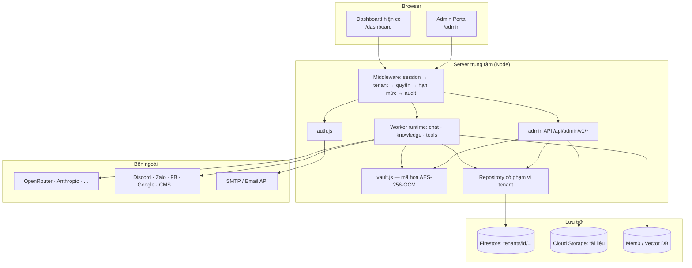
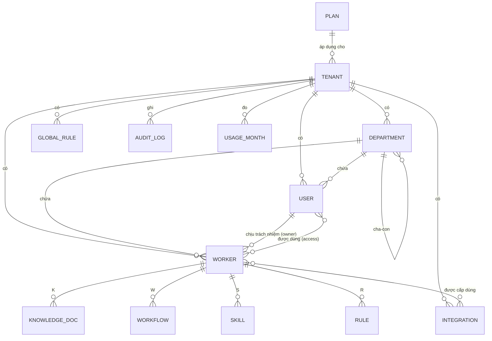

# AI OS Admin Portal — Tài liệu mô tả & thiết kế (bản production)

> **Trạng thái:** BẢN NHÁP v0.1 — chờ chốt các quyết định ở [§14](#14-câu-hỏi-mở-cần-bạn-chốt-trước-khi-code).
> **Phạm vi:** chỉ thiết kế, chưa viết code. Tài liệu này (1) đánh giá lại code hiện tại so với mục tiêu production, (2) đặc tả trang Admin, (3) đề xuất lộ trình xây.

---

## 0. Tóm tắt (đọc phần này là đủ nắm ý)

- **Hiện trạng:** AI OS là dashboard tĩnh (`website/`) + một proxy Node chạy **trên máy người dùng** (`server/`). Không có đăng nhập, không có khái niệm khách hàng/gói, cấu hình Worker nằm cứng trong mã (`AGENTS` trong `app.js`, `agents.config.json`, biến `HERMES_KEY_*` trong `.env`). Đây là bản **demo một công ty**, chưa phải sản phẩm bán cho nhiều khách.
- **Mục tiêu:** một **Admin Portal** để quản lý Khách hàng → Gói → Worker → Người dùng → Kết nối API → Sơ đồ tổ chức, chạy trên **server tập trung**, có đăng nhập email + mật khẩu, tách dữ liệu theo khách hàng.
- **Quyết định thiết kế lớn nhất:** chuyển từ *"cấu hình nằm trong code"* sang *"cấu hình nằm trong database, gắn với `tenant`"*. Mọi tính năng ở mục 2 của yêu cầu đều là hệ quả của bước chuyển này.
- **Giữ nguyên** những gì đang làm tốt: ghi đĩa trước – Firestore sau, chỉ ghi bản ghi thay đổi, mô hình KWSR, quy tắc "mỗi Agent có đúng 1 người chịu trách nhiệm".
- **Cần bạn quyết** 9 câu ở §14 — quan trọng nhất: *Admin là của nhà cung cấp (bạn) hay của từng khách hàng?* (tôi giả định **cả hai**, 2 cấp).

---

## 1. Thuật ngữ (thống nhất để khỏi nhầm)

| Thuật ngữ trong tài liệu | Nghĩa | Tên trong code hiện tại |
|---|---|---|
| **Platform** | Hệ thống AI OS do bạn vận hành | — |
| **Tenant** (Khách hàng) | Một doanh nghiệp mua AI OS | *(chưa có; đang hard-code "Giải Pháp An Khang")* |
| **Plan** (Gói) | Gói tài khoản khách mua, quyết định hạn mức | *(chưa có; chỉ có dòng chữ "Gói AI OS Standard")* |
| **Worker** | Một AI Agent chuyên môn (Sales, HR, Content…) | `Agent` (`AGENTS` trong `app.js`, `agents.config.json`) |
| **Orchestrator** | Worker điều phối, nhận lệnh từ người rồi giao việc | `Orches Agent` |
| **KWSR** | Knowledge · Workflow · Skill · Rule của một Worker | `a.knowledge / workflows / skills / rules` |
| **Member** (Người dùng) | Nhân sự của khách hàng đăng nhập dùng AI OS | `staff` trong `work.js` |
| **Department** (Phòng ban) | Đơn vị trong sơ đồ tổ chức | `DEPARTMENTS` trong `app.js` |
| **Integration** (Kết nối) | Thông tin kết nối tới nền tảng ngoài (API key, OAuth…) | `.env`, `genful.config.json`, `tripx-webpost/config.json` |

---

## 2. Đánh giá code hiện tại so với mục tiêu production

### 2.1 Những gì đã có và nên tái sử dụng

| Thành phần | Vị trí | Dùng lại thế nào |
|---|---|---|
| Mô hình KWSR + giao diện sửa 4 tầng | `website/js/app.js` (`SECTION_META`, `renderAgentInfo`) | Chuyển thành tab "KWSR" của trang chi tiết Worker |
| Sơ đồ tổ chức theo phòng ban | `app.js` (`orgChartHTML`) | Nền cho màn Sơ đồ tổ chức, nâng lên thành cây nhiều cấp, kéo-thả được |
| Quy tắc "1 Agent = 1 nhân sự chịu trách nhiệm" | `work.js` (`agentOwners`) | Trở thành `worker.ownerUserId` |
| Ghi song song đĩa + Firestore, chỉ ghi bản ghi đổi, hoãn nhịp | `server/db.js` | Giữ làm lớp lưu trữ; thêm tiền tố `tenants/{id}/…` |
| Chuẩn hoá dữ liệu cho Firestore (mảng lồng, key xấu, trần 1 MiB) | `db.js` (`encodeForFirestore`…) | Dùng nguyên |
| 3 kiểu backend chạy Worker: Hermes / OpenRouter / Genful-image | `server.js` (`handleChat`) | Trở thành trường `worker.runtime` |
| Chặn rò dữ liệu cá nhân (`SYNC_PII`) | `db.js`, `FIREBASE_SETUP.md` | Thành chính sách dữ liệu theo tenant |

### 2.2 Khoảng cách phải lấp (đây là lý do cần Admin Portal)

| # | Vấn đề hiện tại | Hệ quả khi lên production | Hướng xử lý |
|---|---|---|---|
| G1 | **Không có xác thực.** Mọi route `/api/*` trong `server.js` mở; chỉ có CORS (CORS chỉ là rào của trình duyệt, `curl` đi xuyên qua). | Ai biết địa chỉ proxy đều đọc được CV, kho lead, ghi đè được cấu hình Agent. | §6 Xác thực + middleware bắt buộc cho mọi route |
| G2 | **Proxy chạy trên máy người xem** (`.env.example`, header Private Network Access trong `server.js`). | Mỗi người một proxy riêng → không thể có dữ liệu chung, không quản lý tập trung được. | Host 1 server trung tâm; admin + API cùng origin → bỏ được toàn bộ cơ chế PNA |
| G3 | **Một công ty duy nhất**: badge cứng ở `dashboard.html`, Mem0 `user_id: "aios-company"` ở `agents.config.json`, collection Firestore không có tiền tố tenant. | Hai khách hàng dùng chung sẽ **thấy và ghi đè dữ liệu của nhau**. | Mọi dữ liệu nằm dưới `tenants/{tenantId}/…`; Mem0 `user_id = tenantId` |
| G4 | **Cấu hình Worker nằm trong code**: `AGENTS` (`app.js:25`), `agents.config.json` (port, model), `HERMES_KEY_<ID>` trong `.env`. | Thêm 1 Worker = sửa code + sửa 2 file + thêm biến môi trường + khởi động lại. Không thể cho khách tự tạo. | Worker là bản ghi trong DB; runtime đọc từ DB |
| G5 | **KWSR lưu dạng `string[]`** (+ 1 blob qua `saveAgents`). Không có id, phiên bản, bật/tắt, người tạo, loại tài liệu. | Không quản lý được vòng đời tài liệu, không phân quyền, không audit được. | Mỗi mục là một document riêng (§5.3) |
| G6 | **Upload file và kết nối MCP chỉ là giao diện mô phỏng** (`app.js:1284` có vùng kéo-thả nhưng không có `FileReader`/upload; `app.js:1670` "Đang kết nối…" là hiệu ứng). Chỉ đường "nhập tay" thật sự ghi vào Mem0. | Khách tưởng đã nạp tài liệu nhưng Worker không biết gì. | Pipeline tri thức thật (§7.3) |
| G7 | **Bí mật rải rác**: `server/.env`, `~/.claude/skills/tripx-webpost/config.json`, `genful.config.json` trong thư mục home. | Không thể có kết nối riêng cho từng khách; mất máy là mất khoá. | Két kết nối mã hoá theo tenant (§8) |
| G8 | **Không có hạn mức, không đo dùng.** Chi phí OpenRouter/Genful không ghi theo Worker/tenant. | Không bán theo gói được; một Worker chạy vòng lặp có thể đốt hết tiền. | Bộ đếm sử dụng + chốt chặn (§9) |
| G9 | **Dữ liệu nghiệp vụ nằm đĩa local** (`hr/data/`, `marketing/data/`, `data/*.json`). | Container/VPS mất là mất; không tách được theo tenant. | Chuyển sang Storage/Firestore theo tenant; đĩa chỉ là cache |
| G10 | **Mỗi Hermes Profile = 1 tiến trình + 1 cổng + 1 key.** | Tạo Worker từ giao diện đòi hỏi tự động tạo Profile + cấp cổng → khó và dễ lỗi. | Quyết định D3 (§14): ưu tiên Worker "API-native" (không cần tiến trình riêng) |
| G11 | `server.js` là chuỗi `if` dài tự định tuyến, không middleware. | Thêm ~40 endpoint admin + auth + kiểm quyền theo cách này sẽ rối và dễ sót kiểm quyền. | Thêm router mỏng có middleware (vẫn không phụ thuộc gói ngoài) |
| G12 | Dữ liệu mẫu nhân sự/khách hàng hư cấu trong `work.js` (`seed()`). | Production không được lẫn dữ liệu mẫu. | Chuyển thành script seed cho tenant demo |

> **Kết luận khảo sát:** nền móng lưu trữ và mô hình KWSR tốt, dùng lại được. Thứ **thiếu hoàn toàn** là lớp *danh tính + tenant + phân quyền + hạn mức + két bí mật*. Admin Portal chính là lớp đó.

---

## 3. Kiến trúc mục tiêu



**Nguyên tắc kiến trúc**

1. **Same-origin.** Admin Portal, Dashboard và API cùng một domain (reverse proxy). Cookie phiên `HttpOnly; Secure; SameSite=Lax`, không cần CORS rộng, bỏ được header Private Network Access.
2. **Tenant là ranh giới cứng.** Không có hàm đọc/ghi nào nhận `tenantId` từ body/URL do client gửi. `tenantId` luôn lấy từ **phiên đã xác thực** (trừ `platform_admin` khi "vào xem" một khách, có ghi audit).
3. **Mọi truy cập dữ liệu đi qua `Repository(tenantId)`** — một lớp duy nhất tự gắn tiền tố `tenants/{id}/`. Cấm gọi Firestore trực tiếp ở handler. Đây là chốt chặn chống rò dữ liệu chéo khách.
4. **Kiểm hạn mức ở server**, không tin giao diện (giao diện chỉ làm mờ nút).
5. **Bí mật không bao giờ rời server**: API trả về dạng che `sk-…a1b2`; giải mã chỉ khi runtime cần gọi bên thứ ba.
6. **Frontend giữ phong cách hiện tại**: HTML + JS thuần, không bước build (khớp `website/`). Thư mục mới `website/admin/`.
7. **Server host ở đâu?** Server dùng `fs`, `exceljs`, `docxtemplater` nên **không chạy được trên Cloudflare Workers** (nơi `workers.ai-os.vn` đang đặt trang tĩnh). Cần VPS/Cloud Run/Fly… → câu hỏi D4.

---

## 4. Vai trò & phân quyền

Hai cấp, dùng chung một ứng dụng admin, khác nhau ở phạm vi dữ liệu:

| Vai trò | Thuộc | Phạm vi | Mô tả |
|---|---|---|---|
| `platform_admin` | Nhà cung cấp (bạn) | Mọi tenant | Tạo khách, gán gói, đặt hạn mức riêng, tạm khoá tenant, "vào xem" tenant để hỗ trợ (có audit) |
| `tenant_owner` | Khách hàng | 1 tenant | Người ký mua; toàn quyền trong tenant, đổi gói, xoá tenant. Mỗi tenant ≥ 1 owner |
| `tenant_admin` | Khách hàng | 1 tenant | Quản lý Worker, người dùng, kết nối, sơ đồ tổ chức; **không** đổi gói / xoá tenant |
| `dept_manager` | Khách hàng | Phòng mình | Sửa KWSR + Rule của Worker thuộc phòng mình; mời/khoá member trong phòng; xem sử dụng |
| `member` | Khách hàng | Worker được cấp | Dùng Worker (chat, giao việc), không vào Admin |
| `viewer` | Khách hàng | Chỉ xem | Xem báo cáo/sơ đồ |

**Ma trận quyền** (✔ toàn quyền · ◐ có điều kiện · ✖ không)

| Chức năng | platform_admin | owner | admin | dept_manager | member |
|---|:-:|:-:|:-:|:-:|:-:|
| Tạo/sửa Tenant, Plan, hạn mức riêng | ✔ | ✖ | ✖ | ✖ | ✖ |
| Đổi gói của tenant | ✔ | ◐ (yêu cầu) | ✖ | ✖ | ✖ |
| Tạo / xoá Worker | ✔ | ✔ | ✔ | ✖ | ✖ |
| Sửa thông tin & model Worker | ✔ | ✔ | ✔ | ◐ phòng mình | ✖ |
| Sửa Knowledge / Workflow / Skill | ✔ | ✔ | ✔ | ◐ phòng mình | ✖ |
| Sửa **Rule** của Worker | ✔ | ✔ | ✔ | ◐ chỉ *thêm*, không gỡ Rule do admin đặt | ✖ |
| Sửa **Global Rule** toàn công ty | ✔ | ✔ | ✔ | ✖ | ✖ |
| Quản lý Kết nối API | ✔ | ✔ | ✔ | ✖ | ✖ |
| Thêm/sửa/khoá người dùng | ✔ | ✔ | ✔ | ◐ phòng mình | ✖ |
| Đổi vai trò lên `admin`/`owner` | ✔ | ✔ | ✖ | ✖ | ✖ |
| Sơ đồ tổ chức | ✔ | ✔ | ✔ | ◐ phòng mình | xem |
| Xem Nhật ký kiểm toán | ✔ | ✔ | ✔ | ✖ | ✖ |
| Dùng Worker | ✔ | ✔ | ✔ | ✔ | ◐ Worker được cấp |

Quy tắc an toàn: không thể tự hạ quyền/khoá chính mình nếu mình là owner cuối cùng; không thể tự nâng quyền.

---

## 5. Mô hình dữ liệu

### 5.1 Sơ đồ quan hệ



### 5.2 Cấu trúc Firestore

```
plans/{planId}
tenants/{tenantId}
  ├─ departments/{deptId}
  ├─ workers/{workerId}
  │    ├─ knowledge/{docId}
  │    ├─ workflows/{id}
  │    ├─ skills/{id}
  │    └─ rules/{id}
  ├─ rules/{id}                  ← Global Rule (scope = tenant)
  ├─ integrations/{id}
  ├─ usage/{yyyymm}              ← token/credit theo tháng, theo Worker
  └─ audit/{auto}
users/{userId}                   ← cấp cao nhất để tra email → tenant khi đăng nhập
sessions/{sessionIdHash}
invites/{tokenHash}
```

`users` để cấp cao nhất vì lúc đăng nhập ta mới có email, chưa biết tenant. Email là **duy nhất toàn hệ thống** (một người thuộc đúng một tenant ở v1; muốn thuộc nhiều tenant → mở rộng sau, xem D9).

### 5.3 Các thực thể chính

**`plans/{planId}`**
```jsonc
{
  "id": "standard", "name": "AI OS Standard", "active": true, "sortOrder": 2,
  "priceVndPerMonth": null,                 // để trống nếu báo giá riêng
  "limits": {
    "maxWorkers": 10,                       // KHÔNG tính Orchestrator (xem D6)
    "maxMembers": 25,
    "maxKnowledgeMB": 2048,                 // tổng dung lượng tài liệu cả tenant
    "maxDocsPerWorker": 200,
    "maxIntegrations": 10,
    "monthlyCreditBudget": 5000000,         // đơn vị quy đổi, xem §9
    "allowedModels": ["deepseek/deepseek-v4-flash", "claude-sonnet-5-5"],
    "allowedRuntimes": ["api"],             // "api" | "hermes"
    "features": { "customSkill": true, "mcpSources": false, "auditExportDays": 90 }
  }
}
```

**`tenants/{tenantId}`**
```jsonc
{
  "name": "Công ty TNHH Giải Pháp An Khang", "slug": "an-khang",
  "planId": "standard",
  "status": "active",                       // trial | active | suspended | cancelled
  "trialEndsAt": null, "contractEndsAt": "2027-06-30",
  "limitOverrides": { "maxWorkers": 15 },   // platform_admin nới/siết riêng cho khách này
  "settings": { "defaultLocale": "vi", "passwordMinLength": 10, "sessionHours": 12,
                "dataResidencyNote": "…", "syncPii": false },
  "createdAt": "…", "createdBy": "userId"
}
```
Hạn mức hiệu lực = `plan.limits` được `limitOverrides` ghi đè. Một hàm duy nhất `effectiveLimits(tenant)` tính ra, mọi nơi gọi hàm này.

**`users/{userId}`**
```jsonc
{
  "id": "u_…", "tenantId": "t_…", "email": "a@congty.vn",     // lowercase, unique
  "name": "Nguyễn Minh An", "title": "Trưởng nhóm giải pháp",
  "role": "tenant_admin", "deptId": "d_…",
  "status": "active",                       // invited | active | locked | disabled
  "passwordHash": "scrypt$N$r$p$salt$hash", "mustChangePassword": false,
  "failedLogins": 0, "lockedUntil": null, "lastLoginAt": "…",
  "createdAt": "…", "createdBy": "…"
}
```
`passwordHash` **không bao giờ** nằm trong response API.

**`tenants/{t}/departments/{deptId}`** — `{ name, parentId|null, headUserId|null, order, icon }`

**`tenants/{t}/workers/{workerId}`**
```jsonc
{
  "id": "w_sales1", "name": "Sales Agent", "icon": "💼",
  "role": "Chuyên viên chăm sóc & đề xuất bán hàng",
  "kind": "worker",                         // worker | orchestrator
  "deptId": "d_sales",
  "ownerUserId": "u_…",                     // 1 người chịu trách nhiệm (bắt buộc)
  "accessUserIds": ["u_…"],                 // ai được dùng; rỗng = cả phòng
  "runtime": { "type": "api", "model": "deepseek/deepseek-v4-flash",
               "mode": "Planning", "maxTokens": 16000, "temperature": 0.4 },
  "status": "active",                       // draft | active | paused | archived
  "budget": { "dailyCredit": 50000, "onExceed": "pause" },   // pause | warn
  "integrationIds": ["i_…"],
  "systemPrompt": "…",                      // phần mô tả vai trò; KWSR được ghép vào lúc chạy
  "maturity": 55, "stage": "Học việc",
  "createdAt": "…", "createdBy": "…", "updatedAt": "…", "updatedBy": "…"
}
```
Nếu `runtime.type = "hermes"`, thêm `{ profile, port, apiKeyRef }` — chỉ cho gói cho phép và chỉ sau khi chốt D3.

**KWSR con của Worker** (mỗi mục một document, `scope` để Global Rule dùng chung cấu trúc)

```jsonc
// knowledge/{docId}
{ "title": "Bảng giá 2026", "source": "file",          // file | text | mcp
  "tier": 2,                                             // 1 Nền tảng · 2 Vận hành · 3 Trí tuệ · 4 Lưu trữ  (mục 1.4.3 tài liệu KWSR)
  "kind": "pricing",                                     // taxonomy §7.2
  "mime": "application/pdf", "sizeBytes": 482113, "storagePath": "tenants/t_…/knowledge/…",
  "status": "indexed",                                   // uploaded | processing | indexed | failed
  "chunks": 42, "errorMsg": null, "version": 3, "enabled": true,
  "uploadedBy": "u_…", "uploadedAt": "…" }

// workflows/{id}
{ "command": "/bao-cao-thang", "description": "Tổng hợp số liệu rồi xuất PDF",
  "steps": ["Lấy dữ liệu doanh thu…", "…"], "markdown": "…WORKFLOW.md…", "enabled": true }

// skills/{id}
{ "slug": "viet-email-ca-nhan-hoa", "description": "Khi nào nên kích hoạt…",
  "markdown": "…SKILL.md…", "builtin": false, "enabled": true }

// rules/{id}   (cũng dùng cho tenants/{t}/rules — Global Rule)
{ "text": "Cấm gửi bảng giá gốc ra ngoài domain công ty",
  "severity": "block",                                   // block (chặn cứng) | warn (nhắc nhở)
  "locked": true,                                        // true = dept_manager không gỡ được
  "enabled": true }
```

**`tenants/{t}/integrations/{id}`** — chi tiết ở §8.

**`tenants/{t}/audit/{auto}`**
```jsonc
{ "at": "…", "actorId": "u_…", "actorRole": "tenant_admin", "ip": "…",
  "action": "worker.update", "target": { "type": "worker", "id": "w_…" },
  "before": { … }, "after": { … },            // chỉ các trường đổi; bí mật luôn bị che
  "viaImpersonation": false }
```

### 5.4 Ánh xạ từ dữ liệu hiện có → mô hình mới (để di trú)

| Hiện tại | → | Mới |
|---|---|---|
| `AGENTS[]` (`app.js`) + `agents.config.json` | → | `tenants/{t}/workers/*` (+ KWSR con) |
| `a.knowledge[] / workflows[] / skills[] / rules[]` (string) | → | document riêng trong 4 subcollection |
| `GLOBAL_RULES` | → | `tenants/{t}/rules/*` |
| `DEPARTMENTS` | → | `tenants/{t}/departments/*` |
| `staff` (`work.js` seed) + `agentOwners` | → | `users/*` + `worker.ownerUserId` |
| `HERMES_KEY_*`, `OPENROUTER_API_KEY`, `MEM0_API_KEY` | → | `integrations/*` (mã hoá) hoặc biến môi trường của *platform* nếu dùng chung |
| `marketing/skills/*/SKILL.md`, `hr/skills/*/SKILL.md` | → | `skills/*` (nội dung nạp từ file lúc seed, `builtin: true`) |
| `aios_meta/kwsr` | → | bỏ (thay bằng các subcollection trên) |

Một script `scripts/migrate-default-tenant.js` đọc code hiện tại tạo tenant "Giải Pháp An Khang" + 12 Worker + owner, để Dashboard hiện có chạy tiếp mà không mất gì.

---

## 6. Xác thực (Trang đăng nhập Admin) — yêu cầu #1

### 6.1 Luồng

```
Đăng nhập: email + mật khẩu ─► server tra users theo email
   ├─ không có / sai MK ─► cùng một thông báo chung "Email hoặc mật khẩu không đúng" (không lộ email có tồn tại)
   ├─ tenant suspended ─► "Tài khoản tạm khoá, liên hệ quản trị"
   ├─ đúng ─► tạo phiên, set cookie, chuyển hướng:
   │            mustChangePassword → màn đổi mật khẩu bắt buộc
   │            platform_admin/owner/admin/dept_manager → /admin
   │            member/viewer → /dashboard
```

Tạo người dùng bởi admin → **không bao giờ admin đặt hộ mật khẩu**. Server tạo `invite` (token ngẫu nhiên 32 byte, lưu băm, hạn 72 giờ, dùng một lần) → gửi email "Đặt mật khẩu" → người dùng tự đặt. (Tuỳ chọn cho demo: admin bấm "Sao chép link mời" khi chưa có SMTP.)

Quên mật khẩu: nhập email → luôn trả "Nếu email tồn tại, chúng tôi đã gửi hướng dẫn" → link reset hạn 30 phút, dùng một lần, mọi phiên cũ bị huỷ sau khi đổi.

### 6.2 Quy tắc bảo mật (bắt buộc cho production)

| Hạng mục | Quy định |
|---|---|
| Băm mật khẩu | `scrypt` của Node (`crypto.scrypt`, N≥2¹⁵) kèm salt riêng — không thêm gói ngoài, khớp triết lý zero-dependency của `server/` |
| Chính sách mật khẩu | ≥ 10 ký tự, chặn danh sách mật khẩu phổ biến, không trùng email; không ép đổi định kỳ (theo NIST) |
| Phiên | Cookie `__Host-sid`: `HttpOnly; Secure; SameSite=Lax; Path=/`. Giá trị ngẫu nhiên 32 byte; DB chỉ lưu **băm SHA-256**. Hết hạn tuyệt đối 12 giờ, trượt 2 giờ không hoạt động |
| Chống dò mật khẩu | Giới hạn 5 lần sai / 15 phút / (email + IP) → khoá tạm có thời gian tăng dần; giới hạn tốc độ theo IP |
| CSRF | `SameSite=Lax` + kiểm `Origin`/`Sec-Fetch-Site` trên mọi request ghi (POST/PUT/PATCH/DELETE) |
| Truyền tải | HTTPS bắt buộc; HSTS; `Content-Security-Policy` chặt cho `/admin` |
| Đăng xuất | Huỷ phiên phía server; "Đăng xuất mọi thiết bị" |
| Ghi nhật ký | Đăng nhập thành công/thất bại, đổi mật khẩu, khoá/mở khoá, đổi vai trò → audit |
| MFA (TOTP) | **Không thuộc v1**, nhưng schema chừa chỗ (`mfa: {enabled, secretRef}`); bắt buộc cho `platform_admin` ở giai đoạn 3 |
| Tài khoản `platform_admin` đầu tiên | Tạo bằng lệnh CLI một lần `node scripts/create-platform-admin.js` (không có đường đăng ký công khai) |

### 6.3 Màn hình

```
┌─────────────────────────────────────────────┐
│                  OS  AI OS                  │
│            Cổng quản trị (Admin)            │
│                                             │
│   Email     [ ______________________ ]      │
│   Mật khẩu  [ ______________________ ] 👁   │
│                                             │
│   [ Đăng nhập ]                             │
│   Quên mật khẩu?                            │
│                                             │
│   ⚠ (chỗ hiển thị lỗi chung, 1 dòng)       │
└─────────────────────────────────────────────┘
```
Có nút đổi sáng/tối (dùng lại `theme.js`). Không có "Đăng ký".

---

## 7. Các phân hệ quản trị

### 7.1 Khách hàng & Gói (chỉ `platform_admin`) — yêu cầu #2.2

**Danh sách Gói** (bảng minh hoạ — *con số chỉ là đề xuất để có cái mà bàn, cần bạn chốt*):

| Hạn mức | Starter | Standard | Business | Enterprise |
|---|---:|---:|---:|---:|
| Số Worker (không tính Orchestrator) | 3 | 10 | 25 | tuỳ chỉnh |
| Số người dùng | 5 | 25 | 100 | tuỳ chỉnh |
| Dung lượng Knowledge | 200 MB | 2 GB | 10 GB | tuỳ chỉnh |
| Số kết nối API | 3 | 10 | 30 | tuỳ chỉnh |
| Model được dùng | model rẻ | + Sonnet | + Opus | tất cả |
| Nguồn MCP (Drive/Notion…) | ✖ | ✖ | ✔ | ✔ |
| Worker runtime Hermes riêng | ✖ | ✖ | ✖ | ✔ |
| Lưu nhật ký kiểm toán | 30 ngày | 90 ngày | 1 năm | tuỳ chỉnh |

**Cơ chế áp hạn mức** (`enforce`):

| Tình huống | Hành vi |
|---|---|
| Tạo Worker khi đã đủ `maxWorkers` | Server trả `409 LIMIT_REACHED` kèm `{limit, used, planName}`; UI hiện "Gói Standard cho tối đa 10 Worker (đang dùng 10). Nâng gói để thêm." |
| Chạy đua (2 admin cùng tạo Worker thứ 10) | Đếm + ghi trong **một transaction** Firestore, không đếm ngoài rồi ghi sau |
| Mời user khi đủ `maxMembers` | Cùng cơ chế. Người dùng `invited` chưa kích hoạt **có tính** vào hạn mức (tránh lách bằng mời hàng loạt) |
| **Hạ gói** khi đang dùng vượt mức mới | **Không xoá gì.** Hiển thị cảnh báo "vượt gói", chặn *tạo mới*; admin chọn Worker/User nào tạm dừng. Quá 14 ngày thì các mục tạo sau cùng chuyển `paused` (cấu hình được) |
| Tenant `suspended` / hết hạn hợp đồng | Đăng nhập vẫn được nhưng **chỉ đọc**; Worker ngừng chạy; dữ liệu giữ nguyên 90 ngày |
| `limitOverrides` | `platform_admin` nới/siết riêng từng khách (khuyến mãi, thoả thuận riêng) — có audit |

Màn hình "Mức sử dụng" hiện thanh tiến độ: Worker 7/10 · Người dùng 18/25 · Knowledge 1,2/2 GB · Kết nối 4/10.

### 7.2 Worker — yêu cầu #2.1 và #2.3

**Danh sách Worker**: bảng (icon, tên, phòng, người chịu trách nhiệm, model, trạng thái, % trưởng thành, chi phí hôm nay) + lọc theo phòng/trạng thái + nút **＋ Tạo Worker** (hiện thanh `7/10`).

**Tạo Worker — trình hướng dẫn 4 bước** (tránh form dài):

| Bước | Nội dung |
|---|---|
| 1. Danh tính | Tên, icon, vai trò (1 câu), phòng ban, **người chịu trách nhiệm** (bắt buộc) |
| 2. Bộ não | Model (chỉ liệt kê model gói cho phép), chế độ Planning/Fast, `maxTokens`, ngân sách ngày. Có gợi ý model theo ngành lấy từ mục 2.3.4 tài liệu KWSR |
| 3. Khởi tạo KWSR | Chọn **mẫu** (Sales, Content, HR, Tài chính, Pháp lý, CSKH, "Trống") → nạp sẵn Rule an toàn mặc định + vài Skill/Workflow gợi ý. Có thể bỏ qua |
| 4. Xem lại & tạo | Tóm tắt + hiển thị hạn mức còn lại. Trạng thái ban đầu `draft` → bấm **Kích hoạt** mới chạy được |

**Sửa Worker** — trang chi tiết có 8 tab:

```
┌ 💼 Sales Agent   ● Đang chạy   Phòng: Kinh doanh   Chịu trách nhiệm: Ngô Thanh Mai ┐
│ [Thông tin] [Knowledge] [Workflow] [Skill] [Rule] [Kết nối] [Model & Hạn mức] [Nhật ký] │
├─────────────────────────────────────────────────────────────────────────────────────┤
│  (nội dung tab)                                                                      │
└─────────────────────────────────────────────────────────────────────────────────────┘
        [ Tạm dừng ]   [ Nhân bản ]   [ Xuất cấu hình ]   [ Lưu trữ / Xoá ]
```

**Xoá Worker** — hai tầng để tránh tai nạn:
1. **Lưu trữ** (`archived`): ngừng chạy, ẩn khỏi danh sách, giữ KWSR + lịch sử. Worker đã lưu trữ **giải phóng** 1 chỗ trong hạn mức (đề xuất); khôi phục được trong 30 ngày, và khi khôi phục phải còn chỗ trong hạn mức.
2. **Xoá vĩnh viễn**: gõ lại tên Worker để xác nhận; xoá KWSR, tài liệu trong Storage, vector trong Mem0, thu hồi quyền tích hợp; giữ lại audit. Công việc/phiếu cũ do Worker này thực hiện giữ nguyên, hiển thị tên "(Worker đã xoá)".

**Tab KWSR** (yêu cầu #2.3) — mỗi tầng là một bảng có thêm/sửa/xoá/bật-tắt:

| Tầng | Quản lý gì | Loại dữ liệu | Ghi chú thiết kế |
|---|---|---|---|
| **K**nowledge | Tài liệu Worker được tham khảo | Upload file · Nhập tay · Nguồn MCP | Xem bảng loại tài liệu bên dưới |
| **W**orkflow | Quy trình kích hoạt thủ công bằng lệnh `/…` | Trình tạo từng bước · Nhập Markdown · Upload SOP | Tên lệnh duy nhất trong Worker; xem trước `WORKFLOW.md` |
| **S**kill | Năng lực tự kích hoạt khi nhận diện đúng tình huống | Soạn `SKILL.md` (frontmatter `name/description` + thân) · chọn từ thư viện chung | `description` là thứ quyết định khi nào kích hoạt → hiện hướng dẫn viết tốt; có nút **Thử** gửi 1 câu để xem Skill có kích hoạt không |
| **R**ule | Chốt chặn "không được làm" | Câu quy tắc + mức độ `block`/`warn` | Hiện kèm danh sách **Global Rule** (chỉ đọc, khoá) ngay phía trên; Rule `locked` không gỡ được bởi dept_manager |

**Loại tài liệu Knowledge** — phân theo 2 trục:

*Trục 1 — Tầng tri thức (chọn khi nạp)*, bám mục 1.4.3 của tài liệu KWSR:

| Tầng | Ví dụ | Tần suất đổi | Gợi ý |
|---|---|---|---|
| 1 Nền tảng | Sứ mệnh, cơ cấu, chính sách, pháp lý | 1–2 lần/năm | Cần owner/admin duyệt trước khi `enabled` |
| 2 Vận hành | SOP, checklist, mẫu biểu, FAQ, bảng giá | hàng tháng/quý | Hỏi "thay thế bản cũ?" khi trùng tên → tăng `version` |
| 3 Trí tuệ | Case study, bài học, best practice | theo dự án | — |
| 4 Lưu trữ | Hồ sơ đã đóng, báo cáo cũ | ít | Mặc định **không** đưa vào ngữ cảnh trừ khi được hỏi tới |

*Trục 2 — Định dạng file được chấp nhận* (khớp giao diện hiện có `.pdf .doc .docx .xls .xlsx .md`, thêm vài loại cần thiết):

| Nhóm | Đuôi | Cách xử lý |
|---|---|---|
| Văn bản | `.pdf` `.docx` `.doc` `.md` `.txt` | Trích text; PDF scan → OCR/vision (kinh nghiệm: đã có lỗi "chỉ đọc được metadata" ở luồng CV, xem `OPENROUTER_CV_MODEL`) |
| Bảng tính | `.xlsx` `.xls` `.csv` | Giữ cấu trúc theo sheet/dòng, không làm phẳng thành văn xuôi |
| Nhập tay | văn bản trực tiếp | Lưu thẳng |
| Nguồn ngoài (MCP) | Google Drive · Notion · SharePoint · kho RAG | Đồng bộ định kỳ; theo gói |

Giới hạn: ≤ 20 MB/file (đúng UI hiện tại), chặn đuôi thực thi, kiểm tra magic bytes (không tin đuôi file), đếm vào `maxKnowledgeMB`.

**Vòng đời một tài liệu Knowledge**

```
uploaded ─► processing (trích text → chia đoạn → nhúng vector) ─► indexed
                   └──────────────► failed (kèm lý do, nút Thử lại)
Sửa nội dung ⇒ version+1, giữ bản cũ 30 ngày.  Tắt (enabled=false) ⇒ Worker ngừng dùng ngay, không xoá.
```

### 7.3 Pipeline Knowledge thật (thay phần đang mô phỏng — G6)

1. Trình duyệt gửi file → `POST /workers/:id/knowledge` (multipart, giới hạn kích thước ở server).
2. Server kiểm tra quyền + hạn mức → lưu Cloud Storage `tenants/{t}/knowledge/{docId}` → tạo doc `uploaded`.
3. Tác vụ nền (hàng đợi trong tiến trình, có thể nâng lên Cloud Tasks sau): trích text → chia đoạn → gọi Mem0 `add` với **`user_id = tenantId`, `agent_id = workerId`** (hiện đang cố định `aios-company` — sửa ở G3) → cập nhật `status`.
4. Xoá/tắt tài liệu → xoá/vô hiệu hoá bộ nhớ tương ứng.
5. Kiểm thử cách ly (đã có ở `HERMES_INTEGRATION.md` §8): Worker A hỏi dữ liệu của Worker B/tenant khác phải **không biết**.

### 7.4 Người dùng — yêu cầu #2.5

Bảng: Tên · Email · Vai trò · Phòng · Worker phụ trách · Trạng thái · Đăng nhập gần nhất. Thanh `18/25` người dùng.

| Thao tác | Hành vi |
|---|---|
| **Thêm** | Nhập email, tên, vai trò, phòng (+ Worker cấp quyền dùng) → gửi lời mời. Trùng email → báo "đã tồn tại" (không lộ tenant khác: nếu email thuộc tenant khác chỉ báo "không thể dùng email này") |
| **Mời hàng loạt** | Dán danh sách / import CSV `email,tên,vai trò,phòng`; xem trước lỗi từng dòng trước khi gửi; dừng đúng ở hạn mức |
| **Sửa** | Đổi tên, chức danh, phòng, vai trò (theo ma trận §4) |
| **Khoá / Mở khoá** | Khoá = không đăng nhập được, huỷ mọi phiên, **giữ** dữ liệu & lịch sử; vẫn tính hạn mức (khoá không phải cách lách) |
| **Vô hiệu hoá** | Giải phóng 1 chỗ trong hạn mức; không đăng nhập được; có thể kích hoạt lại nếu còn chỗ |
| **Xoá** | Chỉ khi user không còn là `ownerUserId` của Worker nào → hệ thống buộc **chuyển giao Worker** cho người khác trước. Công việc đã làm giữ tên (ẩn danh hoá nếu có yêu cầu xoá dữ liệu cá nhân) |
| **Đặt lại mật khẩu** | Gửi lại email (admin không xem/đặt được mật khẩu) |
| **Đăng xuất thiết bị** | Huỷ mọi phiên |

### 7.5 Sơ đồ tổ chức — yêu cầu #2.6

Nâng `orgChartHTML()` hiện tại (CEO → Orches → các cột phòng ban) thành:

- **Phòng ban dạng cây nhiều cấp** (`parentId`): Ban giám đốc → Khối → Phòng → Nhóm. Mỗi phòng có `headUserId`.
- **Trong mỗi phòng**: hai làn — 👤 *Con người* (member) và 🤖 *Worker*. Mỗi thẻ Worker hiện **người chịu trách nhiệm**; mỗi thẻ người hiện **các Worker họ phụ trách**.
- **Kéo-thả** Worker/người sang phòng khác (ghi audit; kiểm quyền theo phạm vi).
- **Hai chế độ xem**: *Theo phòng ban* (cây) và *Ma trận Người ↔ Worker* (hàng = người, cột = Worker, ô = Phụ trách / Được dùng / —).
- **Khung "Chưa phân công"**: Worker chưa có owner, người chưa có phòng — vừa là cảnh báo, vừa là nơi kéo ra.
- **Ràng buộc**: Worker bắt buộc có đúng 1 owner; một phòng không thể là con của chính nó/hậu duệ nó; xoá phòng còn Worker/người → buộc chuyển trước.
- **Orchestrator** hiển thị cố định ở đỉnh cây phía dưới "Chủ doanh nghiệp" (như hiện tại), không kéo được.

```
                 👤 Chủ doanh nghiệp (Owner)
                          │
                 🧭 Orchestrator  [DeepSeek V4 Flash]
        ┌────────────┬────┴───────┬─────────────┐
   💼 Kinh doanh   🎨 Marketing  🧑‍🤝‍🧑 Nhân sự   📊 Tài chính
   TP: Bùi K.Linh  TP: Ngô T.Mai  TP: Trần Q.Bảo  TP: Nguyễn M.An
   👤 3 người      👤 4 người     👤 2 người       👤 2 người
   🤖 Sales Agent  🤖 Content     🤖 HR Agent      🤖 Finance
      └ Ngô T.Mai     └ Bùi K.Linh   └ Trần Q.Bảo     └ Nguyễn M.An
   🤖 Lead Hunter  🤖 Social …
   ⚠ Chưa phân công: 1 Worker · 2 người   [+ Thêm phòng]
```

### 7.6 Bổ sung ngoài danh sách của bạn (đề xuất — cần cho production)

| # | Hạng mục | Vì sao cần | Mức ưu tiên |
|---|---|---|---|
| B1 | **Nhật ký kiểm toán** (Audit) | Ai đổi Rule/Kết nối/vai trò, khi nào, trước–sau. Bắt buộc để điều tra sự cố và bán cho doanh nghiệp | Cao (v1) |
| B2 | **Sử dụng & chi phí** theo Worker/tháng + **ngân sách ngày, tự tạm dừng** | Chính tài liệu thiết kế gốc đã yêu cầu ("Hạn mức tài chính"); không có thì một vòng lặp lỗi đốt hết tiền | Cao (v1: chỉ đo; v2: chặn) |
| B3 | **Global Rule** toàn công ty | Đang có trong code (`GLOBAL_RULES`), cần chỗ quản trị | Cao (v1) |
| B4 | **Mẫu Worker** (template) | Tạo Worker nhanh, Rule an toàn có sẵn; platform_admin duy trì thư viện mẫu | Trung bình |
| B5 | **Trạng thái sức khoẻ** từng Worker/Kết nối | "Kết nối Zalo hết hạn", "Worker lỗi 3 lần liền" hiện ngay trên tổng quan | Trung bình |
| B6 | **Phê duyệt (Decision Gate)** cấu hình theo Worker | Từ tài liệu gốc: hành động rủi ro cao phải qua người duyệt | Trung bình (v2) |
| B7 | **Xuất/nhập cấu hình Worker** (JSON) | Sao lưu, chuyển sang tenant khác, dựng mẫu | Trung bình |
| B8 | **Chính sách dữ liệu & quyền riêng tư** | Nghị định 13/2023: bật/tắt đồng bộ PII cloud theo tenant, xuất/xoá dữ liệu theo yêu cầu chủ thể | Cao nếu có khách thật |
| B9 | **Hỗ trợ "vào xem" tenant** (impersonation) | Hỗ trợ khách; bắt buộc có banner đỏ + audit + hết hạn 30 phút | Trung bình |
| B10 | **Thông báo** (email/Telegram/Slack) khi Worker vượt ngân sách, kết nối hỏng, user bị khoá | Quản trị viên không ngồi nhìn dashboard cả ngày | Thấp (v3) |
| B11 | **Sao lưu & khôi phục** theo tenant | Cam kết với khách | Thấp (v3) |

---

## 8. Kết nối API tới nền tảng — yêu cầu #2.4

### 8.1 Danh mục kết nối (provider catalog)

Mỗi provider là một **khai báo dữ liệu** (không phải code riêng cho từng màn hình): tên, nhóm, kiểu xác thực, các trường nhập, cách "Kiểm tra kết nối". Thêm provider mới = thêm 1 mục khai báo.

| Nhóm | Provider (ưu tiên theo code hiện có) | Xác thực | Hiện đang ở đâu |
|---|---|---|---|
| **Mô hình ngôn ngữ** | OpenRouter · Anthropic · OpenAI · Google Gemini | API key | `.env` `OPENROUTER_API_KEY` |
| **Sinh ảnh** | Genful | Token | `genful.config.json` (thư mục home) |
| **Kho tri thức** | Mem0 | API key | `.env` `MEM0_API_KEY` |
| **Hermes** | Hermes API Server (host, port, key) | API key | `.env` `HERMES_KEY_*` |
| **Xuất bản nội dung** | TripX SEO-CMS · WordPress · Shopify | Token / OAuth | `~/.claude/skills/tripx-webpost/config.json` |
| **Nhắn tin / kênh** | Discord · Telegram · Zalo OA · Facebook Page/Messenger · Slack | Bot token / OAuth | Discord (Hermes Gateway) |
| **Google Workspace** | Drive · Sheets · Gmail · Calendar | OAuth | — (HR đang ghi `.xlsx` local) |
| **Quảng cáo** | Google Ads · Meta Ads | OAuth + developer token | — |
| **Email gửi đi** | SMTP / Resend / SendGrid | API key | — (cần cho §6 mời/đặt lại mật khẩu — của *platform*) |
| **Tuỳ chỉnh** | Webhook / REST tuỳ ý (URL + header) | Bearer / Header | — |

### 8.2 Hành vi giao diện

- Màn **Kết nối** = lưới thẻ theo nhóm, mỗi thẻ có trạng thái `Chưa kết nối / Hoạt động / Lỗi / Hết hạn`, lần kiểm tra gần nhất.
- Thêm: chọn provider → form theo khai báo → **[Kiểm tra kết nối]** (gọi thử một endpoint nhẹ, vd liệt kê model) → chỉ khi qua mới cho **Lưu**.
- Sau khi lưu, trường bí mật hiển thị `••••••a1b2` và **không bao giờ trả về nguyên văn**. Muốn đổi → "Thay khoá" (nhập mới đè lên).
- **Cấp quyền cho Worker (nguyên tắc quyền tối thiểu)**: một kết nối *không* tự dùng được bởi mọi Worker; vào tab Kết nối của Worker để tick kết nối được dùng (khớp ghi chú "quyền tối thiểu" trong `HERMES_INTEGRATION.md` §7). Màn Kết nối hiện "đang được dùng bởi: Sales Agent, Content Agent".
- Xoá kết nối đang được Worker dùng → cảnh báo liệt kê Worker bị ảnh hưởng, yêu cầu xác nhận.
- Mỗi lần runtime *dùng* khoá ghi một dòng đếm vào `usage` (không ghi nội dung).

### 8.3 Lưu trữ bí mật (`vault.js`)

- Mã hoá **AES-256-GCM** mỗi bí mật, nonce ngẫu nhiên; lưu `{ciphertext, nonce, keyVersion}`.
- Khoá chủ (master key) lấy từ biến môi trường / Secret Manager của nền tảng host — **không** nằm trong Firestore, không nằm trong git. Hỗ trợ `keyVersion` để xoay khoá.
- Giải mã chỉ trong bộ nhớ, ngay lúc gọi bên thứ ba; không log.
- `.gitignore` đã chặn `serviceAccount*.json`/`.env`; thêm kiểm tra CI cấm commit chuỗi giống khoá.
- Quy tắc chuyển đổi: các khoá đang nằm `.env`/home của máy bạn được **nạp một lần** vào vault của tenant mặc định rồi xoá khỏi nơi cũ.

OAuth (Google, Meta, Zalo): cần màn hình đồng ý + callback + làm mới token → **giai đoạn 2**; v1 chỉ hỗ trợ kiểu API key / token dán vào.

---

## 9. Sử dụng, chi phí & chốt chặn (yêu cầu bổ sung B2)

- Mỗi lần gọi model/ảnh: ghi `{tenantId, workerId, tokensIn, tokensOut, credit, at}` vào `usage/{yyyymm}` (cộng dồn, không ghi từng dòng để tiết kiệm lượt ghi Firestore — cùng triết lý `db.js`).
- Quy đổi về **một đơn vị credit** nội bộ để so sánh model chữ và ảnh (hiện Genful tính credit, OpenRouter tính USD — kinh nghiệm trong `server.js` đã phải tự quy đổi).
- **Ngân sách ngày theo Worker** (`budget.dailyCredit`) và **ngân sách tháng theo tenant** (`plan.limits.monthlyCreditBudget`): ≥ 80% → cảnh báo; 100% → `pause` Worker hoặc chỉ cảnh báo, theo `onExceed`.
- Biểu đồ: chi phí theo ngày, theo Worker; số lần bị từ chối ở bước duyệt (nếu có B6).

---

## 10. Đặc tả API (`/api/admin/v1`)

Mọi route (trừ `auth/*` công khai) đi qua middleware theo thứ tự: **phiên → nạp tenant → kiểm vai trò → kiểm hạn mức (route tạo) → handler → audit**. Lỗi thống nhất `{ "error": { "code": "LIMIT_REACHED", "message": "…", "details": {…} } }`. Danh sách có phân trang `?limit=&cursor=`.

| Nhóm | Phương thức & đường dẫn | Vai trò tối thiểu |
|---|---|---|
| **Auth** | `POST /auth/login` · `POST /auth/logout` · `GET /auth/me` | công khai / mọi |
| | `POST /auth/password/forgot` · `POST /auth/password/reset` · `POST /auth/password/change` | công khai / mọi |
| | `POST /auth/invite/accept` (đặt mật khẩu lần đầu) | công khai (token) |
| **Plans** | `GET/POST /plans` · `GET/PATCH /plans/:id` | platform_admin |
| **Tenants** | `GET/POST /tenants` · `GET/PATCH /tenants/:id` · `POST /tenants/:id/suspend` `…/resume` · `POST /tenants/:id/impersonate` | platform_admin |
| **Tenant của tôi** | `GET /tenant` · `GET /tenant/usage` (đã dùng vs hạn mức) · `PATCH /tenant/settings` | admin |
| **Workers** | `GET /workers` · `POST /workers` *(kiểm hạn mức)* | admin / dept_manager (đọc) |
| | `GET/PATCH/DELETE /workers/:id` · `POST /workers/:id/{activate,pause,archive,restore,duplicate}` | admin |
| | `GET /workers/:id/export` · `POST /workers/import` | admin |
| **KWSR** | `GET/POST /workers/:id/knowledge` *(multipart; kiểm dung lượng)* · `PATCH/DELETE …/knowledge/:docId` · `POST …/knowledge/:docId/reindex` | dept_manager |
| | `GET/POST/PATCH/DELETE /workers/:id/{workflows,skills,rules}[/:itemId]` | dept_manager |
| | `GET/POST/PATCH/DELETE /rules` (Global Rule) | admin |
| | `POST /workers/:id/test` (gửi 1 câu thử, trả lời + Skill/Rule nào kích hoạt) | dept_manager |
| **Users** | `GET /users` · `POST /users` *(kiểm hạn mức, gửi mời)* · `POST /users/bulk` | admin / dept_manager (phòng mình) |
| | `GET/PATCH/DELETE /users/:id` · `POST /users/:id/{lock,unlock,disable,enable,reset-password,revoke-sessions}` | admin |
| **Org** | `GET /org` (cây + Worker + người) · `POST/PATCH/DELETE /departments[/:id]` · `PUT /org/assignments` (kéo-thả hàng loạt) | admin |
| **Integrations** | `GET /integrations/catalog` · `GET/POST /integrations` · `PATCH/DELETE /integrations/:id` · `POST /integrations/:id/test` · `PUT /workers/:id/integrations` | admin |
| **Audit & Usage** | `GET /audit` (lọc theo người/hành động/đối tượng/ngày) · `GET /usage?month=` | admin |

Các endpoint hiện có (`/api/db/*`, `/api/agents/:id/chat`, `/api/hr/*`, `/api/sales/*`, `/api/marketing/*`, `/api/tripx/*`) **giữ nguyên đường dẫn nhưng bắt buộc có phiên**, và `agentId` được phân giải thành Worker **trong tenant của phiên** (chứ không phải từ `agents.config.json`).

---

## 11. Cấu trúc thư mục đề xuất

```
server/
  server.js              (giữ; gắn middleware + router mới)
  router.js              NEW — router mỏng có middleware, không gói ngoài
  auth.js                NEW — scrypt, phiên, mời, reset, khoá
  tenancy.js             NEW — Repository(tenantId), effectiveLimits, enforce()
  vault.js               NEW — AES-256-GCM
  audit.js               NEW
  usage.js               NEW
  mailer.js              NEW — SMTP/API gửi mail (tách khỏi Kết nối của tenant)
  admin/                 NEW — handler theo nhóm: workers.js users.js org.js integrations.js knowledge.js …
  providers/             NEW — khai báo provider catalog
  db.js                  (giữ; thêm tiền tố tenant)
scripts/
  create-platform-admin.js
  migrate-default-tenant.js
website/
  admin/                 NEW — index.html, login.html, css/admin.css, js/admin/*.js (JS thuần, ES module)
docs/
  ADMIN_PORTAL_DESIGN.md (tài liệu này)
```

---

## 12. Lộ trình triển khai

Mỗi giai đoạn kết thúc ở trạng thái **chạy được và kiểm thử được**, không để dở dang.

| GĐ | Nội dung | Kết quả kiểm chứng được |
|---|---|---|
| **0 — Nền tảng** | `router.js`, `auth.js` (đăng nhập, phiên, đổi/quên MK, mời), `tenancy.js` (Repository có tiền tố), `audit.js`, collection `plans/tenants/users`, script tạo platform_admin, màn **Đăng nhập** + khung Admin trống. Bắt buộc phiên cho mọi route cũ | Không đăng nhập ⇒ mọi `/api/*` trả 401. User tenant A không đọc được dữ liệu tenant B (test tự động) |
| **1 — Quản trị lõi** | Plans & Tenants, **Người dùng** (CRUD + mời + hạn mức), **Worker** (CRUD + hạn mức + vòng đời), **Sơ đồ tổ chức**, Global Rule. Script di trú tenant mặc định | Tạo Worker thứ 11 ở gói 10 bị chặn; 2 request song song không vượt hạn mức; Dashboard hiện có chạy bằng dữ liệu từ DB |
| **2 — KWSR & Kết nối** | KWSR dạng document đầy đủ; **upload Knowledge thật** + pipeline Mem0 theo tenant; **vault + Kết nối** (API key); cấp kết nối cho Worker; Worker "Thử" | Nạp PDF cho Worker A ⇒ A trả lời đúng, B không biết; khoá không lộ trong response/log |
| **3 — Vận hành** | Đo sử dụng + ngân sách + tự tạm dừng; dashboard sử dụng; Decision Gate (B6); thông báo; OAuth (Google/Meta/Zalo); MFA cho platform_admin; mẫu Worker; xuất/nhập | Vượt ngân sách ngày ⇒ Worker tạm dừng + có cảnh báo |
| **4 — Mở rộng** *(tuỳ nhu cầu)* | Worker runtime Hermes tự cấp (provisioner), thanh toán/billing, một user nhiều tenant, SSO | — |

---

## 13. Kiểm thử & tiêu chí nghiệm thu

**Bảo mật (chặn phát hành nếu trượt)**
- Mọi route không có phiên ⇒ 401; sai vai trò ⇒ 403; **thử mọi route với phiên của tenant khác ⇒ 404/403** (test lặp tự động theo danh sách route).
- Brute-force: lần sai thứ 6 bị khoá; thông báo lỗi không phân biệt "sai email" và "sai mật khẩu"; thời gian phản hồi xấp xỉ nhau (chống dò tài khoản).
- Response không chứa `passwordHash`, bí mật, `storagePath` thô; log không chứa mật khẩu/token.
- CSRF: request ghi từ origin lạ bị từ chối.

**Hạn mức**
- Biên: dùng đúng `N`, `N+1`; hai request đồng thời; hạ gói khi đang vượt; override tenant; tenant suspended chỉ đọc.

**Chức năng**
- Vòng đời Worker: draft → active → paused → archived → restore → xoá vĩnh viễn (xác nhận tên).
- Xoá user đang là owner Worker bị chặn cho tới khi chuyển giao.
- Org: không tạo được vòng lặp cha–con; xoá phòng còn thành viên bị chặn.
- Knowledge: upload sai magic bytes bị từ chối; file lỗi vào `failed` kèm lý do + thử lại được; tắt tài liệu có hiệu lực ngay.

**Di trú**: sau `migrate-default-tenant`, Dashboard hiện tại hiển thị đủ 12 Worker + KWSR như trước (so sánh snapshot).

---

## 14. Câu hỏi mở (cần bạn chốt trước khi code)

> Tôi đã chọn **mặc định đề xuất** cho từng câu để bạn chỉ cần sửa chỗ không đồng ý.

| # | Câu hỏi | Mặc định đề xuất | Ảnh hưởng nếu đổi |
|---|---|---|---|
| **D1** | **Admin là của ai?** (a) chỉ nhà cung cấp quản lý mọi khách, (b) mỗi khách tự quản, (c) cả hai | **(c) hai cấp** — `platform_admin` + `tenant_admin` | (a) bỏ vai trò tenant; (b) bỏ Plans/Tenants UI nhưng vẫn phải có Plan để áp hạn mức |
| **D2** | Xác thực tự xây (scrypt + phiên cookie) hay dùng **Firebase Auth**? | **Tự xây**: giữ zero-dependency, chạy được không cần Firebase khi dev, giữ khả năng cài private-cloud. *Đánh đổi:* tự gánh MFA/xác thực email sau này | Firebase Auth: có MFA & mail sẵn nhưng dev local phải dùng emulator, và gắn chặt vào Google |
| **D3** | Worker mới tạo từ giao diện chạy bằng gì? | **"API-native"** (như OpenRouter đang chạy Content Cluster: không cần tiến trình riêng; KWSR ghép vào prompt lúc chạy). Hermes chỉ cho gói cao, GĐ 4 | Bắt buộc Hermes cho mọi Worker ⇒ phải viết provisioner cấp Profile/cổng/key, rủi ro vận hành lớn |
| **D4** | Server production host ở đâu? | **VPS hoặc Cloud Run** (cần `fs`, tiến trình dài). Trang tĩnh có thể vẫn ở Cloudflare nhưng khi đó khác origin ⇒ phải xử lý cookie cross-site (kém an toàn hơn) | Cloudflare Workers: phải viết lại các phần dùng `fs`/`exceljs`/`docxtemplater` |
| **D5** | Gói & con số hạn mức (§7.1) | Dùng bảng đề xuất làm khung | Chỉ đổi dữ liệu trong `plans`, không đổi code |
| **D6** | Orchestrator có tính vào `maxWorkers` không? | **Không** (là hạ tầng bắt buộc của mỗi tenant) | Tính ⇒ gói Starter còn 2 Worker thật |
| **D7** | Dịch vụ gửi email (mời, quên mật khẩu) | **Resend** hoặc SMTP của bạn; GĐ 0 có chế độ "sao chép link mời" khi chưa cấu hình | Không có email ⇒ không thể đưa khách thật vào |
| **D8** | Kho vector: giữ Mem0 hay tự chạy Qdrant/pgvector? | **Giữ Mem0** sau một lớp trừu tượng `KnowledgeStore`; cân nhắc chuyển khi chi phí/NĐ13 đòi hỏi | Tự chạy: thêm hạ tầng, nhưng dữ liệu ở trong nước được |
| **D9** | Một người có thể thuộc nhiều tenant không (vd tư vấn viên)? | **Không ở v1** (email duy nhất toàn hệ thống, thuộc 1 tenant) | Có ⇒ đổi sang bảng `memberships`, màn chọn tenant sau đăng nhập |

**Hai điểm cần bạn bổ sung:**
1. **Mục "3." trong danh sách yêu cầu của bạn đang để trống** — bạn định thêm hạng mục nào (ví dụ: thanh toán/hoá đơn, báo cáo, thông báo, nhật ký)? Tôi đã đề xuất B1–B11 ở §7.6, bạn chọn mục nào đưa vào phạm vi.
2. **Dữ liệu cá nhân (Nghị định 13/2023)**: khi nhiều khách cùng dùng, ai là "bên kiểm soát/xử lý dữ liệu" và dữ liệu có được lưu ngoài Việt Nam không? Đây là quyết định pháp lý–kinh doanh, ảnh hưởng chọn vùng Firestore/Storage (hiện hướng dẫn chọn Singapore) và `syncPii`.

---

## 15. Rủi ro chính

| Rủi ro | Mức | Giảm thiểu |
|---|---|---|
| Rò dữ liệu chéo tenant do sót tiền tố ở một query | **Rất cao** | Chỉ cho phép truy cập qua `Repository(tenantId)`; lint cấm import Firestore ngoài `tenancy.js`; test tự động quét mọi route bằng phiên tenant khác |
| Lộ khoá API của khách | Cao | Vault mã hoá, che khi trả về, không log, xoay khoá chủ có `keyVersion` |
| Chi phí model vượt kiểm soát | Cao | Ngân sách ngày + tự `pause` (GĐ 3); đo ngay từ GĐ 2 |
| Chạy hai hệ thống song song trong lúc di trú (Dashboard cũ dùng `AGENTS` cứng, mới dùng DB) | Trung bình | Dashboard đọc Worker từ API trước khi gỡ dữ liệu cứng; cờ tính năng; so sánh snapshot |
| Vượt hạn mức ghi Firestore (gói Spark) khi nhiều tenant | Trung bình | Giữ kỹ thuật diff-ghi + hoãn nhịp của `db.js`; theo dõi; nâng Blaze khi có khách thật |
| Tự xây xác thực có lỗ hổng tinh vi | Trung bình | Chỉ dùng primitive chuẩn của Node (`scrypt`, `randomBytes`, `timingSafeEqual`); checklist §6.2; rà soát bảo mật trước khi mở cho khách đầu tiên |
| Phạm vi phình to | Trung bình | Chốt phạm vi từng GĐ; mọi thứ ở §7.6 mức "thấp" để sau |

---

*Tài liệu sinh từ khảo sát mã nguồn tại commit `c89a426` (nhánh `claude/lucid-cerf-wq7cjp`). Khi bạn chốt D1–D9, tôi sẽ cập nhật bản này thành v1.0 rồi bắt đầu GĐ 0.*
