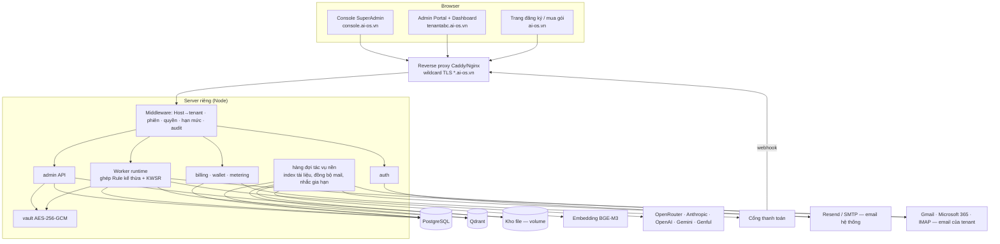
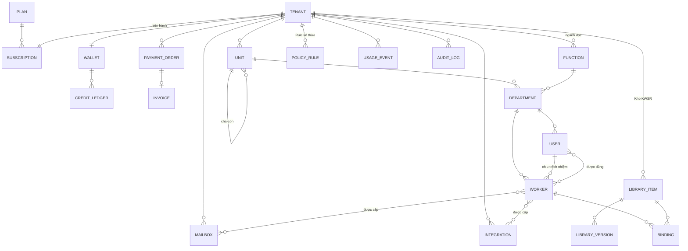

# AI OS Admin Portal — Tài liệu mô tả & thiết kế (bản production)

> **Phiên bản:** v2.0 (02/11/2026) — cập nhật theo bản thiết kế giao diện Admin · Console · Workspace (xem [§24](#24-cập-nhật-theo-thiết-kế-giao-diện-v20--112026)). Kế thừa v1.2 **đã chốt toàn bộ**: D1–D9, Q1–Q7, 4 quyết định về Console và 7 yêu cầu bổ sung (xem [§0.2](#02-quyết-định-đã-chốt)). Không còn câu hỏi mở chặn Giai đoạn 0.
> **Phạm vi:** thiết kế, chưa viết code.
> **Lịch sử:** v0.1 là bản khảo sát và đề xuất. v1.0 bỏ Hermes và Mem0, thêm subdomain theo tenant, cơ cấu tổ chức phức hợp theo ngành dọc, Kho KWSR, thanh toán và ví token, email của tenant, và đưa 11 hạng mục bổ sung vào phạm vi. v1.1 chốt Q1–Q7: **PostgreSQL thay Firebase**, thêm lược đồ CSDL ([§7.7](#77-lưu-trữ-trên-postgresql)) và cấu hình server ([§3.1](#31-thành-phần-chạy-trên-server-riêng)). v1.2 thêm đặc tả đầy đủ **Console SuperAdmin** ([§22](#22-console-superadmin-consoleai-osvn)) và sơ đồ màn hình quản trị tenant ([§23](#23-sơ-đồ-màn-hình-quản-trị-tenant-tenantabcai-osvn)). **v2.0** gộp bản Admin và bản bổ sung Console thành một tài liệu, và đưa mọi điều chỉnh chức năng / logic phát sinh khi thiết kế giao diện vào [§24](#24-cập-nhật-theo-thiết-kế-giao-diện-v20--112026): logic thống nhất 3 khu vực, Cài đặt trạng thái, Quy tắc duyệt, danh mục Kho (loại tài liệu, loại bước, thẻ), Global Rule đồng bộ, Mô hình AI, Sửa Worker một trang, Người dùng theo sơ đồ tổ chức, đổi gói và chứng từ chuyển khoản.

---

## 0. Tóm tắt

### 0.1 Bức tranh chung

- **Hiện trạng:** AI OS gồm một dashboard tĩnh (`website/`) và một proxy Node chạy trên máy người dùng (`server/`). Hệ thống chưa có đăng nhập, chưa có khái niệm khách hàng hay gói. Cấu hình Worker nằm cứng trong mã nguồn. Worker chạy qua Hermes, OpenRouter hoặc Genful. Đây vẫn là bản demo cho một công ty.
- **Mục tiêu:** một nền tảng nhiều khách hàng (tenant), chạy trên server riêng. Mỗi khách có subdomain riêng (`tenantabc.ai-os.vn`). Có một **Console SuperAdmin** cho nhà cung cấp (`console.ai-os.vn`, §22) và một **Admin Portal** cho từng khách do Admin của tenant tự quản trị (§23).
- **Bước chuyển cốt lõi:** mọi cấu hình chuyển từ mã nguồn vào cơ sở dữ liệu và gắn với `tenantId`. Mọi tính năng trong tài liệu này đều xây trên bước chuyển đó.

### 0.2 Quyết định đã chốt

| # | Chủ đề | Quyết định |
|---|---|---|
| — | Hermes Agent | **Không dùng.** Gỡ khỏi thiết kế và mã nguồn ([§2.3](#23-danh-mục-gỡ-hermes--mem0)). Worker gọi thẳng API mô hình |
| D1 | Cấp quản trị | **SuperAdmin** thuộc hệ thống. Mỗi tenant có **Admin** toàn quyền cấu hình trong tenant đó |
| D2 | Xác thực | **Tự xây**: scrypt, phiên cookie, email |
| D3 | Tạo Worker | **Chỉ tạo qua giao diện** (trình hướng dẫn). Không có API công khai hay API token để tạo Worker |
| D4 | Hạ tầng | **Server riêng**, không chạy trên Cloudflare |
| D5 | Gói & hạn mức | Dùng bảng đề xuất ([§10](#10-gói--hạn-mức)) |
| D6 | Orchestrator | **Không tính** vào `maxWorkers`. Mỗi tenant có sẵn một Orchestrator, không xoá được |
| D7 | Email hệ thống | Resend, hoặc nhà cung cấp phù hợp qua lớp `mailer` thay thế được |
| D8 | Kho vector | **Qdrant** tự vận hành (thay Mem0) |
| D9 | Danh tính người dùng | Đăng ký và xác thực bằng email. v1: email là duy nhất toàn hệ thống, mỗi người thuộc một tenant |
| — | Dữ liệu cá nhân | **Tạm chưa đề cập.** Thiết kế chừa sẵn chỗ để bổ sung khi cần |
| Q1 | Cơ sở dữ liệu | **PostgreSQL** tự chạy trên server riêng. **Bỏ Firebase** (Firestore và Cloud Storage) |
| Q2 | Cổng thanh toán | **PayOS (VietQR)** trước, kèm xác nhận chuyển khoản thủ công; VNPay ở bước sau |
| Q3 | Hoá đơn | Giai đoạn 3 xuất **phiếu thu PDF**; hoá đơn điện tử tích hợp sau, khi chốt nhà cung cấp |
| Q4 | Đơn vị credit | **1 credit = 1 VNĐ**; giá bán token = giá nhà cung cấp × hệ số (mặc định 1,3) do SuperAdmin chỉnh |
| Q5 | Embedding | Model đa ngôn ngữ **tự chạy** cùng server (**BGE-M3**, 1024 chiều) |
| Q6 | Kết nối mô hình mặc định | **Platform** (khoá của hệ thống, trừ Ví). BYOK là tuỳ chọn từ gói Standard |
| Q7 | Tên host | `console.ai-os.vn` (SuperAdmin), `ai-os.vn/dang-ky` (đăng ký) |
| — | Hạn mức thêm mới | **Số đơn vị** 1/3/20 và **số hộp thư** 1/5/30 cho Starter/Standard/Business (theo đề xuất ở §10) |
| C1 | Vào quản trị tenant từ Console | Phiên hỗ trợ mặc định **chỉ xem**, muốn sửa phải bật thêm (§22.8) |
| C2 | Thông báo cho khách | **Luôn gửi email** cho Admin tenant khi bắt đầu và kết thúc phiên hỗ trợ |
| C3 | Vai nhân viên hệ thống | v1 **một vai `superadmin`**, chừa cột `platform_role` để tách 4 vai sau (§22.10) |
| C4 | Thao tác SuperAdmin bị chặn | Giữ nguyên danh sách chặn (§22.8). Với mật khẩu, SuperAdmin **chỉ gửi link đặt lại** cho Admin tenant |

### 0.3 Yêu cầu bổ sung đã đưa vào

| # | Yêu cầu | Mục |
|---|---|---|
| 1 | Thanh toán mua và gia hạn gói, thanh toán cho bộ đếm token | [§11](#11-thanh-toán-mua-gói-gia-hạn-nạp-token) |
| 2 | Cơ cấu Tổng công ty, Chi nhánh, Cửa hàng; sơ đồ theo **ngành dọc**; Rule kế thừa theo ngành | [§8](#8-cơ-cấu-tổ-chức-phức-hợp--ngành-dọc) |
| 3 | **Kho KWSR** dùng chung: chọn khi cấu hình và tinh chỉnh được khi tạo Worker | [§9](#9-kho-kwsr-thư-viện-dùng-chung) |
| 4 | Tích hợp **email của tenant** cho công việc (tuỳ chọn của người dùng) | [§14](#14-tích-hợp-email-của-tenant) |
| 5 | Tạo tenant (tên, email, username, mật khẩu) và đăng nhập theo **subdomain** | [§4](#4-tenant-subdomain--khởi-tạo) |
| 6 | Màn "Mức sử dụng" hiện **số dư token** của các kết nối cần nạp tiền | [§12](#12-màn-mức-sử-dụng) |
| 7 | Đồng ý cả 11 hạng mục bổ sung (B1–B11) | [§16](#16-hạng-mục-bổ-sung-b1b11) |
| 8 | Điều chỉnh chức năng và logic theo bản thiết kế giao diện (11/2026) | [§24](#24-cập-nhật-theo-thiết-kế-giao-diện-v20--112026) |

---

## 1. Thuật ngữ

| Thuật ngữ | Nghĩa | Tên trong code hiện tại |
|---|---|---|
| **Platform** | Hệ thống AI OS do bạn vận hành | — |
| **SuperAdmin** | Quản trị viên của Platform, làm việc trên Console | — |
| **Tenant** | Một doanh nghiệp mua AI OS, có subdomain riêng | *(chưa có; đang gắn cứng "Giải Pháp An Khang")* |
| **Plan** (Gói) | Gói tài khoản, quyết định hạn mức | *(chỉ có dòng chữ "Gói AI OS Standard")* |
| **Subscription** | Thuê bao gói của một tenant theo chu kỳ | — |
| **Wallet** (Ví credit) | Số dư credit để trả cho token và ảnh khi dùng khoá của Platform | — |
| **Unit** (Đơn vị) | Tổng công ty, Chi nhánh, Cửa hàng… (cây pháp nhân hoặc địa điểm) | — |
| **Function** (Ngành dọc) | Chức năng xuyên suốt các đơn vị: Kế toán, Kinh doanh, Nhân sự… | gần với `DEPARTMENTS` |
| **Department** (Bộ phận) | Giao của **Unit × Function**, ví dụ "Kế toán – Chi nhánh Hà Nội" | `DEPARTMENTS` trong `app.js` |
| **Worker** | Một AI Agent chuyên môn | `Agent` (`AGENTS`, `agents.config.json`) |
| **Orchestrator** | Worker điều phối, nhận lệnh rồi giao việc | `Orches Agent` |
| **KWSR** | Knowledge · Workflow · Skill · Rule | `a.knowledge / workflows / skills / rules` |
| **Kho KWSR** (Library) | Thư viện mục KWSR dùng chung cho nhiều Worker | — |
| **Binding** | Liên kết một Worker với một mục trong Kho (theo kho, hoặc đã tinh chỉnh) | — |
| **Member** | Người dùng của tenant | `staff` trong `work.js` |
| **Integration** | Kết nối tới nền tảng ngoài | `.env`, `genful.config.json`, `tripx-webpost/config.json` |
| **Mailbox** | Hộp thư của tenant hoặc của người dùng được kết nối cho Worker | — |

---

## 2. Đánh giá code hiện tại

### 2.1 Phần nên tái sử dụng

| Thành phần | Vị trí | Dùng lại thế nào |
|---|---|---|
| Mô hình KWSR và giao diện sửa 4 tầng | `website/js/app.js` (`SECTION_META`, `renderAgentInfo`) | Thành trình soạn mục Kho KWSR và tab KWSR của Worker |
| Sơ đồ tổ chức | `app.js` (`orgChartHTML`) | Nền cho 3 chế độ xem sơ đồ ở §8.5 |
| Quy tắc "1 Agent = 1 nhân sự chịu trách nhiệm" | `work.js` (`agentOwners`) | Thành `worker.ownerUserId` |
| Ghi bản sao đĩa, chỉ ghi bản ghi đổi, hoãn nhịp | `server/db.js` | **Viết lại trên PostgreSQL** (§7.7). Giữ nguyên tắc "lỗi lưu trữ phụ không làm hỏng luồng làm việc" |
| Gọi OpenRouter | `server/openrouter.js` (`callChatModel`) | Thành runtime chuẩn của Worker |
| Sinh ảnh Genful và đọc số dư credit | `server/genful.js` (`sinhAnh`, `soDuCredit`) | Provider ảnh; `soDuCredit` dùng cho màn số dư kết nối (§12) |
| Bộ SKILL.md có sẵn | `marketing/skills/*`, `hr/skills/*`, `sales/skills/*` | Nạp vào **Kho hệ thống** làm mẫu ngành |

### 2.2 Khoảng cách phải lấp

| # | Vấn đề hiện tại | Hệ quả khi lên production | Hướng xử lý |
|---|---|---|---|
| G1 | **Không có xác thực.** Mọi route `/api/*` trong `server.js` đều mở; chỉ có CORS. | Ai biết địa chỉ đều đọc được CV và kho lead, ghi đè được cấu hình. | §6 + middleware bắt buộc |
| G2 | **Proxy chạy trên máy người xem** (header Private Network Access trong `server.js`). | Không có dữ liệu chung, không quản lý tập trung được. | Server riêng, cùng origin theo subdomain |
| G3 | **Một công ty duy nhất**: badge cứng ở `dashboard.html`, `mem0UserId: "aios-company"`, dữ liệu không có tiền tố tenant. | Hai khách sẽ thấy và ghi đè dữ liệu của nhau. | Mọi bản ghi mang `tenantId`; tenant xác định theo subdomain |
| G4 | **Cấu hình Worker nằm trong code**: `AGENTS` (`app.js:25`), `agents.config.json`, `HERMES_KEY_*`. | Thêm Worker phải sửa code. | Worker là bản ghi, tạo qua giao diện (D3) |
| G5 | **KWSR lưu dạng `string[]`**, không có id, phiên bản, nguồn gốc. | Không dùng chung, không kế thừa, không audit được. | Kho KWSR + Binding (§9) |
| G6 | **Upload file và MCP chỉ là giao diện mô phỏng** (`app.js:1284`, `app.js:1670`). | Khách tưởng đã nạp tài liệu nhưng Worker không biết gì. | Pipeline Qdrant thật (§15) |
| G7 | **Bí mật rải rác**: `.env`, `~/.claude/skills/tripx-webpost/config.json`, `genful.config.json`. | Không có kết nối riêng theo khách; mất máy là mất khoá. | Két bí mật mã hoá (§13.3) |
| G8 | **Không đo sử dụng, không thu tiền.** | Không bán được theo gói; vòng lặp lỗi có thể đốt hết tiền. | Đo, Ví, thanh toán, ngân sách (§11–12) |
| G9 | **Dữ liệu nghiệp vụ nằm đĩa local** (`hr/data/`, `marketing/data/`, `data/*.json`). | Không tách được theo tenant. | Lưu theo tenant; đĩa chỉ là cache |
| G10 | **Phụ thuộc Hermes và Mem0** (mỗi Agent một Profile, một cổng, một key). | Trái quyết định mới; không tạo Worker động được. | Gỡ bỏ (§2.3) |
| G11 | `server.js` định tuyến bằng chuỗi `if` dài, không middleware. | Thêm khoảng 60 endpoint sẽ dễ sót kiểm quyền. | `router.js` mỏng có middleware |
| G12 | Dữ liệu mẫu hư cấu trong `work.js` (`seed()`). | Không được lẫn vào production. | Thành script seed cho tenant demo |
| G13 | **Không có cấu trúc tổ chức nhiều cấp**: `DEPARTMENTS` là danh sách phẳng 6 phòng. | Không biểu diễn được Tổng công ty, Chi nhánh, Cửa hàng. | Unit × Function (§8) |
| G14 | **Lưu trữ dựa trên Firebase** (`firebase.js`, `db.js`, `firestore.rules`): không có ràng buộc duy nhất, không có giao dịch nhiều bảng cho tiền, trần 20.000 lượt ghi mỗi ngày. | Không đáp ứng được thanh toán, ledger và cây tổ chức. | PostgreSQL (Q1, §7.7); gỡ Firebase (§2.3) |

### 2.3 Danh mục gỡ Hermes / Mem0 / Firebase

Gỡ ở **đầu Giai đoạn 0**, trong một commit riêng để dễ đối chiếu. Một lưu ý về hành vi: hiện 9 Agent không có `backend` (sales-1, mkt-2, hr-1, fin-1, fin-2, legal-1, cskh-1, cskh-2, mkt-6) trả lời **giả lập (MOCK)** miễn phí. Sau khi gỡ Hermes, các Agent này sẽ gọi **mô hình thật qua OpenRouter và phát sinh chi phí**. Vì vậy cần có ngân sách ngày (§12.4) đi kèm, hoặc tạm để `status: paused` cho tới khi được cấu hình.

| File | Việc cần làm |
|---|---|
| `server/server.js` | Bỏ nhánh Hermes trong `handleChat`, bỏ `MOCK_MODE`, `hermesKeyEnvName`, `CONFIG.hermesHost`. Bỏ `handleKnowledge` (Mem0), thay bằng pipeline Qdrant. Mọi Worker đi qua runtime API |
| `server/agents.config.json` | Bỏ `hermesHost`, `mem0UserId`, `port`. File chỉ còn dùng làm dữ liệu di trú, sau đó xoá |
| `server/.env.example` | Bỏ `MOCK_MODE`, `HERMES_KEY_*`, `MEM0_API_KEY`. Thêm `QDRANT_URL`, `QDRANT_API_KEY`, `BASE_DOMAIN`, `VAULT_MASTER_KEY`… |
| `server/package.json` | Đổi `name`/`description` (`aios-hermes-proxy` → `aios-server`) |
| `server/README.md`, `server/hr.js`, `server/openrouter.js` | Cập nhật chú thích có nhắc Hermes |
| `website/js/app.js` | Bỏ `USE_REAL_HERMES`, `fetchHermesReply`, `syncKnowledgeToHermes`. Đổi `HERMES_PROXY_BASE` thành `API_BASE` (cùng origin, mặc định `""`) |
| `website/js/work.js` | Bỏ thông báo `MOCK_MODE`, `HERMES_KEY_*`, badge "Hermes thật" |
| `HERMES_INTEGRATION.md` | Xoá (lịch sử vẫn còn trong git) |
| `hr/README.md`, `marketing/README.md`, `sales/README.md` | Bỏ mục "Cách C (Hermes)" |
| `TaiLieu_ThietKe_AI_OS.md` | Giữ nguyên (tài liệu phân tích ý tưởng gốc), thêm ghi chú trỏ sang tài liệu này |
| `server/firebase.js` | Xoá. Thay bằng `server/core/pg.js` (pool kết nối PostgreSQL) |
| `server/db.js` | Viết lại trên PostgreSQL: `loadWork/saveWork`, `saveArticle`, `saveMedia`, `saveAgents`… giữ chữ ký hàm để `server.js` đổi ít nhất |
| `server/db.js` (`syncLeads`, `syncRequisition`, `uploadHrFile`) và nơi gọi trong `hr.js`, `sales.js` | Bỏ đường đẩy lên Firestore/Storage; ghi vào bảng và kho file theo tenant |
| `server/package.json` | Bỏ `firebase-admin`; thêm `pg` (gói ngoài duy nhất cho CSDL, không dùng ORM) |
| `firebase.json`, `firestore.rules`, `firestore.indexes.json`, `storage.rules`, `FIREBASE_SETUP.md` | Xoá |
| `server/.env.example` | Bỏ `FIREBASE_*`, `SYNC_PII`; thêm `DATABASE_URL`, `OBJECT_STORE_DIR`, `EMBEDDING_URL` |
| `.gitignore` | Bỏ các dòng `serviceAccount*.json` (giữ thêm một thời gian nếu máy dev còn file cũ) |
| `website/js/work.js` | Đổi huy hiệu "☁ Đã đồng bộ Firebase" thành trạng thái lưu của server |

**Dữ liệu đang có trên Firestore** (nếu bạn đã bật `FIREBASE_ENABLED`) được chuyển một lần bằng `scripts/import-firestore.js`: đọc bằng service account hiện có, ghi vào tenant demo. Chạy xong mới gỡ Firebase.

Kênh Discord trước đây đi qua Hermes Gateway. Nếu vẫn cần, Discord sẽ là một **Integration kênh nhắn tin** gốc ở Giai đoạn 4.

---

## 3. Kiến trúc mục tiêu



**Nguyên tắc**

1. **Tenant xác định theo `Host`.** `tenantabc.ai-os.vn` thì tenant là `tenantabc`. Không route nào nhận `tenantId` từ body hay query do client gửi.
2. **Cookie theo từng host** (`__Host-sid`, không đặt `Domain`). Phiên của tenant A không bao giờ gửi sang subdomain tenant B. Console dùng host và cookie riêng.
3. **Mọi truy cập dữ liệu đi qua `Repository(tenantId)`**, lớp duy nhất được chạm vào CSDL. Đây là chốt chặn chống rò dữ liệu chéo khách.
4. **Hạn mức, số dư và quyền kiểm ở server.** Giao diện chỉ làm mờ nút.
5. **Bí mật không rời server.** Khi trả về luôn che dạng `sk-…a1b2`.
6. **Frontend giữ phong cách hiện tại:** HTML + JS thuần, không bước build.
7. **Đóng gói chạy bằng Docker Compose** trên server riêng (§3.1). Hàng đợi tác vụ nền chạy **ngay trên PostgreSQL** (`SELECT … FOR UPDATE SKIP LOCKED`), không cần thêm Redis.

### 3.1 Thành phần chạy trên server riêng

| Dịch vụ (Docker Compose) | Vai trò | Mạng |
|---|---|---|
| `caddy` | Reverse proxy, TLS wildcard `*.{BASE_DOMAIN}`, chuyển request theo Host | Mở cổng 80/443 ra Internet — **dịch vụ duy nhất mở ra ngoài** |
| `aios-server` | Node: API, trang tĩnh, runtime Worker, tác vụ nền | Nội bộ |
| `postgres` (16+) | CSDL chính | Nội bộ, **không** mở cổng ra ngoài |
| `qdrant` | Kho vector | Nội bộ, bật API key |
| `embeddings` | Phục vụ BGE-M3 qua HTTP (ví dụ image Text Embeddings Inference) | Nội bộ |
| Volume `objects/` | Kho file: tài liệu Knowledge, ảnh, CV, hoá đơn PDF (`tenants/{id}/…`) | Đọc/ghi qua `objectStore` — đổi sang S3-compatible (MinIO…) sau chỉ cần thay lớp này |
| Cron sao lưu | `pg_dump` hằng ngày, snapshot Qdrant, nén thư mục `objects/`, đẩy sang máy hoặc dịch vụ khác | — |

**Cấu hình server tối thiểu đề xuất** cho giai đoạn đầu (vài chục tenant): **4 vCPU, 16 GB RAM, 200 GB SSD**. BGE-M3 chạy CPU chiếm khoảng 3–4 GB RAM; khi nạp nhiều tài liệu cùng lúc, index sẽ chậm hơn nhưng không chặn Worker trả lời. Nâng cấp khi số tenant hoặc lượng tài liệu tăng: tách `embeddings` sang máy có GPU, hoặc tách `postgres` ra máy riêng.

---

## 4. Tenant, subdomain & khởi tạo

### 4.1 Tên miền (cấu hình được lúc go-live)

| Biến môi trường | Mặc định | Ý nghĩa |
|---|---|---|
| `BASE_DOMAIN` | `ai-os.vn` | Tên miền gốc. Đổi tên miền chỉ cần sửa biến này và DNS |
| `CONSOLE_HOST` | `console.ai-os.vn` | Nơi SuperAdmin đăng nhập |
| `PUBLIC_HOST` | `ai-os.vn` | Trang giới thiệu, đăng ký, mua gói |
| `TENANT_HOST_PATTERN` | `{slug}.{BASE_DOMAIN}` | Mẫu subdomain của tenant |

Hạ tầng cần có:
- DNS wildcard `*.ai-os.vn` trỏ về server.
- Chứng chỉ TLS wildcard qua Let's Encrypt, xác minh DNS-01. Caddy tự gia hạn được.
- Host lạ hoặc slug không tồn tại trả về trang 404 chung.
- **Tên miền riêng của khách** (ví dụ `ai.congtyabc.vn` qua CNAME, TLS cấp theo yêu cầu) để ở Giai đoạn 4.

### 4.2 Quy tắc slug (tên tenant trên URL)

- Gồm `a-z`, `0-9` và `-`, dài 3–30 ký tự, không bắt đầu hay kết thúc bằng `-`. Lưu chữ thường, duy nhất toàn hệ thống.
- **Danh sách cấm:** `www, api, app, admin, console, mail, smtp, imap, static, cdn, assets, auth, login, billing, pay, status, docs, help, support, dev, staging, test, demo, root, superadmin, system, ai-os`. SuperAdmin bổ sung được.
- Đổi slug được (chỉ SuperAdmin làm). Slug cũ tự chuyển hướng 301 trong 30 ngày và bị giữ chỗ 180 ngày để tránh người khác chiếm.

### 4.3 Hai cách tạo tenant

Cả hai cách đều nhập cùng 4 thông tin: **Tên tenant (slug)**, **Email**, **Username**, **Mật khẩu khởi tạo**. Thêm tên hiển thị của công ty và gói.

**(a) SuperAdmin tạo trên Console**

```
Console › Tenant › ＋ Tạo tenant          (màn Console đầy đủ ở §22)
  Tên công ty (hiển thị)  [Công ty TNHH ABC              ]
  Tên tenant (slug)       [tenantabc ] .ai-os.vn   ✔ còn trống
  Gói                     [Standard ▾]   Chu kỳ [Tháng ▾]   ☐ Dùng thử 14 ngày
  ── Tài khoản Admin đầu tiên ──
  Email                   [admin@abc.vn                  ]
  Username                [admin                         ]
  Mật khẩu khởi tạo       [••••••••••••] [🎲 Tạo ngẫu nhiên] 👁
                          ☑ Bắt đổi mật khẩu ở lần đăng nhập đầu
  [ Tạo tenant ]
```

Khi bấm Tạo, hệ thống **làm trong một giao dịch**:
1. Tạo tenant.
2. Tạo đơn vị gốc (Tổng công ty).
3. Tạo bộ Ngành dọc mặc định.
4. Tạo Orchestrator.
5. Tạo Subscription (trial hoặc chờ thanh toán).
6. Tạo Ví.
7. Tạo user Admin (`mustChangePassword = true`).
8. Ghi audit.

Sau đó gửi email tới Admin **chỉ kèm link** `https://tenantabc.ai-os.vn/login`. Email **không bao giờ chứa mật khẩu**; SuperAdmin tự chuyển mật khẩu qua kênh khác. Mật khẩu chỉ hiện một lần sau khi tạo.

**(b) Khách tự đăng ký và mua gói trên `ai-os.vn`** (D9: xác thực bằng email)

```
Chọn gói → Nhập: Tên công ty · slug · Email · Username · Mật khẩu
        → Mã xác thực 6 số gửi email (hạn 10 phút, tối đa 5 lần thử)
        → Thanh toán (§11), hoặc bắt đầu dùng thử nếu gói cho phép
        → Khởi tạo tenant (như (a)) → chuyển tới https://{slug}.ai-os.vn/login
```

Trong luồng này người dùng tự chọn mật khẩu nên không bắt đổi. Slug được **giữ chỗ 30 phút** trong lúc chờ thanh toán. Có CAPTCHA và giới hạn tốc độ theo IP để chống tạo tenant rác.

### 4.4 Đăng nhập theo subdomain

- `https://tenantabc.ai-os.vn/login` hiện tên và logo của tenant (B-branding). Ô đăng nhập nhận **username hoặc email**, cộng mật khẩu.
- Tenant lấy từ Host. Username **duy nhất trong tenant**; email duy nhất toàn hệ thống (D9).
- Người dùng tenant A đăng nhập ở subdomain tenant B sẽ thất bại với thông báo lỗi chung.
- SuperAdmin chỉ đăng nhập được ở `CONSOLE_HOST`. Muốn vào một tenant để hỗ trợ thì dùng **phiên hỗ trợ** từ Console (§22.8).

---

## 5. Vai trò & phân quyền

| Vai trò | Thuộc | Phạm vi | Mô tả |
|---|---|---|---|
| `superadmin` | Platform | Mọi tenant | Làm việc trên Console (§22): gói, tenant, giá model, thanh toán, Kho hệ thống, vô hiệu hoá tenant, vào quản trị tenant bằng phiên hỗ trợ (§22.8) |
| `tenant_admin` | Tenant | Toàn tenant | **Toàn quyền cấu hình** (D1): Worker, Kho KWSR, người dùng, cơ cấu tổ chức, kết nối, email, thanh toán, nạp token. Mỗi tenant luôn có ít nhất 1 Admin |
| `unit_manager` | Tenant | Một đơn vị và các đơn vị con | Quản lý Worker và người dùng trong nhánh đơn vị của mình (ví dụ Giám đốc chi nhánh) |
| `function_head` | Tenant | Một ngành dọc, từ đơn vị được gán trở xuống | Ví dụ Kế toán trưởng Tổng công ty: đặt Rule và phát hành mục Kho cho ngành Kế toán của mọi chi nhánh và cửa hàng |
| `member` | Tenant | Worker được cấp | Dùng Worker; kết nối hộp thư cá nhân của mình (§14) |
| `viewer` | Tenant | Chỉ xem | Xem báo cáo và sơ đồ |

**Ma trận quyền** (✔ có · ◐ trong phạm vi được gán · ✖ không)

| Chức năng | superadmin | tenant_admin | unit_manager | function_head | member |
|---|:-:|:-:|:-:|:-:|:-:|
| Gói, tenant, giá model, Kho hệ thống | ✔ | ✖ | ✖ | ✖ | ✖ |
| Mua, gia hạn gói, nạp token, xem hoá đơn | ✔ | ✔ | ✖ | ✖ | ✖ |
| Cơ cấu đơn vị và ngành dọc | ✔ | ✔ | ◐ thêm đơn vị con | ✖ | xem |
| Tạo, xoá Worker (qua giao diện) | ✔ | ✔ | ◐ | ✖ | ✖ |
| Sửa Worker và Binding KWSR | ✔ | ✔ | ◐ | ◐ Worker thuộc ngành mình | ✖ |
| Soạn và phát hành mục Kho KWSR | ✔ | ✔ | ◐ phát hành trong nhánh | ◐ phát hành theo ngành | ✖ |
| Rule kế thừa (đơn vị hoặc ngành) | ✔ | ✔ | ◐ cấp đơn vị | ◐ cấp ngành | ✖ |
| Kết nối API | ✔ | ✔ | ✖ | ✖ | ✖ |
| Hộp thư dùng chung của tenant | ✔ | ✔ | ✖ | ✖ | ✖ |
| Hộp thư cá nhân của mình | — | ✔ | ✔ | ✔ | ✔ |
| Người dùng | ✔ | ✔ | ◐ trong nhánh | ✖ | ✖ |
| Nhật ký kiểm toán | ✔ | ✔ | ◐ | ◐ | ✖ |
| Mức sử dụng | ✔ | ✔ | ◐ | ◐ | ✖ |

**Quy tắc an toàn:**
- Không ai tự nâng quyền của mình.
- Không xoá hay hạ quyền được Admin cuối cùng của tenant.
- `unit_manager` và `function_head` không bao giờ được gỡ Rule do cấp trên đặt (§8.3).

---

## 6. Xác thực

### 6.1 Luồng

```
Đăng nhập (username|email + mật khẩu) trên {slug}.ai-os.vn
 ├─ sai / không tồn tại → "Tên đăng nhập hoặc mật khẩu không đúng" (một thông báo chung cho mọi trường hợp)
 ├─ tenant disabled     → không cho đăng nhập: "Tài khoản đã bị vô hiệu hoá. Vui lòng liên hệ AI OS." (§22.7)
 ├─ tenant suspended    → cho đăng nhập, chỉ đọc, hiện banner "Gói đã hết hạn — gia hạn để tiếp tục"
 ├─ user locked         → thông báo chung + gợi ý liên hệ Admin
 └─ đúng → tạo phiên → mustChangePassword ? /doi-mat-khau : (admin/manager → /admin, còn lại → /dashboard)
```

| Luồng | Chi tiết |
|---|---|
| **Admin thêm user** | Nhập email, username, tên, vai trò, bộ phận, rồi chọn một trong hai: **gửi lời mời** (link đặt mật khẩu, hạn 72 giờ, dùng một lần) hoặc **đặt mật khẩu khởi tạo** (bắt đổi ở lần đầu, giống tạo tenant) |
| **Quên mật khẩu** | Luôn trả lời "Nếu tài khoản tồn tại, chúng tôi đã gửi hướng dẫn". Link hạn 30 phút, dùng một lần. Mọi phiên cũ bị huỷ |
| **Xác thực email** | Tenant tự đăng ký thì bắt buộc OTP. User được Admin thêm thì xác thực khi bấm link mời. Đổi email phải xác nhận ở **địa chỉ mới**, và có thông báo gửi tới địa chỉ cũ |

### 6.2 Quy tắc bảo mật

| Hạng mục | Quy định |
|---|---|
| Băm mật khẩu | `crypto.scrypt` (N ≥ 2¹⁵, r=8, p=1), salt 16 byte; so sánh bằng `timingSafeEqual` |
| Mật khẩu | Tối thiểu 10 ký tự; chặn danh sách mật khẩu phổ biến; không trùng username hoặc email; không ép đổi định kỳ |
| Phiên | Cookie `__Host-sid` (`HttpOnly; Secure; SameSite=Lax; Path=/`), giá trị 32 byte ngẫu nhiên; CSDL chỉ lưu băm SHA-256. Hạn tuyệt đối 12 giờ, hết hạn sau 2 giờ không hoạt động (Console: 4 giờ và 30 phút) |
| Chống dò mật khẩu | Sai 5 lần trong 15 phút (tính theo user + IP) thì khoá tạm, thời gian khoá tăng dần; giới hạn tốc độ theo IP; thời gian phản hồi gần như nhau giữa các trường hợp |
| CSRF | `SameSite=Lax` + kiểm `Origin` và `Sec-Fetch-Site` với mọi request ghi |
| Header | HSTS, CSP chặt, `X-Frame-Options: DENY`, `Referrer-Policy: same-origin` |
| MFA (TOTP) | **Bắt buộc với SuperAdmin** từ Giai đoạn 0. Tenant Admin bật tuỳ chọn ở Giai đoạn 4 |
| SuperAdmin đầu tiên | Tạo bằng CLI `node scripts/create-superadmin.js`. Không có đường đăng ký SuperAdmin công khai |
| Audit | Đăng nhập thành công hoặc thất bại, đổi mật khẩu, khoá, đổi vai trò, mở và đóng phiên hỗ trợ |

---

## 7. Mô hình dữ liệu (mức logic)

Các mục 7.1–7.5 mô tả thực thể ở mức logic (viết dạng JSON cho dễ đọc). Cách lưu cụ thể trên **PostgreSQL** ở [§7.7](#77-lưu-trữ-trên-postgresql): tên cột dùng `snake_case`, các trường lồng nhau như `limits`, `runtime`, `content` lưu dạng `jsonb`. Mọi bảng thuộc tenant đều có `tenant_id` và các cột `created_at/by`, `updated_at/by`.

### 7.1 Sơ đồ quan hệ



### 7.2 Nền tảng & thương mại

```jsonc
// plans
{ "id": "standard", "name": "AI OS Standard", "active": true, "sortOrder": 2,
  "prices": { "month": 0, "year": 0 },                   // VNĐ — SuperAdmin nhập
  "trialDays": 14,
  "includedCreditsPerCycle": 0,                          // credit tặng mỗi chu kỳ (không cộng dồn)
  "limits": { "maxWorkers": 10, "maxMembers": 25, "maxUnits": 3, "maxKnowledgeMB": 2048,
              "maxDocsPerWorker": 200, "maxIntegrations": 10, "maxMailboxes": 5,
              "allowedModels": ["deepseek/deepseek-v4-flash", "…"],
              "features": { "mcpSources": false, "functionLines": true, "byok": true,
                            "auditRetentionDays": 90, "customDomain": false } } }

// tenants
{ "id": "t_…", "slug": "tenantabc", "displayName": "Công ty TNHH ABC", "status": "active",
  // trialing | active | past_due | suspended | cancelled — trạng thái THANH TOÁN
  "disabledAt": null, "disabledReason": null, "disabledBy": null,   // vô hiệu hoá do SuperAdmin — trục riêng, §22.7
  "limitOverrides": {}, "branding": { "logoPath": null, "primaryColor": null },
  "settings": { "locale": "vi", "timezone": "Asia/Ho_Chi_Minh", "sessionHours": 12,
                "creditBillingMode": "platform" } }       // platform | byok | mixed (§11.4)

// subscriptions
{ "tenantId": "t_…", "planId": "standard", "cycle": "month",
  "status": "active", "currentPeriodStart": "…", "currentPeriodEnd": "…",
  "graceEndsAt": null, "pendingChange": { "planId": "starter", "effectiveAt": "…" } }

// wallets       — 1 ví / tenant; balance là số đệm, nguồn sự thật là ledger
{ "tenantId": "t_…", "balance": 1250000, "lowBalanceThreshold": 100000, "autoPauseAtZero": true }

// credit_ledger — CHỈ THÊM, không sửa, không xoá
{ "tenantId": "t_…", "type": "consume",                  // grant_plan | purchase | consume | refund | adjust | expire
  "amount": -3120, "balanceAfter": 1246880, "bucket": "purchased", "expiresAt": "…",
  "ref": { "kind": "usage_batch", "id": "ub_…" }, "note": null, "at": "…", "by": "system" }

// model_pricing — SuperAdmin quản lý
{ "model": "deepseek/deepseek-v4-flash", "creditPer1MIn": 0, "creditPer1MOut": 0,
  "creditPerImage": null, "active": true }

// payment_orders, invoices — xem §11
```

### 7.3 Tổ chức & người dùng

```jsonc
// units
{ "id": "u_hq", "tenantId": "t_…", "name": "Tổng công ty ABC", "type": "hq",   // hq | branch | store | other
  "parentId": null, "code": "HQ", "address": "…", "headUserId": "usr_…", "order": 0 }
// functions (ngành dọc)
{ "id": "f_ketoan", "tenantId": "t_…", "name": "Kế toán", "icon": "📊", "order": 3 }
// departments = unit × function
{ "id": "d_…", "tenantId": "t_…", "unitId": "u_hn", "functionId": "f_ketoan",
  "name": null,                // null → tự hiển thị "Kế toán – Chi nhánh Hà Nội"
  "headUserId": "usr_…" }
// users
{ "id": "usr_…", "tenantId": "t_…", "email": "a@abc.vn", "username": "an.nguyen",
  "name": "…", "title": "…", "role": "member", "deptId": "d_…",
  "scope": { "unitId": null, "functionId": null },   // cho unit_manager / function_head
  "status": "active",          // invited | active | locked | disabled
  "passwordHash": "scrypt$…", "mustChangePassword": false, "emailVerifiedAt": "…",
  "mfa": { "enabled": false, "secretRef": null },
  "failedLogins": 0, "lockedUntil": null, "lastLoginAt": "…" }
// sessions, invites, email_otps — chỉ lưu băm của token
```

Ràng buộc duy nhất: `tenants.slug`; `users.email` (toàn hệ thống, chữ thường); `(users.tenantId, users.username)`; `(departments.unitId, departments.functionId)`.

### 7.4 Worker, Kho KWSR, Rule

```jsonc
// workers
{ "id": "w_…", "tenantId": "t_…", "name": "Kế toán công nợ HN", "icon": "📊",
  "role": "…", "kind": "worker",               // worker | orchestrator
  "deptId": "d_…", "ownerUserId": "usr_…", "accessUserIds": [],
  "runtime": { "integrationId": "i_…", "model": "deepseek/deepseek-v4-flash",
               "mode": "Planning", "maxTokens": 16000, "temperature": 0.4 },
  "systemPrompt": "…", "status": "draft",     // draft | active | paused | archived
  "budget": { "dailyCredit": 50000, "onExceed": "pause" },
  "integrationIds": [], "mailboxGrants": [], "maturity": 0, "stage": "Học việc" }

// library_items — Kho KWSR
{ "id": "lib_…", "tenantId": "t_…",           // tenantId = null → Kho HỆ THỐNG
  "type": "rule",                              // knowledge | workflow | skill | rule
  "title": "…", "tags": ["công nợ"], "functionIds": ["f_ketoan"],
  "ownerUnitId": "u_hq", "visibility": "function_line",   // tenant | unit_subtree | function_line
  "distribution": "suggested",                 // suggested | mandatory  (§8.3, §9.3)
  "currentVersion": 3, "status": "published",  // draft | published | deprecated
  "sourceSystemItemId": null }                 // nếu nhập từ Kho hệ thống
// library_versions — nội dung theo phiên bản
{ "itemId": "lib_…", "version": 3, "content": { … }, "changeNote": "…", "at": "…", "by": "…" }
//   knowledge: { state: active|archived, kind, source: file|text|mcp, mime, sizeBytes, storagePath, indexStatus, chunks }
//   workflow:  { command: "/bao-cao-thang", description, steps[], markdown }
//   skill:     { slug, description, markdown }   // SKILL.md
//   rule:      { text, severity: block|warn, enforcement: prompt|hard, allowLocalOverride: false }

// bindings — Worker dùng mục nào trong Kho
{ "workerId": "w_…", "itemId": "lib_…",
  "mode": "linked",            // linked (theo kho) | customized (đã tinh chỉnh)
  "followLatest": true, "pinnedVersion": null,   // linked: tự lên bản mới hay ghim
  "baseVersion": 2, "localContent": null,        // customized: nội dung đã chỉnh + bản kho làm gốc
  "origin": "manual",          // manual | inherited (do phân phối mandatory) | wizard
  "enabled": true }

// policy_rules — Rule gắn vào CẤU TRÚC (không phải vào từng Worker), §8.3
{ "id": "pr_…", "tenantId": "t_…", "itemId": "lib_…",        // nội dung Rule nằm trong Kho
  "scope": "function_at_unit",  // tenant | unit | function_at_unit | function_everywhere
  "unitId": "u_hq", "functionId": "f_ketoan", "inheritDown": true }
```

Mục chỉ dùng cho riêng một Worker vẫn nằm trong Kho, với `visibility: "worker_private"`, nên lúc nào cũng có nút "Đưa vào Kho chung". Nhờ vậy chỉ có **một** cấu trúc lưu trữ KWSR.

### 7.5 Kết nối, email, đo đếm, audit

```jsonc
// integrations
{ "id": "i_…", "tenantId": "t_…",              // tenantId = null → kết nối CỦA PLATFORM
  "provider": "openrouter", "category": "llm", "name": "OpenRouter công ty",
  "billingMode": "byok",                         // platform | byok — §11.4
  "secret": { "ciphertext": "…", "nonce": "…", "keyVersion": 1 }, "masked": "sk-…a1b2",
  "config": { … }, "status": "ok", "lastTestedAt": "…",
  "balance": { "source": "api", "amount": 18.42, "currency": "USD", "checkedAt": "…" } }
// mailboxes — §14
// usage_events — gộp theo lô; usage_daily — tổng theo ngày × worker × model
// audit_logs
{ "at": "…", "tenantId": "t_…", "actorId": "…", "actorRole": "…", "ip": "…",
  "action": "worker.update", "target": { "type": "worker", "id": "w_…" },
  "diff": { "before": { … }, "after": { … } }, "supportSessionId": null }   // khác null = thao tác trong phiên hỗ trợ
```

### 7.6 Di trú từ dữ liệu hiện có

| Hiện tại | → | Mới |
|---|---|---|
| `DEPARTMENTS` (6 phòng phẳng) | → | 1 Unit `hq` + 6 Function + 6 Department |
| `AGENTS[]` + `agents.config.json` (model, maxTokens) | → | `workers` (bỏ `port`, `hermes*`) |
| `a.knowledge/workflows/skills/rules` (`string[]`) | → | `library_items` riêng của Worker + `bindings` |
| `SKILLS` / `WFLOWS` trong `app.js` | → | `library_items` loại skill / workflow của tenant |
| `GLOBAL_RULES` | → | `library_items` loại rule + `policy_rules` có scope `tenant`, `mandatory` |
| `marketing/hr/sales/skills/*/SKILL.md` | → | Kho **hệ thống** (mẫu ngành) + nhập vào tenant mặc định |
| `staff` + `agentOwners` (`work.js`) | → | `users` + `worker.ownerUserId` (chỉ cho tenant demo) |
| `OPENROUTER_API_KEY`, Genful, TripX config | → | `integrations` (Platform hoặc tenant mặc định) |
| `HERMES_KEY_*`, `MEM0_API_KEY` | → | **bỏ** |

Script `scripts/migrate-default-tenant.js` tạo tenant `ankhang` (tenant demo) để Dashboard hiện có chạy tiếp.

---

### 7.7 Lưu trữ trên PostgreSQL

**Nguyên tắc**

| Hạng mục | Quyết định |
|---|---|
| Phiên bản | PostgreSQL 16+, extension `citext`, `pgcrypto` (sinh `gen_random_uuid()`) |
| Mô hình tenant | **Một CSDL, một schema dùng chung**, mọi bảng thuộc tenant có cột `tenant_id uuid not null`; index bắt đầu bằng `tenant_id` |
| Truy cập từ Node | Gói `pg` (node-postgres), **SQL thuần, không ORM**. Câu lệnh luôn dùng tham số (`$1`), không bao giờ nối chuỗi |
| Migration | File SQL đánh số trong `server/db/migrations/`, chạy bằng `server/db/migrate.js`, ghi vết vào `schema_migrations`. Chỉ thêm file mới, không sửa file đã chạy |
| Dữ liệu linh hoạt | `jsonb` cho `plans.limits`, `workers.runtime`, `library_versions.content`, `integrations.config`, `audit_logs.diff` |
| Thời gian | `timestamptz`, lưu UTC, hiển thị theo `tenants.settings.timezone` |
| Tiền | `bigint` (đơn vị credit = VNĐ), **không dùng số thực** |

**Lớp chắn thứ hai: Row-Level Security (RLS).** Repository (§3) là lớp chắn thứ nhất. RLS thêm một lớp nữa ở chính CSDL, để một truy vấn lỡ quên điều kiện `tenant_id` vẫn không đọc được dữ liệu tenant khác.

```sql
-- Ứng dụng kết nối bằng role KHÔNG phải chủ bảng, KHÔNG có BYPASSRLS
CREATE ROLE aios_app LOGIN;          -- phục vụ request của tenant
CREATE ROLE aios_console LOGIN;      -- phục vụ Console SuperAdmin + tác vụ hệ thống
-- Mỗi bảng thuộc tenant:
ALTER TABLE workers ENABLE ROW LEVEL SECURITY;
ALTER TABLE workers FORCE ROW LEVEL SECURITY;
CREATE POLICY tenant_isolation ON workers TO aios_app
  USING (tenant_id = current_setting('app.tenant_id')::uuid)
  WITH CHECK (tenant_id = current_setting('app.tenant_id')::uuid);
CREATE POLICY console_all ON workers TO aios_console USING (true) WITH CHECK (true);
```

Mỗi request của tenant chạy trong một giao dịch, mở đầu bằng `SELECT set_config('app.tenant_id', $1, true)`. Tham số `true` nghĩa là chỉ có hiệu lực trong giao dịch đó, nên kết nối trả về pool không mang theo tenant cũ. Thiếu biến này thì `current_setting` báo lỗi và truy vấn thất bại, tức là **mặc định từ chối**.

Một số bước phải chạy **trước khi** biết tenant, hoặc phải nhìn xuyên tenant. Mỗi bước đi qua một hàm hẹp, không mở quyền rộng:

| Bước | Cách xử lý |
|---|---|
| Đổi Host thành tenant | Hàm `resolve_tenant(slug)` dạng `SECURITY DEFINER`, chỉ trả `id` và `status` |
| Kiểm email trùng toàn hệ thống khi thêm user | Dựa vào ràng buộc `UNIQUE` của CSDL; lỗi trùng được đổi thành thông báo chung, không lộ email đó thuộc tenant nào |
| Đăng ký tenant mới, webhook thanh toán, tác vụ nền | Chạy bằng role `aios_console` trong module riêng, có audit |

**Lược đồ các bảng chính** (rút gọn; khi viết migration sẽ thêm đủ cột theo §7.2–7.5):

```sql
-- ===== Platform =====
CREATE TABLE plans (id text PRIMARY KEY, name text NOT NULL, prices jsonb NOT NULL,
  trial_days int NOT NULL DEFAULT 0, included_credits_per_cycle bigint NOT NULL DEFAULT 0,
  limits jsonb NOT NULL, active boolean NOT NULL DEFAULT true, sort_order int);

CREATE TABLE tenants (id uuid PRIMARY KEY DEFAULT gen_random_uuid(),
  slug citext NOT NULL UNIQUE CHECK (slug ~ '^[a-z0-9]([a-z0-9-]{1,28})[a-z0-9]$'),
  display_name text NOT NULL, status text NOT NULL,   -- trialing|active|past_due|suspended|cancelled (thanh toán)
  disabled_at timestamptz, disabled_reason text, disabled_by uuid,   -- vô hiệu hoá do SuperAdmin (§22.7)
  limit_overrides jsonb NOT NULL DEFAULT '{}', branding jsonb, settings jsonb NOT NULL DEFAULT '{}',
  created_at timestamptz NOT NULL DEFAULT now());
CREATE TABLE slug_reservations (slug citext PRIMARY KEY, reason text, until timestamptz NOT NULL);

CREATE TABLE users (id uuid PRIMARY KEY DEFAULT gen_random_uuid(),
  tenant_id uuid REFERENCES tenants(id),              -- NULL = superadmin
  email citext NOT NULL UNIQUE,                        -- D9: duy nhất toàn hệ thống
  username citext NOT NULL, name text, title text, role text NOT NULL,
  platform_role text,                                  -- chỉ cho superadmin: v1 luôn 'owner' (§22.10)
  dept_id uuid, scope_unit_id uuid, scope_function_id uuid, status text NOT NULL,
  password_hash text, must_change_password boolean NOT NULL DEFAULT false,
  email_verified_at timestamptz, mfa jsonb, failed_logins int NOT NULL DEFAULT 0,
  locked_until timestamptz, last_login_at timestamptz,
  UNIQUE (tenant_id, username));
CREATE TABLE sessions (token_hash bytea PRIMARY KEY, user_id uuid NOT NULL REFERENCES users(id) ON DELETE CASCADE,
  tenant_id uuid, host text NOT NULL, expires_at timestamptz NOT NULL, idle_expires_at timestamptz NOT NULL,
  ip inet, user_agent text, support_session_id uuid);  -- khác NULL = phiên hỗ trợ của SuperAdmin (§22.8)
-- support_tickets, support_sessions: xem §22.8
CREATE TABLE tenant_notes (id bigserial PRIMARY KEY, tenant_id uuid NOT NULL REFERENCES tenants(id),
  at timestamptz NOT NULL DEFAULT now(), by_user uuid NOT NULL, text text NOT NULL);   -- ghi chú nội bộ của Console (§22.5), khách không thấy; không có policy cho aios_app

-- ===== Thương mại =====
CREATE TABLE subscriptions (tenant_id uuid PRIMARY KEY REFERENCES tenants(id), plan_id text NOT NULL REFERENCES plans(id),
  cycle text NOT NULL, status text NOT NULL, current_period_start timestamptz, current_period_end timestamptz,
  grace_ends_at timestamptz, pending_change jsonb);
CREATE TABLE wallets (tenant_id uuid PRIMARY KEY REFERENCES tenants(id), balance bigint NOT NULL DEFAULT 0,
  low_balance_threshold bigint, auto_pause_at_zero boolean NOT NULL DEFAULT true);
CREATE TABLE credit_ledger (id bigserial PRIMARY KEY, tenant_id uuid NOT NULL REFERENCES tenants(id),
  type text NOT NULL CHECK (type IN ('grant_plan','purchase','consume','refund','adjust','expire')),
  amount bigint NOT NULL, balance_after bigint NOT NULL, bucket text NOT NULL, expires_at timestamptz,
  ref_kind text, ref_id text, note text, at timestamptz NOT NULL DEFAULT now(), by_user uuid);
-- Ledger chỉ thêm: thu hồi quyền UPDATE/DELETE với aios_app và aios_console
REVOKE UPDATE, DELETE ON credit_ledger FROM aios_app, aios_console;
CREATE TABLE payment_orders (id uuid PRIMARY KEY DEFAULT gen_random_uuid(), tenant_id uuid NOT NULL REFERENCES tenants(id),
  gateway text NOT NULL, order_code bigint NOT NULL, kind text NOT NULL, items jsonb NOT NULL,
  amount bigint NOT NULL CHECK (amount > 0), currency text NOT NULL DEFAULT 'VND', status text NOT NULL,
  gateway_ref text, paid_at timestamptz, expires_at timestamptz, created_by uuid,
  UNIQUE (gateway, order_code));                      -- chống xử lý trùng
CREATE TABLE payment_webhook_events (gateway text, event_id text, received_at timestamptz DEFAULT now(),
  payload jsonb, PRIMARY KEY (gateway, event_id));   -- webhook lặp lại → ON CONFLICT DO NOTHING
CREATE TABLE model_pricing (model text PRIMARY KEY, credit_per_1m_in bigint, credit_per_1m_out bigint,
  credit_per_image bigint, markup numeric(4,2) NOT NULL DEFAULT 1.30, active boolean DEFAULT true);

-- ===== Tổ chức =====
CREATE TABLE units (id uuid PRIMARY KEY DEFAULT gen_random_uuid(), tenant_id uuid NOT NULL REFERENCES tenants(id),
  name text NOT NULL, type text NOT NULL CHECK (type IN ('hq','branch','store','other')),
  parent_id uuid REFERENCES units(id), code text, head_user_id uuid, sort_order int);
CREATE UNIQUE INDEX one_hq_per_tenant ON units(tenant_id) WHERE type = 'hq';
CREATE TABLE functions (id uuid PRIMARY KEY DEFAULT gen_random_uuid(), tenant_id uuid NOT NULL REFERENCES tenants(id),
  name text NOT NULL, icon text, sort_order int, UNIQUE (tenant_id, name));
CREATE TABLE departments (id uuid PRIMARY KEY DEFAULT gen_random_uuid(), tenant_id uuid NOT NULL REFERENCES tenants(id),
  unit_id uuid NOT NULL REFERENCES units(id), function_id uuid NOT NULL REFERENCES functions(id),
  name text, head_user_id uuid, UNIQUE (unit_id, function_id));

-- ===== Worker & Kho KWSR =====
CREATE TABLE workers (id uuid PRIMARY KEY DEFAULT gen_random_uuid(), tenant_id uuid NOT NULL REFERENCES tenants(id),
  kind text NOT NULL DEFAULT 'worker', name text NOT NULL, icon text, role text, dept_id uuid REFERENCES departments(id),
  owner_user_id uuid REFERENCES users(id), runtime jsonb NOT NULL, system_prompt text, status text NOT NULL,
  budget jsonb, maturity int DEFAULT 0, stage text);
CREATE UNIQUE INDEX one_orchestrator_per_tenant ON workers(tenant_id) WHERE kind = 'orchestrator';
CREATE TABLE worker_access (worker_id uuid REFERENCES workers(id) ON DELETE CASCADE, user_id uuid REFERENCES users(id),
  tenant_id uuid NOT NULL, PRIMARY KEY (worker_id, user_id));
CREATE TABLE library_items (id uuid PRIMARY KEY DEFAULT gen_random_uuid(),
  tenant_id uuid REFERENCES tenants(id),              -- NULL = Kho hệ thống
  type text NOT NULL CHECK (type IN ('knowledge','workflow','skill','rule')), title text NOT NULL,
  tags text[], function_ids uuid[], owner_unit_id uuid, visibility text NOT NULL, distribution text NOT NULL,
  current_version int NOT NULL DEFAULT 1, status text NOT NULL, source_system_item_id uuid);
CREATE TABLE library_versions (item_id uuid REFERENCES library_items(id) ON DELETE CASCADE, version int,
  tenant_id uuid, content jsonb NOT NULL, change_note text, at timestamptz DEFAULT now(), by_user uuid,
  PRIMARY KEY (item_id, version));
CREATE TABLE bindings (id uuid PRIMARY KEY DEFAULT gen_random_uuid(), tenant_id uuid NOT NULL,
  worker_id uuid NOT NULL REFERENCES workers(id) ON DELETE CASCADE, item_id uuid NOT NULL REFERENCES library_items(id),
  mode text NOT NULL, follow_latest boolean, pinned_version int, base_version int, local_content jsonb,
  origin text NOT NULL, enabled boolean NOT NULL DEFAULT true, UNIQUE (worker_id, item_id));
CREATE TABLE policy_rules (id uuid PRIMARY KEY DEFAULT gen_random_uuid(), tenant_id uuid NOT NULL,
  item_id uuid NOT NULL REFERENCES library_items(id), scope text NOT NULL, unit_id uuid, function_id uuid,
  inherit_down boolean NOT NULL DEFAULT true);

-- ===== Kết nối, email, đo đếm, audit, hàng đợi =====
CREATE TABLE integrations (...);  CREATE TABLE worker_integrations (...);
CREATE TABLE mailboxes (...);     CREATE TABLE mailbox_grants (...);
CREATE TABLE usage_daily (tenant_id uuid, day date, worker_id uuid, model text, integration_id uuid,
  tokens_in bigint DEFAULT 0, tokens_out bigint DEFAULT 0, images int DEFAULT 0, calls int DEFAULT 0,
  errors int DEFAULT 0, credit bigint DEFAULT 0, provider_cost_estimate numeric,
  PRIMARY KEY (tenant_id, day, worker_id, model, integration_id));   -- cộng dồn bằng ON CONFLICT DO UPDATE
CREATE TABLE audit_logs (id bigserial, tenant_id uuid, at timestamptz NOT NULL DEFAULT now(), actor_id uuid,
  actor_role text, ip inet, action text NOT NULL, target_type text, target_id text, diff jsonb,
  support_session_id uuid) PARTITION BY RANGE (at);   -- khác NULL = thao tác trong phiên hỗ trợ (§22.8);   -- phân vùng theo tháng, xoá theo auditRetentionDays
CREATE TABLE jobs (id bigserial PRIMARY KEY, tenant_id uuid, kind text NOT NULL, payload jsonb,
  run_at timestamptz NOT NULL DEFAULT now(), attempts int DEFAULT 0, status text NOT NULL DEFAULT 'queued',
  last_error text, locked_until timestamptz);
```

**Các thao tác quan trọng được bảo vệ ở tầng CSDL:**

| Thao tác | Cách làm |
|---|---|
| Trừ hoặc cộng credit | Một giao dịch: `SELECT … FROM wallets WHERE tenant_id=$1 FOR UPDATE` → `INSERT credit_ledger` → `UPDATE wallets SET balance` |
| Xử lý webhook thanh toán | Một giao dịch: `INSERT payment_webhook_events … ON CONFLICT DO NOTHING` (đã có thì dừng) → khoá `payment_orders` bằng `FOR UPDATE` → kiểm số tiền → áp dụng |
| Tạo Worker hoặc user trong hạn mức | Một giao dịch: khoá dòng `subscriptions` của tenant bằng `FOR UPDATE` → đếm → chèn. Hai request song song phải chờ nhau, không vượt hạn mức |
| Tính Rule hiệu lực | Truy vấn đệ quy `WITH RECURSIVE` lấy chuỗi đơn vị tổ tiên (sâu tối đa 6) rồi nối với `policy_rules` |
| Chuyển đơn vị sang cha khác | Trigger kiểm tra không tạo vòng lặp và cha hợp lệ theo loại (§8.2) |
| Tác vụ nền | `UPDATE jobs SET status='running' … WHERE id = (SELECT id FROM jobs WHERE status='queued' AND run_at<=now() ORDER BY run_at FOR UPDATE SKIP LOCKED LIMIT 1) RETURNING *` |

**Sao lưu (B11):** `pg_dump -Fc` hằng ngày, giữ 30 ngày, đẩy ra máy hoặc dịch vụ khác. Bật lưu trữ WAL để khôi phục về một thời điểm (PITR) ở Giai đoạn 4.

---

## 8. Cơ cấu tổ chức phức hợp & ngành dọc

### 8.1 Hai trục tổ chức

Doanh nghiệp nhiều cấp luôn có **hai trục đan nhau**:

- **Trục đơn vị (ngang):** Tổng công ty → Chi nhánh → Cửa hàng. Trả lời câu hỏi "ở đâu, ai quản lý trực tiếp".
- **Trục ngành dọc (dọc):** Kế toán, Kinh doanh, Nhân sự… chạy xuyên mọi đơn vị. Trả lời câu hỏi "theo chuyên môn nào, chuẩn của ai".

**Bộ phận** là ô giao nhau. Ví dụ "Kế toán – Chi nhánh Hà Nội" vừa thuộc Chi nhánh Hà Nội, vừa thuộc ngành dọc Kế toán.

```
                    Kế toán      Kinh doanh     Nhân sự      Kho
Tổng công ty ABC      ■ 2🤖         ■ 3🤖          ■ 1🤖        ·
 ├─ CN Hà Nội         ■ 1🤖         ■ 2🤖          ·            ■ 1🤖
 │   ├─ CH Cầu Giấy   ·             ■ 1🤖          ·            ·
 │   └─ CH Đống Đa    ·             ■ 1🤖          ·            ·
 ├─ CN HCM            ■ 1🤖         ■ 2🤖          ■ 1🤖        ■ 1🤖
 └─ CH Online (Tổng cty quản trực tiếp)  ■ 1🤖     ·            ·
■ = có bộ phận    🤖 = số Worker
```

### 8.2 Quy tắc cấu trúc

| Quy tắc | Chi tiết |
|---|---|
| Loại đơn vị | `hq` (đúng 1, là gốc), `branch`, `store`, `other` |
| Quan hệ cha–con hợp lệ | `branch` → cha là `hq` hoặc `branch` (chi nhánh cấp vùng). `store` → cha là `hq` **hoặc** `branch` (đúng yêu cầu: cửa hàng do Tổng công ty hoặc chi nhánh quản) |
| Chống vòng lặp | Không chọn được chính mình hoặc hậu duệ của mình làm cha |
| Độ sâu | Tối đa 6 cấp |
| Ngành dọc | Danh mục của tenant: thêm, sửa tên, sắp xếp. Xoá được khi không còn bộ phận nào dùng |
| Tạo bộ phận | Chọn đơn vị và ngành; mỗi cặp chỉ có 1 bộ phận |
| Chuyển đơn vị (ví dụ Cửa hàng từ Tổng công ty sang Chi nhánh) | Bắt buộc màn **xem trước khác biệt**: Rule được thêm hoặc mất, mục Kho phân phối thay đổi, người quản lý thay đổi. Xác nhận xong mới chuyển; có ghi audit |
| Tenant đơn giản (chỉ 1 đơn vị) | Giao diện **ẩn trục đơn vị**, chỉ hiện phòng ban như hiện nay. Mô hình dữ liệu không đổi, nên lớn lên lúc nào cũng được |
| Hạn mức | `maxUnits` theo gói (§10) |

### 8.3 Rule kế thừa theo ngành dọc

Yêu cầu: *"Tổng công ty có Rule cho Kế toán thì Rule đó áp dụng cho Kế toán của Chi nhánh."*

**Phạm vi gắn một Rule** (`policy_rules.scope`):

| Scope | Áp dụng cho | Ví dụ |
|---|---|---|
| `tenant` | Mọi Worker của tenant (Global Rule hiện nay) | "Giao tiếp bằng tiếng Việt" |
| `unit` (+`inheritDown`) | Mọi Worker thuộc đơn vị U và các đơn vị con | "CN HCM: không hứa giao hàng trong ngày" |
| `function_at_unit` (+`inheritDown`) | Worker thuộc ngành F, tại U và các đơn vị con của U | **Tổng công ty × Kế toán**: "Mọi bút toán > 50 triệu phải chờ duyệt" → áp cho Kế toán ở mọi chi nhánh và cửa hàng |
| `function_everywhere` | Worker thuộc ngành F ở mọi đơn vị | Tương đương trường hợp trên đặt tại gốc |
| *(riêng Worker)* | Binding trực tiếp trên Worker | "Không gửi bảng công nợ cho khách ngoài danh sách" |

**Cách tính bộ Rule hiệu lực của một Worker** (worker W thuộc bộ phận (U, F)):

```
Rule(W) =  rule scope=tenant
        ∪  với mỗi đơn vị A trong chuỗi [U, cha(U), …, gốc]:
             rule scope=unit tại A                (A = U, hoặc inheritDown=true)
             rule scope=function_at_unit tại (A,F) (A = U, hoặc inheritDown=true)
        ∪  rule scope=function_everywhere của F
        ∪  rule binding riêng của W
```

**Nguyên tắc xung đột** (Rule là điều cấm, nên **cấm nhiều hơn thì thắng**):

1. **Hợp lại, không ghi đè.** Mọi Rule trong chuỗi đều áp dụng.
2. **Cấp dưới chỉ được siết, không được nới:** được thêm Rule, được nâng `warn` → `block`, **không** được tắt hay hạ Rule của cấp trên.
3. **Ngoại lệ có kiểm soát:** nếu cấp trên đặt `allowLocalOverride: true`, Admin hoặc người quản lý cấp dưới được *tắt cục bộ* kèm lý do bắt buộc. Việc này ghi audit và báo cho người đặt Rule.
4. **Rule `mandatory` từ Kho** không gỡ được khỏi Worker (binding `origin: inherited` bị khoá).
5. **Rule có `enforcement: hard`** được kiểm bằng mã trước khi hành động, không chỉ dựa vào prompt. Ví dụ: chặn gửi email ra ngoài các domain cho phép (§14.4), chặn vượt ngân sách.

**Hiển thị trong tab Rule của Worker** (người xem luôn biết Rule đến từ đâu):

```
🔴 Rule hiệu lực — Kế toán công nợ HN (Kế toán · CN Hà Nội)                    14 rule
 🌐 Toàn công ty (5)                                                    🔒 kế thừa
    · Giao tiếp tiếng Việt, chuyên nghiệp – thân thiện                         warn
    · Cấm gửi dữ liệu nội bộ ra ngoài domain công ty                    block · hard
 🏢 Tổng công ty › Kế toán — ngành dọc (4)                              🔒 kế thừa
    · Bút toán > 50 triệu phải chờ duyệt                                       block
 🏬 CN Hà Nội (2)                                                       🔒 kế thừa
 🤖 Riêng Worker này (3)                                        [＋ Thêm] [Chọn từ Kho]
```

### 8.4 Phân phối K/W/S theo ngành dọc

Cơ chế giống hệt Rule: một mục Kho (ví dụ SOP "Quy trình đối chiếu công nợ" của Kế toán Tổng công ty) được **phát hành** theo `visibility: function_line` từ một đơn vị:

- `distribution: mandatory`: tự động gắn (binding `inherited`, `linked`) vào mọi Worker thuộc ngành đó trong nhánh. Không gỡ được; cấp dưới vẫn có thể **tinh chỉnh** nếu mục cho phép.
- `distribution: suggested`: hiện sẵn và được tick sẵn trong trình tạo Worker của ngành đó. Bỏ được.

Worker tạo mới ở chi nhánh vì vậy **tự có ngay chuẩn ngành** của Tổng công ty.

### 8.5 Ba chế độ xem sơ đồ tổ chức

| Chế độ | Nội dung | Thao tác |
|---|---|---|
| **1. Theo đơn vị** | Cây Tổng công ty → Chi nhánh → Cửa hàng; mỗi nút có người đứng đầu, số người, số Worker, các bộ phận | Thêm hoặc **đổi cha đơn vị** (modal chọn cây, khoá chính nó và đơn vị con, xem ảnh hưởng, hiệu lực ngay / từ ngày, lý do — §24.10); **Tạo bộ phận** (đơn vị × phòng ban); kéo-thả người và Worker giữa các bộ phận |
| **2. Theo ngành dọc** | Chọn một ngành (ví dụ Kế toán) để thấy cây đơn vị chỉ gồm bộ phận Kế toán: Worker, người, **số Rule kế thừa và Rule riêng**, mục Kho được phân phối | Đặt Rule và phát hành mục Kho cho cả ngành ngay trên sơ đồ |
| **3. Người dùng ↔ Worker** (trước: Ma trận) | Hai cách xem **Theo người dùng / Theo Worker**, gom theo bộ phận, phân trang; 4 mức 👑 **Phụ trách** (mỗi Worker đúng 1 người) · ✔ Dùng trực tiếp · ✉ Qua yêu cầu · 👁 Chỉ xem (§24.0 L3, §24.10). Không dùng ma trận vì không hiển thị được khi có 50+ Worker | Đổi người phụ trách, cấp quyền dùng hàng loạt |

Cả ba chế độ đều có khung **"Chưa phân công"** (Worker chưa có người phụ trách, người chưa có bộ phận). Orchestrator luôn nằm ở đỉnh, không kéo được.

```
Chế độ 2 — Ngành dọc: [Kế toán ▾]
  📊 Kế toán – Tổng công ty            👤 Kế toán trưởng: Trần Q.Bảo
     🤖 Kế toán tổng hợp   🤖 Kiểm soát nội bộ        🔴 4 rule ngành · 📚 6 mục phát hành
     ├─ 📊 Kế toán – CN Hà Nội          👤 2  🤖 1    🔴 4 kế thừa + 2 riêng
     │     └─ (CH Cầu Giấy, CH Đống Đa: chưa có bộ phận Kế toán)  [＋ Tạo bộ phận]
     ├─ 📊 Kế toán – CN HCM             👤 1  🤖 1    🔴 4 kế thừa + 0 riêng
     └─ 📊 Kế toán – CH Online           ·    ·       ⚠ chưa có Worker
```

---

## 9. Kho KWSR (thư viện dùng chung)

### 9.1 Hai tầng kho

| Kho | Ai quản lý | Nội dung | Tenant dùng thế nào |
|---|---|---|---|
| **Kho hệ thống** | SuperAdmin | Mẫu theo ngành (Sales, Content Cluster, Tuyển dụng, Kế toán, Pháp lý, CSKH…), lấy từ các `SKILL.md` có sẵn trong repo | **Nhập về** Kho tenant (sao chép, nhớ nguồn). Khi Kho hệ thống có bản mới thì báo "có cập nhật" |
| **Kho tenant** | Admin, người quản lý trong phạm vi được gán | Tài liệu, quy trình, kỹ năng, quy tắc của công ty | Gắn vào Worker: theo kho hoặc tinh chỉnh |

### 9.2 Màn Kho KWSR

```
Kho KWSR    [🟡 Knowledge 128] [🔵 Workflow 24] [🟢 Skill 31] [🔴 Rule 47]     [＋ Tạo mục] [⤓ Nhập từ Kho hệ thống]
Lọc: Ngành [Kế toán ▾]  Đơn vị [Tất cả ▾]  Phân phối [Tất cả ▾]  Trạng thái [Đã phát hành ▾]  🔎 ______
┌──────────────────────────────────────┬────────┬──────────────┬───────────┬────────┬────────────┐
│ Tiêu đề                              │ Loại   │ Phạm vi      │ Phân phối │ Bản    │ Dùng bởi   │
├──────────────────────────────────────┼────────┼──────────────┼───────────┼────────┼────────────┤
│ Quy trình đối chiếu công nợ          │ 🔵 W   │ Kế toán·TCT↓ │ bắt buộc  │ v4     │ 6 Worker   │
│ Bảng giá 2026 (PDF)                  │ 🟡 K·T2│ Toàn cty     │ gợi ý     │ v2     │ 9 Worker   │
│ Bút toán > 50tr phải chờ duyệt       │ 🔴 R   │ Kế toán·TCT↓ │ bắt buộc  │ v1     │ 6 Worker   │
└──────────────────────────────────────┴────────┴──────────────┴───────────┴────────┴────────────┘
```

Chi tiết một mục gồm: nội dung, lịch sử phiên bản (so sánh 2 bản), **"Dùng bởi"** (danh sách Worker kèm chế độ theo kho / tinh chỉnh / bản đang ghim), phạm vi phát hành. **v2.0:** trang chi tiết làm gọn thành *Nội dung chính* và *Cài đặt & quy định*; màn **Tạo mục** và **Nhập từ Kho hệ thống** đặc tả ở §24.6; danh mục Loại tài liệu / Loại bước / Thẻ ở §24.7.

### 9.3 Gắn mục Kho vào Worker: theo kho hay tinh chỉnh

| Chế độ | Hành vi | Khi Kho ra bản mới |
|---|---|---|
| **Theo kho** (`linked`, `followLatest`) | Dùng nguyên văn bản mới nhất | Tự cập nhật. Thông báo cho người phụ trách Worker |
| **Theo kho, ghim bản** (`linked`, `pinnedVersion`) | Dùng đúng một phiên bản | Badge "Kho có v5". Bấm để xem khác biệt và nâng cấp |
| **Tinh chỉnh** (`customized`) | Sao chép nội dung rồi sửa riêng cho Worker; nhớ `baseVersion` | Badge "Kho có v5 · bạn đang chỉnh từ v3". Xem khác biệt 3 chiều, chọn: giữ bản mình / lấy bản kho / gộp tay |

Giới hạn khi tinh chỉnh:
- **Rule mandatory:** chỉ được siết (thêm điều kiện, `warn` → `block`), không nới.
- **Knowledge:** tinh chỉnh = thêm ghi chú hoặc bản bổ sung riêng của Worker (một tài liệu mới được index riêng). File gốc trong Kho không bị sửa.
- Tinh chỉnh xong có thể bấm **"Đề xuất đưa vào Kho"**: tạo bản nháp phiên bản mới cho người quản lý mục đó duyệt.

**Xoá mục Kho:**
- Đang được dùng thì **không xoá được**, chỉ được chuyển `deprecated` (ẩn khỏi trình chọn, Worker đang dùng vẫn chạy và thấy cảnh báo).
- Hết người dùng thì mới xoá được.

**Hạn mức:** dung lượng Knowledge tính **một lần cho mỗi tài liệu trong Kho**, dù 10 Worker cùng dùng. Đây là lợi ích chi phí trực tiếp của mô hình Kho.

### 9.4 Worker: tạo, sửa, xoá (D3: chỉ qua giao diện)

- Worker **chỉ được tạo qua trình hướng dẫn** trong Admin Portal.
- Không có API token, không có endpoint công khai cho bên ngoài. Endpoint nội bộ `POST /workers` chỉ nhận phiên cookie + CSRF + quyền phù hợp + **trường `wizardToken`** do bước 1 cấp. Gọi trực tiếp không qua trình hướng dẫn sẽ bị từ chối.
- **Orchestrator** được tạo tự động khi khởi tạo tenant: không xoá được, không tính vào hạn mức (D6). Chỉ sửa được model, Rule và ngân sách — qua trang **Cấu hình Orchestrator**; Rule đặt ở đây là **Rule toàn công ty**, tự đồng bộ xuống mọi Worker (§24.4).

**Trình tạo Worker (4 bước):**

| Bước | Nội dung |
|---|---|
| 1. Vị trí & danh tính | Chọn **đơn vị → phòng ban** (ra bộ phận, §24.0 L1), tên, icon, vai trò, **người chịu trách nhiệm** (bắt buộc). Hiện thanh hạn mức "7/10 Worker" |
| 2. Bộ não | Kết nối mô hình (Platform hoặc BYOK), model (lọc theo gói và theo **Mô hình AI** đã bật, §24.9), Planning/Fast; `maxTokens` và trần credit ngày có **công tắc, mặc định tắt**. Gợi ý model theo ngành |
| 3. Chọn từ Kho KWSR | 4 cột K/W/S/R. **Bắt buộc** (khoá, đến từ ngành dọc hoặc đơn vị) · **Gợi ý** (tick sẵn) · tìm thêm trong Kho. Mỗi mục có nút **Tinh chỉnh** để mở trình soạn ngay trong bước này. Có thể "＋ Tạo mục riêng" |
| 4. Xem lại | Tóm tắt; **danh sách Rule hiệu lực** (kế thừa + riêng); chi phí ước tính mỗi ngày; nút **Thử 1 câu** trước khi tạo. Worker tạo ra ở trạng thái `draft`, bấm **Kích hoạt** mới chạy |

**Trang chi tiết Worker**

Gồm các tab: Thông tin · Knowledge · Workflow · Skill · Rule · Kết nối & Email · Model & Ngân sách · Sử dụng · Nhật ký — **mở ngay trong trang**. Sửa Worker là **một trang** mở từ icon ✎ cạnh tên (không quay lại trình tạo); K/W/S thêm từ Kho bằng icon ＋; Đổi model là modal chọn trong danh sách Admin đã bật (§24.8).

Thao tác: Tạm dừng · Nhân bản (trong hạn mức) · Xuất cấu hình · Lưu trữ · Xoá.

**Xoá Worker:**
- **Lưu trữ:** ngừng chạy, giải phóng một chỗ trong hạn mức, khôi phục được trong 30 ngày (nếu còn chỗ).
- **Xoá vĩnh viễn:** phải gõ lại tên Worker để xác nhận. Xoá binding, các mục `worker_private`, vector riêng; thu hồi kết nối và hộp thư. **Mục Kho dùng chung không bị ảnh hưởng.** Audit, lịch sử công việc và chi phí được giữ lại.

**Runtime khi Worker chạy** (thay Hermes):
1. Ghép system prompt theo thứ tự: vai trò → **Rule hiệu lực** (§8.3) → Skill phù hợp (chọn theo `description`) → Workflow nếu tin nhắn bắt đầu bằng `/lệnh`.
2. Truy vấn Qdrant, lọc theo `tenantId` + các tài liệu Worker được gắn.
3. Gọi model qua kết nối đã chọn.
4. Kiểm các Rule `hard` trước khi thực hiện hành động có tác động ra ngoài.
5. Ghi sử dụng (§12).

---

## 10. Gói & hạn mức

| Hạn mức | Starter | Standard | Business | Enterprise |
|---|---:|---:|---:|---:|
| Số Worker (không tính Orchestrator) | 3 | 10 | 25 | tuỳ chỉnh |
| Số người dùng | 5 | 25 | 100 | tuỳ chỉnh |
| Số đơn vị (*thêm mới, đề xuất*) | 1 | 3 | 20 | tuỳ chỉnh |
| Ngành dọc và Rule kế thừa | ✖ (chỉ phòng ban) | ✔ | ✔ | ✔ |
| Dung lượng Knowledge | 200 MB | 2 GB | 10 GB | tuỳ chỉnh |
| Số kết nối API | 3 | 10 | 30 | tuỳ chỉnh |
| Số hộp thư email (*thêm mới, đề xuất*) | 1 | 5 | 30 | tuỳ chỉnh |
| Model | model rẻ | + Sonnet | + Opus | tất cả |
| Nguồn MCP (Drive/Notion…) | ✖ | ✖ | ✔ | ✔ |
| Dùng khoá riêng (BYOK) | ✖ | ✔ | ✔ | ✔ |
| Tên miền riêng | ✖ | ✖ | ✖ | ✔ |
| Lưu nhật ký kiểm toán | 30 ngày | 90 ngày | 1 năm | tuỳ chỉnh |

Giá tiền và credit tặng mỗi chu kỳ do SuperAdmin nhập trên Console.

**Áp hạn mức:**

| Tình huống | Hành vi |
|---|---|
| Tạo vượt hạn mức | `409 LIMIT_REACHED` + `{limit, used, plan}`; giao diện mời nâng gói |
| Hai người tạo cùng lúc | Đếm và ghi trong **một giao dịch**; không đếm trước rồi ghi sau |
| User `invited` hoặc `locked` | Có tính vào hạn mức (tránh lách). User `disabled` thì không tính |
| Hạ gói khi đang dùng vượt | Không xoá gì. Chặn tạo mới; Admin chọn mục nào tạm dừng; sau 14 ngày các mục tạo sau cùng tự `paused` |
| `limitOverrides` | SuperAdmin nới hoặc siết riêng từng khách; có audit |

---

## 11. Thanh toán: mua gói, gia hạn, nạp token

### 11.1 Ba loại giao dịch

| Loại | Khi nào | Kết quả |
|---|---|---|
| **Mua gói** | Đăng ký mới (§4.3b) hoặc từ dùng thử lên trả phí | Subscription `active`, chu kỳ bắt đầu |
| **Gia hạn** | Trước khi `currentPeriodEnd` hết | Kéo dài chu kỳ; cộng `includedCreditsPerCycle` |
| **Đổi gói** | Nâng hoặc hạ | Nâng: **có hiệu lực ngay**, thu phần chênh tính theo ngày còn lại. Hạ: **có hiệu lực cuối chu kỳ** (`pendingChange`) |
| **Nạp token (credit)** | Bất kỳ lúc nào | Cộng vào Ví (bucket `purchased`) |

### 11.2 Luồng thanh toán

```
Admin bấm Thanh toán → server tạo payment_order {orderCode, amount, items, status: pending, expiresAt: +30'}
 → chuyển hướng sang cổng / hiện mã VietQR
 → cổng gọi WEBHOOK → server: (1) kiểm chữ ký HMAC (2) tìm order theo orderCode
                               (3) so khớp số tiền & tiền tệ (4) idempotent: đã paid thì bỏ qua
                               (5) áp dụng trong 1 giao dịch: subscription/ledger + invoice + audit
 → trang "return" của cổng CHỈ hiển thị trạng thái đọc lại từ server, không bao giờ tự kích hoạt
Tác vụ đối soát mỗi giờ: hỏi lại cổng các order pending quá 15' (phòng webhook bị lỡ)
```

```jsonc
// payment_orders
{ "id": "po_…", "tenantId": "t_…", "orderCode": 260731000123, "kind": "renewal",
  // purchase | renewal | upgrade | topup
  "items": [{ "type": "plan", "planId": "standard", "cycle": "month", "amount": 0 }],
  "amount": 0, "currency": "VND", "gateway": "payos", "status": "pending",
  // pending | paid | failed | expired | refunded
  "gatewayRef": null, "paidAt": null, "createdBy": "usr_…" }
// invoices
{ "id": "inv_…", "orderId": "po_…", "number": "AIOS-2026-000123", "pdfPath": "…",
  "buyer": { "companyName": "…", "taxCode": "…", "address": "…", "email": "…" },
  "eInvoice": { "provider": null, "lookupCode": null } }   // v1: phiếu thu PDF; hoá đơn điện tử tích hợp sau (Q3)
```

**Cổng thanh toán** dùng lớp `PaymentGateway` (`createOrder`, `verifyWebhook`, `queryOrder`, `refund`) để thêm cổng không phải sửa nghiệp vụ.
- **Đề xuất triển khai trước:** **PayOS (VietQR chuyển khoản)**, vì khách doanh nghiệp quen chuyển khoản và phí thấp.
- **Cổng thứ hai:** VNPay (thẻ nội địa và quốc tế).
- **Dự phòng:** **xác nhận chuyển khoản thủ công** bởi SuperAdmin (có audit) cho khách trả theo hợp đồng.

Đã chốt (Q2): **PayOS** + xác nhận thủ công ở Giai đoạn 3; VNPay sau.

### 11.3 Vòng đời thuê bao và nhắc gia hạn

```
trialing ──thanh toán──► active ──hết chu kỳ, chưa trả──► past_due (ân hạn 7 ngày, vẫn chạy bình thường)
                            ▲                                   │ hết ân hạn
                            └──────────── thanh toán ◄──── suspended (chỉ đọc, Worker dừng)
                                                                │ 90 ngày
                                                           cancelled (xuất dữ liệu được 30 ngày, sau đó xoá — B8)
```

- Nhắc gia hạn bằng email và banner trong Portal ở các mốc **T−14, T−7, T−3, T−1, T0**, và mỗi ngày trong thời gian ân hạn.
- Gia hạn tự động (trừ thẻ đã lưu) chỉ có khi dùng cổng hỗ trợ token hoá thẻ (Giai đoạn 4). Chuyển khoản VietQR là gia hạn chủ động.

### 11.4 Bộ đếm token và thanh toán token

Mỗi **kết nối mô hình** có một trong hai chế độ:

| Chế độ | Ai trả nhà cung cấp mô hình | Tenant trả cho Platform | Hệ thống làm gì |
|---|---|---|---|
| **Platform** | Platform (khoá của bạn) | **Theo token đã dùng**, trừ vào Ví credit | Đếm token → quy đổi credit theo `model_pricing` → trừ Ví |
| **BYOK** (khoá của tenant) | Tenant nạp thẳng cho nhà cung cấp | Không tính tiền token (chỉ phí gói) | Vẫn **đếm token** và theo dõi **số dư tại nhà cung cấp** (§12.3) |

**Ví credit:**

- **Đơn vị (Q4):** 1 credit = 1 VNĐ. Giá bán token = giá nhà cung cấp × hệ số (mặc định 1,3, SuperAdmin chỉnh theo từng model trong `model_pricing`). Giao diện luôn hiện cả số token và số tiền.
- **Mặc định khi tạo tenant (Q6):** tenant mới được gắn sẵn kết nối mô hình **Platform**, nên tạo Worker và dùng được ngay. BYOK là tuỳ chọn từ gói Standard.
- **Hai nguồn credit (bucket):** `plan` là credit tặng theo chu kỳ, **không cộng dồn** sang chu kỳ sau. `purchased` là credit nạp, **hết hạn sau 12 tháng**. Khi trừ, dùng bucket `plan` trước, sau đó `purchased` theo thứ tự sắp hết hạn trước.
- **Gói nạp:** ví dụ 200.000 / 500.000 / 2.000.000 VNĐ, hoặc số tuỳ chọn ≥ 100.000.
- **Trừ tiền không tốn lượt ghi:**
  - Trước mỗi lượt gọi, **ước tính chi phí tối đa** (`maxTokens` × giá output) và chặn nếu Ví không đủ.
  - Sau khi gọi, cộng dồn chi phí thật trong bộ nhớ theo (tenant, worker, model). Cứ mỗi 30 giây hoặc mỗi khi một tác vụ kết thúc, ghi **một** dòng `consume` vào ledger.
  - Cho phép âm tối đa bằng ngưỡng nhỏ (mặc định 5.000 credit) để không cắt ngang một tác vụ đang chạy dở.
- **Hết credit:** nếu `autoPauseAtZero` thì Worker dùng kết nối Platform chuyển `paused (hết credit)`, báo cho Admin, nạp xong tự chạy lại. Worker dùng BYOK không bị ảnh hưởng.
- **Không bao giờ sửa trực tiếp `wallet.balance`.** Mọi thay đổi đều đi qua một dòng ledger, trong cùng giao dịch. Điều chỉnh tay của SuperAdmin là dòng `adjust` có lý do bắt buộc.

---

## 12. Màn "Mức sử dụng"

### 12.1 Bố cục

```
Mức sử dụng — Tháng 10/2026                                   [Tháng ▾]  [⤓ Xuất CSV]
┌─ Gói Standard · hết hạn 30/11/2026 (còn 30 ngày) ─────────────── [Gia hạn] [Đổi gói] ┐
│ Worker      ███████░░░  7/10        Người dùng  ███████░░░ 18/25                       │
│ Đơn vị      ██████████  3/3  ⚠      Knowledge   ██████░░░░ 1,2/2 GB                    │
│ Kết nối     ████░░░░░░  4/10        Hộp thư     ██░░░░░░░░ 1/5                         │
└─────────────────────────────────────────────────────────────────────────────────────────┘
┌─ Ví credit (kết nối Platform) ─────────────────────────────────────────── [＋ Nạp token] ┐
│ Số dư 1.246.880  ·  tặng theo gói còn 0 · đã nạp 1.246.880 (hết hạn sớm nhất 12/2026)     │
│ Đã dùng tháng này 412.300 (≈ 38,6 triệu token)   ·   TB 7 ngày: 18.900/ngày → còn ~66 ngày │
└──────────────────────────────────────────────────────────────────────────────────────────┘
┌─ Số dư tại nhà cung cấp (kết nối BYOK — cần nạp tiền để Worker chạy) ────────────────────┐
│ Kết nối              Số dư         Nguồn số liệu      Tiêu TB/ngày   Còn khoảng   Trạng thái │
│ OpenRouter công ty   $18,42        API · 5' trước     $1,90          ~9 ngày      🟡 sắp hết │
│ Genful (ảnh)         12.400 cr     API · 5' trước     1.600 cr       ~7 ngày      🟡 sắp hết │
│ Anthropic            ~$40 (ước)    Nhập tay 01/10     $3,10          ~13 ngày     🟢         │
│                                     [Cập nhật số dư]  [Mở trang nạp tiền của nhà cung cấp ↗] │
└───────────────────────────────────────────────────────────────────────────────────────────┘
┌─ Chi phí theo Worker ──────┐  ┌─ Token theo ngày (biểu đồ cột, tách vào/ra) ──────────────┐
│ Content Agent   182.000    │  │ ▂▃▅▇▅▃▂▁▃▅▆▇█▆▅▃ …                                         │
│ Research Agent   96.500    │  └────────────────────────────────────────────────────────────┘
│ …              (xem tất cả)│
└────────────────────────────┘
```

### 12.2 Số liệu đo

`usage_daily` (ngày × Worker × model × kết nối) lưu: `tokensIn`, `tokensOut`, `images`, `calls`, `errors`, `credit` (với kết nối Platform) và `providerCostEstimate` (với BYOK, tính theo bảng giá công khai do SuperAdmin cập nhật).

### 12.3 Số dư tại nhà cung cấp (yêu cầu 6)

| Cách lấy số dư | Áp dụng | Ghi chú |
|---|---|---|
| **Đọc qua API của nhà cung cấp** | Những nhà cung cấp có API số dư. Trong code đã có `genful.soDuCredit()`. OpenRouter có endpoint thông tin credit và khoá (**cần kiểm lại tài liệu chính thức** trước khi viết) | Tác vụ nền mỗi 15 phút và khi bấm "Cập nhật" |
| **Nhập tay rồi trừ dần ước tính** | Nhà cung cấp không có API số dư | Admin nhập số dư sau mỗi lần nạp; hệ thống trừ dần theo token đếm được × bảng giá, ghi rõ "(ước tính)" |

**"Còn khoảng N ngày"** = số dư ÷ mức tiêu trung bình 7 ngày.

Ngưỡng cảnh báo cấu hình theo từng kết nối, mặc định **còn ≤ 7 ngày hoặc ≤ 10%**. Khi chạm ngưỡng:
- Hiện banner trong Portal.
- Gửi email cho Admin (B10).
- Thẻ kết nối chuyển 🟡; hết tiền thì 🔴 và **liệt kê các Worker sẽ ngừng**.

Lỗi `402` hoặc `insufficient credit` từ nhà cung cấp được nhận diện riêng (không gộp chung với lỗi mạng). Kết nối chuyển 🔴 ngay, kể cả khi số dư ước tính vẫn dương.

### 12.4 Ngân sách & tự tạm dừng (B2)

- **Ngân sách ngày theo Worker** (`budget.dailyCredit`) và **trần tháng theo tenant**.
- Chạm 80% thì cảnh báo. Chạm 100% thì làm theo `onExceed`: `pause` (mặc định) hoặc `warn`.
- Áp cho cả hai chế độ. Với BYOK, ngân sách tính theo chi phí ước tính.

---

## 13. Kết nối API tới nền tảng

### 13.1 Danh mục provider (khai báo dạng dữ liệu, thêm provider không cần màn hình mới)

| Nhóm | Provider | Xác thực | Số dư qua API | Nguồn hiện tại |
|---|---|---|---|---|
| Mô hình ngôn ngữ | OpenRouter · Anthropic · OpenAI · Google Gemini | API key | OpenRouter: có (cần kiểm) · các nhà cung cấp khác: nhập tay | `.env` `OPENROUTER_API_KEY` |
| Sinh ảnh | Genful | Token | Có (`soDuCredit`) | `genful.config.json` |
| Nhúng vector (embedding) | BGE-M3 tự chạy (Q5) — kết nối **của Platform**, tenant không thấy | Nội bộ | — | — |
| Xuất bản nội dung | TripX SEO-CMS · WordPress · Shopify | Token / OAuth | — | `tripx-webpost/config.json` |
| Kênh nhắn tin | Telegram · Zalo OA · Facebook Page/Messenger · Discord · Slack | Bot token / OAuth | — | (Discord trước qua Hermes — bỏ) |
| Google Workspace | Drive · Sheets · Calendar | OAuth | — | — |
| Email của tenant | Xem §14 | OAuth / IMAP | — | — |
| Quảng cáo | Google Ads · Meta Ads | OAuth | — | — |
| Tuỳ chỉnh | Webhook / REST | Bearer / Header | — | — |

**Kết nối của Platform** (`tenantId = null`) gồm khoá mô hình dùng cho chế độ Platform, email hệ thống (D7) và cổng thanh toán. Chỉ SuperAdmin quản lý; tenant không bao giờ thấy.

### 13.2 Hành vi giao diện

- Lưới thẻ theo nhóm; mỗi thẻ có trạng thái **Chưa kết nối / Hoạt động / Sắp hết tiền / Lỗi / Hết hạn**.
- Thêm kết nối: form theo khai báo → **[Kiểm tra kết nối]** → chỉ khi qua mới lưu được.
- Bí mật chỉ hiện dạng che. Muốn đổi thì bấm "Thay khoá".
- **Cấp cho Worker theo nguyên tắc quyền tối thiểu:** kết nối không tự dùng được cho mọi Worker. Thẻ kết nối hiện "đang được dùng bởi…".
- Xoá kết nối đang dùng: liệt kê các Worker bị ảnh hưởng và yêu cầu xác nhận.
- OAuth (Google, Microsoft, Meta, Zalo) có màn hình đồng ý, callback, tự làm mới token, cảnh báo khi bị thu hồi.

### 13.3 Két bí mật (`vault.js`)

- Mã hoá AES-256-GCM, nonce ngẫu nhiên cho từng bí mật; lưu `{ciphertext, nonce, keyVersion}`.
- Khoá chủ `VAULT_MASTER_KEY` đặt trong biến môi trường hoặc file secret của server riêng (quyền 600). Không nằm trong CSDL, không nằm trong git. Hỗ trợ xoay khoá theo `keyVersion`.
- Chỉ giải mã trong bộ nhớ, ngay lúc gọi nhà cung cấp; không bao giờ ghi log.
- Các khoá đang nằm trong `.env` hoặc thư mục home được nạp **một lần** vào két, sau đó xoá khỏi nơi cũ.

---

## 14. Tích hợp email của tenant

Mục đích: Worker **đọc, soạn và gửi email phục vụ công việc** (Sales theo dõi khách, CSKH trả lời yêu cầu, HR liên lạc ứng viên…). Tính năng này **hoàn toàn tuỳ chọn** và phải được bật chủ động. Tách bạch với **email hệ thống** của Platform (D7: mời, OTP, nhắc gia hạn).

### 14.1 Hai loại hộp thư

| Loại | Ai kết nối | Ai được cấp cho Worker | Ví dụ |
|---|---|---|---|
| **Hộp thư dùng chung** | Admin | Admin cấp cho Worker bất kỳ | `sales@abc.vn`, `cskh@abc.vn` |
| **Hộp thư cá nhân** | **Chính người dùng tự kết nối** (opt-in) | Chỉ người đó cấp, và chỉ cho Worker họ phụ trách hoặc được dùng. Admin **không** tự cấp hộ được | `an.nguyen@abc.vn` |

Người dùng tự **ngắt kết nối** hộp thư cá nhân bất cứ lúc nào; mọi quyền cấp từ hộp thư đó mất ngay.

### 14.2 Nhà cung cấp

| Nhà cung cấp | Xác thực | Quyền xin (tối thiểu) |
|---|---|---|
| Google Workspace / Gmail | OAuth 2.0 | Đọc và soạn thảo; quyền gửi chỉ xin khi bật "Gửi" |
| Microsoft 365 / Outlook | OAuth 2.0 (Microsoft Graph) | `Mail.Read`, `Mail.ReadWrite` (nháp); `Mail.Send` khi bật gửi |
| Máy chủ mail khác | IMAP + SMTP, mật khẩu ứng dụng lưu trong két | — |

Ghi chú: ứng dụng OAuth Google dùng các quyền Gmail nhạy cảm sẽ phải qua **xác minh ứng dụng của Google** trước khi dùng cho khách bên ngoài. Cần tính thời gian này vào lịch (Giai đoạn 4).

### 14.3 Quyền cấp cho Worker (theo từng hộp thư × Worker)

| Quyền | Mặc định | Tuỳ chọn |
|---|---|---|
| **Đọc** | Tắt | Bộ lọc nhãn/thư mục, người gửi/domain, khoảng thời gian (ví dụ 30 ngày gần nhất) |
| **Soạn nháp** | Bật khi cấp | Nháp nằm trong hộp thư thật, người dùng tự bấm gửi |
| **Gửi trực tiếp** | **Tắt** | Bật thì mặc định **qua Phê duyệt (B6)**; danh sách domain nhận được phép; trần số thư mỗi ngày; chữ ký |

### 14.4 Chốt chặn bắt buộc

- **Rule "cấm gửi dữ liệu nội bộ ra ngoài domain"** được thực thi **bằng mã**: trước mỗi lần gửi, kiểm người nhận theo danh sách domain cho phép (`enforcement: hard`), không chỉ dặn trong prompt.
- **Mọi lần gửi đều ghi audit:** Worker, hộp thư, người nhận, tiêu đề, `messageId`, người duyệt. Nội dung thư **không** lưu thêm ngoài hộp thư gốc (tối thiểu hoá dữ liệu).
- **Đồng bộ đọc:** tác vụ nền theo lịch (mặc định 5 phút); webhook hoặc push của Gmail và Graph để Giai đoạn sau.
- **Hạn mức:** `maxMailboxes` theo gói.

---

## 15. Pipeline Knowledge với Qdrant

```
Upload (≤20MB, kiểm magic bytes, chặn file thực thi) → Lưu file (tenants/{t}/library/{itemId}/v{n})
 → library_versions.indexStatus = processing
 → Trích text (PDF / DOCX / XLSX giữ cấu trúc sheet; PDF scan → OCR / model vision)
 → Chia đoạn (~800 token, chồng 100) → Nhúng vector BGE-M3 (1024 chiều, dịch vụ `embeddings`) → upsert Qdrant
 → indexed | failed (lý do + nút Thử lại)
```

**Thiết kế Qdrant:**
- **Một collection** `aios_knowledge`. Dùng chế độ multitenancy của Qdrant: payload index `tenant_id` với `is_tenant: true`.
- Payload mỗi điểm: `tenant_id, item_id, version, worker_id (null nếu mục Kho dùng chung), state, function_ids`.
- Truy vấn của Worker **luôn có** bộ lọc `tenant_id = X` **và** `item_id ∈ {các mục Knowledge Worker đang gắn, đúng phiên bản}`. Bộ lọc này đặt cứng trong `knowledgeStore.search()`; handler không tự dựng được truy vấn.
- Phiên bản mới của tài liệu được index song song; xong mới chuyển con trỏ và xoá vector của bản cũ (không có khoảng trống "đang không biết gì").
- Tri thức chỉ có **2 trạng thái**: **Đang dùng** (đưa vào truy vấn) và **Lưu trữ** (mặc định **không** đưa vào truy vấn thường, trừ khi người dùng hỏi về lịch sử). Không phân tầng T1–T4 (chốt v2.0, §24.6).
- **Vận hành:** Qdrant chạy Docker trên server riêng, bật API key, **không mở cổng ra Internet** (chỉ mạng nội bộ Docker); snapshot hằng ngày (B11).
- **Kiểm thử cách ly:** Worker A không thấy tài liệu của Worker B (nếu không được gắn) và tenant X không thấy tenant Y (test tự động).
- **Nguồn MCP** (Drive, Notion, SharePoint): đồng bộ định kỳ vào cùng pipeline; chỉ có từ gói Business.

---

## 16. Hạng mục bổ sung B1–B11

Cả 11 hạng mục đã được đồng ý và đưa vào phạm vi.

| # | Hạng mục | Đặc tả rút gọn | GĐ |
|---|---|---|---|
| **B1** | Nhật ký kiểm toán | Ghi mọi thay đổi cấu hình, quyền, kết nối, thanh toán, gửi email, phiên hỗ trợ của SuperAdmin. Lọc theo người, hành động, đối tượng, ngày. Xuất CSV. Lưu theo `auditRetentionDays`. Không sửa, không xoá được | 0 |
| **B2** | Sử dụng, chi phí, ngân sách tự dừng | §12 | 3 |
| **B3** | Global Rule | Là Rule scope `tenant` trong §8.3. **v2.0:** quản lý ở tab Rule của Orchestrator, có thời gian áp dụng và trạng thái đồng bộ tới Worker (§24.4) | 1 |
| **B4** | Mẫu Worker | Một bộ cấu hình dựng sẵn = vai trò + model gợi ý + gói mục Kho. Nằm ở Kho hệ thống (SuperAdmin) và Kho tenant. Dùng ở bước 1 trình tạo | 2 |
| **B5** | Sức khoẻ Worker và kết nối | Trạng thái 🟢🟡🔴; lỗi liên tiếp, độ trễ, kết nối hết hạn hoặc hết tiền; hiện trên Tổng quan | 3 |
| **B6** | Phê duyệt (Decision Gate) | **v2.0:** cấu hình tập trung ở Cài đặt › Quy tắc duyệt (điều kiện, nhiều cấp, uỷ quyền — §24.5). Cấu hình theo Worker và hành động: gửi email, đăng bài, chi phí một tác vụ > X, ghi dữ liệu ra ngoài. Hộp "Chờ duyệt": Duyệt / Từ chối kèm góp ý / Sửa rồi duyệt. Hết hạn duyệt thì huỷ | 4 |
| **B7** | Xuất/nhập cấu hình Worker | Xuất JSON gồm Worker + binding + nội dung mục tinh chỉnh (**không** kèm bí mật). Nhập vào tenant khác: khớp mục Kho theo nguồn, kiểm hạn mức | 4 |
| **B8** | Dữ liệu tenant: xuất & xoá | Xuất toàn bộ dữ liệu tenant (ZIP). Khi `cancelled`: mở xuất 30 ngày rồi xoá hẳn (CSDL, file, vector). *Phần pháp lý về dữ liệu cá nhân tạm chưa xử lý theo chỉ đạo; chỉ làm phần kỹ thuật* | 4 |
| **B9** | Vào quản trị tenant (SuperAdmin) | Đặc tả đầy đủ ở **§22.8**: phiên hỗ trợ mang danh tính SuperAdmin; vé dùng 1 lần chuyển phiên giữa hai host; lý do + MFA; mặc định **chỉ xem**; 30 phút; danh sách thao tác luôn bị chặn; **luôn** gửi email cho Admin tenant; chi phí model không trừ Ví khách | 1 |
| **B10** | Thông báo | Kênh: email + trong Portal (Telegram/Slack qua kết nối, tuỳ chọn). Sự kiện: sắp hết hạn gói, Ví hoặc số dư nhà cung cấp thấp, Worker tự dừng, kết nối lỗi, user bị khoá, có việc chờ duyệt. Mỗi người tự bật/tắt từng loại | 3 |
| **B11** | Sao lưu & khôi phục | Sao lưu CSDL hằng ngày (giữ 30 ngày), snapshot Qdrant, sao lưu thư mục file, bản sao ở máy hoặc dịch vụ khác. Diễn tập khôi phục mỗi quý. Khôi phục một tenant riêng lẻ do SuperAdmin thực hiện | 1 (sao lưu) · 4 (khôi phục theo tenant) |

Đi kèm B1–B11 có **thương hiệu tenant**: logo và màu trên trang đăng nhập và Portal (dùng ở §4.4), làm ở Giai đoạn 1.

---

## 17. Đặc tả API

Có ba nhóm host, mỗi host có tiền tố riêng:

- **Console** `console.{BASE_DOMAIN}/api/console/v1/*`: chỉ `superadmin`.
- **Tenant** `{slug}.{BASE_DOMAIN}/api/v1/*`: tenant lấy từ Host.
- **Công khai** `{BASE_DOMAIN}/api/public/v1/*`: đăng ký, webhook thanh toán.

Middleware chạy theo thứ tự: **Host → tenant · phiên · CSRF · vai trò và phạm vi · hạn mức · handler · audit**.

Lỗi trả về thống nhất `{ "error": { "code", "message", "details" } }`. Danh sách phân trang bằng `?limit&cursor`.

**Không có API token** ở v1. Mọi API phục vụ giao diện qua phiên cookie (D3).

| Nhóm | Endpoint chính |
|---|---|
| **Công khai** | `GET /public/v1/slug-available?slug=` · `POST /signup/start` (giữ chỗ slug, gửi OTP) · `POST /signup/verify` · `POST /signup/checkout` · `POST /payments/webhook/:gateway` |
| **Auth (tenant & console)** | `POST /auth/login` · `/logout` · `GET /auth/me` · `POST /auth/password/{forgot,reset,change}` · `POST /auth/invite/accept` · `POST /auth/mfa/{setup,verify}` |
| **Console** | `plans` CRUD · `tenants` CRUD · `model-pricing` CRUD · `system-library` CRUD · `platform-integrations` CRUD · `payments` (danh sách, `/:id/confirm-manual`, `/:id/refund`). Dashboard, hành động trên tenant, phiên hỗ trợ, nhân viên hệ thống, nhật ký và sức khoẻ: xem **§22.13** |
| **Tenant / thuê bao** | `GET /tenant` · `PATCH /tenant/settings` · `PATCH /tenant/branding` · `GET /subscription` · `POST /subscription/{renew,change-plan}` · `GET /invoices` |
| **Ví & sử dụng** | `GET /wallet` · `GET /wallet/ledger` · `POST /wallet/topup` · `GET /usage?month=&groupBy=` · `GET /usage/provider-balances` · `POST /integrations/:id/balance` (nhập tay) |
| **Tổ chức** | `units` CRUD + `POST /units/:id/move/preview` + `/move` · `functions` CRUD · `departments` CRUD · `GET /org?view=unit|function&functionId=` · `GET /org/matrix` · `PUT /org/assignments` |
| **Người dùng** | `users` CRUD · `POST /users/bulk` · `POST /users/:id/{lock,unlock,disable,enable,reset-password,revoke-sessions}` |
| **Kho KWSR** | `library` CRUD (`?type&functionId&unitId&status`) · `GET/POST /library/:id/versions` · `GET /library/:id/diff?from&to` · `POST /library/:id/{publish,deprecate}` · `GET /library/:id/usage` · `POST /library/import-system/:systemItemId` · `POST /library/:id/knowledge` (multipart) · `POST /library/:id/reindex` |
| **Rule kế thừa** | `policy-rules` CRUD · `GET /workers/:id/effective-rules` · `POST /workers/:id/rule-overrides` (khi `allowLocalOverride`) |
| **Worker** | `POST /workers/wizard/start` (cấp `wizardToken`) · `POST /workers` (bắt buộc `wizardToken`) · `GET/PATCH/DELETE /workers/:id` · `POST /workers/:id/{activate,pause,archive,restore,duplicate,test}` · `GET/POST/PATCH/DELETE /workers/:id/bindings[/:bid]` · `POST /workers/:id/bindings/:bid/{upgrade,merge}` · `GET /workers/:id/export` · `POST /workers/import` |
| **Kết nối** | `GET /integrations/catalog` · `integrations` CRUD · `POST /integrations/:id/test` · `GET /integrations/oauth/:provider/{start,callback}` · `PUT /workers/:id/integrations` |
| **Email tenant** | `mailboxes` CRUD (dùng chung: Admin; cá nhân: chính chủ) · `GET /mailboxes/oauth/:provider/{start,callback}` · `PUT /workers/:id/mailbox-grants` · `GET /mailboxes/:id/send-log` |
| **Phê duyệt / Thông báo / Audit** | `GET /approvals` · `POST /approvals/:id/{approve,reject}` · `GET/PATCH /notifications/preferences` · `GET /audit` · `GET /audit/export` |
| **Runtime (dashboard)** | `POST /workers/:id/chat` · `POST /orchestrator/command` — thay cho `/api/agents/:id/{chat,knowledge}` hiện tại |

Các endpoint nghiệp vụ hiện có (`/api/db/*`, `/api/hr/*`, `/api/sales/*`, `/api/marketing/*`, `/api/tripx/*`) chuyển về dưới `/api/v1/` và **bắt buộc có phiên + tenant**.

---

## 18. Cấu trúc thư mục đề xuất

```
docker-compose.yml          caddy · aios-server · postgres · qdrant · embeddings (§3.1)
Caddyfile                   wildcard *.{BASE_DOMAIN}, console, public
server/
  server.js                 khởi động + gắn router (bỏ nhánh Hermes)
  router.js                 router mỏng có middleware, không gói ngoài
  core/  pg.js  auth.js  tenancy.js (Repository, effectiveLimits, enforce)  vault.js  audit.js  mailer.js  jobs.js  object-store.js
  billing/  wallet.js  ledger.js  metering.js  subscriptions.js  gateways/{payos,vnpay,manual}.js
  org/      units.js  functions.js  departments.js  rules-engine.js (tính Rule hiệu lực)
  library/  items.js  versions.js  bindings.js  knowledge-store.js (Qdrant)  extract/  embed.js
  workers/  workers.js  wizard.js  runtime.js (ghép prompt + gọi model)
  integrations/  catalog/  providers/{openrouter,anthropic,genful,tripx,…}.js  balances.js
  mail/     mailboxes.js  providers/{gmail,graph,imap}.js  send-guard.js
  api/      console/*.js  tenant/*.js  public/*.js
  db.js (viết lại trên PostgreSQL) · hr.js · sales.js · marketing.js · tripx.js · genful.js · openrouter.js   (giữ, chuyển dần vào tenant)
server/db/migrations/      0001_core.sql, 0002_org.sql … (SQL thuần, đánh số, chạy theo thứ tự)
server/db/migrate.js       chạy migration chưa áp dụng, ghi vào bảng schema_migrations
scripts/   create-superadmin.js  migrate-default-tenant.js  import-firestore.js  seed-system-library.js
website/
  index.html … (trang giới thiệu, thêm trang giá + đăng ký)
  console/   SuperAdmin
  admin/     Admin Portal của tenant
  dashboard.html · js/app.js · js/work.js  (đọc dữ liệu qua API, bỏ dữ liệu cứng)
docs/ADMIN_PORTAL_DESIGN.md
```

---

## 19. Lộ trình triển khai

Mỗi giai đoạn kết thúc ở trạng thái **chạy được và kiểm thử được**.

| GĐ | Nội dung | Kết quả kiểm chứng được |
|---|---|---|
| **0 — Nền móng** | Gỡ Hermes/Mem0 (§2.3). Docker Compose (§3.1) + Caddy wildcard. **PostgreSQL + migration + RLS** (§7.7); viết lại `db.js`, chuyển dữ liệu Firestore cũ rồi gỡ Firebase. `router.js`, `auth.js`, `tenancy.js` (Host→tenant, Repository), `vault.js`, `audit.js` (B1). Console: đăng nhập SuperAdmin + MFA, **tạo tenant** (§4.3a), **danh sách và chi tiết tenant** bản cơ bản (§22.4–22.5), **vô hiệu hoá / kích hoạt lại** (§22.7), thêm nhân viên hệ thống (§22.10), nhật ký hệ thống (§22.11). Đăng nhập tenant theo subdomain. Bắt buộc phiên cho mọi route cũ. Sao lưu hằng ngày (B11) | Không đăng nhập thì mọi API trả 401. Phiên tenant A gọi sang B bị chặn (test tự động trên mọi route), **kể cả khi cố tình bỏ điều kiện `tenant_id` trong một truy vấn thử (RLS chặn)**. Tạo `tenantabc` xong đăng nhập được ở `tenantabc.<domain>` |
| **1 — Tổ chức, người dùng, Worker** | Gói & hạn mức. Unit / Function / Department + 3 chế độ sơ đồ. Người dùng (mời / mật khẩu khởi tạo). **Bộ máy Rule kế thừa** + Global Rule (B3). Trình tạo Worker (bản đầu: Rule + chọn model). Orchestrator tự tạo. **Phiên hỗ trợ** từ Console (§22.8). **Dashboard Console** khối Tenant, Hoạt động, Cần xử lý (§22.3). Sức khoẻ hệ thống (§22.12). Sơ đồ màn hình tenant (§23). Thương hiệu. Di trú tenant demo | Rule Kế toán đặt ở Tổng công ty xuất hiện ở Worker Kế toán chi nhánh, không gỡ được. Worker thứ 11 ở gói 10 bị chặn, kể cả khi gửi song song. Dashboard cũ chạy bằng dữ liệu từ CSDL |
| **2 — Kho KWSR & tri thức** | Kho tenant + Kho hệ thống (nạp SKILL.md sẵn có), phiên bản, so sánh, binding theo kho / tinh chỉnh, phân phối theo ngành dọc. Qdrant + pipeline Knowledge thật. Kết nối API dạng API key + két bí mật. Runtime ghép prompt. Mẫu Worker (B4). Nút "Thử" | Nạp PDF vào Kho, gắn cho 2 Worker: cả hai trả lời đúng, Worker thứ 3 không biết; dung lượng chỉ tính một lần. Kho ra bản mới thì Worker "theo kho" tự cập nhật, Worker "tinh chỉnh" hiện badge khác biệt |
| **3 — Thanh toán & sử dụng** | Đo token, `model_pricing`, Ví + ledger, nạp token, ngân sách và tự dừng (B2). Số dư nhà cung cấp (§12.3). Cổng **PayOS** + xác nhận thủ công: mua, gia hạn, đổi gói, phiếu thu PDF. Nhắc gia hạn, ân hạn, tạm khoá. Tự đăng ký (§4.3b). Sức khoẻ (B5). Thông báo (B10). Console: khối Doanh thu, Token & credit trên Dashboard; các tab và hành động thanh toán (§22.5–22.6, §22.9) | Thanh toán thử trên sandbox: webhook lặp lại không cộng tiền hai lần. Hết credit thì Worker Platform dừng còn Worker BYOK vẫn chạy. Số dư OpenRouter thấp thì có cảnh báo kèm số ngày còn lại |
| **4 — Email & vận hành nâng cao** | Hộp thư tenant (Gmail, Microsoft 365, IMAP) + chốt chặn gửi. Phê duyệt (B6). Xuất/nhập Worker (B7). Xuất & xoá dữ liệu tenant (B8). Khôi phục theo tenant (B11). OAuth kênh nhắn tin, quảng cáo. MFA cho Admin tenant. Tên miền riêng | Worker soạn nháp vào Gmail thật. Gửi tới domain ngoài danh sách bị chặn bằng mã, có audit. Gửi trực tiếp thì phải qua hộp Chờ duyệt |

---

## 20. Việc cần chuẩn bị song song (ngoài code)

Không còn câu hỏi thiết kế nào chặn tiến độ. Các việc dưới đây cần bạn (hoặc bộ phận vận hành) làm song song vì phụ thuộc bên thứ ba và mất thời gian chờ:

| Việc | Cần cho | Ghi chú |
|---|---|---|
| Thuê server riêng (tối thiểu 4 vCPU / 16 GB RAM / 200 GB SSD), cài Docker | GĐ 0 | §3.1 |
| DNS: bản ghi wildcard `*.ai-os.vn`, `console.ai-os.vn`, `ai-os.vn` trỏ về server; cấp API token của nhà quản lý DNS cho Caddy (xác minh DNS-01) | GĐ 0 | Nếu đổi tên miền lúc go-live chỉ cần đổi `BASE_DOMAIN` |
| Chỗ lưu bản sao lưu bên ngoài server (máy khác hoặc dịch vụ lưu trữ) | GĐ 0 | B11 |
| Tài khoản Resend (hoặc SMTP), xác minh domain gửi thư (SPF, DKIM, DMARC) | GĐ 0 | Email mời, OTP, quên mật khẩu |
| Khoá OpenRouter **của Platform** (cho chế độ Platform) và nạp tiền | GĐ 2 | Q6 |
| Đăng ký merchant **PayOS**, lấy khoá sandbox | GĐ 3 | Q2 |
| Bảng giá gói (tháng/năm), credit tặng mỗi gói, hệ số giá token | GĐ 3 | Nhập trên Console, không cần sửa code |
| Thông tin bên bán cho phiếu thu (tên công ty, MST, địa chỉ) | GĐ 3 | Q3 |
| Đăng ký ứng dụng OAuth Google (và xin xác minh quyền Gmail) và Microsoft | GĐ 4 | Thủ tục xác minh của Google có thể mất vài tuần, nên bắt đầu sớm |

---

## 21. Rủi ro chính

| Rủi ro | Mức | Giảm thiểu |
|---|---|---|
| Rò dữ liệu chéo tenant (sót bộ lọc ở một truy vấn CSDL hoặc Qdrant) | **Rất cao** | Hai lớp: `Repository(tenantId)` + **RLS của PostgreSQL** (§7.7); `knowledgeStore.search()` là cửa duy nhất vào Qdrant; lint cấm import `pg`/Qdrant ở nơi khác; test tự động quét mọi route bằng phiên tenant khác |
| Chuyển từ Firebase sang PostgreSQL làm mất dữ liệu cũ | Trung bình | `import-firestore.js` chạy và đối chiếu số bản ghi trước khi gỡ Firebase; giữ service account cũ tới khi xác nhận xong |
| Sai lệch tiền (cộng trùng khi webhook lặp, trừ thiếu credit) | **Cao** | Idempotency theo `orderCode`; ledger chỉ thêm; đối soát hằng giờ; kiểm chữ ký; trang return không kích hoạt gì |
| Rule kế thừa tính sai, Worker chạy thiếu chốt chặn | Cao | `rules-engine.js` là hàm thuần, có bộ test bảng cho cây 3 cấp; màn Rule hiệu lực cho người kiểm bằng mắt; xem trước khác biệt khi chuyển đơn vị |
| Worker gửi email sai người hoặc lộ dữ liệu | Cao | Gửi mặc định tắt; chặn domain bằng mã; Phê duyệt; trần mỗi ngày; audit |
| Lộ khoá API hoặc token OAuth của khách | Cao | Két mã hoá, che khi trả về, không log, xoay khoá chủ; Qdrant và CSDL không mở ra Internet |
| Chi phí tăng vọt khi gỡ MOCK (§2.3) | Trung bình | Worker di trú để `paused` + ngân sách ngày trước khi bật |
| Server riêng là điểm hỏng duy nhất (server, PostgreSQL, Qdrant cùng một máy) | Trung bình | Sao lưu hằng ngày ra nơi khác; diễn tập khôi phục mỗi quý; giám sát uptime và dung lượng đĩa; runbook; tách CSDL ra máy riêng khi tải tăng |
| Chờ duyệt ứng dụng OAuth Gmail kéo dài | Trung bình | Bắt đầu thủ tục sớm; có IMAP/SMTP làm phương án tạm |
| Tài khoản SuperAdmin bị chiếm, kẻ tấn công vào được mọi tenant | **Rất cao** | MFA bắt buộc; phiên ngắn; email báo mỗi lần đăng nhập; tuỳ chọn giới hạn IP; phiên hỗ trợ mặc định chỉ xem, cần lý do + MFA mỗi lần, có danh sách thao tác luôn bị chặn, và khách luôn nhận email; thu hồi phiên console là thu hồi luôn phiên hỗ trợ (§22) |
| Phạm vi lớn | Trung bình | Chia 5 giai đoạn, mỗi giai đoạn tự đứng được; không bắt đầu giai đoạn sau khi giai đoạn trước chưa qua tiêu chí nghiệm thu |

---

## 22. Console SuperAdmin (`console.ai-os.vn`)

### 22.1 Nguyên tắc

- **Console dùng để quản lý và quan sát, không để làm việc thay khách.** Console chỉ hiển thị thông tin quản lý và số liệu tổng hợp: tenant, gói, thanh toán, credit, số lượng, trạng thái, lỗi. **Nội dung nghiệp vụ của khách** (bài viết, CV, lead, nội dung chat, tài liệu Knowledge, nội dung KWSR) **không bao giờ hiện trên Console**. Muốn xem phải dùng "Vào quản trị tenant" (§22.8), có lý do, có nhật ký và có thông báo cho khách.
- **Truy cập dữ liệu:** Console đọc qua role CSDL `aios_console` (§7.7). Các truy vấn của Dashboard và danh sách **chỉ chạm các bảng quản lý và tổng hợp**: `tenants`, `subscriptions`, `payment_orders`, `credit_ledger`, `usage_daily`, `users` (chỉ các cột quản lý), `workers` (chỉ các cột quản lý), `jobs`, `audit_logs`.
- **Bảo vệ riêng cho Console** (bổ sung §6.2):

| Hạng mục | Quy định |
|---|---|
| MFA | Bắt buộc. Tài khoản chưa đăng ký MFA không vào được màn nào ngoài màn đăng ký MFA |
| Phiên | Hạn tuyệt đối 4 giờ, hết hạn sau 30 phút không hoạt động. Không có "ghi nhớ đăng nhập" |
| Cảnh báo | Email báo cho chính tài khoản đó sau **mỗi lần đăng nhập** (thời gian, IP, trình duyệt) |
| Chỉ mục | `X-Robots-Tag: noindex, nofollow`; không có link nào từ trang công khai trỏ tới Console |
| Giới hạn IP | Tuỳ chọn `CONSOLE_IP_ALLOWLIST` (danh sách IP hoặc dải VPN của công ty). Để trống thì không giới hạn |
| Xác nhận nguy hiểm | Các hành động phá huỷ hoặc làm gián đoạn khách (vô hiệu hoá, huỷ, đổi slug, điều chỉnh credit) bắt buộc **nhập lý do** và **gõ lại slug** của tenant |

- **Vai trò:** v1 dùng **một vai `superadmin`** (đã chốt), nhưng bảng `users` có sẵn cột `platform_role` (mặc định `owner`) để tách vai sau này mà không phải di trú (§22.10).

### 22.2 Sơ đồ màn hình

```
console.ai-os.vn
├─ /login · /mfa · /doi-mat-khau
├─ Dashboard                              §22.3
├─ Tenant
│   ├─ Danh sách                          §22.4
│   ├─ ＋ Tạo tenant                       §4.3a
│   └─ Chi tiết tenant (8 tab)            §22.5 – §22.7
│        └─ [Vào quản trị tenant]          §22.8
├─ Thanh toán
│   ├─ Đơn thanh toán (lọc theo trạng thái, cổng, tenant)
│   ├─ Chờ xác nhận chuyển khoản thủ công
│   └─ Phiếu thu
├─ Gói & Giá
│   ├─ Gói (giá, chu kỳ, credit tặng, hạn mức)          §10
│   └─ Giá model (giá gốc, hệ số, credit/1M token)     §11.4
├─ Kho hệ thống
│   ├─ Mục KWSR mẫu theo ngành                         §9.1
│   └─ Mẫu Worker                                      B4
├─ Kết nối hệ thống (khoá mô hình Platform, Genful, email hệ thống, PayOS, embedding)   §13.1
├─ Nhân viên hệ thống                                  §22.10
├─ Nhật ký hệ thống                                    §22.11
└─ Sức khoẻ hệ thống                                   §22.12
```

### 22.3 Dashboard

```
Dashboard — 31/10/2026 14:05                                            ⟳ tự làm mới 60 giây
┌ Cần xử lý ngay (4) ─────────────────────────────────────────────────────────────────────────────┐
│ 🔴 Khoá OpenRouter của Platform còn ~3 ngày ($41)                       [Mở Kết nối hệ thống]  │
│ 🟡 2 đơn chuyển khoản chờ xác nhận thủ công                              [Xác nhận]             │
│ 🟡 3 tenant quá hạn thanh toán (past_due), 1 tenant hết ân hạn ngày mai  [Xem]                  │
│ 🟡 Sao lưu Qdrant đêm qua thất bại                                       [Sức khoẻ hệ thống]   │
└─────────────────────────────────────────────────────────────────────────────────────────────────┘
┌ Tenant ──────────────┐ ┌ Doanh thu tháng 10 ──────┐ ┌ Token & credit ─────────┐ ┌ Hoạt động 7 ngày ───┐
│ Đang dùng      42    │ │ Đã thu      186.400.000  │ │ Credit đã trừ  31,2 tr  │ │ Tenant hoạt động 38 │
│ Dùng thử        6    │ │ MRR ước tính 64.900.000  │ │ Giá gốc ước tính 24,0tr │ │ Worker đang chạy 311│
│ Quá hạn TT      3    │ │ Gia hạn 30 ngày tới      │ │ Biên lợi nhuận   23%    │ │ Lượt gọi Worker 48k │
│ Tạm khoá        1    │ │   11 tenant · 52,3 tr    │ │ Ví sắp hết: 5 tenant    │ │ Tỉ lệ lỗi      1,4% │
│ Vô hiệu hoá     1    │ │ Đơn chờ thanh toán   4   │ │                         │ │                     │
│ Mới 30 ngày    +7    │ └──────────────────────────┘ └─────────────────────────┘ └─────────────────────┘
└──────────────────────┘
┌ Top 10 tenant theo chi phí token (tháng) ──────┐ ┌ Tenant mới & doanh thu theo tháng (biểu đồ cột) ─┐
│ tenantabc   4,1 tr  ▇▇▇▇▇▇▇▇                    │ │ ▃▄▅▅▆▇ …                                          │
│ ...                                             │ └───────────────────────────────────────────────────┘
└─────────────────────────────────────────────────┘
```

| Khu vực | Chỉ số | Cách tính |
|---|---|---|
| Cần xử lý ngay | Khoá Platform sắp hết tiền; đơn chờ xác nhận thủ công; tenant `past_due` hoặc sắp hết ân hạn; sao lưu thất bại; tenant có tỉ lệ lỗi > 10% trong 24 giờ; webhook thanh toán không đến > 24 giờ | Mỗi dòng có nút đi thẳng tới chỗ xử lý |
| Tenant | Số tenant theo trạng thái hiệu lực (§22.7); tenant mới 30 ngày; dùng thử sắp hết (≤ 3 ngày) | `tenants` + `subscriptions` |
| Doanh thu | Đã thu trong tháng; **MRR ước tính** (tổng giá gói của các tenant đang `active`, quy về tháng); gia hạn đến hạn 7/30 ngày (số lượng và giá trị); đơn chờ | `payment_orders` (paid), `subscriptions`, `plans` |
| Token & credit | Credit đã trừ (Ví khách); **giá gốc ước tính** phải trả nhà cung cấp; **biên lợi nhuận token** = 1 − giá gốc ÷ credit đã trừ; số tenant có Ví dưới ngưỡng | `credit_ledger` (consume), `usage_daily` × giá gốc trong `model_pricing` |
| Hoạt động | Tenant có đăng nhập hoặc có lượt gọi Worker trong 7 ngày; số Worker `active`; số lượt gọi; tỉ lệ lỗi | `sessions`, `usage_daily`, `workers` |
| Biểu đồ | Top 10 tenant theo chi phí token; tenant mới và doanh thu 12 tháng | như trên |

Số liệu tiền chốt theo ngày giờ Việt Nam (`Asia/Ho_Chi_Minh`). Dashboard bản đầu (Giai đoạn 1) chỉ có các khối Tenant, Hoạt động và Cần xử lý; khối Doanh thu và Token & credit có từ Giai đoạn 3, khi đã có dữ liệu thanh toán.

### 22.4 Danh sách tenant

```
Tenant (59)                                                                   [＋ Tạo tenant] [⤓ CSV]
Trạng thái [Tất cả ▾]  Gói [Tất cả ▾]  Hết hạn trong [— ▾]  [☐ Ví thấp] [☐ Không hoạt động 14 ngày] [☐ Có lỗi]
🔎 tên công ty · slug · email Admin  ________
┌────────────────────┬───────────┬─────────┬──────────┬───────────┬────────┬────────┬───────────┬──────────┬───────────┬──────┐
│ Công ty            │ Slug      │ Gói     │ Trạng thái│ Hết hạn   │ Worker │ User   │ Ví        │ Chi 30 ngày│ Hoạt động │ SK   │
├────────────────────┼───────────┼─────────┼──────────┼───────────┼────────┼────────┼───────────┼──────────┼───────────┼──────┤
│ Công ty TNHH ABC   │ tenantabc │ Standard│ 🟢 active │ 30/11/2026│ 7/10   │ 18/25  │ 1.246.880 │ 412.300  │ 5 phút    │ 🟢   │
│ ...                │           │         │          │           │        │        │           │          │           │  ⋯   │
└────────────────────┴───────────┴─────────┴──────────┴───────────┴────────┴────────┴───────────┴──────────┴───────────┴──────┘
   Menu ⋯ của mỗi dòng: Mở chi tiết · Vào quản trị tenant · Mở trang đăng nhập của tenant ↗ · Vô hiệu hoá
```

- **Cột "SK" (sức khoẻ):** 🔴 nếu có kết nối hỏng hoặc Worker lỗi liên tiếp; 🟡 nếu Ví hoặc số dư nhà cung cấp (BYOK) sắp hết; 🟢 nếu không có vấn đề.
- **Sắp xếp được** theo mọi cột. Bộ lọc và cách sắp xếp lưu lại trên trình duyệt.
- **Xuất CSV** chỉ gồm đúng các cột đang hiển thị (thông tin quản lý, không có dữ liệu nghiệp vụ).

### 22.5 Chi tiết tenant

```
← Tenant   Công ty TNHH ABC   tenantabc.ai-os.vn ↗   🟢 Đang dùng   Standard · tháng · hết hạn 30/11/2026
                                                     [Vào quản trị tenant]  [Hành động ▾]
[Tổng quan] [Thuê bao & thanh toán] [Ví & sử dụng] [Người dùng] [Worker] [Kết nối & email] [Nhật ký] [Cài đặt]
```

| Tab | Hiển thị | Hành động trong tab |
|---|---|---|
| **Tổng quan** | Thông tin công ty (tên, MST, địa chỉ, người liên hệ); danh sách Admin của tenant (tên, email); ngày tạo và nguồn (Console hoặc tự đăng ký); thanh hạn mức đã dùng so với gói (giống §12.1); biểu đồ hoạt động 30 ngày; các cảnh báo đang có; **ghi chú nội bộ** của nhân viên hệ thống (khách không thấy) | Thêm ghi chú nội bộ |
| **Thuê bao & thanh toán** | Gói, chu kỳ, ngày bắt đầu và hết hạn, `pendingChange`; lịch sử đơn thanh toán; phiếu thu | Đổi gói (ngay hoặc cuối chu kỳ); gia hạn thủ công; xác nhận chuyển khoản; hoàn tiền |
| **Ví & sử dụng** | Số dư theo bucket; sổ ledger (lọc theo loại); token và chi phí theo Worker và model; số dư nhà cung cấp của các kết nối BYOK | Điều chỉnh credit (cộng hoặc trừ, lý do bắt buộc, ghi dòng `adjust`) |
| **Người dùng** | Tên, email, username, vai trò, đơn vị, trạng thái, đăng nhập gần nhất, đang bị khoá do sai mật khẩu hay không | Gửi link đặt lại mật khẩu (**chỉ** cho tài khoản Admin của tenant); mở khoá tài khoản bị khoá do nhập sai; đăng xuất mọi phiên của toàn tenant. **Không** đặt mật khẩu, **không** sửa email, **không** đổi vai trò |
| **Worker** | Tên, bộ phận, model, kết nối (Platform/BYOK), trạng thái, chi phí 30 ngày, số lỗi. **Không** hiện nội dung KWSR | Không có (thao tác trên Worker phải vào quản trị tenant) |
| **Kết nối & email** | Kết nối: provider, chế độ, trạng thái, lần kiểm tra cuối, số dư. **Không bao giờ hiện khoá.** Hộp thư: số lượng hộp thư dùng chung và cá nhân, trạng thái đồng bộ; **không hiện địa chỉ hộp thư cá nhân** | Không có |
| **Nhật ký** | Nhật ký kiểm toán của tenant (chỉ đọc) + danh sách các phiên hỗ trợ đã diễn ra (ai, khi nào, lý do, chế độ, số thao tác ghi) | Xuất CSV |
| **Cài đặt** | Hạn mức riêng (`limitOverrides`) đặt cạnh hạn mức của gói; slug; thương hiệu; múi giờ; ngôn ngữ | Sửa hạn mức riêng; đổi slug (§4.2); các thao tác trạng thái ở §22.6 |

### 22.6 Hành động quản lý tenant

| Hành động | Hiệu lực | Xác nhận | Ghi chú |
|---|---|---|---|
| Đổi gói | Ngay (nâng) hoặc cuối chu kỳ (hạ) — theo §11.1 | Lý do | Nâng gói từ Console không tự sinh hoá đơn; chọn "miễn phí phần chênh" hoặc "tạo đơn thanh toán gửi khách" |
| Gia hạn thủ công | Cộng thêm chu kỳ, tạo đơn `gateway = manual` | Lý do + số tiền đã thu | Dùng cho khách trả theo hợp đồng |
| Nới hoặc siết hạn mức riêng | Ngay | Lý do | Không áp dụng ngược: siết xuống dưới mức đang dùng thì xử lý như hạ gói (§10) |
| Điều chỉnh credit | Ngay | Lý do + gõ slug | Dòng `adjust` trong ledger |
| Đổi slug | Ngay; slug cũ chuyển hướng 30 ngày | Lý do + gõ slug cũ | Mọi phiên của tenant bị đăng xuất |
| Gửi link đặt lại mật khẩu cho Admin tenant | Email gửi tới chính Admin đó | — | SuperAdmin không thấy link |
| Mở khoá user bị khoá do sai mật khẩu | Ngay | — | |
| Đăng xuất mọi phiên của tenant | Ngay | Lý do | Dùng khi nghi lộ tài khoản |
| **Vô hiệu hoá** | Ngay — xem §22.7 | Lý do + gõ slug | Gửi email cho các Admin của tenant (có thể tắt riêng lần đó nếu cần, ví dụ đang điều tra lạm dụng) |
| **Kích hoạt lại** | Ngay | Lý do | Tuỳ chọn **"cộng bù số ngày bị vô hiệu hoá"** vào chu kỳ hiện tại |
| **Huỷ tenant** | Chuyển `cancelled`, mở xuất dữ liệu 30 ngày rồi xoá (B8) | Lý do + gõ slug + MFA lại | Không hoàn tác được sau khi đã xoá dữ liệu |

Mọi hành động đều ghi nhật ký ở cả hệ thống và tenant, kèm lý do.

### 22.7 Trạng thái tenant: thanh toán và vô hiệu hoá là hai trục riêng

Trạng thái thanh toán do hệ thống tự tính, còn vô hiệu hoá là quyết định của con người. Nếu gộp chung vào một cột thì sẽ đè lên nhau. Ví dụ: tenant đang bị vô hiệu hoá thì đến kỳ gia hạn, hệ thống lại tự chuyển sang `past_due` và vô tình "mở khoá". Vì vậy tách thành hai trục:

- `tenants.status`: trạng thái **thanh toán**, gồm `trialing | active | past_due | suspended | cancelled` (§11.3). Do hệ thống tự cập nhật.
- `tenants.disabled_at`, `disabled_reason`, `disabled_by`: trạng thái **vô hiệu hoá**. Chỉ SuperAdmin đặt hoặc gỡ.

**Trạng thái hiệu lực** = `disabled` nếu `disabled_at` có giá trị, ngược lại là `status`.

| Trạng thái hiệu lực | Ai gây ra | Đăng nhập | Worker & tác vụ nền | Dữ liệu | Thoát ra bằng cách |
|---|---|---|---|---|---|
| `trialing` | Tạo tenant | ✔ | Chạy | Giữ | Thanh toán → `active`; hết hạn → `suspended` |
| `active` | Thanh toán | ✔ | Chạy | Giữ | Hết chu kỳ chưa trả → `past_due` |
| `past_due` | Hết chu kỳ | ✔ + banner nhắc | Chạy (ân hạn 7 ngày) | Giữ | Thanh toán → `active`; hết ân hạn → `suspended` |
| `suspended` | Hết ân hạn | ✔ **chỉ đọc** | Dừng | Giữ | Thanh toán → `active`; 90 ngày → `cancelled` |
| **`disabled`** | **SuperAdmin** | ✖ — trang thông báo "Tài khoản đã bị vô hiệu hoá. Vui lòng liên hệ AI OS." | **Dừng tất cả**: Worker, đồng bộ email, tác vụ đã lên lịch, webhook ra ngoài | **Giữ nguyên** | SuperAdmin kích hoạt lại → quay về trạng thái thanh toán hiện tại |
| `cancelled` | Hết hạn lâu hoặc SuperAdmin huỷ | ✖ (chỉ Admin vào được trang xuất dữ liệu trong 30 ngày) | Dừng | Xoá sau 30 ngày (B8) | — |

Khi vô hiệu hoá, hệ thống làm **trong một giao dịch**: đặt `disabled_*` → huỷ mọi phiên của tenant (trừ phiên hỗ trợ chỉ đọc, xem §22.8) → huỷ các `jobs` đang chờ → ghi nhật ký. Sau giao dịch, các Worker đang chạy dở được dừng ở bước gọi model kế tiếp (runtime kiểm trạng thái tenant trước mỗi lượt gọi).

Thời gian chu kỳ thuê bao **vẫn chạy** trong lúc tenant bị vô hiệu hoá. Khi kích hoạt lại, SuperAdmin chọn có cộng bù số ngày hay không (§22.6).

### 22.8 Vào quản trị tenant (phiên hỗ trợ)

**Đã chốt:**
1. Mặc định **chỉ xem**, muốn sửa phải bật thêm.
2. **Luôn gửi email** cho các Admin của tenant.
3. Một vai `superadmin` ở v1.
4. Giữ nguyên danh sách thao tác bị chặn. SuperAdmin chỉ được gửi link đặt lại mật khẩu.

Phiên hỗ trợ **không** đăng nhập bằng tài khoản của khách. Đây là phiên riêng mang danh tính SuperAdmin, mượn quyền `tenant_admin` trong thời gian có hạn.

**Luồng chuyển phiên giữa hai host** (cookie mỗi host là riêng nên bắt buộc phải có bước bàn giao):

```
console.ai-os.vn                                      tenantabc.ai-os.vn
1. Bấm [Vào quản trị tenant]
2. Nhập lý do (bắt buộc, ≥ 10 ký tự, vd "Phiếu hỗ trợ #123: không tạo được Worker")
3. Nhập lại mã MFA
4. Server tạo VÉ: 32 byte ngẫu nhiên, lưu băm,
   gắn {superadmin, tenant, lý do, phiên console},
   hạn 60 giây, dùng 1 lần
5. Trình duyệt tự gửi FORM POST ──────────────────►  6. POST /auth/support  { ticket }
   (vé không nằm trên URL → không lọt vào log,          - kiểm Origin = CONSOLE_HOST
   lịch sử trình duyệt hay header Referer)              - đổi vé (huỷ ngay khi dùng)
                                                         - tạo phiên hỗ trợ, đặt cookie của host này
                                                         - gửi email cho Admin tenant
                                                       7. Chuyển tới /admin, hiện banner đỏ
```

**Quy định của phiên hỗ trợ:**

| Hạng mục | Quy định |
|---|---|
| Thời hạn | 30 phút tuyệt đối; hết hạn thì tự đăng xuất, không gia hạn ngầm. Muốn tiếp tục phải vào lại từ Console (lý do mới, MFA mới) |
| Ràng buộc | Phiên console bị đăng xuất hoặc thu hồi thì mọi phiên hỗ trợ sinh ra từ nó cũng bị huỷ. Mỗi SuperAdmin tối đa **1** phiên hỗ trợ đang mở |
| Banner | Đỏ, cố định đầu trang, không đóng được: "🛟 Bạn đang hỗ trợ **Công ty TNHH ABC** với tư cách Admin · **Chỉ xem** · còn 24:13 · [Bật chế độ sửa] [Thoát]" |
| Chế độ **Chỉ xem** (mặc định) | Mọi request ghi (POST/PUT/PATCH/DELETE) bị middleware từ chối, trừ hai việc: bật chế độ sửa và kết thúc phiên. Được xem mọi màn của Admin tenant, kể cả nội dung KWSR và dữ liệu nghiệp vụ, trừ các mục trong danh sách luôn bị chặn |
| **Bật chế độ sửa** | Hộp xác nhận + bổ sung lý do. Ghi `support.write_enabled` vào nhật ký. Không tắt lại được trong cùng phiên (để nhật ký rõ ràng: mọi thao tác sau mốc đó đều thuộc chế độ sửa) |
| **Luôn bị chặn**, ở mọi chế độ | Xem hoặc thay khoá API, token OAuth (két chỉ hiện dạng che, kể cả với SuperAdmin) · Đặt mật khẩu, đổi email hoặc đổi vai trò của user · Thêm hoặc xoá Admin của tenant · Xoá dữ liệu (Worker vĩnh viễn, mục Kho, tài liệu, đơn vị) · Xuất toàn bộ dữ liệu · Thanh toán, nạp token, đổi gói (làm ở Console) · **Đọc hộp thư cá nhân** · Gửi email từ bất kỳ hộp thư nào của tenant · Tạo hoặc sửa phiên hỗ trợ khác |
| Cách chặn | Mỗi route khai báo cờ `supportBlocked: true` ngay trong định nghĩa route. Middleware từ chối theo cờ này, không dựa vào giao diện ẩn nút |
| Chi phí | Mọi lượt gọi model trong phiên hỗ trợ (ví dụ chat thử với Worker) **không trừ Ví của khách**. `usage_daily` ghi `billed_to = platform` |
| Tenant `disabled` | Vẫn vào được nhưng **chỉ xem**, không bật được chế độ sửa (để điều tra) |
| Tenant `suspended` | Vào được; bật chế độ sửa được để hỗ trợ khách khắc phục |
| Tenant `cancelled` | Không vào được |
| Hiển thị phía khách | Phiên hỗ trợ **không** xuất hiện trong danh sách người dùng, **không** tính vào hạn mức. Nhật ký của tenant ghi người thực hiện là "🛟 Hỗ trợ AI OS — {tên nhân viên}" |

**Email gửi Admin tenant** (luôn gửi, không tắt được):
- **Lúc bắt đầu:** tên nhân viên hỗ trợ, lý do, chế độ, thời điểm.
- **Lúc kết thúc:** thời lượng, có bật chế độ sửa hay không, số thao tác ghi, link tới nhật ký đã lọc sẵn theo phiên đó.

**Lưu trữ:**

```sql
CREATE TABLE support_tickets (token_hash bytea PRIMARY KEY, superadmin_id uuid NOT NULL REFERENCES users(id),
  tenant_id uuid NOT NULL REFERENCES tenants(id), console_session bytea NOT NULL, reason text NOT NULL,
  expires_at timestamptz NOT NULL, used_at timestamptz);
CREATE TABLE support_sessions (id uuid PRIMARY KEY DEFAULT gen_random_uuid(), superadmin_id uuid NOT NULL,
  tenant_id uuid NOT NULL, session_token_hash bytea NOT NULL, console_session bytea NOT NULL,
  reason text NOT NULL, mode text NOT NULL DEFAULT 'read' CHECK (mode IN ('read','write')),
  write_enabled_at timestamptz, started_at timestamptz NOT NULL DEFAULT now(),
  expires_at timestamptz NOT NULL, ended_at timestamptz, end_reason text, write_actions int NOT NULL DEFAULT 0);
```

### 22.9 Gói & Giá, Kho hệ thống, Kết nối hệ thống, Thanh toán

| Màn | Nội dung | Ràng buộc |
|---|---|---|
| **Gói** | Danh sách gói; sửa giá tháng/năm, ngày dùng thử, credit tặng, hạn mức, tính năng; ẩn hoặc hiện gói trên trang đăng ký | Sửa gói **không** đổi ngay hạn mức của tenant đang dùng mà áp dụng từ kỳ gia hạn kế tiếp (có tuỳ chọn "áp dụng ngay cho mọi tenant" kèm cảnh báo số tenant sẽ vượt hạn mức). Gói đang có tenant dùng không xoá được, chỉ ẩn |
| **Giá model** | Model, giá gốc vào/ra của nhà cung cấp, hệ số (mặc định 1,3), credit/1M token tính sẵn, credit/ảnh; bật/tắt model | Đổi giá chỉ áp dụng cho lượt gọi sau thời điểm đổi; lưu lịch sử giá |
| **Kho hệ thống** | Mục KWSR mẫu theo ngành và Mẫu Worker (§9.1, B4); soạn, phiên bản, phát hành | Tenant chỉ nhận bản đã phát hành; phát hành bản mới thì tenant đã nhập thấy badge "có cập nhật" |
| **Kết nối hệ thống** | Khoá mô hình dùng cho chế độ Platform, Genful, email hệ thống, PayOS, dịch vụ embedding; trạng thái và **số dư** | Đây là nguồn của cảnh báo "Khoá Platform sắp hết tiền" trên Dashboard. Khoá chỉ hiện dạng che |
| **Thanh toán** | Mọi đơn của mọi tenant; lọc theo trạng thái, cổng, khoảng ngày; **hàng chờ xác nhận chuyển khoản thủ công**; hoàn tiền; phiếu thu | Xác nhận thủ công yêu cầu nhập mã giao dịch ngân hàng và số tiền thực nhận; lệch số tiền thì không cho xác nhận |

### 22.10 Nhân viên hệ thống (tài khoản SuperAdmin)

- **Tài khoản đầu tiên** tạo bằng CLI (§6.2). Các tài khoản sau **thêm trên giao diện** bởi một SuperAdmin đang hoạt động: nhập email và tên → gửi lời mời → người được mời tự đặt mật khẩu và **bắt buộc đăng ký MFA** trước khi vào được Console.
- **Thao tác:** khoá hoặc mở khoá, vô hiệu hoá, thu hồi mọi phiên (kéo theo mọi phiên hỗ trợ của người đó), đặt lại MFA.
- **Không ai tự đặt lại MFA cho chính mình**; phải nhờ một SuperAdmin khác. Không xoá hoặc vô hiệu hoá được SuperAdmin cuối cùng đang hoạt động.
- Tài khoản SuperAdmin có `tenant_id = NULL` nên không đăng nhập được ở subdomain tenant nào (§4.4).
- **Chừa sẵn để tách vai sau này** (cột `platform_role`, v1 mọi tài khoản là `owner`):

| Vai (dự kiến) | Quyền |
|---|---|
| `owner` | Toàn quyền (vai duy nhất ở v1) |
| `support` | Dashboard, danh sách và chi tiết tenant, vào quản trị tenant; không thanh toán, không vô hiệu hoá hay huỷ tenant |
| `billing` | Thanh toán, xác nhận chuyển khoản, điều chỉnh credit, Gói & Giá; không vào quản trị tenant |
| `viewer` | Chỉ xem Dashboard và danh sách tenant |

### 22.11 Nhật ký hệ thống

- Ghi mọi thao tác trên Console: đăng nhập, tạo hay sửa tenant, các hành động ở §22.6, Gói & Giá, Kho hệ thống, Kết nối hệ thống, nhân viên hệ thống, xác nhận thanh toán, mở và đóng phiên hỗ trợ.
- **Thao tác trên một tenant ghi hai nơi:** nhật ký hệ thống và nhật ký của tenant đó (để khách cũng thấy).
- Lọc theo nhân viên, hành động, tenant, khoảng ngày. Xuất CSV.
- Lưu **tối thiểu 1 năm**, không sửa, không xoá được.

### 22.12 Sức khoẻ hệ thống

| Thành phần | Theo dõi | Ngưỡng cảnh báo (mặc định) |
|---|---|---|
| PostgreSQL | Kết nối được; số kết nối; dung lượng; truy vấn chậm | Mất kết nối; dung lượng > 80% |
| Qdrant | Kết nối được; số điểm vector; dung lượng | Mất kết nối |
| Dịch vụ embedding | Kết nối được; độ trễ; hàng chờ index | Mất kết nối; hàng chờ > 30 phút |
| Ổ đĩa server | Dung lượng còn trống (thư mục `objects/`, CSDL, log) | Còn < 20% |
| Hàng đợi tác vụ (`jobs`) | Đang chờ, đang chạy, lỗi 24 giờ; tác vụ chờ lâu nhất | Lỗi tăng đột biến; chờ > 15 phút |
| Sao lưu | Lần chạy cuối của từng loại (PostgreSQL, Qdrant, file) và kết quả | Thất bại, hoặc không chạy > 26 giờ |
| Chứng chỉ TLS | Ngày hết hạn | Còn < 14 ngày |
| Email hệ thống | Tỉ lệ gửi lỗi hoặc bị trả về | > 5% |
| Thanh toán | Webhook PayOS gần nhất; đơn `pending` quá 1 giờ | Không có webhook > 24 giờ khi vẫn có đơn |
| Nhà cung cấp mô hình | Tỉ lệ lỗi, độ trễ theo provider (gộp mọi tenant) | Lỗi > 10% trong 15 phút |

Mỗi cảnh báo hiện ở khối "Cần xử lý ngay" của Dashboard và gửi email cho các SuperAdmin. Lặp lại tối đa 1 lần mỗi giờ cho cùng một vấn đề.

### 22.13 API Console bổ sung

Tất cả nằm dưới `console.{BASE_DOMAIN}/api/console/v1/`:

| Nhóm | Endpoint |
|---|---|
| Dashboard | `GET /dashboard/summary` · `GET /dashboard/alerts` · `GET /dashboard/top-tenants?metric=&period=` · `GET /dashboard/timeseries?metric=&months=` |
| Tenant | `GET /tenants?status&plan&expiresIn&lowWallet&inactiveDays&hasErrors&q&sort&cursor` · `GET /tenants/export.csv` · `GET /tenants/:id` · `GET /tenants/:id/{subscription,payments,wallet,ledger,usage,users,workers,integrations,audit,support-sessions}` · `POST/GET /tenants/:id/notes` |
| Hành động | `POST /tenants/:id/{change-plan,renew-manual,limit-overrides,wallet-adjust,rename-slug,disable,enable,cancel,revoke-all-sessions}` · `POST /tenants/:id/users/:uid/{send-reset-link,unlock}` |
| Phiên hỗ trợ | `POST /tenants/:id/support-ticket` (lý do + MFA, trả về vé để trình duyệt tự gửi POST) · phía tenant: `POST /api/v1/auth/support` · `POST /api/v1/auth/support/enable-write` · `POST /api/v1/auth/support/end` |
| Nhân viên hệ thống | `GET/POST /staff` · `POST /staff/:id/{lock,unlock,disable,revoke-sessions,reset-mfa}` |
| Nhật ký & sức khoẻ | `GET /audit?actor&action&tenant&from&to` · `GET /audit/export.csv` · `GET /health` |

---

## 23. Sơ đồ màn hình quản trị tenant (`tenantabc.ai-os.vn`)

Do Admin của tenant tự quản trị. Đặt cạnh Console (§22) để thấy rõ ranh giới giữa hai bên.

```
tenantabc.ai-os.vn
├─ /login · /quen-mat-khau · /doi-mat-khau · /moi/:token (nhận lời mời) · /dang-ky (+ thanh toán, gửi chứng từ CK)
├─ /                   Workspace (tài liệu Workspace)
├─ /tai-khoan          Hồ sơ cá nhân, bảo mật, MFA, hộp thư cá nhân (§14), thông báo (B10), mức sử dụng
└─ /admin              Thanh bên: tên tổ chức + avatar (AN ▾) · Ví credit · 4 nhóm menu (§24.1)
    VẬN HÀNH
    ├─ Tổng quan               hạn mức, cảnh báo, việc chờ duyệt, sức khoẻ (B5)
    ├─ Sơ đồ tổ chức           theo đơn vị · theo ngành dọc · Người dùng ↔ Worker; đổi đơn vị cha; tạo bộ phận   §8, §24.10
    ├─ AI Worker               lưới / danh sách (Orchestrator ghim đầu) · trình tạo 4 bước · chi tiết · Sửa Worker · Cấu hình Orchestrator   §9.4, §24.4, §24.8
    ├─ Kho KWSR                danh sách · Tạo mục · Nhập từ Kho hệ thống · chi tiết mục   §9, §24.6
    └─ Chờ duyệt               hộp Chờ duyệt (link "Cấu hình quy tắc duyệt")            B6, §24.5
    CHI PHÍ
    ├─ Mức sử dụng             hạn mức · Ví · số dư nhà cung cấp · chi phí theo Worker   §12
    └─ Gói & thanh toán        gia hạn · đổi gói (proration) · nạp token · phiếu thu   §11, §24.12
    KẾT NỐI
    ├─ Kết nối API             lưới / danh sách · mô hình · kênh nhắn tin (Zalo OA, Facebook, Webchat, WhatsApp) · CMS   §13, §24.12
    ├─ Mô hình AI              danh mục model được dùng · quy tắc chọn model · mức dùng   §24.9
    ├─ Hộp thư email           hộp thư dùng chung · quyền cấp cho Worker · nhật ký gửi  §14
    └─ Chat Social             kênh social đã kết nối · kết nối / cấu hình kênh · phân quyền xem & trả lời · cài đặt chung   §24.17
    QUẢN TRỊ
    ├─ Người dùng              danh sách · Thêm (theo sơ đồ tổ chức) · Chi tiết (tab Thông tin / Quyền bổ sung / Hội thoại)   §5, §6, §24.11
    ├─ Nhật ký kiểm toán       gồm cả các phiên hỗ trợ của AI OS                         B1, §22.8
    └─ Cài đặt                 Tổ chức · Cài đặt trạng thái · Quy tắc duyệt · Kho KWSR   B7, B8, §24.2
```

**Ai thấy mục nào trong `/admin`** (✔ đầy đủ · ◐ trong phạm vi được gán · ✖ không thấy):

| Mục | tenant_admin | unit_manager | function_head | member / viewer |
|---|:-:|:-:|:-:|:-:|
| Tổng quan | ✔ | ◐ | ◐ | ✖ |
| Cơ cấu tổ chức | ✔ | ◐ | ◐ (chế độ Ngành dọc) | ✖ |
| Người dùng | ✔ | ◐ | ✖ | ✖ |
| Worker | ✔ | ◐ | ◐ | ✖ |
| Kho KWSR | ✔ | ◐ | ◐ | ✖ |
| Cấu hình Orchestrator (Rule toàn công ty) | ✔ | xem | xem | ✖ |
| Kết nối API · Mô hình AI · Email (dùng chung) · Gói & thanh toán · Cài đặt | ✔ | ✖ | ✖ | ✖ |
| Chat Social (quản trị kênh) | ✔ | ◐ kênh được cấp "Quản lý kênh" | ◐ kênh được cấp "Quản lý kênh" | ✖ |
| Chờ duyệt | ✔ | ◐ | ◐ | ✖ |
| Mức sử dụng · Nhật ký | ✔ | ◐ | ◐ | ✖ |

`member` và `viewer` không có mục `/admin`, chỉ có Workspace (`/`) và `/tai-khoan`.

---

## 24. Cập nhật theo thiết kế giao diện (v2.0 · 11/2026)

> Chương này gom mọi điều chỉnh **chức năng và logic** phát sinh trong lúc thiết kế giao diện (bản thiết kế Admin · Console · Workspace, board 01–145). Chỗ nào trong các chương trước mâu thuẫn với chương này thì **chương này là bản chốt**; các chương trước đã được sửa tại chỗ ở những điểm chính và có dẫn chiếu về đây.
> Phần Workspace tương ứng nằm ở tài liệu Workspace §21. Số board trong ngoặc là board trên canvas thiết kế.

### 24.0 Logic thống nhất Console – Admin – Workspace

| # | Khái niệm | Quy định chốt | Console | Admin | Workspace |
|---|---|---|---|---|---|
| L1 | **Bộ phận** | Bộ phận = **Đơn vị × Phòng ban**. Đơn vị lấy từ cây Sơ đồ tổ chức (Tổng công ty → Chi nhánh → Cửa hàng); Phòng ban là danh mục chức năng (Kế toán, Kinh doanh…). Không nhập tay tên bộ phận ở bất cứ form nào | — | Sơ đồ tổ chức, Thêm người dùng, Tạo bộ phận, Trình tạo Worker | Danh bạ, Sơ đồ (chỉ xem) |
| L2 | **Phòng ban + "Dùng cho ngành dọc"** | Mọi chỗ trước đây ghi "Ngành dọc" trong form đổi thành **Phòng ban**, kèm ô tick **"Dùng cho ngành dọc"** (áp xuống phòng ban cùng ngành ở đơn vị cấp dưới). Phạm vi phát hành chỉ còn **Toàn công ty** / **Đơn vị và cấp dưới**; lựa chọn "Ngành dọc từ đơn vị" bị bỏ vì đã do ô tick quyết định | — | Kho KWSR (Tạo mục, Nhập từ Kho hệ thống), Rule | — |
| L3 | **Quan hệ Người dùng ↔ Worker** | 4 mức: **👑 Phụ trách** (người quản lý Worker: cấu hình, duyệt việc ra ngoài, nhận cảnh báo; mỗi Worker đúng 1 người) · **✔ Dùng trực tiếp** · **✉ Qua yêu cầu** · **👁 Chỉ xem**. Cả hai bên hiển thị cùng một dữ liệu `worker_access` + `workers.owner_user_id` | — | Sơ đồ › Người dùng ↔ Worker (sửa được) | Sơ đồ › Người dùng ↔ Worker (chỉ xem) |
| L4 | **Rule toàn công ty = Rule của Orchestrator** | Rule đặt tại Orchestrator (Global Rule, scope `tenant`) **tự đồng bộ** xuống mọi Worker, kể cả Worker tạo sau; tại Worker hiện nhãn 🔒 "Toàn công ty", không gỡ được. Có **thời gian áp dụng** | — | Orchestrator › Rule | Worker từ chối việc trái Rule, hiện tên Rule |
| L5 | **Quy tắc duyệt** | Danh mục quy tắc "việc gì phải chờ người duyệt" cấu hình tập trung ở Cài đặt › Quy tắc duyệt; hộp Chờ duyệt (Admin) và Phê duyệt (Workspace) đều đọc từ đây | — | Cài đặt › Quy tắc duyệt, Chờ duyệt | Phê duyệt, Chat Social, Orchestrator |
| L6 | **Trạng thái cấu hình được** | Trạng thái Công việc / Phiếu yêu cầu / Dự án và chỉ số Dashboard do Admin cấu hình; mỗi trạng thái thuộc một **Nhóm trạng thái** quyết định hành vi (trễ hạn, thiếu báo cáo, vào Điều phối, kết thúc) | — | Cài đặt › Cài đặt trạng thái | Công việc, Dashboard, Điều phối, Báo cáo |
| L7 | **Danh mục dùng chung cho Kho** | Loại tài liệu, Loại bước Workflow, Danh mục thẻ quản lý ở Cài đặt › Kho KWSR; form chỉ **chọn**, không gõ tự do | Kho hệ thống dùng cùng danh mục mặc định | Tạo mục, Nhập từ Kho hệ thống | — |
| L8 | **Mô hình AI** | Console quản lý giá model toàn hệ thống; Admin bật/tắt model nào tenant được dùng và đặt quy tắc đổi model; Worker chỉ chọn trong danh sách đã bật | Giá model | Mô hình AI, Đổi model | — |
| L9 | **Chat Social** | **Luôn có** cho mọi tenant, không tính vào hạn mức gói. Kênh (Zalo OA, Facebook Fanpage, Webchat, WhatsApp Business…) kết nối và cấu hình ở **Admin › Chat Social**; **quyền xem / trả lời / gán phụ trách / quản lý kênh phân theo từng kênh** ở cùng màn đó. Worker được giao tự trả lời; nhân viên **Dừng tay** để tự trả lời | Kết nối hệ thống (OAuth app của AI OS) | Chat Social, Quy tắc duyệt, Người dùng › Quyền bổ sung | Chat Social |
| L10 | **Chuyển khoản thủ công** | Tenant gửi chứng từ chuyển khoản; Console xác nhận ở hàng chờ (§22.9); gói chỉ kích hoạt khi xác nhận | Thanh toán › hàng chờ xác nhận | Đăng ký, Gói & thanh toán | — |
| L11 | **Màn xem vs modal** | Chi tiết một đối tượng có nhiều tab (Người dùng, Worker, mục Kho) là **trang thường** có đủ menu và nút "← Danh sách". Modal chỉ dùng cho thao tác ngắn (thêm, sửa nhanh, chọn) | Như nhau | Như nhau | Như nhau |
| L12 | **Danh sách lớn** | Mọi danh sách có thể lớn (AI Worker, Kết nối API, Danh bạ Worker…) có nút **▦ Lưới / ☰ Danh sách**; danh sách có lọc, tìm, phân trang | — | AI Worker, Kết nối API | Danh bạ Worker, Sơ đồ |

### 24.1 Khung điều hướng Admin (thay §23)

- **Đầu thanh bên:** logo + tên tổ chức + đường dẫn đăng nhập; **avatar người dùng (AN ▾)** nằm bên phải tên tổ chức, bấm mở menu tài khoản (Hồ sơ, Quyền & hội thoại của tôi, Đăng xuất).
- **Khối Ví credit** nằm ngay dưới tên tổ chức, **trên nhóm VẬN HÀNH**: số dư, "đủ dùng khoảng N ngày".
- **Nhóm menu:** VẬN HÀNH (Tổng quan, Sơ đồ tổ chức, AI Worker, Kho KWSR, Chờ duyệt) · CHI PHÍ (Mức sử dụng, Gói & thanh toán) · KẾT NỐI (Kết nối API, **Mô hình AI**, Hộp thư email, **Chat Social**) · QUẢN TRỊ (Người dùng, Nhật ký kiểm toán, Cài đặt).
- Không còn nút "← Về Workspace" trên các màn Quản trị; chuyển khu vực qua menu tài khoản.
- Màn tạo / sửa (trình tạo Worker, Sửa Worker, Tạo mục Kho, Nhập từ Kho hệ thống, Cấu hình Orchestrator) đều **nằm trong khung Admin**, giữ đủ thanh menu. Nút **Thoát** của trình tạo Worker quay về **màn trước đó** (Tổng quan → Tổng quan; AI Worker → danh sách AI Worker).

### 24.2 Cài đặt (board 25) — 4 tab

| Tab | Nội dung | Quy định |
|---|---|---|
| **Tổ chức** | Tên, logo, màu thương hiệu, **Đường dẫn đăng nhập** (chỉ đọc, không sửa), múi giờ, bảo mật, kênh thông báo ("Kết nối" / "Chưa kết nối") | Nút **Huỷ / Lưu thay đổi** chỉ có ở tab này, đặt ở **cuối trang**. Các tab khác lưu theo từng thao tác (modal) |
| **Cài đặt trạng thái** | Tab con: Công việc · Phiếu yêu cầu · Dự án · Dashboard · **Nhóm trạng thái** | §24.3 |
| **Quy tắc duyệt** | Bảng quy tắc + Mặc định + Người được duyệt thay | §24.5 |
| **Kho KWSR** | Phân loại tài liệu · Loại bước Workflow · Danh mục thẻ | §24.7 |

Khối "Việc gì phải chờ người duyệt" cũ trong tab Tổ chức **đã gỡ** (chuyển thành tab Quy tắc duyệt).

### 24.3 Cài đặt trạng thái

**Nhóm trạng thái** (định nghĩa hành vi chung):

| Nhóm | Tính trễ hạn | Tính thiếu báo cáo | Vào Điều phối | Kết thúc | Loại |
|---|:-:|:-:|:-:|:-:|---|
| Mở | ✔ | | | | 🔒 Hệ thống |
| Đang làm | ✔ | ✔ | | | 🔒 Hệ thống |
| Chờ (duyệt / khách / bên ngoài) | ✔ | | | | 🔒 Hệ thống |
| Vướng | ✔ | ✔ | ✔ | | 🔒 Hệ thống |
| Kết thúc · đạt (tính 100% tiến độ) | | | | ✔ | 🔒 Hệ thống |
| Kết thúc · không đạt (bắt buộc lý do) | | | | ✔ | 🔒 Hệ thống |
| *Nhóm tuỳ chỉnh* (vd. Chờ khách hàng: dừng đếm hạn) | tuỳ | tuỳ | tuỳ | tuỳ | Tuỳ chỉnh |

- Nhóm 🔒 không xoá được, hành vi đã khoá; nhóm tuỳ chỉnh thêm / sửa / xoá được (xoá khi không còn trạng thái nào dùng).
- **Trạng thái** (riêng cho Công việc, Phiếu yêu cầu, Dự án): thứ tự, tên, màu, nhóm, mặc định khi tạo, bắt buộc lý do; Sửa / Xoá; trạng thái 🔒 hệ thống chỉ đổi tên, màu, thứ tự. Modal **Thêm / sửa trạng thái** (board 120).
- **Chuyển trạng thái được phép**: bảng từ → sang; Workspace chỉ hiện nút chuyển hợp lệ.
- **Dashboard**: Admin chọn chỉ số và ngưỡng (vd. "trễ hạn" = quá hạn N giờ, "thiếu báo cáo" = N ngày không cập nhật) cho Dashboard Workspace.
- Đổi cấu hình **không sửa dữ liệu cũ**: việc đang ở trạng thái bị xoá phải được chuyển sang trạng thái khác trước khi xoá.

### 24.4 Orchestrator (board 127, 128)

Nút "Sửa model & ngân sách" ở Sơ đồ tổ chức và dòng Orchestrator ở AI Worker mở **Cấu hình Orchestrator** (trang riêng, 3 phần):

| Phần | Nội dung |
|---|---|
| **Model** | Model phân tích lệnh và lập kế hoạch (chọn trong Mô hình AI đã bật); model dự phòng |
| **Rule** | **Rule toàn công ty (Global Rule)**: tên, nội dung, mức, **thời gian áp dụng**, cột **"Đồng bộ tới Worker"** (✓ 13/13 · ⟳ đang đồng bộ 11/13 · Lên lịch). Thẻ **Trạng thái đồng bộ**: số Worker đã nhận, lần đồng bộ gần nhất; Worker đang chạy việc thì áp từ lượt sau. Khối nhỏ riêng: **Rule chỉ dùng khi lập kế hoạch** (không đồng bộ xuống Worker) |
| **Ngân sách** | Giới hạn theo **credit hoặc token** (giống quy định usage của Worker khác): trần ngày, trần tháng, hành động khi chạm trần |

**Màn Thêm / sửa Rule (board 128):** tên, nội dung, mức (`warn` / `block` / hỏi lại), kiểm bằng mã hay bằng AI, phạm vi (toàn công ty / chỉ khi lập kế hoạch); **thời gian áp dụng**: áp dụng ngay hoặc từ ngày, kết thúc không thời hạn hoặc đến ngày, chọn ngày trong tuần và khung giờ; nút **Lưu bản nháp** / **Lưu & đồng bộ**.

→ Mục "Rule toàn công ty" (B3) không còn là mục menu riêng; B3 = tab Rule của Orchestrator.

### 24.5 Quy tắc duyệt (B6 mở rộng, board 136, 137)

| Cột | Ý nghĩa |
|---|---|
| Việc cần duyệt | Loại hành động: gửi email ra ngoài, đăng bài (website / Fanpage / group), gửi ZNS / tin nhắn hàng loạt từ N người nhận, tác vụ tốn > X credit, bút toán > X đồng, ghi dữ liệu ra hệ thống ngoài… |
| Áp dụng cho | Mọi Worker / phòng ban (có tick ngành dọc) / Worker cụ thể |
| Người duyệt | Theo vai trò hoặc người cụ thể; **nhiều cấp** (cấp 2 có điều kiện riêng, vd. > 200 triệu) |
| Hạn duyệt | Giờ |
| Quá hạn thì | Huỷ hành động và báo / nhắc lại và báo Điều phối / tự chuyển cấp sau / dừng tác vụ |
| Bật | Bật / tắt từng quy tắc |

- **Modal thêm / sửa:** tên, loại hành động, **điều kiện** (trường – so sánh – giá trị, thêm nhiều điều kiện), áp dụng cho, kênh duyệt (hộp Chờ duyệt + Telegram / chỉ hộp), người duyệt theo cấp (＋ Thêm cấp), hạn, quá hạn thì, **cho người duyệt sửa nội dung rồi duyệt**.
- **Mặc định:** hạn duyệt mặc định, xử lý khi quá hạn, cho duyệt nhanh trên điện thoại / Telegram.
- **Người được duyệt thay:** uỷ quyền tạm thời khi người duyệt nghỉ (từ ngày – đến ngày); mọi lần duyệt thay ghi nhật ký.
- Link "Cấu hình quy tắc duyệt" ở màn Chờ duyệt mở thẳng tab này.
- Giai đoạn đầu khuyến nghị bật hết, tắt dần khi đã tin kết quả.

### 24.6 Kho KWSR

**Tạo mục (board 130)** — chọn loại bằng 4 thẻ Knowledge · Workflow · Skill · Rule:

| Loại | Trường |
|---|---|
| Knowledge | Nguồn: **Tải tệp lên** (≤ 20 MB) hoặc **Nhập văn bản** (ô Tên tài liệu + ô Nội dung, dán từ Word / Google Docs). **Bỏ nguồn "Kết nối MCP"**. Loại tài liệu (chọn từ danh mục, tự điền trạng thái mặc định), **Trạng thái tri thức: Đang dùng / Lưu trữ**, cờ 🔒 Mật (chỉ Knowledge), tiến trình lập chỉ mục (trích chữ → chia đoạn → nhúng vector → sẵn sàng) |
| Workflow | Lệnh `/…`, mô tả, **danh sách bước**: tay kéo ⋮⋮ đổi thứ tự, tên bước, **Loại bước** (từ danh mục), ✕ xoá, "＋ Thêm bước"; dưới mỗi bước là phần cấu hình hành động theo loại (Worker tự làm: đầu ra · Gọi Skill: chọn Skill · Chờ người duyệt: người duyệt, hạn, quá hạn thì · Gửi ra ngoài: kênh, người duyệt gửi). **"Hướng dẫn thêm"** là ô soạn văn bản thường (B, I, danh sách, link) — người dùng không phải viết Markdown; hệ thống tự chuyển sang Markdown khi ghép prompt |
| Skill | Slug, mô tả khi nào dùng, nội dung (soạn hoặc tải tệp; lưu dạng `SKILL.md`) |
| Rule | Câu Rule, mức `block` / `warn`, thực thi trong prompt hoặc bằng mã (`hard`), có cho cấp dưới tắt cục bộ không (mặc định chỉ được siết) |
| Chung | Tiêu đề, **Thẻ (chọn từ Danh mục thẻ, chip ✕ + "＋ Chọn thẻ")**, Đơn vị sở hữu, **Phòng ban + tick Dùng cho ngành dọc**, Phạm vi phát hành (Toàn công ty / Đơn vị và cấp dưới), Phân phối (gợi ý / bắt buộc, kèm số Worker bị ảnh hưởng), ghi chú phiên bản; xem trước; **Phát hành / Lưu nháp / Huỷ** (nháp chưa gắn được cho Worker) |

**Nhập từ Kho hệ thống (board 131)** — thay chỗ trỏ tạm trước đây:
- Trên cùng: ô tìm mẫu, 3 chế độ xem (Mục KWSR theo ngành · Mẫu Worker · Có bản mới) và **thanh Tóm tắt nhập** (mục mới, cập nhật, bỏ qua, dung lượng thêm, dung lượng Kho sau khi nhập, Huỷ / Nhập N mục).
- Cột trái lọc ngành. Giữa: gói mẫu (số K/W/S/R, phiên bản, ngày phát hành, trạng thái Chưa nhập / Đã nhập / Có bản mới); chi tiết gói để tick mục (mục đã có bị khoá; mục đã nhập bản cũ có "Xem khác biệt"); khối **Nhập về Kho công ty** (đơn vị sở hữu, Phòng ban + tick ngành dọc, phạm vi, phân phối mặc định, Lưu nháp / Phát hành ngay).
- Khối **"Có bản mới từ Kho hệ thống"** đặt **cuối trang**, 2 cột, mỗi mục có "Xem khác biệt".
- Nhập = sao chép và nhớ nguồn (`sourceSystemItemId`, `sourceVersion`).

**Chi tiết mục (board 17)** — làm gọn cho người xem nghiệp vụ:
- Đầu trang: "← Kho KWSR", tên / lệnh, nhãn loại · phiên bản · trạng thái; nút **Ngừng dùng** và **✎ Sửa** (mở màn Tạo / Sửa mục).
- 2 phần chính: **Nội dung chính** (mô tả, lệnh, các bước kèm loại bước, thẻ) và **Cài đặt & quy định** (chủ sở hữu, phạm vi, phân phối, người duyệt, quy định dùng…).
- Cột bên: **Dùng bởi · N Worker** (cách gắn, bản đang dùng, chạy gần nhất, gửi nhắc cập nhật) và **Phiên bản** (lịch sử, so sánh 2 bản, khôi phục, bản nháp).
- Các khối kỹ thuật (diff chi tiết, log) không hiện trên trang xem.

**Trạng thái tri thức (đã chốt):** chỉ còn 2 trạng thái, **không phân tầng T1–T4**. **Đang dùng** — Worker tra cứu bình thường. **Lưu trữ** — bản cũ, hồ sơ năm trước; không đưa vào truy vấn thường, chỉ dùng khi người dùng hỏi về lịch sử. Trạng thái **không** quyết định quyền xem; quyền xem do phạm vi phát hành và cờ Mật. Trường dữ liệu: `knowledge.state` (`active` | `archived`), thay cho `knowledge.tier`.

### 24.7 Cài đặt › Kho KWSR — danh mục dùng chung

**Phân loại tài liệu (`knowledge.kind`, board 132, 133)**

| Trường | Ý nghĩa |
|---|---|
| Biểu tượng, tên, mô tả | Hiện trong ô "Loại tài liệu" |
| Trạng thái mặc định | Đang dùng / Lưu trữ, tự điền khi chọn loại |
| Đề xuất 🔒 Mật | Vd. Hợp đồng mẫu tự đề xuất bật Mật |
| Cách chia đoạn khi lập chỉ mục | Theo đoạn văn / theo điều khoản / giữ cấu trúc bảng / theo trang |
| Nhận dạng chữ (OCR) | Cho PDF scan, ảnh |
| Định dạng tệp gợi ý | PDF, DOCX, XLSX… |
| Hiển thị | Bật / tắt hiện trong ô chọn |

- Sẵn 6 loại: Quy chế / chính sách · Bảng giá · Hợp đồng mẫu · Dữ liệu (bảng) · Hướng dẫn · Hồ sơ lưu trữ (mặc định Lưu trữ). Kéo để sắp xếp.
- Loại đang có tài liệu dùng thì **chỉ ẩn**, không xoá. Sửa trạng thái mặc định hoặc cách chia đoạn **chỉ áp cho tài liệu mới**, trừ khi bấm **"Lập chỉ mục lại"** (có cảnh báo số tài liệu ảnh hưởng).

**Loại bước Workflow (board 134)**

| Trường | Ý nghĩa |
|---|---|
| Tên, mô tả, biểu tượng | Hiện trong ô "Loại bước" |
| Hành động hệ thống | Worker xử lý · tạo mục chờ duyệt · gọi Skill · gửi qua kênh sau phê duyệt · gọi kết nối API · hỏi người yêu cầu · chỉ gửi thông báo |
| Ô cấu hình khi dùng | Thêm / xoá / sắp xếp trường; kiểu trường (văn bản, chọn người / vai trò, chọn Skill, chọn kết nối, số, danh sách chọn, có / không); bắt buộc hay không |
| Thời hạn mặc định, xử lý khi quá hạn / lỗi | Vd. thử lại 3 lần rồi báo Vướng |
| Ai được dùng | Mọi người tạo mục / phòng ban cụ thể |
| Công tắc | Luôn cần duyệt trước khi chạy · ghi kết quả vào báo cáo tiến độ · bật ngay sau khi lưu |

- 4 loại 🔒 hệ thống (Worker tự làm, Chờ người duyệt, Gọi Skill, Gửi ra ngoài qua phê duyệt) không xoá được vì gắn với Phê duyệt và Rule. Loại tuỳ chỉnh (vd. Hỏi người yêu cầu, Ghi vào hệ thống ngoài) thêm / sửa / xoá được.

**Danh mục thẻ (`library_items.tags`)**
- Mục đích: lọc và tìm trong Kho, trong modal "Thêm … từ Kho", màn Nhập từ Kho hệ thống; gom mục cùng chủ đề; gợi ý mục liên quan khi tạo Worker. **Thẻ không quyết định quyền hay phân phối.**
- Thêm / sửa / xoá / **gộp** thẻ (kéo thẻ thả lên thẻ khác), xem số mục đang dùng; xoá thẻ thì gỡ khỏi các mục.
- Công tắc "Cho phép người tạo mục thêm thẻ mới ngay trong form" — **mặc định tắt** để thẻ đồng nhất.

### 24.8 AI Worker

**Danh sách (board 09, 135):** nút **▦ Lưới / ☰ Danh sách**. Dạng danh sách: Worker, bộ phận, model, việc tuần này, credit, trạng thái, thao tác; **Orchestrator luôn ghim dòng đầu** (bấm mở Cấu hình Orchestrator).

**Trình tạo Worker (board 10–13):**
- Nằm trong khung Admin (đủ menu); Thoát về màn trước.
- B1: chọn **Đơn vị → Phòng ban** (ra bộ phận theo L1).
- B2 Bộ não: công tắc **"Giới hạn maxTokens mỗi lượt"** và **"Đặt trần credit mỗi ngày"** — **mặc định tắt**; tắt thì ô nhập bị khoá. Tiêu đề "Cách làm việc (mặc định, có thể thay đổi sau)".

**Chi tiết Worker (board 14):**
- Icon **✎** cạnh tên Worker mở **Sửa Worker**; không còn nút chữ "Sửa" ở thẻ Danh tính.
- Mọi tab (Thông tin · Knowledge · Workflow · Skill · Rule · Kết nối & Email · Model & Ngân sách · Sử dụng · Nhật ký) **mở ngay trong trang**, không chuyển trang.
- Tab K / W / S: bảng mục đang gắn (nguồn, cách gắn, phiên bản, cập nhật); icon **＋** ở góc trên phải mở modal **"Thêm … từ Kho KWSR"** (board 124–126: tìm, lọc nguồn Kho công ty / Kho hệ thống và ngành; mục đã gắn hiện "Đã gắn" và khoá; chọn cách gắn **Liên kết / Ghim bản**; "Thêm N mục"). Đã bỏ các khối "Tạo riêng cho Worker này", "Cách gắn", "Mục có bản mới".
- Tab Rule: Rule hiệu lực (cấp đặt, khoá / sửa được, thứ tự áp dụng); Rule toàn công ty hiện 🔒.
- Tab Model & Ngân sách: model, kết nối, công tắc maxTokens / trần credit ngày; nút **Đổi model** mở modal **Đổi model** (board 122): chỉ model Admin đã bật, nhãn phù hợp (Nhanh / Cân bằng / Suy luận sâu / Đọc ảnh / Ngữ cảnh dài), giá credit, ước tính chi phí tháng; cảnh báo khi đắt hơn; áp dụng từ lượt sau hoặc ngay; ghi nhật ký.
- Tab Kết nối & Email: hộp thư của Worker, công tắc soạn / phân loại / gửi thẳng (gửi thẳng mặc định tắt), kênh chat & dịch vụ ngoài.
- Tab Sử dụng: hôm nay / 7 ngày / tháng / lượt chạy, biểu đồ, theo workflow, theo model, cảnh báo. Tab Nhật ký: lọc, bảng sự kiện, tóm tắt 7 ngày, xuất CSV.

**Sửa Worker — một trang (board 123)** thay cho 4 bước sửa cũ:
- Trái: mục lục nhảy nhanh. Giữa: Danh tính & vị trí (tên, vai trò, đơn vị, bộ phận, **người phụ trách**, chính sách nhận việc) · Bộ não (kết nối, model, cách làm việc) · Ngân sách · Knowledge / Workflow / Skill (gỡ ✕, đổi cách gắn ngay trong bảng, ＋ thêm từ Kho) · Rule (kế thừa khoá; Rule riêng sửa / gỡ) · **Tài liệu riêng của Worker** (tải tệp).
- Phải: thẻ "Thay đổi chưa lưu" với **Lưu và áp dụng** (tạo **phiên bản cấu hình** mới) / Lưu nháp / Huỷ thay đổi.

### 24.9 Mô hình AI (mục menu mới, board 121)

| Phần | Nội dung |
|---|---|
| Danh mục model | Nhà cung cấp, nhãn phù hợp, giá vào / ra (credit), ngữ cảnh, nguồn (Platform trừ ví / khoá riêng), số Worker đang dùng, **bật / tắt cho phép**, **mặc định cho Worker mới**. Model đang có Worker dùng thì không tắt được |
| Quy tắc chọn model | Ai được đổi model; hỏi xác nhận khi model mới đắt hơn 50%; **model dự phòng** khi nhà cung cấp lỗi; có cho dùng tài liệu Mật qua khoá riêng hay không |
| Mức dùng | Theo model trong tháng |

Giá lấy từ Console › Giá model (§22.9); tenant không sửa giá.

### 24.10 Sơ đồ tổ chức

- **Đổi đơn vị cha** (board 129): ô tìm; cây chọn một (cha hiện tại có nhãn "Hiện tại"; chính đơn vị đó và đơn vị con **bị khoá** để tránh vòng lặp); khung **Ảnh hưởng khi đổi** (đơn vị con, người và Worker đi theo; Rule ngành dọc thay đổi; phạm vi quản lý; dự án đang chạy; số người bị tính lại quan hệ với Worker); hiệu lực **ngay / từ ngày**; ô lý do → nhật ký.
- **Tạo bộ phận** (board 47): chọn đơn vị, phòng ban, tên, người phụ trách, mã, thừa hưởng Rule / Kho.
- Chế độ 3 đổi tên **"Người dùng ↔ Worker"** (thay "Ma trận Người ↔ Worker"); hiển thị theo L3 với 2 cách xem Theo người dùng / Theo Worker (giống Workspace §21.6 nhưng sửa được: đổi người phụ trách, cấp quyền dùng hàng loạt).

### 24.11 Người dùng

- **Danh sách (board 23):** bấm tên → **trang Chi tiết người dùng** (không còn modal). Mỗi dòng có nút **🔐 Quyền** mở thẳng tab Quyền bổ sung. Khối **Quy tắc an toàn** đặt **cuối trang**, trải ngang.
- **Chi tiết người dùng (board 46, trang thường):** đầu trang tên, đường dẫn Quản trị › Người dùng › Thông tin, "← Danh sách"; 3 tab **Thông tin · Quyền bổ sung · Hội thoại**. Tab Thông tin: Thông tin cá nhân, Email đăng nhập (đổi email gửi link xác nhận; email cũ dùng đến khi xác nhận), Trạng thái (Hoạt động / Khoá tạm / Vô hiệu), Vai trò & phạm vi, Mật khẩu (gửi link đặt lại 72 giờ hoặc đặt mật khẩu tạm); thanh **Huỷ / Lưu thay đổi** cuối trang. Tab Quyền bổ sung: ra lệnh Orchestrator, tạo dự án, **Chat Social (xem & trả lời theo kênh, liên kết tới Admin › Chat Social)**…, danh sách người đang có quyền Orchestrator. Tab Hội thoại: chỉ `tenant_admin`, mỗi lần mở ghi `conversation.viewed`.
- **Thêm người dùng (modal, board 45):** Bộ phận chọn trên **cây sơ đồ tổ chức** (mỗi đơn vị ghi các phòng ban hiện có) rồi chọn **Phòng ban**, hiện "Bộ phận: …"; **Phạm vi quản lý = 3 ô tick**: Quản lý bộ phận này · Quản lý đơn vị và đơn vị con · **Quản lý ngành dọc** (hiện danh sách bộ phận sẽ thuộc quyền). Không tick = thành viên. Ô tick **gợi ý** vai trò (`unit_manager` / `function_head`); quyền thực tế không vượt vai trò đã chọn. Cách cấp tài khoản: gửi lời mời (72 giờ, một lần) hoặc mật khẩu khởi tạo.

### 24.12 Kết nối API, Gói & thanh toán

- **Kết nối API (board 20, 144):** nút ▦ Lưới / ☰ Danh sách. Dạng danh sách: lọc loại / trạng thái, tìm; bảng kết nối (tên, loại, cách xác thực), trạng thái, dùng bởi, ghi chú (số dư, hạn token), thao tác (Chi tiết / Nạp tiền / Phạm vi / Cấp lại / Cấu hình); dòng tổng kết số cần xử lý và hạn mức gói. Kênh chat khách hàng **không** quản lý ở đây mà ở mục riêng **Chat Social** (§24.17).
- **Đổi gói (modal, board 138):** so sánh gói (gói hiện tại, gói chọn); chu kỳ tháng / năm (năm giảm 15%, theo Console); bảng tính: giá gói mới − phần còn lại của gói cũ (tính theo ngày) + VAT = thanh toán hôm nay; phương thức: chuyển khoản QR / thẻ / trừ ví. **Nâng gói hiệu lực ngay** sau khi thanh toán xác nhận; **hạ gói áp từ kỳ sau** và phải tắt bớt Worker / người dùng vượt hạn mức trước ngày chuyển.
- **Thanh toán đăng ký (board 04, 139):** nút đổi thành **"Đã chuyển khoản"**, mở popup **Gửi chứng từ chuyển khoản**: tóm tắt gói, số tiền, nội dung CK; đính kèm ảnh / PDF (≤ 10 MB, ≤ 5 tệp); ngày chuyển, mã giao dịch (tuỳ chọn), ghi chú. **Gửi** → về Dashboard; đơn ở trạng thái `awaiting_confirmation`; Console xác nhận ở hàng chờ chuyển khoản thủ công (§22.9), lệch số tiền thì không xác nhận; xác nhận xong kích hoạt gói và gửi email.

### 24.13 Mô hình dữ liệu bổ sung (PostgreSQL)

```sql
-- Trạng thái cấu hình được
CREATE TABLE status_groups (id uuid PRIMARY KEY, tenant_id uuid NOT NULL, key text, name text,
  counts_overdue bool, counts_missing_report bool, to_dispatch bool, is_terminal bool,
  terminal_outcome text CHECK (terminal_outcome IN ('done','failed')), is_system bool DEFAULT false);
CREATE TABLE status_defs (id uuid PRIMARY KEY, tenant_id uuid NOT NULL,
  entity text CHECK (entity IN ('task','ticket','project')), name text, color text, sort int,
  group_id uuid REFERENCES status_groups(id), is_default bool, reason_required bool, is_system bool DEFAULT false);
CREATE TABLE status_transitions (tenant_id uuid, entity text, from_status uuid, to_status uuid,
  PRIMARY KEY (tenant_id, entity, from_status, to_status));
CREATE TABLE dashboard_settings (tenant_id uuid PRIMARY KEY, metrics jsonb, thresholds jsonb);

-- Quy tắc duyệt
CREATE TABLE approval_rules (id uuid PRIMARY KEY, tenant_id uuid NOT NULL, name text, action_kind text,
  conditions jsonb, scope jsonb, channel text, deadline_hours int, on_overdue text,
  allow_edit_then_approve bool, enabled bool DEFAULT true, sort int);
CREATE TABLE approval_rule_levels (rule_id uuid REFERENCES approval_rules(id) ON DELETE CASCADE,
  level int, approver jsonb, condition jsonb, PRIMARY KEY (rule_id, level));
CREATE TABLE approval_delegations (id uuid PRIMARY KEY, tenant_id uuid, from_user uuid, to_user uuid,
  starts_at timestamptz, ends_at timestamptz);

-- Danh mục Kho
CREATE TABLE doc_kinds (id uuid PRIMARY KEY, tenant_id uuid NOT NULL, name text, icon text, description text,
  default_state text CHECK (default_state IN ('active','archived')), suggest_confidential bool, chunking text, ocr bool, file_hints text[], visible bool, sort int);
CREATE TABLE workflow_step_types (id uuid PRIMARY KEY, tenant_id uuid NOT NULL, name text, icon text,
  system_action text, config_fields jsonb, default_deadline_hours int, on_error text, allowed_scope jsonb,
  always_approve bool, log_to_report bool, enabled bool, is_system bool DEFAULT false);
CREATE TABLE library_tags (id uuid PRIMARY KEY, tenant_id uuid NOT NULL, name citext, UNIQUE (tenant_id, name));
-- library_versions: knowledge.tier → knowledge.state ('active'|'archived')
-- library_items.tags text[] → library_item_tags(item_id, tag_id); library_items thêm: department_id, apply_to_function bool,
-- doc_kind_id, source_system_item_id, source_version; scope chỉ còn 'tenant' | 'unit_subtree'

-- Rule toàn công ty, thời gian áp dụng, đồng bộ
-- policy_rules thêm: schedule jsonb (starts_at, ends_at, weekdays, time_window), check_mode ('code'|'ai'),
--   level ('warn'|'block'|'ask'), applies ('all_workers'|'planning_only'), status ('draft'|'active')
CREATE TABLE rule_sync_status (rule_id uuid, worker_id uuid, synced_version int, synced_at timestamptz,
  PRIMARY KEY (rule_id, worker_id));

-- Mô hình AI theo tenant
CREATE TABLE tenant_models (tenant_id uuid, model text REFERENCES model_pricing(model), enabled bool,
  is_default bool, labels text[], PRIMARY KEY (tenant_id, model));
CREATE TABLE tenant_model_policy (tenant_id uuid PRIMARY KEY, who_can_change jsonb, confirm_if_pricier_pct int,
  fallback_model text, allow_confidential_via_byok bool);

-- Worker: phiên bản cấu hình, giới hạn tuỳ chọn
-- workers thêm: owner_user_id (người phụ trách, NOT NULL trừ Orchestrator), config_version int,
--   max_tokens_enabled bool DEFAULT false, daily_cap_enabled bool DEFAULT false
CREATE TABLE worker_config_versions (worker_id uuid, version int, snapshot jsonb, created_by uuid,
  created_at timestamptz, PRIMARY KEY (worker_id, version));

-- Người dùng: phạm vi quản lý dạng tick
CREATE TABLE user_manage_scopes (user_id uuid, kind text CHECK (kind IN ('department','unit_subtree','function')),
  unit_id uuid, function_id uuid, PRIMARY KEY (user_id, kind, unit_id, function_id));

-- Thanh toán
CREATE TABLE payment_proofs (id uuid PRIMARY KEY, order_id uuid REFERENCES payment_orders(id), files jsonb,
  paid_on date, bank_ref text, note text, submitted_by uuid, submitted_at timestamptz,
  reviewed_by uuid, reviewed_at timestamptz, result text);
CREATE TABLE plan_changes (id uuid PRIMARY KEY, tenant_id uuid, from_plan text, to_plan text, cycle text,
  proration_credit bigint, vat bigint, amount_due bigint, effective text CHECK (effective IN ('now','next_cycle')),
  order_id uuid, status text, created_at timestamptz);

-- Chat Social: phân quyền theo kênh (bảng kênh, hội thoại, tin nhắn ở tài liệu Workspace §21.10)
CREATE TABLE social_channel_grants (id uuid PRIMARY KEY, tenant_id uuid NOT NULL, channel_id uuid,
  grantee_kind text CHECK (grantee_kind IN ('user','group','department')), grantee_id uuid,
  level text CHECK (level IN ('view','reply','assign','manage')), can_view_reports bool, created_by uuid, created_at timestamptz);
CREATE TABLE social_settings (tenant_id uuid PRIMARY KEY, remind_after_min int, escalate_after_min int,
  retention_months int, show_agent_name bool, label_bot_messages bool);
-- social_channels thêm: business_hours jsonb, after_hours text, handoff_to jsonb, greeting text, token_expires_at timestamptz

-- Đổi đơn vị cha
CREATE TABLE unit_moves (id uuid PRIMARY KEY, unit_id uuid, from_parent uuid, to_parent uuid,
  effective_at timestamptz, reason text, impact jsonb, created_by uuid);
```

### 24.14 API bổ sung (Admin)

| Nhóm | Endpoint |
|---|---|
| Trạng thái | `GET/POST/PATCH/DELETE /admin/status-groups` · `/admin/statuses?entity=` · `PUT /admin/status-transitions` · `PUT /admin/dashboard-settings` |
| Quy tắc duyệt | `GET/POST/PATCH/DELETE /admin/approval-rules` · `PUT /admin/approval-rules/defaults` · `/admin/approval-delegations` |
| Danh mục Kho | `/admin/doc-kinds` (+ `POST /:id/reindex`) · `/admin/step-types` · `/admin/tags` (+ `POST /merge`) |
| Kho | `POST /admin/library/items` (draft/publish) · `GET /admin/system-library/packs` · `POST /admin/library/import` · `GET /admin/library/items/:id/diff?from=&to=` |
| Orchestrator | `GET/PATCH /admin/orchestrator` · `/admin/orchestrator/rules` (+ `POST /:id/sync`) · `GET /admin/orchestrator/rules/sync-status` |
| Mô hình | `GET/PATCH /admin/models` · `PUT /admin/models/policy` · `POST /admin/workers/:id/model` |
| Worker | `PUT /admin/workers/:id` (một trang, tạo `config_version`) · `POST /admin/workers/:id/bindings` (hàng loạt từ Kho) |
| Tổ chức | `POST /admin/units/:id/move` (dry-run trả `impact`) · `POST /admin/departments` |
| Người dùng | `PUT /admin/users/:id/manage-scopes` |
| Chat Social | `GET /admin/social/channels` · `POST /admin/social/channels/connect` (OAuth: Zalo / Meta) · `GET /admin/social/oauth/:provider/pages` · `PATCH /admin/social/channels/:id` · `DELETE /admin/social/channels/:id` (ngắt, giữ lịch sử) · `GET /admin/social/channels/:id/embed` (mã Webchat) · `GET/POST/PATCH/DELETE /admin/social/grants` · `PUT /admin/social/settings` · `/admin/social/quick-replies` · `/admin/social/contact-tags` |
| Thanh toán | `POST /admin/billing/plan-change/quote` · `POST /admin/billing/plan-change` · `POST /billing/orders/:id/proof` |

### 24.15 Console — điểm nối cần bổ sung

| Màn Console | Bổ sung |
|---|---|
| Thanh toán (§22.9) | Hàng chờ xác nhận hiển thị **chứng từ** tenant gửi (ảnh / PDF, mã GD, ghi chú); xác nhận → kích hoạt gói + email; từ chối kèm lý do → tenant nhận email và thông báo |
| Gói & Giá | Cấu hình chiết khấu chu kỳ năm (mặc định 15%), quy tắc proration khi nâng gói, VAT |
| Kho hệ thống | Gói mẫu theo ngành gồm K/W/S/R + Mẫu Worker; dùng cùng danh mục mặc định Loại tài liệu / Loại bước / Thẻ; phát hành bản mới → tenant thấy "Có bản mới" |
| Kết nối hệ thống | OAuth app cho kênh chat (Zalo OA, Facebook, WhatsApp Business) và Webchat widget dùng cho Chat Social |
| Giá model | Nhãn phù hợp của model (Nhanh / Cân bằng / Suy luận sâu / Đọc ảnh / Ngữ cảnh dài) để tenant hiển thị ở Mô hình AI và Đổi model |

### 24.16 Các điểm đã chốt (02/11/2026)

| # | Chủ đề | Chốt |
|---|---|---|
| 1 | Tầng tri thức | Bỏ T1–T4. Chỉ còn **Đang dùng / Lưu trữ** (§24.6, §15). Đã cập nhật thiết kế: Tạo mục, Phân loại tài liệu (bảng + modal thêm / sửa), Kho KWSR, trình tạo Worker bước 3 |
| 2 | Chat Social | **Luôn có**, không tính hạn mức gói. Quyền xem / trả lời phân trong **Admin › Chat Social** theo từng kênh (§24.17); quyền bổ sung hiện ở Chi tiết người dùng |
| 3 | Nhân sự & Worker (Workspace) | **Bỏ hẳn** — không có màn, không có số liệu riêng; board đã xoá khỏi thiết kế |
| 4 | Hạn link lời mời / đặt mật khẩu | **72 giờ**, dùng một lần, ở mọi nơi (Thêm người dùng, email mời, màn Nhận lời mời) |

### 24.17 Chat Social — quản trị (board 146, 147, 148)

Mục menu **KẾT NỐI › Chat Social**. Workspace: tài liệu Workspace §21.2.

| Phần | Nội dung |
|---|---|
| Chỉ số | Số kênh đã kết nối, cuộc chat đang mở, tỉ lệ Worker tự xử lý 7 ngày, số kênh cần xử lý |
| **Kênh đã kết nối** | Bảng: kênh (biểu tượng, tên trang / OA, ID), trạng thái (Hoạt động / Token sắp hết hạn / Chưa xác minh), Worker tự trả lời, giờ Worker trả lời, người / nhóm được xem & trả lời, thao tác (Cấu hình · Cấp lại quyền · Mã nhúng (Webchat) · Ngắt · Hoàn tất kết nối). Token tự làm mới, báo trước 7 ngày khi sắp hết hạn; **ngắt kết nối không xoá lịch sử** |
| **Kết nối / cấu hình kênh** (modal) | ① Chọn kênh: Zalo OA · Facebook Fanpage · Webchat · WhatsApp Business (Instagram, TikTok Shop: sắp có). ② Đăng nhập & cấp quyền (OAuth với tài khoản quản trị trang), **chọn trang / OA cần kết nối** (nhiều trang được). ③ Cấu hình: tên hiển thị, Worker tự trả lời (hoặc chỉ nhân viên), giờ Worker trả lời (24/7 / giờ hành chính / tuỳ chỉnh), hành vi ngoài giờ, **điều kiện chuyển cho người** (chip: hỏi giá sỉ, khiếu nại, đổi trả, khách yêu cầu gặp nhân viên…), người nhận khi chuyển (nhóm luân phiên / người cụ thể), người được xem & trả lời, lời chào tự động. Webchat có mã nhúng; WhatsApp cần xác minh số qua Meta. Kênh chỉ chạy sau **Lưu & kích hoạt** |
| **Phân quyền xem & trả lời** | Bảng: người / nhóm / bộ phận, kênh, quyền, ghi chú, Sửa / Gỡ; nút ＋ Thêm quyền (modal: cấp cho, chọn kênh, mức quyền, được xem báo cáo kênh). 4 mức: **Chỉ xem** · **Xem & trả lời** (dừng tay, trả lời, gắn tag, trả lại Worker) · **Gán phụ trách** · **Quản lý kênh** (kết nối, cấu hình, phân quyền kênh). `tenant_admin` mặc định Quản lý mọi kênh, không gỡ được |
| Cài đặt chung | Nhắc người phụ trách khi chưa trả lời sau N phút; báo Điều phối sau N phút; thời gian lưu hội thoại khách; hiện tên nhân viên khi nhân viên trả lời; gắn nhãn "Trợ lý tự động" cho tin Worker gửi; quản lý **Trả lời nhanh** và **Tag khách hàng** |

**Quy tắc quyền:**
- Người dùng chỉ thấy cuộc chat của kênh mình được cấp; chưa được cấp kênh nào thì mục Chat Social trên Workspace hiện trạng thái trống và hướng dẫn liên hệ quản trị viên (menu luôn hiện).
- Quyền theo bộ phận áp cho mọi người trong bộ phận đó, kể cả người vào sau.
- Người phụ trách Worker được giao tự trả lời một kênh **mặc định** có quyền Xem & trả lời kênh đó.
- Quy tắc riêng tư U5 (hội thoại nội bộ chỉ chủ và `tenant_admin` xem) **không** áp cho Chat Social: cuộc chat khách hàng là dữ liệu của kênh, ai có quyền kênh thì xem được.
- Mọi lần cấp / gỡ quyền, kết nối / ngắt kênh, dừng tay và trả lại Worker đều ghi nhật ký kiểm toán.
- Tin Worker gửi vẫn theo Rule và **Quy tắc duyệt** (vd. gửi tin hàng loạt phải duyệt).

---

*Tài liệu dựa trên khảo sát mã nguồn tại commit `c89a426`. Bước tiếp theo: Giai đoạn 0, mở đầu bằng commit gỡ Hermes/Mem0.*
