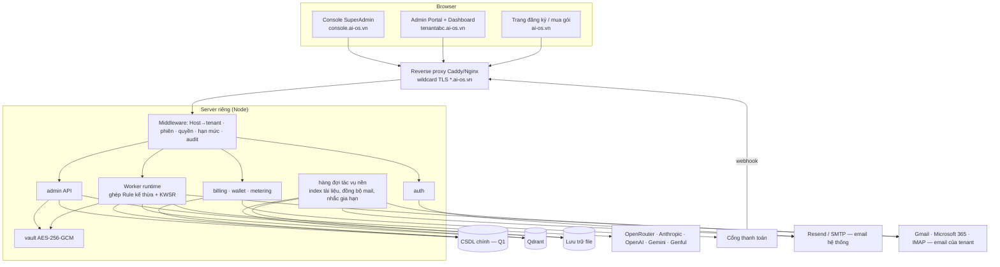
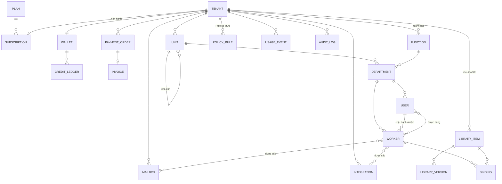

# AI OS Admin Portal — Tài liệu mô tả & thiết kế (bản production)

> **Phiên bản:** v1.0 — đã chốt D1–D9 và 7 yêu cầu bổ sung (xem [§0.2](#02-quyết-định-đã-chốt)).
> **Phạm vi:** thiết kế, chưa viết code. Còn **7 câu hỏi nhỏ** ở [§20](#20-câu-hỏi-còn-mở) cần chốt trước Giai đoạn 0. Riêng Q1 (chọn cơ sở dữ liệu) ảnh hưởng toàn bộ phần lưu trữ.
> **Lịch sử:** v0.1 là bản khảo sát và đề xuất. v1.0 bỏ Hermes và Mem0, thêm subdomain theo tenant, cơ cấu tổ chức phức hợp theo ngành dọc, Kho KWSR, thanh toán và ví token, email của tenant, và đưa 11 hạng mục bổ sung vào phạm vi.

---

## 0. Tóm tắt

### 0.1 Bức tranh chung

- **Hiện trạng:** AI OS gồm một dashboard tĩnh (`website/`) và một proxy Node chạy trên máy người dùng (`server/`). Hệ thống chưa có đăng nhập, chưa có khái niệm khách hàng hay gói. Cấu hình Worker nằm cứng trong mã nguồn. Worker chạy qua Hermes, OpenRouter hoặc Genful. Đây vẫn là bản demo cho một công ty.
- **Mục tiêu:** một nền tảng nhiều khách hàng (tenant), chạy trên server riêng. Mỗi khách có subdomain riêng (`tenantabc.ai-os.vn`). Có một **Console SuperAdmin** cho nhà cung cấp và một **Admin Portal** cho từng khách.
- **Bước chuyển cốt lõi:** mọi cấu hình chuyển từ mã nguồn vào cơ sở dữ liệu và gắn với `tenantId`. Mọi tính năng trong tài liệu này đều xây trên bước chuyển đó.

### 0.2 Quyết định đã chốt

| # | Chủ đề | Quyết định |
|---|---|---|
| — | Hermes Agent | **Không dùng.** Gỡ khỏi thiết kế và mã nguồn ([§2.3](#23-danh-mục-gỡ-hermes--mem0)). Worker gọi thẳng API mô hình |
| D1 | Cấp quản trị | **SuperAdmin** thuộc hệ thống. Mỗi tenant có **Admin** toàn quyền cấu hình trong tenant đó |
| D2 | Xác thực | **Tự xây**: scrypt, phiên cookie, email |
| D3 | Tạo Worker | **Chỉ tạo qua giao diện** (trình hướng dẫn). Không có API công khai hay API token để tạo Worker |
| D4 | Hạ tầng | **Server riêng**, không chạy trên Cloudflare |
| D5 | Gói & hạn mức | Dùng bảng đề xuất ([§10](#10-gói--hạn-mức)) |
| D6 | Orchestrator | **Không tính** vào `maxWorkers`. Mỗi tenant có sẵn một Orchestrator, không xoá được |
| D7 | Email hệ thống | Resend, hoặc nhà cung cấp phù hợp qua lớp `mailer` thay thế được |
| D8 | Kho vector | **Qdrant** tự vận hành (thay Mem0) |
| D9 | Danh tính người dùng | Đăng ký và xác thực bằng email. v1: email là duy nhất toàn hệ thống, mỗi người thuộc một tenant |
| — | Dữ liệu cá nhân | **Tạm chưa đề cập.** Thiết kế chừa sẵn chỗ để bổ sung khi cần |

### 0.3 Yêu cầu bổ sung đã đưa vào

| # | Yêu cầu | Mục |
|---|---|---|
| 1 | Thanh toán mua và gia hạn gói, thanh toán cho bộ đếm token | [§11](#11-thanh-toán-mua-gói-gia-hạn-nạp-token) |
| 2 | Cơ cấu Tổng công ty, Chi nhánh, Cửa hàng; sơ đồ theo **ngành dọc**; Rule kế thừa theo ngành | [§8](#8-cơ-cấu-tổ-chức-phức-hợp--ngành-dọc) |
| 3 | **Kho KWSR** dùng chung: chọn khi cấu hình và tinh chỉnh được khi tạo Worker | [§9](#9-kho-kwsr-thư-viện-dùng-chung) |
| 4 | Tích hợp **email của tenant** cho công việc (tuỳ chọn của người dùng) | [§14](#14-tích-hợp-email-của-tenant) |
| 5 | Tạo tenant (tên, email, username, mật khẩu) và đăng nhập theo **subdomain** | [§4](#4-tenant-subdomain--khởi-tạo) |
| 6 | Màn "Mức sử dụng" hiện **số dư token** của các kết nối cần nạp tiền | [§12](#12-màn-mức-sử-dụng) |
| 7 | Đồng ý cả 11 hạng mục bổ sung (B1–B11) | [§16](#16-hạng-mục-bổ-sung-b1b11) |

---

## 1. Thuật ngữ

| Thuật ngữ | Nghĩa | Tên trong code hiện tại |
|---|---|---|
| **Platform** | Hệ thống AI OS do bạn vận hành | — |
| **SuperAdmin** | Quản trị viên của Platform, làm việc trên Console | — |
| **Tenant** | Một doanh nghiệp mua AI OS, có subdomain riêng | *(chưa có; đang gắn cứng "Giải Pháp An Khang")* |
| **Plan** (Gói) | Gói tài khoản, quyết định hạn mức | *(chỉ có dòng chữ "Gói AI OS Standard")* |
| **Subscription** | Thuê bao gói của một tenant theo chu kỳ | — |
| **Wallet** (Ví credit) | Số dư credit để trả cho token và ảnh khi dùng khoá của Platform | — |
| **Unit** (Đơn vị) | Tổng công ty, Chi nhánh, Cửa hàng… (cây pháp nhân hoặc địa điểm) | — |
| **Function** (Ngành dọc) | Chức năng xuyên suốt các đơn vị: Kế toán, Kinh doanh, Nhân sự… | gần với `DEPARTMENTS` |
| **Department** (Bộ phận) | Giao của **Unit × Function**, ví dụ "Kế toán – Chi nhánh Hà Nội" | `DEPARTMENTS` trong `app.js` |
| **Worker** | Một AI Agent chuyên môn | `Agent` (`AGENTS`, `agents.config.json`) |
| **Orchestrator** | Worker điều phối, nhận lệnh rồi giao việc | `Orches Agent` |
| **KWSR** | Knowledge · Workflow · Skill · Rule | `a.knowledge / workflows / skills / rules` |
| **Kho KWSR** (Library) | Thư viện mục KWSR dùng chung cho nhiều Worker | — |
| **Binding** | Liên kết một Worker với một mục trong Kho (theo kho, hoặc đã tinh chỉnh) | — |
| **Member** | Người dùng của tenant | `staff` trong `work.js` |
| **Integration** | Kết nối tới nền tảng ngoài | `.env`, `genful.config.json`, `tripx-webpost/config.json` |
| **Mailbox** | Hộp thư của tenant hoặc của người dùng được kết nối cho Worker | — |

---

## 2. Đánh giá code hiện tại

### 2.1 Phần nên tái sử dụng

| Thành phần | Vị trí | Dùng lại thế nào |
|---|---|---|
| Mô hình KWSR và giao diện sửa 4 tầng | `website/js/app.js` (`SECTION_META`, `renderAgentInfo`) | Thành trình soạn mục Kho KWSR và tab KWSR của Worker |
| Sơ đồ tổ chức | `app.js` (`orgChartHTML`) | Nền cho 3 chế độ xem sơ đồ ở §8.5 |
| Quy tắc "1 Agent = 1 nhân sự chịu trách nhiệm" | `work.js` (`agentOwners`) | Thành `worker.ownerUserId` |
| Ghi bản sao đĩa, chỉ ghi bản ghi đổi, hoãn nhịp | `server/db.js` | Giữ nguyên tinh thần; lớp lưu trữ đổi theo Q1 |
| Gọi OpenRouter | `server/openrouter.js` (`callChatModel`) | Thành runtime chuẩn của Worker |
| Sinh ảnh Genful và đọc số dư credit | `server/genful.js` (`sinhAnh`, `soDuCredit`) | Provider ảnh; `soDuCredit` dùng cho màn số dư kết nối (§12) |
| Bộ SKILL.md có sẵn | `marketing/skills/*`, `hr/skills/*`, `sales/skills/*` | Nạp vào **Kho hệ thống** làm mẫu ngành |

### 2.2 Khoảng cách phải lấp

| # | Vấn đề hiện tại | Hệ quả khi lên production | Hướng xử lý |
|---|---|---|---|
| G1 | **Không có xác thực.** Mọi route `/api/*` trong `server.js` đều mở; chỉ có CORS. | Ai biết địa chỉ đều đọc được CV và kho lead, ghi đè được cấu hình. | §6 + middleware bắt buộc |
| G2 | **Proxy chạy trên máy người xem** (header Private Network Access trong `server.js`). | Không có dữ liệu chung, không quản lý tập trung được. | Server riêng, cùng origin theo subdomain |
| G3 | **Một công ty duy nhất**: badge cứng ở `dashboard.html`, `mem0UserId: "aios-company"`, dữ liệu không có tiền tố tenant. | Hai khách sẽ thấy và ghi đè dữ liệu của nhau. | Mọi bản ghi mang `tenantId`; tenant xác định theo subdomain |
| G4 | **Cấu hình Worker nằm trong code**: `AGENTS` (`app.js:25`), `agents.config.json`, `HERMES_KEY_*`. | Thêm Worker phải sửa code. | Worker là bản ghi, tạo qua giao diện (D3) |
| G5 | **KWSR lưu dạng `string[]`**, không có id, phiên bản, nguồn gốc. | Không dùng chung, không kế thừa, không audit được. | Kho KWSR + Binding (§9) |
| G6 | **Upload file và MCP chỉ là giao diện mô phỏng** (`app.js:1284`, `app.js:1670`). | Khách tưởng đã nạp tài liệu nhưng Worker không biết gì. | Pipeline Qdrant thật (§15) |
| G7 | **Bí mật rải rác**: `.env`, `~/.claude/skills/tripx-webpost/config.json`, `genful.config.json`. | Không có kết nối riêng theo khách; mất máy là mất khoá. | Két bí mật mã hoá (§13.3) |
| G8 | **Không đo sử dụng, không thu tiền.** | Không bán được theo gói; vòng lặp lỗi có thể đốt hết tiền. | Đo, Ví, thanh toán, ngân sách (§11–12) |
| G9 | **Dữ liệu nghiệp vụ nằm đĩa local** (`hr/data/`, `marketing/data/`, `data/*.json`). | Không tách được theo tenant. | Lưu theo tenant; đĩa chỉ là cache |
| G10 | **Phụ thuộc Hermes và Mem0** (mỗi Agent một Profile, một cổng, một key). | Trái quyết định mới; không tạo Worker động được. | Gỡ bỏ (§2.3) |
| G11 | `server.js` định tuyến bằng chuỗi `if` dài, không middleware. | Thêm khoảng 60 endpoint sẽ dễ sót kiểm quyền. | `router.js` mỏng có middleware |
| G12 | Dữ liệu mẫu hư cấu trong `work.js` (`seed()`). | Không được lẫn vào production. | Thành script seed cho tenant demo |
| G13 | **Không có cấu trúc tổ chức nhiều cấp**: `DEPARTMENTS` là danh sách phẳng 6 phòng. | Không biểu diễn được Tổng công ty, Chi nhánh, Cửa hàng. | Unit × Function (§8) |

### 2.3 Danh mục gỡ Hermes / Mem0

Gỡ ở **đầu Giai đoạn 0**, trong một commit riêng để dễ đối chiếu. Một lưu ý về hành vi: hiện 9 Agent không có `backend` (sales-1, mkt-2, hr-1, fin-1, fin-2, legal-1, cskh-1, cskh-2, mkt-6) trả lời **giả lập (MOCK)** miễn phí. Sau khi gỡ Hermes, các Agent này sẽ gọi **mô hình thật qua OpenRouter và phát sinh chi phí**. Vì vậy cần có ngân sách ngày (§12.4) đi kèm, hoặc tạm để `status: paused` cho tới khi được cấu hình.

| File | Việc cần làm |
|---|---|
| `server/server.js` | Bỏ nhánh Hermes trong `handleChat`, bỏ `MOCK_MODE`, `hermesKeyEnvName`, `CONFIG.hermesHost`. Bỏ `handleKnowledge` (Mem0), thay bằng pipeline Qdrant. Mọi Worker đi qua runtime API |
| `server/agents.config.json` | Bỏ `hermesHost`, `mem0UserId`, `port`. File chỉ còn dùng làm dữ liệu di trú, sau đó xoá |
| `server/.env.example` | Bỏ `MOCK_MODE`, `HERMES_KEY_*`, `MEM0_API_KEY`. Thêm `QDRANT_URL`, `QDRANT_API_KEY`, `BASE_DOMAIN`, `VAULT_MASTER_KEY`… |
| `server/package.json` | Đổi `name`/`description` (`aios-hermes-proxy` → `aios-server`) |
| `server/README.md`, `server/hr.js`, `server/openrouter.js` | Cập nhật chú thích có nhắc Hermes |
| `website/js/app.js` | Bỏ `USE_REAL_HERMES`, `fetchHermesReply`, `syncKnowledgeToHermes`. Đổi `HERMES_PROXY_BASE` thành `API_BASE` (cùng origin, mặc định `""`) |
| `website/js/work.js` | Bỏ thông báo `MOCK_MODE`, `HERMES_KEY_*`, badge "Hermes thật" |
| `HERMES_INTEGRATION.md` | Xoá (lịch sử vẫn còn trong git) |
| `hr/README.md`, `marketing/README.md`, `sales/README.md` | Bỏ mục "Cách C (Hermes)" |
| `TaiLieu_ThietKe_AI_OS.md` | Giữ nguyên (tài liệu phân tích ý tưởng gốc), thêm ghi chú trỏ sang tài liệu này |

Kênh Discord trước đây đi qua Hermes Gateway. Nếu vẫn cần, Discord sẽ là một **Integration kênh nhắn tin** gốc ở Giai đoạn 4.

---

## 3. Kiến trúc mục tiêu



**Nguyên tắc**

1. **Tenant xác định theo `Host`.** `tenantabc.ai-os.vn` thì tenant là `tenantabc`. Không route nào nhận `tenantId` từ body hay query do client gửi.
2. **Cookie theo từng host** (`__Host-sid`, không đặt `Domain`). Phiên của tenant A không bao giờ gửi sang subdomain tenant B. Console dùng host và cookie riêng.
3. **Mọi truy cập dữ liệu đi qua `Repository(tenantId)`**, lớp duy nhất được chạm vào CSDL. Đây là chốt chặn chống rò dữ liệu chéo khách.
4. **Hạn mức, số dư và quyền kiểm ở server.** Giao diện chỉ làm mờ nút.
5. **Bí mật không rời server.** Khi trả về luôn che dạng `sk-…a1b2`.
6. **Frontend giữ phong cách hiện tại:** HTML + JS thuần, không bước build.
7. **Đóng gói chạy bằng Docker Compose** trên server riêng: `caddy`, `aios-server`, `qdrant`, CSDL (nếu chọn Postgres ở Q1), và hàng đợi tác vụ trong tiến trình (v1).

---

## 4. Tenant, subdomain & khởi tạo

### 4.1 Tên miền (cấu hình được lúc go-live)

| Biến môi trường | Mặc định | Ý nghĩa |
|---|---|---|
| `BASE_DOMAIN` | `ai-os.vn` | Tên miền gốc. Đổi tên miền chỉ cần sửa biến này và DNS |
| `CONSOLE_HOST` | `console.ai-os.vn` | Nơi SuperAdmin đăng nhập |
| `PUBLIC_HOST` | `ai-os.vn` | Trang giới thiệu, đăng ký, mua gói |
| `TENANT_HOST_PATTERN` | `{slug}.{BASE_DOMAIN}` | Mẫu subdomain của tenant |

Hạ tầng cần có:
- DNS wildcard `*.ai-os.vn` trỏ về server.
- Chứng chỉ TLS wildcard qua Let's Encrypt, xác minh DNS-01. Caddy tự gia hạn được.
- Host lạ hoặc slug không tồn tại trả về trang 404 chung.
- **Tên miền riêng của khách** (ví dụ `ai.congtyabc.vn` qua CNAME, TLS cấp theo yêu cầu) để ở Giai đoạn 4.

### 4.2 Quy tắc slug (tên tenant trên URL)

- Gồm `a-z`, `0-9` và `-`, dài 3–30 ký tự, không bắt đầu hay kết thúc bằng `-`. Lưu chữ thường, duy nhất toàn hệ thống.
- **Danh sách cấm:** `www, api, app, admin, console, mail, smtp, imap, static, cdn, assets, auth, login, billing, pay, status, docs, help, support, dev, staging, test, demo, root, superadmin, system, ai-os`. SuperAdmin bổ sung được.
- Đổi slug được (chỉ SuperAdmin làm). Slug cũ tự chuyển hướng 301 trong 30 ngày và bị giữ chỗ 180 ngày để tránh người khác chiếm.

### 4.3 Hai cách tạo tenant

Cả hai cách đều nhập cùng 4 thông tin: **Tên tenant (slug)**, **Email**, **Username**, **Mật khẩu khởi tạo**. Thêm tên hiển thị của công ty và gói.

**(a) SuperAdmin tạo trên Console**

```
Console › Khách hàng › ＋ Tạo tenant
  Tên công ty (hiển thị)  [Công ty TNHH ABC              ]
  Tên tenant (slug)       [tenantabc ] .ai-os.vn   ✔ còn trống
  Gói                     [Standard ▾]   Chu kỳ [Tháng ▾]   ☐ Dùng thử 14 ngày
  ── Tài khoản Admin đầu tiên ──
  Email                   [admin@abc.vn                  ]
  Username                [admin                         ]
  Mật khẩu khởi tạo       [••••••••••••] [🎲 Tạo ngẫu nhiên] 👁
                          ☑ Bắt đổi mật khẩu ở lần đăng nhập đầu
  [ Tạo tenant ]
```

Khi bấm Tạo, hệ thống **làm trong một giao dịch**:
1. Tạo tenant.
2. Tạo đơn vị gốc (Tổng công ty).
3. Tạo bộ Ngành dọc mặc định.
4. Tạo Orchestrator.
5. Tạo Subscription (trial hoặc chờ thanh toán).
6. Tạo Ví.
7. Tạo user Admin (`mustChangePassword = true`).
8. Ghi audit.

Sau đó gửi email tới Admin **chỉ kèm link** `https://tenantabc.ai-os.vn/login`. Email **không bao giờ chứa mật khẩu**; SuperAdmin tự chuyển mật khẩu qua kênh khác. Mật khẩu chỉ hiện một lần sau khi tạo.

**(b) Khách tự đăng ký và mua gói trên `ai-os.vn`** (D9: xác thực bằng email)

```
Chọn gói → Nhập: Tên công ty · slug · Email · Username · Mật khẩu
        → Mã xác thực 6 số gửi email (hạn 10 phút, tối đa 5 lần thử)
        → Thanh toán (§11), hoặc bắt đầu dùng thử nếu gói cho phép
        → Khởi tạo tenant (như (a)) → chuyển tới https://{slug}.ai-os.vn/login
```

Trong luồng này người dùng tự chọn mật khẩu nên không bắt đổi. Slug được **giữ chỗ 30 phút** trong lúc chờ thanh toán. Có CAPTCHA và giới hạn tốc độ theo IP để chống tạo tenant rác.

### 4.4 Đăng nhập theo subdomain

- `https://tenantabc.ai-os.vn/login` hiện tên và logo của tenant (B-branding). Ô đăng nhập nhận **username hoặc email**, cộng mật khẩu.
- Tenant lấy từ Host. Username **duy nhất trong tenant**; email duy nhất toàn hệ thống (D9).
- Người dùng tenant A đăng nhập ở subdomain tenant B sẽ thất bại với thông báo lỗi chung.
- SuperAdmin chỉ đăng nhập được ở `CONSOLE_HOST`. Muốn vào một tenant để hỗ trợ thì dùng "Vào xem" (B9).

---

## 5. Vai trò & phân quyền

| Vai trò | Thuộc | Phạm vi | Mô tả |
|---|---|---|---|
| `superadmin` | Platform | Mọi tenant | Gói, tenant, giá model, thanh toán, Kho hệ thống, vào xem tenant |
| `tenant_admin` | Tenant | Toàn tenant | **Toàn quyền cấu hình** (D1): Worker, Kho KWSR, người dùng, cơ cấu tổ chức, kết nối, email, thanh toán, nạp token. Mỗi tenant luôn có ít nhất 1 Admin |
| `unit_manager` | Tenant | Một đơn vị và các đơn vị con | Quản lý Worker và người dùng trong nhánh đơn vị của mình (ví dụ Giám đốc chi nhánh) |
| `function_head` | Tenant | Một ngành dọc, từ đơn vị được gán trở xuống | Ví dụ Kế toán trưởng Tổng công ty: đặt Rule và phát hành mục Kho cho ngành Kế toán của mọi chi nhánh và cửa hàng |
| `member` | Tenant | Worker được cấp | Dùng Worker; kết nối hộp thư cá nhân của mình (§14) |
| `viewer` | Tenant | Chỉ xem | Xem báo cáo và sơ đồ |

**Ma trận quyền** (✔ có · ◐ trong phạm vi được gán · ✖ không)

| Chức năng | superadmin | tenant_admin | unit_manager | function_head | member |
|---|:-:|:-:|:-:|:-:|:-:|
| Gói, tenant, giá model, Kho hệ thống | ✔ | ✖ | ✖ | ✖ | ✖ |
| Mua, gia hạn gói, nạp token, xem hoá đơn | ✔ | ✔ | ✖ | ✖ | ✖ |
| Cơ cấu đơn vị và ngành dọc | ✔ | ✔ | ◐ thêm đơn vị con | ✖ | xem |
| Tạo, xoá Worker (qua giao diện) | ✔ | ✔ | ◐ | ✖ | ✖ |
| Sửa Worker và Binding KWSR | ✔ | ✔ | ◐ | ◐ Worker thuộc ngành mình | ✖ |
| Soạn và phát hành mục Kho KWSR | ✔ | ✔ | ◐ phát hành trong nhánh | ◐ phát hành theo ngành | ✖ |
| Rule kế thừa (đơn vị hoặc ngành) | ✔ | ✔ | ◐ cấp đơn vị | ◐ cấp ngành | ✖ |
| Kết nối API | ✔ | ✔ | ✖ | ✖ | ✖ |
| Hộp thư dùng chung của tenant | ✔ | ✔ | ✖ | ✖ | ✖ |
| Hộp thư cá nhân của mình | — | ✔ | ✔ | ✔ | ✔ |
| Người dùng | ✔ | ✔ | ◐ trong nhánh | ✖ | ✖ |
| Nhật ký kiểm toán | ✔ | ✔ | ◐ | ◐ | ✖ |
| Mức sử dụng | ✔ | ✔ | ◐ | ◐ | ✖ |

**Quy tắc an toàn:**
- Không ai tự nâng quyền của mình.
- Không xoá hay hạ quyền được Admin cuối cùng của tenant.
- `unit_manager` và `function_head` không bao giờ được gỡ Rule do cấp trên đặt (§8.3).

---

## 6. Xác thực

### 6.1 Luồng

```
Đăng nhập (username|email + mật khẩu) trên {slug}.ai-os.vn
 ├─ sai / không tồn tại → "Tên đăng nhập hoặc mật khẩu không đúng" (một thông báo chung cho mọi trường hợp)
 ├─ tenant suspended    → cho đăng nhập, chỉ đọc, hiện banner "Gói đã hết hạn — gia hạn để tiếp tục"
 ├─ user locked         → thông báo chung + gợi ý liên hệ Admin
 └─ đúng → tạo phiên → mustChangePassword ? /doi-mat-khau : (admin/manager → /admin, còn lại → /dashboard)
```

| Luồng | Chi tiết |
|---|---|
| **Admin thêm user** | Nhập email, username, tên, vai trò, bộ phận, rồi chọn một trong hai: **gửi lời mời** (link đặt mật khẩu, hạn 72 giờ, dùng một lần) hoặc **đặt mật khẩu khởi tạo** (bắt đổi ở lần đầu, giống tạo tenant) |
| **Quên mật khẩu** | Luôn trả lời "Nếu tài khoản tồn tại, chúng tôi đã gửi hướng dẫn". Link hạn 30 phút, dùng một lần. Mọi phiên cũ bị huỷ |
| **Xác thực email** | Tenant tự đăng ký thì bắt buộc OTP. User được Admin thêm thì xác thực khi bấm link mời. Đổi email phải xác nhận ở **địa chỉ mới**, và có thông báo gửi tới địa chỉ cũ |

### 6.2 Quy tắc bảo mật

| Hạng mục | Quy định |
|---|---|
| Băm mật khẩu | `crypto.scrypt` (N ≥ 2¹⁵, r=8, p=1), salt 16 byte; so sánh bằng `timingSafeEqual` |
| Mật khẩu | Tối thiểu 10 ký tự; chặn danh sách mật khẩu phổ biến; không trùng username hoặc email; không ép đổi định kỳ |
| Phiên | Cookie `__Host-sid` (`HttpOnly; Secure; SameSite=Lax; Path=/`), giá trị 32 byte ngẫu nhiên; CSDL chỉ lưu băm SHA-256. Hạn tuyệt đối 12 giờ, hết hạn sau 2 giờ không hoạt động (Console: 4 giờ và 30 phút) |
| Chống dò mật khẩu | Sai 5 lần trong 15 phút (tính theo user + IP) thì khoá tạm, thời gian khoá tăng dần; giới hạn tốc độ theo IP; thời gian phản hồi gần như nhau giữa các trường hợp |
| CSRF | `SameSite=Lax` + kiểm `Origin` và `Sec-Fetch-Site` với mọi request ghi |
| Header | HSTS, CSP chặt, `X-Frame-Options: DENY`, `Referrer-Policy: same-origin` |
| MFA (TOTP) | **Bắt buộc với SuperAdmin** từ Giai đoạn 0. Tenant Admin bật tuỳ chọn ở Giai đoạn 4 |
| SuperAdmin đầu tiên | Tạo bằng CLI `node scripts/create-superadmin.js`. Không có đường đăng ký SuperAdmin công khai |
| Audit | Đăng nhập thành công hoặc thất bại, đổi mật khẩu, khoá, đổi vai trò, vào xem tenant |

---

## 7. Mô hình dữ liệu (mức logic)

Mô hình viết dạng **bảng / thực thể**, không phụ thuộc CSDL cụ thể (xem Q1). Mọi bảng thuộc tenant đều có `tenantId` (nằm trong khoá hoặc index) và các trường `createdAt/By`, `updatedAt/By`.

### 7.1 Sơ đồ quan hệ



### 7.2 Nền tảng & thương mại

```jsonc
// plans
{ "id": "standard", "name": "AI OS Standard", "active": true, "sortOrder": 2,
  "prices": { "month": 0, "year": 0 },                   // VNĐ — SuperAdmin nhập
  "trialDays": 14,
  "includedCreditsPerCycle": 0,                          // credit tặng mỗi chu kỳ (không cộng dồn)
  "limits": { "maxWorkers": 10, "maxMembers": 25, "maxUnits": 3, "maxKnowledgeMB": 2048,
              "maxDocsPerWorker": 200, "maxIntegrations": 10, "maxMailboxes": 5,
              "allowedModels": ["deepseek/deepseek-v4-flash", "…"],
              "features": { "mcpSources": false, "functionLines": true, "byok": true,
                            "auditRetentionDays": 90, "customDomain": false } } }

// tenants
{ "id": "t_…", "slug": "tenantabc", "displayName": "Công ty TNHH ABC", "status": "active",
  // trialing | active | past_due | suspended | cancelled
  "limitOverrides": {}, "branding": { "logoPath": null, "primaryColor": null },
  "settings": { "locale": "vi", "timezone": "Asia/Ho_Chi_Minh", "sessionHours": 12,
                "creditBillingMode": "platform" } }       // platform | byok | mixed (§11.4)

// subscriptions
{ "tenantId": "t_…", "planId": "standard", "cycle": "month",
  "status": "active", "currentPeriodStart": "…", "currentPeriodEnd": "…",
  "graceEndsAt": null, "pendingChange": { "planId": "starter", "effectiveAt": "…" } }

// wallets       — 1 ví / tenant; balance là số đệm, nguồn sự thật là ledger
{ "tenantId": "t_…", "balance": 1250000, "lowBalanceThreshold": 100000, "autoPauseAtZero": true }

// credit_ledger — CHỈ THÊM, không sửa, không xoá
{ "tenantId": "t_…", "type": "consume",                  // grant_plan | purchase | consume | refund | adjust | expire
  "amount": -3120, "balanceAfter": 1246880, "bucket": "purchased", "expiresAt": "…",
  "ref": { "kind": "usage_batch", "id": "ub_…" }, "note": null, "at": "…", "by": "system" }

// model_pricing — SuperAdmin quản lý
{ "model": "deepseek/deepseek-v4-flash", "creditPer1MIn": 0, "creditPer1MOut": 0,
  "creditPerImage": null, "active": true }

// payment_orders, invoices — xem §11
```

### 7.3 Tổ chức & người dùng

```jsonc
// units
{ "id": "u_hq", "tenantId": "t_…", "name": "Tổng công ty ABC", "type": "hq",   // hq | branch | store | other
  "parentId": null, "code": "HQ", "address": "…", "headUserId": "usr_…", "order": 0 }
// functions (ngành dọc)
{ "id": "f_ketoan", "tenantId": "t_…", "name": "Kế toán", "icon": "📊", "order": 3 }
// departments = unit × function
{ "id": "d_…", "tenantId": "t_…", "unitId": "u_hn", "functionId": "f_ketoan",
  "name": null,                // null → tự hiển thị "Kế toán – Chi nhánh Hà Nội"
  "headUserId": "usr_…" }
// users
{ "id": "usr_…", "tenantId": "t_…", "email": "a@abc.vn", "username": "an.nguyen",
  "name": "…", "title": "…", "role": "member", "deptId": "d_…",
  "scope": { "unitId": null, "functionId": null },   // cho unit_manager / function_head
  "status": "active",          // invited | active | locked | disabled
  "passwordHash": "scrypt$…", "mustChangePassword": false, "emailVerifiedAt": "…",
  "mfa": { "enabled": false, "secretRef": null },
  "failedLogins": 0, "lockedUntil": null, "lastLoginAt": "…" }
// sessions, invites, email_otps — chỉ lưu băm của token
```

Ràng buộc duy nhất: `tenants.slug`; `users.email` (toàn hệ thống, chữ thường); `(users.tenantId, users.username)`; `(departments.unitId, departments.functionId)`.

### 7.4 Worker, Kho KWSR, Rule

```jsonc
// workers
{ "id": "w_…", "tenantId": "t_…", "name": "Kế toán công nợ HN", "icon": "📊",
  "role": "…", "kind": "worker",               // worker | orchestrator
  "deptId": "d_…", "ownerUserId": "usr_…", "accessUserIds": [],
  "runtime": { "integrationId": "i_…", "model": "deepseek/deepseek-v4-flash",
               "mode": "Planning", "maxTokens": 16000, "temperature": 0.4 },
  "systemPrompt": "…", "status": "draft",     // draft | active | paused | archived
  "budget": { "dailyCredit": 50000, "onExceed": "pause" },
  "integrationIds": [], "mailboxGrants": [], "maturity": 0, "stage": "Học việc" }

// library_items — Kho KWSR
{ "id": "lib_…", "tenantId": "t_…",           // tenantId = null → Kho HỆ THỐNG
  "type": "rule",                              // knowledge | workflow | skill | rule
  "title": "…", "tags": ["công nợ"], "functionIds": ["f_ketoan"],
  "ownerUnitId": "u_hq", "visibility": "function_line",   // tenant | unit_subtree | function_line
  "distribution": "suggested",                 // suggested | mandatory  (§8.3, §9.3)
  "currentVersion": 3, "status": "published",  // draft | published | deprecated
  "sourceSystemItemId": null }                 // nếu nhập từ Kho hệ thống
// library_versions — nội dung theo phiên bản
{ "itemId": "lib_…", "version": 3, "content": { … }, "changeNote": "…", "at": "…", "by": "…" }
//   knowledge: { tier: 1-4, kind, source: file|text|mcp, mime, sizeBytes, storagePath, indexStatus, chunks }
//   workflow:  { command: "/bao-cao-thang", description, steps[], markdown }
//   skill:     { slug, description, markdown }   // SKILL.md
//   rule:      { text, severity: block|warn, enforcement: prompt|hard, allowLocalOverride: false }

// bindings — Worker dùng mục nào trong Kho
{ "workerId": "w_…", "itemId": "lib_…",
  "mode": "linked",            // linked (theo kho) | customized (đã tinh chỉnh)
  "followLatest": true, "pinnedVersion": null,   // linked: tự lên bản mới hay ghim
  "baseVersion": 2, "localContent": null,        // customized: nội dung đã chỉnh + bản kho làm gốc
  "origin": "manual",          // manual | inherited (do phân phối mandatory) | wizard
  "enabled": true }

// policy_rules — Rule gắn vào CẤU TRÚC (không phải vào từng Worker), §8.3
{ "id": "pr_…", "tenantId": "t_…", "itemId": "lib_…",        // nội dung Rule nằm trong Kho
  "scope": "function_at_unit",  // tenant | unit | function_at_unit | function_everywhere
  "unitId": "u_hq", "functionId": "f_ketoan", "inheritDown": true }
```

Mục chỉ dùng cho riêng một Worker vẫn nằm trong Kho, với `visibility: "worker_private"`, nên lúc nào cũng có nút "Đưa vào Kho chung". Nhờ vậy chỉ có **một** cấu trúc lưu trữ KWSR.

### 7.5 Kết nối, email, đo đếm, audit

```jsonc
// integrations
{ "id": "i_…", "tenantId": "t_…",              // tenantId = null → kết nối CỦA PLATFORM
  "provider": "openrouter", "category": "llm", "name": "OpenRouter công ty",
  "billingMode": "byok",                         // platform | byok — §11.4
  "secret": { "ciphertext": "…", "nonce": "…", "keyVersion": 1 }, "masked": "sk-…a1b2",
  "config": { … }, "status": "ok", "lastTestedAt": "…",
  "balance": { "source": "api", "amount": 18.42, "currency": "USD", "checkedAt": "…" } }
// mailboxes — §14
// usage_events — gộp theo lô; usage_daily — tổng theo ngày × worker × model
// audit_logs
{ "at": "…", "tenantId": "t_…", "actorId": "…", "actorRole": "…", "ip": "…",
  "action": "worker.update", "target": { "type": "worker", "id": "w_…" },
  "diff": { "before": { … }, "after": { … } }, "viaImpersonation": false }
```

### 7.6 Di trú từ dữ liệu hiện có

| Hiện tại | → | Mới |
|---|---|---|
| `DEPARTMENTS` (6 phòng phẳng) | → | 1 Unit `hq` + 6 Function + 6 Department |
| `AGENTS[]` + `agents.config.json` (model, maxTokens) | → | `workers` (bỏ `port`, `hermes*`) |
| `a.knowledge/workflows/skills/rules` (`string[]`) | → | `library_items` riêng của Worker + `bindings` |
| `SKILLS` / `WFLOWS` trong `app.js` | → | `library_items` loại skill / workflow của tenant |
| `GLOBAL_RULES` | → | `library_items` loại rule + `policy_rules` có scope `tenant`, `mandatory` |
| `marketing/hr/sales/skills/*/SKILL.md` | → | Kho **hệ thống** (mẫu ngành) + nhập vào tenant mặc định |
| `staff` + `agentOwners` (`work.js`) | → | `users` + `worker.ownerUserId` (chỉ cho tenant demo) |
| `OPENROUTER_API_KEY`, Genful, TripX config | → | `integrations` (Platform hoặc tenant mặc định) |
| `HERMES_KEY_*`, `MEM0_API_KEY` | → | **bỏ** |

Script `scripts/migrate-default-tenant.js` tạo tenant `ankhang` (tenant demo) để Dashboard hiện có chạy tiếp.

---

## 8. Cơ cấu tổ chức phức hợp & ngành dọc

### 8.1 Hai trục tổ chức

Doanh nghiệp nhiều cấp luôn có **hai trục đan nhau**:

- **Trục đơn vị (ngang):** Tổng công ty → Chi nhánh → Cửa hàng. Trả lời câu hỏi "ở đâu, ai quản lý trực tiếp".
- **Trục ngành dọc (dọc):** Kế toán, Kinh doanh, Nhân sự… chạy xuyên mọi đơn vị. Trả lời câu hỏi "theo chuyên môn nào, chuẩn của ai".

**Bộ phận** là ô giao nhau. Ví dụ "Kế toán – Chi nhánh Hà Nội" vừa thuộc Chi nhánh Hà Nội, vừa thuộc ngành dọc Kế toán.

```
                    Kế toán      Kinh doanh     Nhân sự      Kho
Tổng công ty ABC      ■ 2🤖         ■ 3🤖          ■ 1🤖        ·
 ├─ CN Hà Nội         ■ 1🤖         ■ 2🤖          ·            ■ 1🤖
 │   ├─ CH Cầu Giấy   ·             ■ 1🤖          ·            ·
 │   └─ CH Đống Đa    ·             ■ 1🤖          ·            ·
 ├─ CN HCM            ■ 1🤖         ■ 2🤖          ■ 1🤖        ■ 1🤖
 └─ CH Online (Tổng cty quản trực tiếp)  ■ 1🤖     ·            ·
■ = có bộ phận    🤖 = số Worker
```

### 8.2 Quy tắc cấu trúc

| Quy tắc | Chi tiết |
|---|---|
| Loại đơn vị | `hq` (đúng 1, là gốc), `branch`, `store`, `other` |
| Quan hệ cha–con hợp lệ | `branch` → cha là `hq` hoặc `branch` (chi nhánh cấp vùng). `store` → cha là `hq` **hoặc** `branch` (đúng yêu cầu: cửa hàng do Tổng công ty hoặc chi nhánh quản) |
| Chống vòng lặp | Không chọn được chính mình hoặc hậu duệ của mình làm cha |
| Độ sâu | Tối đa 6 cấp |
| Ngành dọc | Danh mục của tenant: thêm, sửa tên, sắp xếp. Xoá được khi không còn bộ phận nào dùng |
| Tạo bộ phận | Chọn đơn vị và ngành; mỗi cặp chỉ có 1 bộ phận |
| Chuyển đơn vị (ví dụ Cửa hàng từ Tổng công ty sang Chi nhánh) | Bắt buộc màn **xem trước khác biệt**: Rule được thêm hoặc mất, mục Kho phân phối thay đổi, người quản lý thay đổi. Xác nhận xong mới chuyển; có ghi audit |
| Tenant đơn giản (chỉ 1 đơn vị) | Giao diện **ẩn trục đơn vị**, chỉ hiện phòng ban như hiện nay. Mô hình dữ liệu không đổi, nên lớn lên lúc nào cũng được |
| Hạn mức | `maxUnits` theo gói (§10) |

### 8.3 Rule kế thừa theo ngành dọc

Yêu cầu: *"Tổng công ty có Rule cho Kế toán thì Rule đó áp dụng cho Kế toán của Chi nhánh."*

**Phạm vi gắn một Rule** (`policy_rules.scope`):

| Scope | Áp dụng cho | Ví dụ |
|---|---|---|
| `tenant` | Mọi Worker của tenant (Global Rule hiện nay) | "Giao tiếp bằng tiếng Việt" |
| `unit` (+`inheritDown`) | Mọi Worker thuộc đơn vị U và các đơn vị con | "CN HCM: không hứa giao hàng trong ngày" |
| `function_at_unit` (+`inheritDown`) | Worker thuộc ngành F, tại U và các đơn vị con của U | **Tổng công ty × Kế toán**: "Mọi bút toán > 50 triệu phải chờ duyệt" → áp cho Kế toán ở mọi chi nhánh và cửa hàng |
| `function_everywhere` | Worker thuộc ngành F ở mọi đơn vị | Tương đương trường hợp trên đặt tại gốc |
| *(riêng Worker)* | Binding trực tiếp trên Worker | "Không gửi bảng công nợ cho khách ngoài danh sách" |

**Cách tính bộ Rule hiệu lực của một Worker** (worker W thuộc bộ phận (U, F)):

```
Rule(W) =  rule scope=tenant
        ∪  với mỗi đơn vị A trong chuỗi [U, cha(U), …, gốc]:
             rule scope=unit tại A                (A = U, hoặc inheritDown=true)
             rule scope=function_at_unit tại (A,F) (A = U, hoặc inheritDown=true)
        ∪  rule scope=function_everywhere của F
        ∪  rule binding riêng của W
```

**Nguyên tắc xung đột** (Rule là điều cấm, nên **cấm nhiều hơn thì thắng**):

1. **Hợp lại, không ghi đè.** Mọi Rule trong chuỗi đều áp dụng.
2. **Cấp dưới chỉ được siết, không được nới:** được thêm Rule, được nâng `warn` → `block`, **không** được tắt hay hạ Rule của cấp trên.
3. **Ngoại lệ có kiểm soát:** nếu cấp trên đặt `allowLocalOverride: true`, Admin hoặc người quản lý cấp dưới được *tắt cục bộ* kèm lý do bắt buộc. Việc này ghi audit và báo cho người đặt Rule.
4. **Rule `mandatory` từ Kho** không gỡ được khỏi Worker (binding `origin: inherited` bị khoá).
5. **Rule có `enforcement: hard`** được kiểm bằng mã trước khi hành động, không chỉ dựa vào prompt. Ví dụ: chặn gửi email ra ngoài các domain cho phép (§14.4), chặn vượt ngân sách.

**Hiển thị trong tab Rule của Worker** (người xem luôn biết Rule đến từ đâu):

```
🔴 Rule hiệu lực — Kế toán công nợ HN (Kế toán · CN Hà Nội)                    14 rule
 🌐 Toàn công ty (5)                                                    🔒 kế thừa
    · Giao tiếp tiếng Việt, chuyên nghiệp – thân thiện                         warn
    · Cấm gửi dữ liệu nội bộ ra ngoài domain công ty                    block · hard
 🏢 Tổng công ty › Kế toán — ngành dọc (4)                              🔒 kế thừa
    · Bút toán > 50 triệu phải chờ duyệt                                       block
 🏬 CN Hà Nội (2)                                                       🔒 kế thừa
 🤖 Riêng Worker này (3)                                        [＋ Thêm] [Chọn từ Kho]
```

### 8.4 Phân phối K/W/S theo ngành dọc

Cơ chế giống hệt Rule: một mục Kho (ví dụ SOP "Quy trình đối chiếu công nợ" của Kế toán Tổng công ty) được **phát hành** theo `visibility: function_line` từ một đơn vị:

- `distribution: mandatory`: tự động gắn (binding `inherited`, `linked`) vào mọi Worker thuộc ngành đó trong nhánh. Không gỡ được; cấp dưới vẫn có thể **tinh chỉnh** nếu mục cho phép.
- `distribution: suggested`: hiện sẵn và được tick sẵn trong trình tạo Worker của ngành đó. Bỏ được.

Worker tạo mới ở chi nhánh vì vậy **tự có ngay chuẩn ngành** của Tổng công ty.

### 8.5 Ba chế độ xem sơ đồ tổ chức

| Chế độ | Nội dung | Thao tác |
|---|---|---|
| **1. Theo đơn vị** | Cây Tổng công ty → Chi nhánh → Cửa hàng; mỗi nút có người đứng đầu, số người, số Worker, các bộ phận | Thêm hoặc đổi cha đơn vị (có xem trước khác biệt); kéo-thả người và Worker giữa các bộ phận |
| **2. Theo ngành dọc** | Chọn một ngành (ví dụ Kế toán) để thấy cây đơn vị chỉ gồm bộ phận Kế toán: Worker, người, **số Rule kế thừa và Rule riêng**, mục Kho được phân phối | Đặt Rule và phát hành mục Kho cho cả ngành ngay trên sơ đồ |
| **3. Ma trận Người ↔ Worker** | Hàng là người, cột là Worker; ô cho biết **Phụ trách** / **Được dùng** / — | Đổi người phụ trách, cấp quyền dùng hàng loạt |

Cả ba chế độ đều có khung **"Chưa phân công"** (Worker chưa có người phụ trách, người chưa có bộ phận). Orchestrator luôn nằm ở đỉnh, không kéo được.

```
Chế độ 2 — Ngành dọc: [Kế toán ▾]
  📊 Kế toán – Tổng công ty            👤 Kế toán trưởng: Trần Q.Bảo
     🤖 Kế toán tổng hợp   🤖 Kiểm soát nội bộ        🔴 4 rule ngành · 📚 6 mục phát hành
     ├─ 📊 Kế toán – CN Hà Nội          👤 2  🤖 1    🔴 4 kế thừa + 2 riêng
     │     └─ (CH Cầu Giấy, CH Đống Đa: chưa có bộ phận Kế toán)  [＋ Tạo bộ phận]
     ├─ 📊 Kế toán – CN HCM             👤 1  🤖 1    🔴 4 kế thừa + 0 riêng
     └─ 📊 Kế toán – CH Online           ·    ·       ⚠ chưa có Worker
```

---

## 9. Kho KWSR (thư viện dùng chung)

### 9.1 Hai tầng kho

| Kho | Ai quản lý | Nội dung | Tenant dùng thế nào |
|---|---|---|---|
| **Kho hệ thống** | SuperAdmin | Mẫu theo ngành (Sales, Content Cluster, Tuyển dụng, Kế toán, Pháp lý, CSKH…), lấy từ các `SKILL.md` có sẵn trong repo | **Nhập về** Kho tenant (sao chép, nhớ nguồn). Khi Kho hệ thống có bản mới thì báo "có cập nhật" |
| **Kho tenant** | Admin, người quản lý trong phạm vi được gán | Tài liệu, quy trình, kỹ năng, quy tắc của công ty | Gắn vào Worker: theo kho hoặc tinh chỉnh |

### 9.2 Màn Kho KWSR

```
Kho KWSR    [🟡 Knowledge 128] [🔵 Workflow 24] [🟢 Skill 31] [🔴 Rule 47]     [＋ Tạo mục] [⤓ Nhập từ Kho hệ thống]
Lọc: Ngành [Kế toán ▾]  Đơn vị [Tất cả ▾]  Phân phối [Tất cả ▾]  Trạng thái [Đã phát hành ▾]  🔎 ______
┌──────────────────────────────────────┬────────┬──────────────┬───────────┬────────┬────────────┐
│ Tiêu đề                              │ Loại   │ Phạm vi      │ Phân phối │ Bản    │ Dùng bởi   │
├──────────────────────────────────────┼────────┼──────────────┼───────────┼────────┼────────────┤
│ Quy trình đối chiếu công nợ          │ 🔵 W   │ Kế toán·TCT↓ │ bắt buộc  │ v4     │ 6 Worker   │
│ Bảng giá 2026 (PDF)                  │ 🟡 K·T2│ Toàn cty     │ gợi ý     │ v2     │ 9 Worker   │
│ Bút toán > 50tr phải chờ duyệt       │ 🔴 R   │ Kế toán·TCT↓ │ bắt buộc  │ v1     │ 6 Worker   │
└──────────────────────────────────────┴────────┴──────────────┴───────────┴────────┴────────────┘
```

Chi tiết một mục gồm: nội dung, lịch sử phiên bản (so sánh 2 bản), **"Dùng bởi"** (danh sách Worker kèm chế độ theo kho / tinh chỉnh / bản đang ghim), phạm vi phát hành.

### 9.3 Gắn mục Kho vào Worker: theo kho hay tinh chỉnh

| Chế độ | Hành vi | Khi Kho ra bản mới |
|---|---|---|
| **Theo kho** (`linked`, `followLatest`) | Dùng nguyên văn bản mới nhất | Tự cập nhật. Thông báo cho người phụ trách Worker |
| **Theo kho, ghim bản** (`linked`, `pinnedVersion`) | Dùng đúng một phiên bản | Badge "Kho có v5". Bấm để xem khác biệt và nâng cấp |
| **Tinh chỉnh** (`customized`) | Sao chép nội dung rồi sửa riêng cho Worker; nhớ `baseVersion` | Badge "Kho có v5 · bạn đang chỉnh từ v3". Xem khác biệt 3 chiều, chọn: giữ bản mình / lấy bản kho / gộp tay |

Giới hạn khi tinh chỉnh:
- **Rule mandatory:** chỉ được siết (thêm điều kiện, `warn` → `block`), không nới.
- **Knowledge:** tinh chỉnh = thêm ghi chú hoặc bản bổ sung riêng của Worker (một tài liệu mới được index riêng). File gốc trong Kho không bị sửa.
- Tinh chỉnh xong có thể bấm **"Đề xuất đưa vào Kho"**: tạo bản nháp phiên bản mới cho người quản lý mục đó duyệt.

**Xoá mục Kho:**
- Đang được dùng thì **không xoá được**, chỉ được chuyển `deprecated` (ẩn khỏi trình chọn, Worker đang dùng vẫn chạy và thấy cảnh báo).
- Hết người dùng thì mới xoá được.

**Hạn mức:** dung lượng Knowledge tính **một lần cho mỗi tài liệu trong Kho**, dù 10 Worker cùng dùng. Đây là lợi ích chi phí trực tiếp của mô hình Kho.

### 9.4 Worker: tạo, sửa, xoá (D3: chỉ qua giao diện)

- Worker **chỉ được tạo qua trình hướng dẫn** trong Admin Portal.
- Không có API token, không có endpoint công khai cho bên ngoài. Endpoint nội bộ `POST /workers` chỉ nhận phiên cookie + CSRF + quyền phù hợp + **trường `wizardToken`** do bước 1 cấp. Gọi trực tiếp không qua trình hướng dẫn sẽ bị từ chối.
- **Orchestrator** được tạo tự động khi khởi tạo tenant: không xoá được, không tính vào hạn mức (D6). Chỉ sửa được model, Rule và ngân sách.

**Trình tạo Worker (4 bước):**

| Bước | Nội dung |
|---|---|
| 1. Vị trí & danh tính | Chọn **đơn vị → ngành** (ra bộ phận), tên, icon, vai trò, **người chịu trách nhiệm** (bắt buộc). Hiện thanh hạn mức "7/10 Worker" |
| 2. Bộ não | Kết nối mô hình (Platform hoặc BYOK), model (lọc theo gói), Planning/Fast, `maxTokens`, ngân sách ngày. Gợi ý model theo ngành |
| 3. Chọn từ Kho KWSR | 4 cột K/W/S/R. **Bắt buộc** (khoá, đến từ ngành dọc hoặc đơn vị) · **Gợi ý** (tick sẵn) · tìm thêm trong Kho. Mỗi mục có nút **Tinh chỉnh** để mở trình soạn ngay trong bước này. Có thể "＋ Tạo mục riêng" |
| 4. Xem lại | Tóm tắt; **danh sách Rule hiệu lực** (kế thừa + riêng); chi phí ước tính mỗi ngày; nút **Thử 1 câu** trước khi tạo. Worker tạo ra ở trạng thái `draft`, bấm **Kích hoạt** mới chạy |

**Trang chi tiết Worker**

Gồm các tab: Thông tin · Knowledge · Workflow · Skill · Rule · Kết nối & Email · Model & Ngân sách · Sử dụng · Nhật ký.

Thao tác: Tạm dừng · Nhân bản (trong hạn mức) · Xuất cấu hình · Lưu trữ · Xoá.

**Xoá Worker:**
- **Lưu trữ:** ngừng chạy, giải phóng một chỗ trong hạn mức, khôi phục được trong 30 ngày (nếu còn chỗ).
- **Xoá vĩnh viễn:** phải gõ lại tên Worker để xác nhận. Xoá binding, các mục `worker_private`, vector riêng; thu hồi kết nối và hộp thư. **Mục Kho dùng chung không bị ảnh hưởng.** Audit, lịch sử công việc và chi phí được giữ lại.

**Runtime khi Worker chạy** (thay Hermes):
1. Ghép system prompt theo thứ tự: vai trò → **Rule hiệu lực** (§8.3) → Skill phù hợp (chọn theo `description`) → Workflow nếu tin nhắn bắt đầu bằng `/lệnh`.
2. Truy vấn Qdrant, lọc theo `tenantId` + các tài liệu Worker được gắn.
3. Gọi model qua kết nối đã chọn.
4. Kiểm các Rule `hard` trước khi thực hiện hành động có tác động ra ngoài.
5. Ghi sử dụng (§12).

---

## 10. Gói & hạn mức

| Hạn mức | Starter | Standard | Business | Enterprise |
|---|---:|---:|---:|---:|
| Số Worker (không tính Orchestrator) | 3 | 10 | 25 | tuỳ chỉnh |
| Số người dùng | 5 | 25 | 100 | tuỳ chỉnh |
| Số đơn vị (*thêm mới, đề xuất*) | 1 | 3 | 20 | tuỳ chỉnh |
| Ngành dọc và Rule kế thừa | ✖ (chỉ phòng ban) | ✔ | ✔ | ✔ |
| Dung lượng Knowledge | 200 MB | 2 GB | 10 GB | tuỳ chỉnh |
| Số kết nối API | 3 | 10 | 30 | tuỳ chỉnh |
| Số hộp thư email (*thêm mới, đề xuất*) | 1 | 5 | 30 | tuỳ chỉnh |
| Model | model rẻ | + Sonnet | + Opus | tất cả |
| Nguồn MCP (Drive/Notion…) | ✖ | ✖ | ✔ | ✔ |
| Dùng khoá riêng (BYOK) | ✖ | ✔ | ✔ | ✔ |
| Tên miền riêng | ✖ | ✖ | ✖ | ✔ |
| Lưu nhật ký kiểm toán | 30 ngày | 90 ngày | 1 năm | tuỳ chỉnh |

Giá tiền và credit tặng mỗi chu kỳ do SuperAdmin nhập trên Console.

**Áp hạn mức:**

| Tình huống | Hành vi |
|---|---|
| Tạo vượt hạn mức | `409 LIMIT_REACHED` + `{limit, used, plan}`; giao diện mời nâng gói |
| Hai người tạo cùng lúc | Đếm và ghi trong **một giao dịch**; không đếm trước rồi ghi sau |
| User `invited` hoặc `locked` | Có tính vào hạn mức (tránh lách). User `disabled` thì không tính |
| Hạ gói khi đang dùng vượt | Không xoá gì. Chặn tạo mới; Admin chọn mục nào tạm dừng; sau 14 ngày các mục tạo sau cùng tự `paused` |
| `limitOverrides` | SuperAdmin nới hoặc siết riêng từng khách; có audit |

---

## 11. Thanh toán: mua gói, gia hạn, nạp token

### 11.1 Ba loại giao dịch

| Loại | Khi nào | Kết quả |
|---|---|---|
| **Mua gói** | Đăng ký mới (§4.3b) hoặc từ dùng thử lên trả phí | Subscription `active`, chu kỳ bắt đầu |
| **Gia hạn** | Trước khi `currentPeriodEnd` hết | Kéo dài chu kỳ; cộng `includedCreditsPerCycle` |
| **Đổi gói** | Nâng hoặc hạ | Nâng: **có hiệu lực ngay**, thu phần chênh tính theo ngày còn lại. Hạ: **có hiệu lực cuối chu kỳ** (`pendingChange`) |
| **Nạp token (credit)** | Bất kỳ lúc nào | Cộng vào Ví (bucket `purchased`) |

### 11.2 Luồng thanh toán

```
Admin bấm Thanh toán → server tạo payment_order {orderCode, amount, items, status: pending, expiresAt: +30'}
 → chuyển hướng sang cổng / hiện mã VietQR
 → cổng gọi WEBHOOK → server: (1) kiểm chữ ký HMAC (2) tìm order theo orderCode
                               (3) so khớp số tiền & tiền tệ (4) idempotent: đã paid thì bỏ qua
                               (5) áp dụng trong 1 giao dịch: subscription/ledger + invoice + audit
 → trang "return" của cổng CHỈ hiển thị trạng thái đọc lại từ server, không bao giờ tự kích hoạt
Tác vụ đối soát mỗi giờ: hỏi lại cổng các order pending quá 15' (phòng webhook bị lỡ)
```

```jsonc
// payment_orders
{ "id": "po_…", "tenantId": "t_…", "orderCode": 260731000123, "kind": "renewal",
  // purchase | renewal | upgrade | topup
  "items": [{ "type": "plan", "planId": "standard", "cycle": "month", "amount": 0 }],
  "amount": 0, "currency": "VND", "gateway": "payos", "status": "pending",
  // pending | paid | failed | expired | refunded
  "gatewayRef": null, "paidAt": null, "createdBy": "usr_…" }
// invoices
{ "id": "inv_…", "orderId": "po_…", "number": "AIOS-2026-000123", "pdfPath": "…",
  "buyer": { "companyName": "…", "taxCode": "…", "address": "…", "email": "…" },
  "eInvoice": { "provider": null, "lookupCode": null } }   // Q3
```

**Cổng thanh toán** dùng lớp `PaymentGateway` (`createOrder`, `verifyWebhook`, `queryOrder`, `refund`) để thêm cổng không phải sửa nghiệp vụ.
- **Đề xuất triển khai trước:** **PayOS (VietQR chuyển khoản)**, vì khách doanh nghiệp quen chuyển khoản và phí thấp.
- **Cổng thứ hai:** VNPay (thẻ nội địa và quốc tế).
- **Dự phòng:** **xác nhận chuyển khoản thủ công** bởi SuperAdmin (có audit) cho khách trả theo hợp đồng.

Chốt cổng ở Q2.

### 11.3 Vòng đời thuê bao và nhắc gia hạn

```
trialing ──thanh toán──► active ──hết chu kỳ, chưa trả──► past_due (ân hạn 7 ngày, vẫn chạy bình thường)
                            ▲                                   │ hết ân hạn
                            └──────────── thanh toán ◄──── suspended (chỉ đọc, Worker dừng)
                                                                │ 90 ngày
                                                           cancelled (xuất dữ liệu được 30 ngày, sau đó xoá — B8)
```

- Nhắc gia hạn bằng email và banner trong Portal ở các mốc **T−14, T−7, T−3, T−1, T0**, và mỗi ngày trong thời gian ân hạn.
- Gia hạn tự động (trừ thẻ đã lưu) chỉ có khi dùng cổng hỗ trợ token hoá thẻ (Giai đoạn 4). Chuyển khoản VietQR là gia hạn chủ động.

### 11.4 Bộ đếm token và thanh toán token

Mỗi **kết nối mô hình** có một trong hai chế độ:

| Chế độ | Ai trả nhà cung cấp mô hình | Tenant trả cho Platform | Hệ thống làm gì |
|---|---|---|---|
| **Platform** | Platform (khoá của bạn) | **Theo token đã dùng**, trừ vào Ví credit | Đếm token → quy đổi credit theo `model_pricing` → trừ Ví |
| **BYOK** (khoá của tenant) | Tenant nạp thẳng cho nhà cung cấp | Không tính tiền token (chỉ phí gói) | Vẫn **đếm token** và theo dõi **số dư tại nhà cung cấp** (§12.3) |

**Ví credit:**

- **Đơn vị:** 1 credit = 1 VNĐ (đề xuất, để khách dễ đọc; chốt ở Q4). Giao diện luôn hiện cả số token và số tiền.
- **Hai nguồn credit (bucket):** `plan` là credit tặng theo chu kỳ, **không cộng dồn** sang chu kỳ sau. `purchased` là credit nạp, **hết hạn sau 12 tháng**. Khi trừ, dùng bucket `plan` trước, sau đó `purchased` theo thứ tự sắp hết hạn trước.
- **Gói nạp:** ví dụ 200.000 / 500.000 / 2.000.000 VNĐ, hoặc số tuỳ chọn ≥ 100.000.
- **Trừ tiền không tốn lượt ghi:**
  - Trước mỗi lượt gọi, **ước tính chi phí tối đa** (`maxTokens` × giá output) và chặn nếu Ví không đủ.
  - Sau khi gọi, cộng dồn chi phí thật trong bộ nhớ theo (tenant, worker, model). Cứ mỗi 30 giây hoặc mỗi khi một tác vụ kết thúc, ghi **một** dòng `consume` vào ledger.
  - Cho phép âm tối đa bằng ngưỡng nhỏ (mặc định 5.000 credit) để không cắt ngang một tác vụ đang chạy dở.
- **Hết credit:** nếu `autoPauseAtZero` thì Worker dùng kết nối Platform chuyển `paused (hết credit)`, báo cho Admin, nạp xong tự chạy lại. Worker dùng BYOK không bị ảnh hưởng.
- **Không bao giờ sửa trực tiếp `wallet.balance`.** Mọi thay đổi đều đi qua một dòng ledger, trong cùng giao dịch. Điều chỉnh tay của SuperAdmin là dòng `adjust` có lý do bắt buộc.

---

## 12. Màn "Mức sử dụng"

### 12.1 Bố cục

```
Mức sử dụng — Tháng 10/2026                                   [Tháng ▾]  [⤓ Xuất CSV]
┌─ Gói Standard · hết hạn 30/11/2026 (còn 30 ngày) ─────────────── [Gia hạn] [Đổi gói] ┐
│ Worker      ███████░░░  7/10        Người dùng  ███████░░░ 18/25                       │
│ Đơn vị      ██████████  3/3  ⚠      Knowledge   ██████░░░░ 1,2/2 GB                    │
│ Kết nối     ████░░░░░░  4/10        Hộp thư     ██░░░░░░░░ 1/5                         │
└─────────────────────────────────────────────────────────────────────────────────────────┘
┌─ Ví credit (kết nối Platform) ─────────────────────────────────────────── [＋ Nạp token] ┐
│ Số dư 1.246.880  ·  tặng theo gói còn 0 · đã nạp 1.246.880 (hết hạn sớm nhất 12/2026)     │
│ Đã dùng tháng này 412.300 (≈ 38,6 triệu token)   ·   TB 7 ngày: 18.900/ngày → còn ~66 ngày │
└──────────────────────────────────────────────────────────────────────────────────────────┘
┌─ Số dư tại nhà cung cấp (kết nối BYOK — cần nạp tiền để Worker chạy) ────────────────────┐
│ Kết nối              Số dư         Nguồn số liệu      Tiêu TB/ngày   Còn khoảng   Trạng thái │
│ OpenRouter công ty   $18,42        API · 5' trước     $1,90          ~9 ngày      🟡 sắp hết │
│ Genful (ảnh)         12.400 cr     API · 5' trước     1.600 cr       ~7 ngày      🟡 sắp hết │
│ Anthropic            ~$40 (ước)    Nhập tay 01/10     $3,10          ~13 ngày     🟢         │
│                                     [Cập nhật số dư]  [Mở trang nạp tiền của nhà cung cấp ↗] │
└───────────────────────────────────────────────────────────────────────────────────────────┘
┌─ Chi phí theo Worker ──────┐  ┌─ Token theo ngày (biểu đồ cột, tách vào/ra) ──────────────┐
│ Content Agent   182.000    │  │ ▂▃▅▇▅▃▂▁▃▅▆▇█▆▅▃ …                                         │
│ Research Agent   96.500    │  └────────────────────────────────────────────────────────────┘
│ …              (xem tất cả)│
└────────────────────────────┘
```

### 12.2 Số liệu đo

`usage_daily` (ngày × Worker × model × kết nối) lưu: `tokensIn`, `tokensOut`, `images`, `calls`, `errors`, `credit` (với kết nối Platform) và `providerCostEstimate` (với BYOK, tính theo bảng giá công khai do SuperAdmin cập nhật).

### 12.3 Số dư tại nhà cung cấp (yêu cầu 6)

| Cách lấy số dư | Áp dụng | Ghi chú |
|---|---|---|
| **Đọc qua API của nhà cung cấp** | Những nhà cung cấp có API số dư. Trong code đã có `genful.soDuCredit()`. OpenRouter có endpoint thông tin credit và khoá (**cần kiểm lại tài liệu chính thức** trước khi viết) | Tác vụ nền mỗi 15 phút và khi bấm "Cập nhật" |
| **Nhập tay rồi trừ dần ước tính** | Nhà cung cấp không có API số dư | Admin nhập số dư sau mỗi lần nạp; hệ thống trừ dần theo token đếm được × bảng giá, ghi rõ "(ước tính)" |

**"Còn khoảng N ngày"** = số dư ÷ mức tiêu trung bình 7 ngày.

Ngưỡng cảnh báo cấu hình theo từng kết nối, mặc định **còn ≤ 7 ngày hoặc ≤ 10%**. Khi chạm ngưỡng:
- Hiện banner trong Portal.
- Gửi email cho Admin (B10).
- Thẻ kết nối chuyển 🟡; hết tiền thì 🔴 và **liệt kê các Worker sẽ ngừng**.

Lỗi `402` hoặc `insufficient credit` từ nhà cung cấp được nhận diện riêng (không gộp chung với lỗi mạng). Kết nối chuyển 🔴 ngay, kể cả khi số dư ước tính vẫn dương.

### 12.4 Ngân sách & tự tạm dừng (B2)

- **Ngân sách ngày theo Worker** (`budget.dailyCredit`) và **trần tháng theo tenant**.
- Chạm 80% thì cảnh báo. Chạm 100% thì làm theo `onExceed`: `pause` (mặc định) hoặc `warn`.
- Áp cho cả hai chế độ. Với BYOK, ngân sách tính theo chi phí ước tính.

---

## 13. Kết nối API tới nền tảng

### 13.1 Danh mục provider (khai báo dạng dữ liệu, thêm provider không cần màn hình mới)

| Nhóm | Provider | Xác thực | Số dư qua API | Nguồn hiện tại |
|---|---|---|---|---|
| Mô hình ngôn ngữ | OpenRouter · Anthropic · OpenAI · Google Gemini | API key | OpenRouter: có (cần kiểm) · các nhà cung cấp khác: nhập tay | `.env` `OPENROUTER_API_KEY` |
| Sinh ảnh | Genful | Token | Có (`soDuCredit`) | `genful.config.json` |
| Nhúng vector (embedding) | Theo Q5 | API key / nội bộ | — | — |
| Xuất bản nội dung | TripX SEO-CMS · WordPress · Shopify | Token / OAuth | — | `tripx-webpost/config.json` |
| Kênh nhắn tin | Telegram · Zalo OA · Facebook Page/Messenger · Discord · Slack | Bot token / OAuth | — | (Discord trước qua Hermes — bỏ) |
| Google Workspace | Drive · Sheets · Calendar | OAuth | — | — |
| Email của tenant | Xem §14 | OAuth / IMAP | — | — |
| Quảng cáo | Google Ads · Meta Ads | OAuth | — | — |
| Tuỳ chỉnh | Webhook / REST | Bearer / Header | — | — |

**Kết nối của Platform** (`tenantId = null`) gồm khoá mô hình dùng cho chế độ Platform, email hệ thống (D7) và cổng thanh toán. Chỉ SuperAdmin quản lý; tenant không bao giờ thấy.

### 13.2 Hành vi giao diện

- Lưới thẻ theo nhóm; mỗi thẻ có trạng thái **Chưa kết nối / Hoạt động / Sắp hết tiền / Lỗi / Hết hạn**.
- Thêm kết nối: form theo khai báo → **[Kiểm tra kết nối]** → chỉ khi qua mới lưu được.
- Bí mật chỉ hiện dạng che. Muốn đổi thì bấm "Thay khoá".
- **Cấp cho Worker theo nguyên tắc quyền tối thiểu:** kết nối không tự dùng được cho mọi Worker. Thẻ kết nối hiện "đang được dùng bởi…".
- Xoá kết nối đang dùng: liệt kê các Worker bị ảnh hưởng và yêu cầu xác nhận.
- OAuth (Google, Microsoft, Meta, Zalo) có màn hình đồng ý, callback, tự làm mới token, cảnh báo khi bị thu hồi.

### 13.3 Két bí mật (`vault.js`)

- Mã hoá AES-256-GCM, nonce ngẫu nhiên cho từng bí mật; lưu `{ciphertext, nonce, keyVersion}`.
- Khoá chủ `VAULT_MASTER_KEY` đặt trong biến môi trường hoặc file secret của server riêng (quyền 600). Không nằm trong CSDL, không nằm trong git. Hỗ trợ xoay khoá theo `keyVersion`.
- Chỉ giải mã trong bộ nhớ, ngay lúc gọi nhà cung cấp; không bao giờ ghi log.
- Các khoá đang nằm trong `.env` hoặc thư mục home được nạp **một lần** vào két, sau đó xoá khỏi nơi cũ.

---

## 14. Tích hợp email của tenant

Mục đích: Worker **đọc, soạn và gửi email phục vụ công việc** (Sales theo dõi khách, CSKH trả lời yêu cầu, HR liên lạc ứng viên…). Tính năng này **hoàn toàn tuỳ chọn** và phải được bật chủ động. Tách bạch với **email hệ thống** của Platform (D7: mời, OTP, nhắc gia hạn).

### 14.1 Hai loại hộp thư

| Loại | Ai kết nối | Ai được cấp cho Worker | Ví dụ |
|---|---|---|---|
| **Hộp thư dùng chung** | Admin | Admin cấp cho Worker bất kỳ | `sales@abc.vn`, `cskh@abc.vn` |
| **Hộp thư cá nhân** | **Chính người dùng tự kết nối** (opt-in) | Chỉ người đó cấp, và chỉ cho Worker họ phụ trách hoặc được dùng. Admin **không** tự cấp hộ được | `an.nguyen@abc.vn` |

Người dùng tự **ngắt kết nối** hộp thư cá nhân bất cứ lúc nào; mọi quyền cấp từ hộp thư đó mất ngay.

### 14.2 Nhà cung cấp

| Nhà cung cấp | Xác thực | Quyền xin (tối thiểu) |
|---|---|---|
| Google Workspace / Gmail | OAuth 2.0 | Đọc và soạn thảo; quyền gửi chỉ xin khi bật "Gửi" |
| Microsoft 365 / Outlook | OAuth 2.0 (Microsoft Graph) | `Mail.Read`, `Mail.ReadWrite` (nháp); `Mail.Send` khi bật gửi |
| Máy chủ mail khác | IMAP + SMTP, mật khẩu ứng dụng lưu trong két | — |

Ghi chú: ứng dụng OAuth Google dùng các quyền Gmail nhạy cảm sẽ phải qua **xác minh ứng dụng của Google** trước khi dùng cho khách bên ngoài. Cần tính thời gian này vào lịch (Giai đoạn 4).

### 14.3 Quyền cấp cho Worker (theo từng hộp thư × Worker)

| Quyền | Mặc định | Tuỳ chọn |
|---|---|---|
| **Đọc** | Tắt | Bộ lọc nhãn/thư mục, người gửi/domain, khoảng thời gian (ví dụ 30 ngày gần nhất) |
| **Soạn nháp** | Bật khi cấp | Nháp nằm trong hộp thư thật, người dùng tự bấm gửi |
| **Gửi trực tiếp** | **Tắt** | Bật thì mặc định **qua Phê duyệt (B6)**; danh sách domain nhận được phép; trần số thư mỗi ngày; chữ ký |

### 14.4 Chốt chặn bắt buộc

- **Rule "cấm gửi dữ liệu nội bộ ra ngoài domain"** được thực thi **bằng mã**: trước mỗi lần gửi, kiểm người nhận theo danh sách domain cho phép (`enforcement: hard`), không chỉ dặn trong prompt.
- **Mọi lần gửi đều ghi audit:** Worker, hộp thư, người nhận, tiêu đề, `messageId`, người duyệt. Nội dung thư **không** lưu thêm ngoài hộp thư gốc (tối thiểu hoá dữ liệu).
- **Đồng bộ đọc:** tác vụ nền theo lịch (mặc định 5 phút); webhook hoặc push của Gmail và Graph để Giai đoạn sau.
- **Hạn mức:** `maxMailboxes` theo gói.

---

## 15. Pipeline Knowledge với Qdrant

```
Upload (≤20MB, kiểm magic bytes, chặn file thực thi) → Lưu file (tenants/{t}/library/{itemId}/v{n})
 → library_versions.indexStatus = processing
 → Trích text (PDF / DOCX / XLSX giữ cấu trúc sheet; PDF scan → OCR / model vision)
 → Chia đoạn (~800 token, chồng 100) → Nhúng vector (Q5) → upsert Qdrant
 → indexed | failed (lý do + nút Thử lại)
```

**Thiết kế Qdrant:**
- **Một collection** `aios_knowledge`. Dùng chế độ multitenancy của Qdrant: payload index `tenant_id` với `is_tenant: true`.
- Payload mỗi điểm: `tenant_id, item_id, version, worker_id (null nếu mục Kho dùng chung), tier, function_ids`.
- Truy vấn của Worker **luôn có** bộ lọc `tenant_id = X` **và** `item_id ∈ {các mục Knowledge Worker đang gắn, đúng phiên bản}`. Bộ lọc này đặt cứng trong `knowledgeStore.search()`; handler không tự dựng được truy vấn.
- Phiên bản mới của tài liệu được index song song; xong mới chuyển con trỏ và xoá vector của bản cũ (không có khoảng trống "đang không biết gì").
- Tài liệu tầng 4 (Lưu trữ) mặc định **không** đưa vào truy vấn thường, trừ khi người dùng hỏi về lịch sử.
- **Vận hành:** Qdrant chạy Docker trên server riêng, bật API key, **không mở cổng ra Internet** (chỉ mạng nội bộ Docker); snapshot hằng ngày (B11).
- **Kiểm thử cách ly:** Worker A không thấy tài liệu của Worker B (nếu không được gắn) và tenant X không thấy tenant Y (test tự động).
- **Nguồn MCP** (Drive, Notion, SharePoint): đồng bộ định kỳ vào cùng pipeline; chỉ có từ gói Business.

---

## 16. Hạng mục bổ sung B1–B11

Cả 11 hạng mục đã được đồng ý và đưa vào phạm vi.

| # | Hạng mục | Đặc tả rút gọn | GĐ |
|---|---|---|---|
| **B1** | Nhật ký kiểm toán | Ghi mọi thay đổi cấu hình, quyền, kết nối, thanh toán, gửi email, vào xem tenant. Lọc theo người, hành động, đối tượng, ngày. Xuất CSV. Lưu theo `auditRetentionDays`. Không sửa, không xoá được | 0 |
| **B2** | Sử dụng, chi phí, ngân sách tự dừng | §12 | 3 |
| **B3** | Global Rule | Là Rule scope `tenant` trong §8.3; màn riêng dễ tìm | 1 |
| **B4** | Mẫu Worker | Một bộ cấu hình dựng sẵn = vai trò + model gợi ý + gói mục Kho. Nằm ở Kho hệ thống (SuperAdmin) và Kho tenant. Dùng ở bước 1 trình tạo | 2 |
| **B5** | Sức khoẻ Worker và kết nối | Trạng thái 🟢🟡🔴; lỗi liên tiếp, độ trễ, kết nối hết hạn hoặc hết tiền; hiện trên Tổng quan | 3 |
| **B6** | Phê duyệt (Decision Gate) | Cấu hình theo Worker và hành động: gửi email, đăng bài, chi phí một tác vụ > X, ghi dữ liệu ra ngoài. Hộp "Chờ duyệt": Duyệt / Từ chối kèm góp ý / Sửa rồi duyệt. Hết hạn duyệt thì huỷ | 4 |
| **B7** | Xuất/nhập cấu hình Worker | Xuất JSON gồm Worker + binding + nội dung mục tinh chỉnh (**không** kèm bí mật). Nhập vào tenant khác: khớp mục Kho theo nguồn, kiểm hạn mức | 4 |
| **B8** | Dữ liệu tenant: xuất & xoá | Xuất toàn bộ dữ liệu tenant (ZIP). Khi `cancelled`: mở xuất 30 ngày rồi xoá hẳn (CSDL, file, vector). *Phần pháp lý về dữ liệu cá nhân tạm chưa xử lý theo chỉ đạo; chỉ làm phần kỹ thuật* | 4 |
| **B9** | Vào xem tenant (SuperAdmin) | Cần lý do; banner đỏ suốt phiên; mặc định **chỉ đọc**, muốn ghi phải bật riêng; hết hạn sau 30 phút; ghi audit ở cả Platform và tenant; tuỳ chọn báo cho Admin tenant | 1 |
| **B10** | Thông báo | Kênh: email + trong Portal (Telegram/Slack qua kết nối, tuỳ chọn). Sự kiện: sắp hết hạn gói, Ví hoặc số dư nhà cung cấp thấp, Worker tự dừng, kết nối lỗi, user bị khoá, có việc chờ duyệt. Mỗi người tự bật/tắt từng loại | 3 |
| **B11** | Sao lưu & khôi phục | Sao lưu CSDL hằng ngày (giữ 30 ngày), snapshot Qdrant, sao lưu thư mục file, bản sao ở máy hoặc dịch vụ khác. Diễn tập khôi phục mỗi quý. Khôi phục một tenant riêng lẻ do SuperAdmin thực hiện | 1 (sao lưu) · 4 (khôi phục theo tenant) |

Đi kèm B1–B11 có **thương hiệu tenant**: logo và màu trên trang đăng nhập và Portal (dùng ở §4.4), làm ở Giai đoạn 1.

---

## 17. Đặc tả API

Có ba nhóm host, mỗi host có tiền tố riêng:

- **Console** `console.{BASE_DOMAIN}/api/console/v1/*`: chỉ `superadmin`.
- **Tenant** `{slug}.{BASE_DOMAIN}/api/v1/*`: tenant lấy từ Host.
- **Công khai** `{BASE_DOMAIN}/api/public/v1/*`: đăng ký, webhook thanh toán.

Middleware chạy theo thứ tự: **Host → tenant · phiên · CSRF · vai trò và phạm vi · hạn mức · handler · audit**.

Lỗi trả về thống nhất `{ "error": { "code", "message", "details" } }`. Danh sách phân trang bằng `?limit&cursor`.

**Không có API token** ở v1. Mọi API phục vụ giao diện qua phiên cookie (D3).

| Nhóm | Endpoint chính |
|---|---|
| **Công khai** | `GET /public/v1/slug-available?slug=` · `POST /signup/start` (giữ chỗ slug, gửi OTP) · `POST /signup/verify` · `POST /signup/checkout` · `POST /payments/webhook/:gateway` |
| **Auth (tenant & console)** | `POST /auth/login` · `/logout` · `GET /auth/me` · `POST /auth/password/{forgot,reset,change}` · `POST /auth/invite/accept` · `POST /auth/mfa/{setup,verify}` |
| **Console** | `plans` CRUD · `tenants` CRUD + `/:id/{suspend,resume,rename-slug,impersonate}` · `model-pricing` CRUD · `system-library` CRUD · `platform-integrations` CRUD · `payments` (danh sách, `/:id/confirm-manual`, `/:id/refund`) · `wallets/:tenantId/adjust` |
| **Tenant / thuê bao** | `GET /tenant` · `PATCH /tenant/settings` · `PATCH /tenant/branding` · `GET /subscription` · `POST /subscription/{renew,change-plan}` · `GET /invoices` |
| **Ví & sử dụng** | `GET /wallet` · `GET /wallet/ledger` · `POST /wallet/topup` · `GET /usage?month=&groupBy=` · `GET /usage/provider-balances` · `POST /integrations/:id/balance` (nhập tay) |
| **Tổ chức** | `units` CRUD + `POST /units/:id/move/preview` + `/move` · `functions` CRUD · `departments` CRUD · `GET /org?view=unit|function&functionId=` · `GET /org/matrix` · `PUT /org/assignments` |
| **Người dùng** | `users` CRUD · `POST /users/bulk` · `POST /users/:id/{lock,unlock,disable,enable,reset-password,revoke-sessions}` |
| **Kho KWSR** | `library` CRUD (`?type&functionId&unitId&status`) · `GET/POST /library/:id/versions` · `GET /library/:id/diff?from&to` · `POST /library/:id/{publish,deprecate}` · `GET /library/:id/usage` · `POST /library/import-system/:systemItemId` · `POST /library/:id/knowledge` (multipart) · `POST /library/:id/reindex` |
| **Rule kế thừa** | `policy-rules` CRUD · `GET /workers/:id/effective-rules` · `POST /workers/:id/rule-overrides` (khi `allowLocalOverride`) |
| **Worker** | `POST /workers/wizard/start` (cấp `wizardToken`) · `POST /workers` (bắt buộc `wizardToken`) · `GET/PATCH/DELETE /workers/:id` · `POST /workers/:id/{activate,pause,archive,restore,duplicate,test}` · `GET/POST/PATCH/DELETE /workers/:id/bindings[/:bid]` · `POST /workers/:id/bindings/:bid/{upgrade,merge}` · `GET /workers/:id/export` · `POST /workers/import` |
| **Kết nối** | `GET /integrations/catalog` · `integrations` CRUD · `POST /integrations/:id/test` · `GET /integrations/oauth/:provider/{start,callback}` · `PUT /workers/:id/integrations` |
| **Email tenant** | `mailboxes` CRUD (dùng chung: Admin; cá nhân: chính chủ) · `GET /mailboxes/oauth/:provider/{start,callback}` · `PUT /workers/:id/mailbox-grants` · `GET /mailboxes/:id/send-log` |
| **Phê duyệt / Thông báo / Audit** | `GET /approvals` · `POST /approvals/:id/{approve,reject}` · `GET/PATCH /notifications/preferences` · `GET /audit` · `GET /audit/export` |
| **Runtime (dashboard)** | `POST /workers/:id/chat` · `POST /orchestrator/command` — thay cho `/api/agents/:id/{chat,knowledge}` hiện tại |

Các endpoint nghiệp vụ hiện có (`/api/db/*`, `/api/hr/*`, `/api/sales/*`, `/api/marketing/*`, `/api/tripx/*`) chuyển về dưới `/api/v1/` và **bắt buộc có phiên + tenant**.

---

## 18. Cấu trúc thư mục đề xuất

```
docker-compose.yml          caddy · aios-server · qdrant · (postgres nếu Q1)
Caddyfile                   wildcard *.{BASE_DOMAIN}, console, public
server/
  server.js                 khởi động + gắn router (bỏ nhánh Hermes)
  router.js                 router mỏng có middleware, không gói ngoài
  core/  auth.js  tenancy.js (Repository, effectiveLimits, enforce)  vault.js  audit.js  mailer.js  jobs.js
  billing/  wallet.js  ledger.js  metering.js  subscriptions.js  gateways/{payos,vnpay,manual}.js
  org/      units.js  functions.js  departments.js  rules-engine.js (tính Rule hiệu lực)
  library/  items.js  versions.js  bindings.js  knowledge-store.js (Qdrant)  extract/  embed.js
  workers/  workers.js  wizard.js  runtime.js (ghép prompt + gọi model)
  integrations/  catalog/  providers/{openrouter,anthropic,genful,tripx,…}.js  balances.js
  mail/     mailboxes.js  providers/{gmail,graph,imap}.js  send-guard.js
  api/      console/*.js  tenant/*.js  public/*.js
  db.js · hr.js · sales.js · marketing.js · tripx.js · genful.js · openrouter.js   (giữ, chuyển dần vào tenant)
scripts/   create-superadmin.js  migrate-default-tenant.js  seed-system-library.js
website/
  index.html … (trang giới thiệu, thêm trang giá + đăng ký)
  console/   SuperAdmin
  admin/     Admin Portal của tenant
  dashboard.html · js/app.js · js/work.js  (đọc dữ liệu qua API, bỏ dữ liệu cứng)
docs/ADMIN_PORTAL_DESIGN.md
```

---

## 19. Lộ trình triển khai

Mỗi giai đoạn kết thúc ở trạng thái **chạy được và kiểm thử được**.

| GĐ | Nội dung | Kết quả kiểm chứng được |
|---|---|---|
| **0 — Nền móng** | Gỡ Hermes/Mem0 (§2.3). Chốt CSDL (Q1). Docker Compose + Caddy wildcard. `router.js`, `auth.js`, `tenancy.js` (Host→tenant, Repository), `vault.js`, `audit.js` (B1). Console: đăng nhập SuperAdmin + MFA, **tạo tenant** (§4.3a), đăng nhập tenant theo subdomain. Bắt buộc phiên cho mọi route cũ. Sao lưu hằng ngày (B11) | Không đăng nhập thì mọi API trả 401. Phiên tenant A gọi sang B bị chặn (test tự động trên mọi route). Tạo `tenantabc` xong đăng nhập được ở `tenantabc.<domain>` |
| **1 — Tổ chức, người dùng, Worker** | Gói & hạn mức. Unit / Function / Department + 3 chế độ sơ đồ. Người dùng (mời / mật khẩu khởi tạo). **Bộ máy Rule kế thừa** + Global Rule (B3). Trình tạo Worker (bản đầu: Rule + chọn model). Orchestrator tự tạo. Vào xem tenant (B9). Thương hiệu. Di trú tenant demo | Rule Kế toán đặt ở Tổng công ty xuất hiện ở Worker Kế toán chi nhánh, không gỡ được. Worker thứ 11 ở gói 10 bị chặn, kể cả khi gửi song song. Dashboard cũ chạy bằng dữ liệu từ CSDL |
| **2 — Kho KWSR & tri thức** | Kho tenant + Kho hệ thống (nạp SKILL.md sẵn có), phiên bản, so sánh, binding theo kho / tinh chỉnh, phân phối theo ngành dọc. Qdrant + pipeline Knowledge thật. Kết nối API dạng API key + két bí mật. Runtime ghép prompt. Mẫu Worker (B4). Nút "Thử" | Nạp PDF vào Kho, gắn cho 2 Worker: cả hai trả lời đúng, Worker thứ 3 không biết; dung lượng chỉ tính một lần. Kho ra bản mới thì Worker "theo kho" tự cập nhật, Worker "tinh chỉnh" hiện badge khác biệt |
| **3 — Thanh toán & sử dụng** | Đo token, `model_pricing`, Ví + ledger, nạp token, ngân sách và tự dừng (B2). Số dư nhà cung cấp (§12.3). Cổng thanh toán (Q2): mua, gia hạn, đổi gói, hoá đơn. Nhắc gia hạn, ân hạn, tạm khoá. Tự đăng ký (§4.3b). Sức khoẻ (B5). Thông báo (B10) | Thanh toán thử trên sandbox: webhook lặp lại không cộng tiền hai lần. Hết credit thì Worker Platform dừng còn Worker BYOK vẫn chạy. Số dư OpenRouter thấp thì có cảnh báo kèm số ngày còn lại |
| **4 — Email & vận hành nâng cao** | Hộp thư tenant (Gmail, Microsoft 365, IMAP) + chốt chặn gửi. Phê duyệt (B6). Xuất/nhập Worker (B7). Xuất & xoá dữ liệu tenant (B8). Khôi phục theo tenant (B11). OAuth kênh nhắn tin, quảng cáo. MFA cho Admin tenant. Tên miền riêng | Worker soạn nháp vào Gmail thật. Gửi tới domain ngoài danh sách bị chặn bằng mã, có audit. Gửi trực tiếp thì phải qua hộp Chờ duyệt |

---

## 20. Câu hỏi còn mở

| # | Câu hỏi | Đề xuất của tôi | Vì sao cần chốt |
|---|---|---|---|
| **Q1** | **CSDL chính:** giữ Firestore (như `db.js` hiện tại) hay chuyển **PostgreSQL** tự chạy trên server riêng? | **PostgreSQL.** Lý do: (1) đã tự vận hành server và Qdrant thì Postgres cùng chạy Docker không tốn thêm hạ tầng; (2) **ràng buộc duy nhất** cho slug, email, username (Firestore không có, phải tự giả lập); (3) **giao dịch ACID cho tiền** (ledger, thanh toán); (4) truy vấn đệ quy cây đơn vị cho Rule kế thừa; (5) không bị trần 20.000 lượt ghi mỗi ngày. Đánh đổi: phải viết lại `db.js` và di trú dữ liệu Firestore (nếu đã có) | Ảnh hưởng toàn bộ Giai đoạn 0 |
| **Q2** | Cổng thanh toán triển khai trước | **PayOS (VietQR)** + xác nhận chuyển khoản thủ công; VNPay ở bước sau | Phải đăng ký tài khoản merchant (mất vài ngày) |
| **Q3** | Hoá đơn **điện tử** (VAT) có cần ngay không, và dùng nhà cung cấp nào (MISA meInvoice, Viettel S-Invoice…)? | Giai đoạn 3 xuất **phiếu thu PDF**; hoá đơn điện tử tích hợp sau, khi chốt nhà cung cấp | Nghĩa vụ thuế khi bán cho doanh nghiệp |
| **Q4** | Đơn vị credit và mức lãi trên giá token | **1 credit = 1 VNĐ**; giá bán = giá nhà cung cấp × hệ số (ví dụ 1,3) do SuperAdmin chỉnh | Quyết định doanh thu từ token |
| **Q5** | Mô hình **embedding** cho Qdrant (tiếng Việt) | Một model đa ngôn ngữ **tự chạy** cùng server (ví dụ họ BGE-M3) để dữ liệu không ra ngoài và không tốn phí mỗi lượt; hoặc API embedding nếu server không đủ RAM hoặc GPU | Đổi model sau này phải index lại toàn bộ |
| **Q6** | Mặc định khi tạo tenant: kết nối mô hình chế độ **Platform** hay **BYOK**? | **Platform** (khách dùng được ngay, trả theo Ví); BYOK là tuỳ chọn từ gói Standard | Ảnh hưởng luồng tạo Worker đầu tiên và doanh thu |
| **Q7** | Hai tên host `console.` và đường dẫn trang đăng ký | `console.ai-os.vn` và `ai-os.vn/dang-ky` | Cần cho DNS và chứng chỉ ở Giai đoạn 0 |

---

## 21. Rủi ro chính

| Rủi ro | Mức | Giảm thiểu |
|---|---|---|
| Rò dữ liệu chéo tenant (sót bộ lọc ở một truy vấn CSDL hoặc Qdrant) | **Rất cao** | Chỉ truy cập qua `Repository(tenantId)` và `knowledgeStore.search()`; lint cấm import driver CSDL hoặc Qdrant ở nơi khác; test tự động quét mọi route bằng phiên tenant khác |
| Sai lệch tiền (cộng trùng khi webhook lặp, trừ thiếu credit) | **Cao** | Idempotency theo `orderCode`; ledger chỉ thêm; đối soát hằng giờ; kiểm chữ ký; trang return không kích hoạt gì |
| Rule kế thừa tính sai, Worker chạy thiếu chốt chặn | Cao | `rules-engine.js` là hàm thuần, có bộ test bảng cho cây 3 cấp; màn Rule hiệu lực cho người kiểm bằng mắt; xem trước khác biệt khi chuyển đơn vị |
| Worker gửi email sai người hoặc lộ dữ liệu | Cao | Gửi mặc định tắt; chặn domain bằng mã; Phê duyệt; trần mỗi ngày; audit |
| Lộ khoá API hoặc token OAuth của khách | Cao | Két mã hoá, che khi trả về, không log, xoay khoá chủ; Qdrant và CSDL không mở ra Internet |
| Chi phí tăng vọt khi gỡ MOCK (§2.3) | Trung bình | Worker di trú để `paused` + ngân sách ngày trước khi bật |
| Server riêng là điểm hỏng duy nhất | Trung bình | Sao lưu hằng ngày ra nơi khác; diễn tập khôi phục; giám sát uptime; tài liệu runbook |
| Chờ duyệt ứng dụng OAuth Gmail kéo dài | Trung bình | Bắt đầu thủ tục sớm; có IMAP/SMTP làm phương án tạm |
| Phạm vi lớn | Trung bình | Chia 5 giai đoạn, mỗi giai đoạn tự đứng được; không bắt đầu giai đoạn sau khi giai đoạn trước chưa qua tiêu chí nghiệm thu |

---

*Tài liệu dựa trên khảo sát mã nguồn tại commit `c89a426`. Sau khi bạn chốt Q1–Q7, bắt đầu Giai đoạn 0 bằng commit gỡ Hermes/Mem0.*
